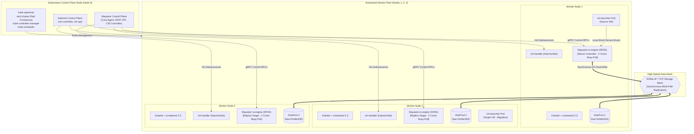
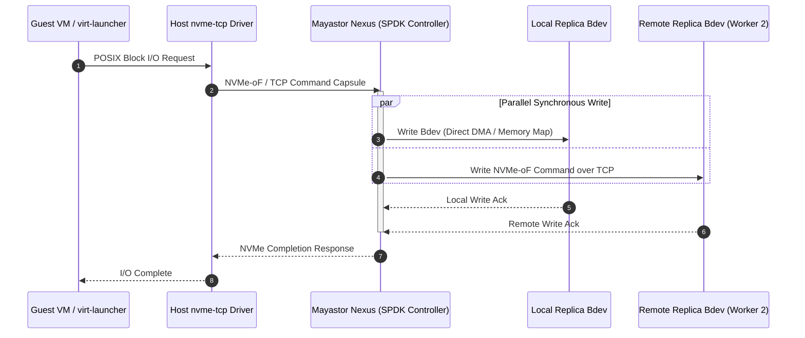

# Proposed Target Architecture Specification

**Project Name:** Deploy High-Performance Storage for Kubernetes  
**Project ID:** SWFW_5S_08  
**Document Status:** PROPOSED (Target Architecture — Not Yet Deployed or Experimentally Validated)  
**Last Updated:** 2026-11-05 (Chunk 1.9 Final Lifecycle & Resource Audit)  

---

> [!WARNING]
> **Architectural Status & Disclaimer:**  
> The system design documented here represents the **target architectural proposal** formulated and audited during the initial project design and feasibility phase. None of the components, node topologies, or inter-service protocols described below have been deployed, configured, or benchmarked at this stage. All performance characteristics and operational behaviors reflect documented upstream technology capabilities and remain **UNVERIFIED ASSUMPTIONS** until empirical validation occurs in subsequent chunks.

---

## 1. Architectural Overview & Design Tenets

The primary objective of this architecture is to bridge high-performance user-space storage engines with cloud-native virtual machine orchestration. The target deployment unifies:
1. **Low-Latency Storage Plane:** User-space block storage processing via OpenEBS Mayastor and SPDK to bypass Linux kernel VFS and context-switch overheads.
2. **Synchronous Data Resiliency:** Cluster-wide data durability using 3-way synchronous multi-replica NVMe-oF targets ($N=3$) across independent failure domains.
3. **Cloud-Native Virtualization:** KubeVirt-managed virtual machines running guest operating systems with near-native hardware access.
4. **Workload Portability:** Virtual machine live migration and runtime resource adaptability (CPU, memory, disk, and network hot-plugging).



---

## 2. Infrastructure Layer Specification

### 2.1 Host Hardware & Operating System
- **Host Operating System:** Ubuntu Server 24.04 LTS (Noble Numbat).
- **Kernel Architecture:** Linux 6.8.0 LTS standard kernel with optimized in-tree `nvme-tcp` and `/dev/kvm`.
- **CPU Architecture:** x86_64; hardware virtualization support (`vmx` for Intel, `svm` for AMD) is mandatory for hardware-accelerated KVM.
  - **Worker CPU Budgeting:** **Minimum 6 physical cores per storage worker node** (2 cores dedicated to SPDK busy-polling running at 100% continuous CPU utilization, 2 cores for host OS/Kubernetes/daemons, and 2 cores for guest VM vCPUs). Preferred: **8–16 physical cores** for high-throughput benchmarking. Four physical cores is explicitly rejected as a comfortable benchmark baseline.
- **Memory Requirements (GB vs. GiB):**
  - **Minimum Planning Target:** **16 GB physical RAM per worker node** ($\approx 14.3\text{ GiB}$ visible to Linux). Pre-allocates 2 GiB HugePages, 1.0–1.5 GiB Mayastor heap, 3.5–4.0 GiB host/K8s daemons, and 4.0 GiB guest VM + 0.6–1.2 GiB QEMU overhead ($\approx 0.8\text{ GiB}$ host headroom).
  - **Preferred Target:** **32 GB physical RAM per worker node** ($\approx 29.3\text{ GiB}$ visible to Linux). Accommodates 8 GB workload VMs, transient live-migration dual allocations (~4.5 GiB), and NFS gateway buffers without risk of OOM eviction.
  - *HugePages Allocation:* Dedicated pre-allocated HugePages (2 MiB pages, 1024 pages = 2 GiB reserved per worker node at boot time) permanently locked out from the Linux kernel specifically for SPDK memory pools.
- **Storage Subsystem:**
  - Dedicated OS disk (`/dev/sda` or primary NVMe) for root filesystem and container runtime state.
  - Dedicated, unpartitioned, non-formatted block device (`/dev/sdb` or `/dev/nvme1n1`) per worker node exclusively bound to Mayastor `DiskPool`.

### 2.2 Network Topology & Segmentation
The intended deployment separates cluster traffic into logical or physical planes:
1. **Cluster Management & Pod Network:** Standard 1 Gbps / 10 Gbps Ethernet for Kubernetes API communication, pod-to-pod CNI traffic, and management queries.
2. **Storage Data Fabric (NVMe-oF):** Low-latency network mesh carrying NVMe over TCP frames between Mayastor Nexus and worker node replicas.
   - *Target Configuration:* MTU 9000 (Jumbo Frames) enabled across storage interfaces to minimize packet fragmentation overhead under high-throughput I/O bursts.
   - *Latency Objective:* Sub-millisecond node-to-node round-trip time (RTT) to prevent replication acknowledgment stalls.

---

## 3. Kubernetes Orchestration Layer

- **Cluster Deployment Engine:** `kubeadm` v1.35.x providing standard, upstream-compliant Kubernetes lifecycle management.
- **Target Software Baseline Specification (ADR-010):**
  - **Host Operating System:** Ubuntu Server 24.04 LTS (Noble Numbat).
  - **Linux Kernel:** 6.8.0 LTS with optimized in-tree `nvme-tcp` and `/dev/kvm`.
  - **Kubernetes Version:** **v1.35.x (Time-Limited Primary Candidate)**, active support through February 28, 2027. Kubernetes v1.34 is removed as supported fallback due to upstream EOL on October 27, 2026. Upstream qualification gaps for v1.36 and v1.37 are documented.
  - **Container Runtime:** **`containerd` 2.3 LTS** (supported through April 30, 2028; alternative containerd 2.4). containerd 1.7.22 is removed due to upstream EOL on September 30, 2026.
  - **CNI Plugin:** **Calico v3.33** (officially tested for Kubernetes v1.35–v1.37; pure routed BGP networking without VXLAN encapsulation penalty).
  - **Storage Engine:** OpenEBS v4.6.x (Mayastor v2.11+) with native experimental RWX block volume support.
  - **Virtualization Engine:** KubeVirt v1.8.x + CDI v1.61.x.
- **Node Topology:**
  - **1 Dedicated Control Plane Node (Node 0):** Hosts API server, `etcd` (Raft consensus), controller manager, scheduler, and Mayastor control plane agents.
  - **3 Dedicated Worker Nodes (Nodes 1, 2, 3):** Labeled and configured for storage and virtualization workloads (`openebs.io/engine=mayastor`, `kubevirt.io/schedulable=true`), each with 2 GiB HugePages pre-allocated and dedicated NVMe/SSD raw block devices.

---

## 4. Virtualization Layer (KubeVirt)

### 4.1 KubeVirt Core Components
KubeVirt extends Kubernetes to manage virtual machines as native declarative resources:
- **`virt-operator`:** Manages the lifecycle and version upgrades of KubeVirt system components.
- **`virt-api`:** An aggregated API server providing validation, admission webhooks, and KubeVirt-specific subresources (VNC, console, start/stop).
- **`virt-controller`:** Monitors `VirtualMachine` (VM) and `VirtualMachineInstance` (VMI) Custom Resource Definitions (CRDs) and coordinates scheduling.
- **`virt-handler` (DaemonSet):** Runs on every worker node; communicates directly with the local container runtime and hypervisor to launch and manage VM processes.
- **`virt-launcher` (Pod):** The pod wrapper containing the QEMU/KVM process. Each VM runs inside its own `virt-launcher` pod, inheriting Kubernetes cgroups, namespaces, and security contexts.

### 4.2 Hardware Virtualization & KVM Integration
The `virt-handler` detects the `/dev/kvm` character device on the host. If `/dev/kvm` is absent (e.g., in un-nested virtual machines), KubeVirt falls back to software emulation (TCG), which drastically degrades performance. Hardware KVM pass-through is therefore a mandatory pre-condition for valid benchmarking.

---

## 5. Storage Layer (OpenEBS Mayastor & SPDK)

### 5.1 The Mayastor Storage Pipeline
OpenEBS Mayastor operates as a cloud-native, containerized distributed block storage system written in Rust and C, built on top of the **Storage Performance Development Kit (SPDK)**.



### 5.2 Key Mayastor Architectural Primitives
1. **`DiskPool` CRD:** Defines storage capacity on a node backed by a designated block device (e.g., `/dev/sdb`). Mayastor formats and manages this pool using SPDK's `lvol` (logical volume) subsystem.
2. **Replicas:** A thin- or thick-provisioned logical block device created inside a `DiskPool`. A volume with a replication factor of $N=3$ maintains active replicas across 3 distinct worker nodes.
3. **Nexus:** The dynamic storage controller. A Nexus is instantiated (typically on the node where the consumer pod resides) and aggregates the volume's replicas. It acts as an NVMe-oF target, receiving I/O from the client and issuing simultaneous synchronous writes to all replicas.
4. **CSI Controller & Node Plugin:**
   - *CSI Controller:* Interacts with the Mayastor REST API to provision volumes and arrange replicas across pools.
   - *CSI Node Plugin:* Mounts the Mayastor volume on the consumer node using the Linux kernel's in-tree `nvme-tcp` initiator driver, creating a local `/dev/nvmeXnY` block device exposed to the pod.

### 5.3 SPDK & NVMe-oF Acceleration Mechanisms
- **User-Space Execution:** The `io-engine` runs in user space, avoiding system call and kernel context-switch overheads for every I/O operation.
- **Polled-Mode Driver (PMD):** Dedicated CPU cores execute busy-polling loops to detect completion queues instantly, drastically reducing latency variance.
- **Lockless Concurrency:** SPDK employs message-passing ring buffers and thread-local data structures, eliminating lock contention between processing cores.

### 5.4 Replica Failure, Degradation & Rebuild Semantics
- **Single Node Failure ($N=3$ on 3-Node Cluster):**
  - If 1 worker node drops offline, the volume transitions to **Degraded** status (2 surviving replicas).
  - The volume is **not** in a fully protected state; client I/O continues, but resilience is impaired.
  - **Anti-Affinity Constraint:** Mayastor enforces pool and node anti-affinity. Because only 2 nodes remain and both already host replicas, **Mayastor cannot allocate a replacement replica**. The volume remains Degraded until the failed node recovers or a 4th worker is joined.
- **Write Log Rebuild Mechanism:**
  - Mayastor tracks uncommitted modifications to faulted replicas using a **Nexus write log** recording dirty address ranges and extents (not an in-memory dirty-block bitmap).
  - Default partial rebuild grace period: **10 minutes** (`--faulted-child-wait-period=10m`). If the faulted node recovers within 10 minutes, a **Partial Rebuild** is executed, replaying only dirty extents across the network.
  - Full rebuild is triggered if the grace period expires, if the underlying pool/device is destroyed, if the Nexus crashes during child fault, or if the write log buffer overflows.
- **Decoupling from etcd Quorum:**
  - Storage data path and Nexus replication use SPDK and NVMe-oF, completely independent of `etcd` Raft consensus. Data-plane I/O continues even if the control plane temporarily loses quorum.

---

## 6. Shared Storage & KubeVirt Live Migration

### 6.1 The Live Migration Architectural Invariant
KubeVirt live migration transfers a running virtual machine from a source worker node to a target worker node with minimal guest downtime (typically < 100 ms). During migration:
1. QEMU on the target node initializes and creates an identical memory map.
2. RAM pages are streamed iteratively over a dedicated migration network connection.
3. Once dirty page transfer reaches convergence, the source VM is paused, final registers are transferred, and the target VM is resumed.

**Storage Requirement:** For stateful VMs, the persistent disk volume must remain accessible to **both the source and destination pods simultaneously** during the handover. This natively requires a **ReadWriteMany (RWX)** volume access mode.

```mermaid
flowchart LR
    subgraph SourceWorker["Source Worker Node (Node 1)"]
        SrcPod["Source virt-launcher Pod"]
        SrcQEMU["Source QEMU Instance"]
        SrcPod --- SrcQEMU
    end

    subgraph TargetWorker["Target Worker Node (Node 2)"]
        TgtPod["Target virt-launcher Pod"]
        TgtQEMU["Target QEMU Instance"]
        TgtPod --- TgtQEMU
    end

    subgraph MigrationFabric["Migration Plane"]
        MemoryStream["Iterative Memory Page Transfer<br/>(QEMU TCP Socket 49152+)"]
    end

    subgraph StorageLayer["Shared Storage Access (RWX)"]
        MayastorNexus["Mayastor Nexus Target (RWX Block)<br/>or NFS Gateway (RWX Filesystem)"]
        SharedDisk[("Mayastor Persistent Volume<br/>(Replicas on Nodes 1, 2, 3)")]
    end

    SrcQEMU ==> MemoryStream ==> TgtQEMU
    SrcPod ==>|Simultaneous Attach (RWX)| MayastorNexus
    TgtPod ==>|Simultaneous Attach (RWX)| MayastorNexus
    MayastorNexus --- SharedDisk
```

### 6.2 Proposed RWX Integration Strategies
1. **Option A: Native Mayastor RWX Block Volumes (Primary Innovation Target — OpenEBS 4.6+ / Mayastor v2.11+)**
   - *Mechanism:* Mayastor exposes an NVMe-oF target accepting simultaneous attachments from both source and destination worker node `nvme-tcp` initiators (`volumeMode: Block`, `accessModes: [ReadWriteMany]`).
   - *Concurrency & Fencing:* Concurrency safety relies on **QEMU / KubeVirt hypervisor serialization** (only the active guest VM issues writes; the target VM is in pre-copy receive mode until cutover).
   - *Performance:* Delivers near-bare-metal NVMe wire throughput and sub-millisecond tail latency.
   - *Status:* Upstream **EXPERIMENTAL**. Evaluated across the **6-Scenario Test Suite** (Clean Migration, Cancellation & Retry, Source Crash, Network Partition, Target Pod Eviction, and Exclusive Write Safety Verification).
2. **Option B: Clustered NFS Gateway RWX Layer (Conservative Fallback Baseline)**
   - *Mechanism:* An NFS server pod mounts a Mayastor RWO volume, formats it (ext4/XFS), and exports an RWX filesystem via `csi-driver-nfs`.
   - *Trade-off:* Introduces Linux VFS overhead and NFSv4 RPC latency (~25,000–45,000 IOPS vs >150,000 IOPS on block), but provides proven, standards-compliant POSIX file locking.
   - *SPOF Risk:* The NFS server pod represents a temporary single point of failure if its host node crashes.

### 6.3 Adopted Comparative Dual-Path Strategy (ADR-008 & ADR-010)
1. **Tier 1 (Direct Block / Maximum Throughput Control):** Benchmarking VMs bind directly to raw Mayastor RWO block volumes (`volumeMode: Block`). Pinned to node; live migration disabled.
2. **Tier 2 (Native RWX Block Live Migration):** Live-migratable VMs bind to native Mayastor RWX block volumes to evaluate zero-overhead NVMe live migration.
3. **Tier 3 (NFS Gateway RWX Fallback):** Live migration is benchmarked over NFS to quantify the exact "NFS Translation Tax" and serve as a proven fallback.

---

## 7. Runtime Resource Hot-Plugging Architecture

KubeVirt supports dynamically mutating the virtual machine specification while the VM remains operational:
- **vCPU Hot-Plug:** Scaling allocated CPU cores dynamically via ACPI CPU hot-plug events inside the guest OS.
- **Memory Hot-Plug:** Expanding allocated RAM using ACPI memory hot-add or virtio-balloon mechanisms.
- **Storage Volume Hot-Plug:** Dynamically attaching a secondary block PVC to a running VM instance via the `virtctl addvolume` subresource command without dismounting the root volume.
- **Network Interface Hot-Plug:** Attaching secondary network interfaces (e.g., via Multus CNI) into a running guest via dynamic virtio-net binding.

---

## 8. Observability & Telemetry Framework

To provide empirical evidence and validate architectural claims, an integrated Prometheus and Grafana stack will be established:
1. **Node & Kernel Metrics:** `node-exporter` gathering CPU utilization, memory pressure, context switches, interrupt rates, and disk I/O stats.
2. **Storage Engine Metrics:** Mayastor Prometheus metrics endpoint exposing:
   - Volume read/write IOPS.
   - Latency histograms (p50, p95, p99).
   - Nexus state and rebuild progress during replica degradation.
   - SPDK core CPU utilization.
3. **Hypervisor & VM Metrics:** KubeVirt metrics server exposing guest CPU usage, memory ballooning state, and virtual disk I/O queue depths.

---

## 9. Architectural Reality Matrix: Facts vs. Assumptions

| Architectural Area | Confirmed Documented Capability | Intended Project Implementation | Unverified Assumption / Risk |
| :--- | :--- | :--- | :--- |
| **SPDK / NVMe-oF** | SPDK delivers sub-10 µs latency on bare-metal NVMe. | Mayastor running in Kubernetes worker pods with 2 dedicated busy-polling cores. | Lab hardware NVMe performance under containerized SPDK polling threads. |
| **Replication & Rebuild** | Mayastor supports 3-way synchronous mirroring and write-log partial rebuilds. | Replicas across 3 worker nodes; 10m grace period. | Rebuild overhead and latency impact during network saturation; 3-node degradation risk. |
| **KubeVirt VM Launch** | KubeVirt runs Linux guest OS inside QEMU pods with hardware `/dev/kvm`. | Ubuntu 24.04 cloud images booted from Mayastor PV. | Driver compatibility between guest OS and NVMe-attached virtio-scsi/virtio-blk. |
| **Native RWX Migration** | Native RWX block volume supported in OpenEBS 4.6+ / Mayastor v2.11+. | Multi-attach NVMe-oF evaluated across 6 live-migration scenarios. | Edge cases during inter-node network partitions; experimental status. |
| **Hot-Plugging** | KubeVirt supports CPU, memory, volume, and interface hot-plug. | Scripted test harness evaluating guest kernel event recognition. | Guest kernel ACPI responsiveness without VM reboot. |
