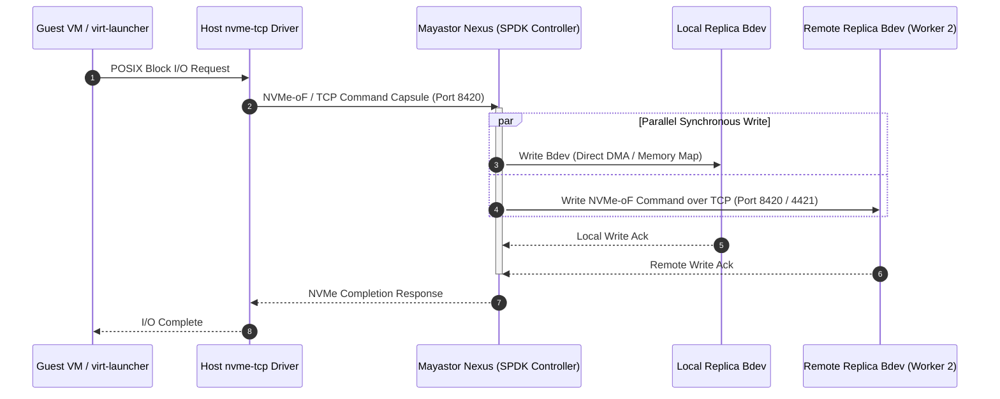

# Proposed Target Architecture Specification

**Project Name:** Deploy High-Performance Storage for Kubernetes  
**Project ID:** SWFW_5S_08  
**Document Status:** PROPOSED TARGET ARCHITECTURE (M2 Kubernetes & Calico Manifests Validated; Local K3s Dev Cluster Active; 4-Node Multi-Node Execution Infrastructure-Dependent)  
**Last Updated:** 2026-11-11 (Milestone M2 Kubernetes Cluster Architecture & Local Dev Validation)  

---

> [!WARNING]
> **Architectural Status & Scope Preservation (ADR-011):**  
> The system design documented here represents the **authoritative, permanent target architecture** of the project. In accordance with Chunk 2.1 and ADR-011, **the complete original technical scope remains strictly preserved without downscaling**:
> - 4-node Kubernetes cluster topology.
> - OpenEBS Mayastor with SPDK and NVMe-oF.
> - KubeVirt virtual machines with hardware KVM acceleration.
> - Dual-path virtual machine live migration.
> - Dynamic CPU, memory, storage, and network hot-plugging.
> - Failure recovery and replica rebuild drills.
> - FIO benchmarking matrix and Prometheus/Grafana observability.
>
> College infrastructure allocation is treated as an optional resource opportunity rather than a blocking project gate. Development, configuration, script authoring, and component testing proceed immediately using locally available resources, while tracking feature completion across three explicit states: `IMPLEMENTED`, `VALIDATED`, and `INFRASTRUCTURE-DEPENDENT`. All performance characteristics on live NVMe hardware remain unverified until deployment on target hardware.

---

## 1. Architectural Overview & Design Tenets

The primary objective of this architecture is to bridge high-performance user-space storage engines with cloud-native virtual machine orchestration. The target deployment unifies:
1. **Low-Latency Storage Plane:** User-space block storage processing via OpenEBS Mayastor and SPDK to bypass Linux kernel VFS and context-switch overheads.
2. **Synchronous Data Resiliency:** Cluster-wide data durability using 3-way synchronous multi-replica NVMe-oF targets ($N=3$) across independent failure domains.
3. **Cloud-Native Virtualization:** KubeVirt-managed virtual machines running guest operating systems with near-native hardware access.
4. **Workload Portability:** Virtual machine live migration and runtime resource adaptability (CPU, memory, disk, and network hot-plugging).

```mermaid
flowchart TB
    subgraph ControlPlane["Kubernetes Control Plane Node (Node 0)"]
        K8sMaster["kube-apiserver<br/>etcd cluster (Raft Consensus)<br/>kube-controller-manager<br/>kube-scheduler"]
        MSControl["Mayastor Control Plane<br/>(Core Agent, REST API, CSI Controller)"]
        KVControl["KubeVirt Control Plane<br/>(virt-controller, virt-api)"]
    end

    subgraph WorkerFleet["Distributed Worker Fleet (Nodes 1, 2, 3)"]
        subgraph Node1["Worker Node 1"]
            Kubelet1["Kubelet + containerd 2.3"]
            VH1["virt-handler (DaemonSet)"]
            IOE1["Mayastor io-engine (SPDK)<br/>[Nexus Controller - 2 Cores Busy-Poll]"]
            DP1[("DiskPool 1<br/>Raw NVMe/SSD")]
            VMPod1["virt-launcher Pod<br/>(Source VM)"]
        end

        subgraph Node2["Worker Node 2"]
            Kubelet2["Kubelet + containerd 2.3"]
            VH2["virt-handler (DaemonSet)"]
            IOE2["Mayastor io-engine (SPDK)<br/>[Replica Target - 2 Cores Busy-Poll]"]
            DP2[("DiskPool 2<br/>Raw NVMe/SSD")]
            VMPod2["virt-launcher Pod<br/>(Target VM - Migration)"]
        end

        subgraph Node3["Worker Node 3"]
            Kubelet3["Kubelet + containerd 2.3"]
            VH3["virt-handler (DaemonSet)"]
            IOE3["Mayastor io-engine (SPDK)<br/>[Replica Target - 2 Cores Busy-Poll]"]
            DP3[("DiskPool 3<br/>Raw NVMe/SSD")]
        end
    end

    subgraph StorageFabric["High-Speed Data Mesh"]
        NVMeMesh{{"NVMe-oF / TCP Storage Mesh<br/>(Synchronous Multi-Path Replication - Ports 8420 & 4421)"}}
    end

    K8sMaster -->|Node Management| WorkerFleet
    MSControl -->|gRPC Control RPCs (Port 10124)| IOE1 & IOE2 & IOE3
    KVControl -->|Virt-Subresources| VH1 & VH2 & VH3

    VMPod1 -->|Local Block Device Mount| IOE1
    IOE1 <==>|Synchronous I/O Dual-Write| NVMeMesh
    NVMeMesh <==> DP1
    NVMeMesh <==> DP2
    NVMeMesh <==> DP3
```

---

## 2. Infrastructure Layer Specification

### 2.1 Host Hardware & Operating System
- **Host Operating System:** Ubuntu Server 24.04 LTS (Noble Numbat).
- **Kernel Architecture:** Linux 6.8.0 LTS standard kernel with optimized in-tree `nvme-tcp` and `/dev/kvm`.
- **CPU Architecture:** x86_64; hardware virtualization support (`vmx` for Intel, `svm` for AMD) is mandatory for hardware-accelerated KVM.
  - **Worker CPU Budgeting:** **Minimum 6 physical cores per storage worker node** (2 cores dedicated to SPDK busy-polling running at 100% continuous CPU utilization, 2 cores for host OS/Kubernetes/daemons, and 2 cores for guest VM vCPUs). Preferred: **8–16 physical cores** for high-throughput benchmarking. Four physical cores is explicitly rejected as a comfortable benchmark baseline.
- **Memory Requirements (Exact Decimal-to-Binary Math & Ranges):**
  - **16 GB Physical Host:** $16 \times 10^9 / 1024^3 = \mathbf{14.90\text{ GiB}}$ raw capacity installed.
  - **32 GB Physical Host:** $32 \times 10^9 / 1024^3 = \mathbf{29.80\text{ GiB}}$ raw capacity installed.
  - **Firmware/Hardware Reservations:** Typically $0.20 - 0.50\text{ GiB}$ consumed by UEFI, ACPI, and PCI MMIO. Visible usable memory (`MemTotal`): $\approx \mathbf{14.40 - 14.70\text{ GiB}}$ on 16 GB hosts, and $\approx \mathbf{29.30 - 29.60\text{ GiB}}$ on 32 GB hosts.
  - **Planning Estimate Disclaimer:** *These figures represent planning estimates based on typical server hardware; exact `MemTotal` and live runtime overhead must be confirmed on target laboratory hardware via `/proc/meminfo` during Chunk 2.*
  - **Static Base Stack:** HugePages (2.00 GiB) + Mayastor Heap (1.00–1.50 GiB) + Host OS/K8s/containerd daemons (2.30–4.00 GiB) + KubeVirt virt-handler (0.40–0.80 GiB) + Monitoring (0.20–0.40 GiB) = **5.90 – 8.70 GiB consumed before starting any VM**.
  - **Guest VM Footprint:** Guest RAM (4.00 GiB) + QEMU process overhead (0.60–1.20 GiB) = **4.60 – 5.20 GiB**.
  - **Live Migration Headroom & Asymmetry:**
    - Source node consumes **10.70 – 14.45 GiB** during pre-copy. Headroom on 16 GB host (`MemTotal`: $14.40 - 14.70\text{ GiB}$): **$-0.05\text{ to }+4.00\text{ GiB}$** (drops into $-0.05\text{ GiB}$ deficit under worst-case peak consumption). Headroom on 32 GB host: **$+14.85\text{ to }+18.90\text{ GiB}$**.
    - Destination node (Case 1: Target Node Initially Idle) requires **10.70 – 14.40 GiB**. Headroom on 16 GB host: **$0.00\text{ to }+4.00\text{ GiB}$** (reaches $0.00\text{ GiB}$ at upper bound). Headroom on 32 GB host: **$+14.90\text{ to }+18.90\text{ GiB}$**.
    - Destination node (Case 2: Target Node Already Hosts an Existing 4 GiB VM) reaches **15.30 – 19.60 GiB**, yielding **$-0.60\text{ to }-5.20\text{ GiB}$ (FATAL DEFICIT)** on 16 GB hosts.
    - **Conclusion:** Under no circumstances can a 16 GB worker node host a migration target if another VM is already running. **32 GB physical RAM per worker node is the mandatory recommended standard for production and benchmarking**.

### 2.2 Network Topology & Segmentation
The intended deployment separates cluster traffic into logical planes across the **canonical 20-port matrix** (10 physical host firewall rules, 10 cluster-internal/loopback services):
1. **Cluster Management & Pod Network:** Standard 1 Gbps / 10 Gbps Ethernet for Kubernetes API communication (TCP 6443), etcd peer/client (TCP 2379–2380), Kubelet (TCP 10250), pod-to-pod CNI traffic (Calico v3.33 BGP on TCP 179), and management queries.
2. **Storage Data Fabric (NVMe-oF):** Low-latency network mesh carrying NVMe over TCP frames between Mayastor Nexus and worker node replicas on **TCP 8420** and **TCP 4421** (gRPC control on TCP 10124).
   - *Target Configuration:* MTU 9000 (Jumbo Frames) enabled across storage interfaces to minimize packet fragmentation overhead under high-throughput I/O bursts.
   - *Latency Objective:* Sub-millisecond node-to-node round-trip time (RTT) to prevent replication acknowledgment stalls.
3. **Hypervisor Live-Migration Plane:** Dedicated QEMU direct TCP streaming on **TCP 49152–49215**.
4. **Internal Monitoring Plane:** Prometheus (9090), Grafana (3000), and exporters (9100, 9502) restricted to internal cluster-internal access only; never exposed on host firewalls.
5. **Multus Secondary Networking:** Implemented via local in-process UNIX domain socket calls to CNI plugins (**zero network ports required**).

---

## 3. Kubernetes Orchestration Layer

- **Cluster Deployment Engine:** `kubeadm` providing standard upstream lifecycle management.
- **Target Software Baseline Specification (ADR-010):**
  - **Host Operating System:** Ubuntu Server 24.04 LTS (Noble Numbat).
  - **Linux Kernel:** 6.8.0 LTS with optimized in-tree `nvme-tcp` and `/dev/kvm`.
  - **Candidate Selection:**
    - **Preferred Qualification Target (Candidate B):** Kubernetes **v1.36.x** + containerd **2.3.x LTS** (supported through April 30, 2028; officially recommended for K8s 1.36+) + KubeVirt **v1.9.x** + Calico **v3.33** + OpenEBS **v4.6.x** (Mayastor subchart v2.12.2, `io-engine:v2.12.2`). Qualification gap of Mayastor on K8s 1.36 will be experimentally evaluated.
    - **Comparison Baseline (Candidate A):** Kubernetes **v1.35.x** + containerd **2.2.x** (reached EOL on Nov 6, 2026; unviable for new deployments) + Mayastor v2.12.2 (E2E CI tested on 1.35.6).
    - **Exclusion:** Kubernetes 1.37.x is excluded due to lack of KubeVirt/Mayastor qualification.
  - **Storage Engine:** OpenEBS v4.6.x (Mayastor subchart v2.12.2) with native experimental RWX block volume support.
  - **Virtualization Engine:** KubeVirt v1.9.x (or v1.8.x) + CDI v1.61.x.
- **Node Topology:**
  - **1 Dedicated Control Plane Node (Node 0):** Hosts API server, `etcd` (Raft consensus), controller manager, scheduler, and Mayastor control plane agents.
  - **3 Dedicated Worker Nodes (Nodes 1, 2, 3):** Labeled and configured for storage and virtualization workloads (`openebs.io/engine=mayastor`, `kubevirt.io/schedulable=true`), each with 2 GiB HugePages pre-allocated and dedicated NVMe/SSD raw block devices.
- **M2 Deliverables & Dual-Environment Reference:**
  - Target `kubeadm` (`kubeadm.k8s.io/v1beta4`, Pod CIDR `10.244.0.0/16`, Service CIDR `10.96.0.0/12`), `containerd` v3 (`SystemdCgroup = true`), and Calico `v3.33.0` (`encapsulation: None`, BGP mesh TCP 179) specifications are documented in [`docs/kubernetes-architecture.md`](docs/kubernetes-architecture.md), [`docs/kubernetes-deployment-guide.md`](docs/kubernetes-deployment-guide.md), and [`docs/calico-networking.md`](docs/calico-networking.md).
  - For offline local development and API verification in WSL2, a lightweight single-node **K3s `v1.36.6+k3s1`** cluster (`containerd v2.3.7-k3s1.36`, Flannel CNI) is validated in isolation from host Docker/containerd installations.

---

## 4. Virtualization Layer (KubeVirt)

### 4.1 KubeVirt Core Components
KubeVirt extends Kubernetes to manage virtual machines as native declarative resources:
- **`virt-operator`:** Manages the lifecycle and version upgrades of KubeVirt system components.
- **`virt-api`:** Aggregated API server providing validation, admission webhooks, and KubeVirt-specific subresources.
- **`virt-controller`:** Monitors `VirtualMachine` (VM) and `VirtualMachineInstance` (VMI) CRDs and coordinates scheduling.
- **`virt-handler` (DaemonSet):** Runs on every worker node; communicates directly with the local container runtime and hypervisor to launch and manage VM processes.
- **`virt-launcher` (Pod):** The pod wrapper containing the QEMU/KVM process. Each VM runs inside its own `virt-launcher` pod, inheriting Kubernetes cgroups, namespaces, and security contexts.

### 4.2 Hardware Virtualization & KVM Integration
The `virt-handler` detects the `/dev/kvm` character device on the host. If `/dev/kvm` is absent (e.g., in un-nested virtual machines), KubeVirt falls back to software emulation (TCG), which drastically degrades performance. Hardware KVM pass-through is therefore a mandatory pre-condition for valid benchmarking.

---

## 5. Storage Layer (OpenEBS Mayastor & SPDK)

### 5.1 The Mayastor Storage Pipeline
OpenEBS Mayastor operates as a cloud-native, containerized distributed block storage system written in Rust and C, built on top of the **Storage Performance Development Kit (SPDK)**.



### 5.2 Key Mayastor Architectural Primitives
1. **`DiskPool` CRD:** Defines storage capacity on a node backed by a designated block device (e.g., `/dev/sdb`). Mayastor formats and manages this pool using SPDK's `lvol` (logical volume) subsystem.
2. **Replicas:** A thin- or thick-provisioned logical block device created inside a `DiskPool`. A volume with a replication factor of $N=3$ maintains active replicas across 3 distinct worker nodes.
3. **Nexus:** The dynamic storage controller. Instantiated on the consumer node, it aggregates volume replicas, acts as an NVMe-oF target, and issues simultaneous synchronous writes.
4. **CSI Controller & Node Plugin:**
   - *CSI Controller:* Interacts with the Mayastor REST API to provision volumes and arrange replicas across pools.
   - *CSI Node Plugin:* Mounts the Mayastor volume on the consumer node using the Linux kernel's in-tree `nvme-tcp` initiator driver, creating a local `/dev/nvmeXnY` block device.

### 5.3 SPDK & NVMe-oF Acceleration Mechanisms
- **User-Space Execution:** The `io-engine` runs in user space, avoiding system call and kernel context-switch overheads for every I/O operation.
- **Polled-Mode Driver (PMD):** 2 dedicated CPU cores execute continuous busy-polling loops to detect completion queues instantly.
- **Lockless Concurrency:** SPDK employs message-passing ring buffers and thread-local data structures, eliminating lock contention.

### 5.4 Replica Failure, Degradation & Rebuild Configuration
- **Single Node Failure ($N=3$ on 3-Node Cluster):**
  - If 1 worker node drops offline, the volume transitions to **Degraded** status (2 surviving replicas).
  - The volume is **not** in a fully protected state; client I/O continues, but resilience is impaired.
  - **Anti-Affinity Constraint:** Mayastor enforces pool and node anti-affinity. Because only 2 nodes remain and both already host replicas, **Mayastor cannot allocate a replacement replica**. The volume remains Degraded until the failed node recovers or a 4th worker is joined.
- **Configurable Rebuild Timers & Disconnection Governance:**
  - **Partial Rebuild Wait Period (`--faulted-child-wait-period`):** Configured on `mayastor-agent-core` (default **10 minutes** / `600s`). If a faulted replica reconnects within this period, the Nexus replays dirty ranges from the write log (**Partial Rebuild**).
  - **Node Disconnection Governance:** Standalone parameter `--node-unreachable-timeout` is **unverified / non-existent** in upstream Mayastor. Node disconnection is governed by Kubernetes node eviction tolerations (`tolerations.node.kubernetes.io/unreachable`, default 300s) and NVMe initiator timeout (`ctrl_loss_tmo`, default 1800s or 120s).
  - **Published vs. Unpublished Volumes:** Published volumes actively accumulate dirty extents; unpublished volumes are quiescent and compare replica generation counters upon next publication.
- **Full Rebuild Triggers:** Faulted child wait period expiration ($>10\text{m}$), disk pool destruction/replacement, Nexus crash while child is faulted, or write log buffer overflow.
- **Decoupling from etcd Quorum:** Storage data plane and Nexus replication operate independently of `etcd` Raft consensus. Data-plane I/O continues even if the control plane temporarily loses quorum.

---

## 6. Shared Storage & KubeVirt Live Migration

### 6.1 The Live Migration Architectural Invariant
KubeVirt live migration transfers a running virtual machine from a source worker node to a target worker node with minimal guest downtime (typically < 100 ms). During migration:
1. QEMU on the target node initializes and creates an identical memory map.
2. RAM pages are streamed iteratively over a dedicated migration network connection (TCP 49152–49215).
3. Once dirty page transfer reaches convergence, the source VM is paused, final registers are transferred, and the target VM is resumed.

**Storage Requirement:** For stateful VMs, the persistent disk volume must remain accessible to **both the source and destination pods simultaneously** during the handover. This natively requires a **ReadWriteMany (RWX)** volume access mode.

```mermaid
flowchart LR
    subgraph SourceWorker["Source Worker Node (Node 1)"]
        SrcPod["Source virt-launcher Pod"]
        SrcQEMU["Source QEMU Instance"]
        SrcPod --- SrcQEMU
    end

    subgraph TargetWorker["Target Worker Node (Node 2)"]
        TgtPod["Target virt-launcher Pod"]
        TgtQEMU["Target QEMU Instance"]
        TgtPod --- TgtQEMU
    end

    subgraph MigrationFabric["Migration Plane"]
        MemoryStream["Iterative Memory Page Transfer<br/>(QEMU TCP Socket 49152+)"]
    end

    subgraph StorageLayer["Shared Storage Access (RWX)"]
        MayastorNexus["Mayastor Nexus Target (RWX Block)<br/>or NFS Gateway (RWX Filesystem)"]
        SharedDisk[("Mayastor Persistent Volume<br/>(Replicas on Nodes 1, 2, 3)")]
    end

    SrcQEMU ==> MemoryStream ==> TgtQEMU
    SrcPod ==>|Simultaneous Attach (RWX)| MayastorNexus
    TgtPod ==>|Simultaneous Attach (RWX)| MayastorNexus
    MayastorNexus --- SharedDisk
```

### 6.2 Proposed RWX Integration Strategies
1. **Option A: Native Mayastor RWX Block Volumes (Primary Innovation Target — OpenEBS v4.6.x / Mayastor v2.12.2)**
   - *Mechanism:* Mayastor exposes an NVMe-oF target accepting simultaneous attachments from both source and destination worker node `nvme-tcp` initiators (`volumeMode: Block`, `accessModes: [ReadWriteMany]`).
   - *Concurrency & Fencing:* Concurrency safety relies on **QEMU / KubeVirt hypervisor serialization** (only the active guest VM issues writes; the target VM is in pre-copy receive mode until cutover).
   - *Performance:* Delivers near-bare-metal NVMe wire throughput and sub-millisecond tail latency.
   - *Status:* Upstream **EXPERIMENTAL**. Evaluated across the **6-Scenario Test Suite**.
   - *Evidence-Based Safety Audit:* Audited via multi-layer event correlation (KubeVirt state machine, QEMU QMP `STOP`/`RESUME` events, Mayastor multi-attach logs, in-guest strictly monotonic sequence writes with 512-byte fixed binary records, and CRC32C verification) under documented clock synchronization boundaries.
2. **Option B: Clustered NFS Gateway RWX Layer (Conservative Fallback Baseline)**
   - *Mechanism:* An NFS server pod mounts a Mayastor RWO volume, formats it (ext4/XFS), and exports an RWX filesystem via `csi-driver-nfs`.
   - *Trade-off:* Introduces Linux VFS overhead and NFSv4 RPC latency (~25,000–45,000 IOPS vs >150,000 IOPS on block), but provides proven, standards-compliant POSIX file locking.
   - *SPOF Risk:* The NFS server pod represents a temporary single point of failure if its host node crashes.

### 6.3 Adopted Comparative Dual-Path Strategy (ADR-008 & ADR-010)
1. **Tier 1 (Direct Block / Maximum Throughput Control):** Benchmarking VMs bind directly to raw Mayastor RWO block volumes (`volumeMode: Block`). Pinned to node; live migration disabled.
2. **Tier 2 (Native RWX Block Live Migration):** Live-migratable VMs bind to native Mayastor RWX block volumes to evaluate zero-overhead NVMe live migration.
3. **Tier 3 (NFS Gateway RWX Fallback):** Live migration is benchmarked over NFS to quantify the exact "NFS Translation Tax" and serve as a proven fallback.

---

## 7. Runtime Resource Hot-Plugging Architecture

KubeVirt supports dynamically mutating the virtual machine specification while the VM remains operational:
- **vCPU Hot-Plug:** Scaling allocated CPU cores dynamically via ACPI CPU hot-plug events inside the guest OS.
- **Memory Hot-Plug:** Expanding allocated RAM using ACPI memory hot-add or virtio-balloon mechanisms.
- **Storage Volume Hot-Plug:** Dynamically attaching a secondary block PVC to a running VM instance via the `virtctl addvolume` subresource command without dismounting the root volume.
- **Network Interface Hot-Plug:** Attaching secondary network interfaces (e.g., via Multus CNI) into a running guest via dynamic virtio-net binding.

---

## 8. Observability & Telemetry Framework

To provide empirical evidence and validate architectural claims, an integrated Prometheus and Grafana stack will be established:
1. **Node & Kernel Metrics:** `node-exporter` gathering CPU utilization, memory pressure, context switches, interrupt rates, and disk I/O stats (Internal only).
2. **Storage Engine Metrics:** Mayastor Prometheus metrics endpoint exposing:
   - Volume read/write IOPS.
   - Latency histograms (p50, p95, p99).
   - Nexus state and rebuild progress during replica degradation.
   - SPDK core CPU utilization.
3. **Hypervisor & VM Metrics:** KubeVirt metrics server exposing guest CPU usage, memory ballooning state, and virtual disk I/O queue depths.

---

## 9. Architectural Reality Matrix: Facts vs. Assumptions

| Architectural Area | Confirmed Documented Capability | Intended Project Implementation | Unverified Assumption / Risk |
| :--- | :--- | :--- | :--- |
| **SPDK / NVMe-oF** | SPDK delivers sub-10 µs latency on bare-metal NVMe. | Mayastor running in Kubernetes worker pods with 2 dedicated busy-polling cores. | Lab hardware NVMe performance under containerized SPDK polling threads. |
| **Replication & Rebuild** | Mayastor supports 3-way synchronous mirroring and write-log partial rebuilds. | Replicas across 3 worker nodes; 10m grace period. | Rebuild overhead and latency impact during network saturation; 3-node degradation risk. |
| **KubeVirt VM Launch** | KubeVirt runs Linux guest OS inside QEMU pods with hardware `/dev/kvm`. | Ubuntu 24.04 cloud images booted from Mayastor PV. | Driver compatibility between guest OS and NVMe-attached virtio-scsi/virtio-blk. |
| **Native RWX Migration** | Native RWX block volume supported in OpenEBS v4.6.x (Mayastor subchart v2.12.2). | Multi-attach NVMe-oF evaluated across 6 live-migration scenarios. | Edge cases during inter-node network partitions; experimental status. |
| **Hot-Plugging** | KubeVirt supports CPU, memory, volume, and interface hot-plug. | Scripted test harness evaluating guest kernel event recognition. | Guest kernel ACPI responsiveness without VM reboot. |
