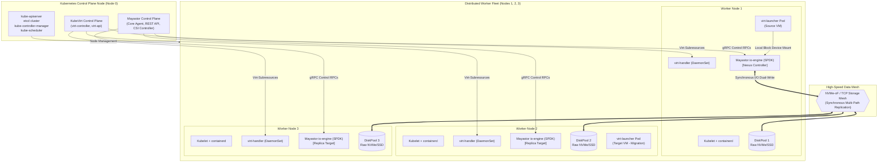
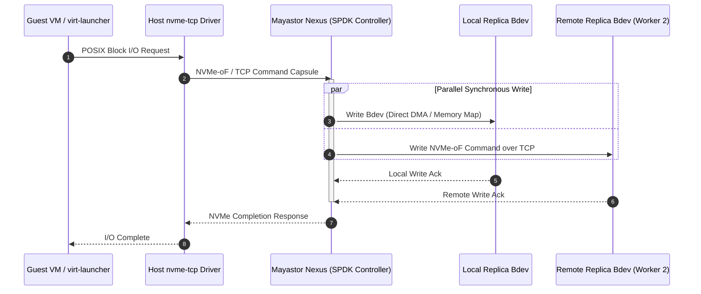

# Proposed Target Architecture Specification

**Project Name:** Deploy High-Performance Storage for Kubernetes  
**Project ID:** SWFW_5S_08  
**Document Status:** PROPOSED (Target Architecture — Not Yet Deployed or Experimentally Validated)  
**Last Updated:** Chunk 0 (Project Foundation & Governance)  

---

> [!WARNING]
> **Architectural Status & Disclaimer:**  
> The system design documented here represents the **target architectural proposal** formulated during the initial project design phase. None of the components, node topologies, or inter-service protocols described below have been deployed, configured, or benchmarked at this stage. All performance characteristics and operational behaviors reflect documented upstream technology capabilities and remain **UNVERIFIED ASSUMPTIONS** until empirical validation occurs in subsequent chunks.

---

## 1. Architectural Overview & Design Tenets

The primary objective of this architecture is to bridge high-performance user-space storage engines with cloud-native virtual machine orchestration. The target deployment unifies:
1. **Low-Latency Storage Plane:** User-space block storage processing via OpenEBS Mayastor and SPDK to bypass Linux kernel VFS and context-switch overheads.
2. **Synchronous Data Resiliency:** Cluster-wide data durability using multi-replica NVMe-oF targets across independent failure domains.
3. **Cloud-Native Virtualization:** KubeVirt-managed virtual machines running guest operating systems with near-native hardware access.
4. **Workload Portability:** Virtual machine live migration and runtime resource adaptability (CPU, memory, disk, and network hot-plugging).



---

## 2. Infrastructure Layer Specification

### 2.1 Host Hardware & Operating System
- **Host Operating System:** Ubuntu Server 22.04 LTS (Jammy Jellyfish) or 24.04 LTS (Noble Numbat).
- **Kernel Architecture:** Linux 5.15+ or 6.x standard kernel.
- **CPU Architecture:** x86_64, minimum 4 physical cores per worker node. Hardware virtualization support (`vmx` for Intel, `svm` for AMD) is mandatory for hardware-accelerated KVM.
- **Memory Requirements:** Minimum 16 GB RAM per worker node on target remote hardware.
  - *HugePages Allocation:* Dedicated pre-allocated HugePages (2 MiB pages, minimum 1024 pages = 2 GiB reserved per node) specifically dedicated to SPDK memory pools.
- **Storage Subsystem:**
  - Dedicated OS disk (`/dev/sda` or primary NVMe) for root filesystem and container runtime state.
  - Dedicated, unpartitioned, non-formatted block device (`/dev/sdb` or `/dev/nvme1n1`) per worker node exclusively bound to Mayastor `DiskPool`.

### 2.2 Network Topology & Segmentation
The intended deployment separates cluster traffic into logical or physical planes:
1. **Cluster Management & Pod Network:** Standard 1 Gbps / 10 Gbps Ethernet for Kubernetes API communication, pod-to-pod CNI traffic, and management queries.
2. **Storage Data Fabric (NVMe-oF):** Low-latency network mesh carrying NVMe over TCP frames between Mayastor Nexus and remote replicas.
   - *Target Configuration:* MTU 9000 (Jumbo Frames) enabled across storage interfaces to minimize packet fragmentation overhead under high-throughput I/O bursts.
   - *Latency Objective:* Sub-millisecond node-to-node round-trip time (RTT) to prevent replication acknowledgment stalls.

---

## 3. Kubernetes Orchestration Layer

- **Cluster Deployment Engine:** `kubeadm` v1.28.8 providing standard, upstream-compliant Kubernetes lifecycle management.
- **Target Software Baseline Specification (ADR-009):**
  - **Host Operating System:** Ubuntu Server 22.04 LTS (Jammy Jellyfish).
  - **Linux Kernel:** 5.15.0 LTS with in-tree `nvme-tcp` and `/dev/kvm`.
  - **Kubernetes Version:** v1.28.8.
  - **Container Runtime:** `containerd` v1.7.15 (systemd cgroup driver).
  - **CNI Plugin:** Calico v3.27.3 (routed BGP without VXLAN overhead).
  - **Storage Engine:** OpenEBS Mayastor v2.5.0.
  - **Virtualization Engine:** KubeVirt v1.1.1 + CDI v1.58.1.
- **Node Topology:**
  - **1 Dedicated Control Plane Node:** Hosts API server, `etcd`, controller manager, scheduler, and Mayastor control plane agents.
  - **3 Dedicated Worker Nodes:** Labeled and configured for storage and virtualization workloads (`openebs.io/engine=mayastor`, `kubevirt.io/schedulable=true`), each with 2 GiB HugePages pre-allocated and dedicated NVMe/SSD raw block devices.

---

## 4. Virtualization Layer (KubeVirt)

### 4.1 KubeVirt Core Components
KubeVirt extends Kubernetes to manage virtual machines as native declarative resources:
- **`virt-operator`:** Manages the lifecycle and version upgrades of KubeVirt system components.
- **`virt-api`:** An aggregated API server providing validation, admission webhooks, and KubeVirt-specific subresources (VNC, console, start/stop).
- **`virt-controller`:** Monitors `VirtualMachine` (VM) and `VirtualMachineInstance` (VMI) Custom Resource Definitions (CRDs) and coordinates scheduling.
- **`virt-handler` (DaemonSet):** Runs on every worker node; communicates directly with the local container runtime and hypervisor to launch and manage VM processes.
- **`virt-launcher` (Pod):** The pod wrapper containing the QEMU/KVM process. Each VM runs inside its own `virt-launcher` pod, inheriting Kubernetes cgroups, namespaces, and security contexts.

### 4.2 Hardware Virtualization & KVM Integration
The `virt-handler` detects the `/dev/kvm` character device on the host. If `/dev/kvm` is absent (e.g., in un-nested virtual machines), KubeVirt falls back to software emulation (TCG), which drastically degrades performance. Hardware KVM pass-through is therefore a mandatory pre-condition for valid benchmarking.

---

## 5. Storage Layer (OpenEBS Mayastor & SPDK)

### 5.1 The Mayastor Storage Pipeline
OpenEBS Mayastor operates as a cloud-native, containerized distributed block storage system written in Rust and C, built on top of the **Storage Performance Development Kit (SPDK)**.



### 5.2 Key Mayastor Architectural Primitives
1. **`DiskPool` CRD:** Defines storage capacity on a node backed by a designated block device (e.g., `/dev/sdb`). Mayastor formats and manages this pool using SPDK's `lvol` (logical volume) subsystem.
2. **Replicas:** A thin- or thick-provisioned logical block device created inside a `DiskPool`. A volume with a replication factor of $N=2$ or $N=3$ maintains active replicas across distinct nodes.
3. **Nexus:** The dynamic storage controller. A Nexus is instantiated (typically on the node where the consumer pod resides) and aggregates the volume's replicas. It acts as an NVMe-oF target, receiving I/O from the client and issuing simultaneous synchronous writes to all replicas.
4. **CSI Controller & Node Plugin:**
   - *CSI Controller:* Interacts with the Mayastor REST API to provision volumes and arrange replicas across pools.
   - *CSI Node Plugin:* Mounts the Mayastor volume on the consumer node using the Linux kernel's in-tree `nvme-tcp` initiator driver, creating a local `/dev/nvmeXnY` block device exposed to the pod.

### 5.3 SPDK & NVMe-oF Acceleration Mechanisms
- **User-Space Execution:** The `io-engine` runs in user space, avoiding system call and kernel context-switch overheads for every I/O operation.
- **Polled-Mode Driver (PMD):** Instead of relying on CPU hardware interrupts upon I/O completion, dedicated CPU cores run polling loops to detect completion queues instantly, drastically reducing latency variance.
- **Lockless Concurrency:** SPDK employs message-passing ring buffers and thread-local data structures, eliminating lock contention between processing cores.

---

## 6. Shared Storage & KubeVirt Live Migration

### 6.1 The Live Migration Architectural Dilemma
KubeVirt live migration transfers a running virtual machine from a source worker node to a target worker node with minimal guest downtime (typically < 100 ms). During migration:
1. QEMU on the target node initializes and creates an identical memory map.
2. RAM pages are streamed iteratively over a dedicated migration network connection.
3. Once dirty page transfer reaches convergence, the source VM is paused, final registers are transferred, and the target VM is resumed.

**Storage Requirement:** For stateful VMs, the persistent disk volume must remain accessible to **both the source and destination pods simultaneously** during the handover. This natively requires a **ReadWriteMany (RWX)** volume access mode.

```mermaid
flowchart LR
    subgraph SourceWorker["Source Worker Node"]
        SrcPod["Source virt-launcher Pod"]
        SrcQEMU["Source QEMU Instance"]
        SrcPod --- SrcQEMU
    end

    subgraph TargetWorker["Target Worker Node"]
        TgtPod["Target virt-launcher Pod"]
        TgtQEMU["Target QEMU Instance"]
        TgtPod --- TgtQEMU
    end

    subgraph MigrationFabric["Migration Plane"]
        MemoryStream["Iterative Memory Page Transfer<br/>(virt-handler to virt-handler TCP socket)"]
    end

    subgraph StorageLayer["Shared Storage Access (RWX)"]
        NFSGate["NFS Gateway / Shared Volume<br/>(Backed by Mayastor PV)"]
        SharedDisk[("Virtual Disk Image<br/>(disk.img / raw block)")]
    end

    SrcQEMU ==> MemoryStream ==> TgtQEMU
    SrcPod ==>|Mount (RWX)| NFSGate
    TgtPod ==>|Simultaneous Mount (RWX)| NFSGate
    NFSGate --- SharedDisk
```

### 6.2 Proposed RWX Integration Strategies
Mayastor volumes natively provide block devices with `ReadWriteOnce` (RWO) semantics: a single Nexus controller exposes an NVMe target to a single initiator node at a time. To enable KubeVirt live migration, two architectural pathways will be investigated:

1. **Option A: NFS-Backed RWX Shared Layer (Primary Evaluation Strategy)**
   - A dedicated clustered NFS gateway or NFS CSI provisioner mounts a high-performance Mayastor RWO volume and exports it with `ReadWriteMany` access mode to the cluster.
   - KubeVirt VMs consume the shared volume formatted with an underlying filesystem storing raw or qcow2 VM disk images.
   - *Trade-off:* Introduces NFS protocol translation and file-locking overhead, potentially compromising raw NVMe throughput.

2. **Option B: Multi-Attach Block / Dual-Initiator Nexus (Experimental Research Extension)**
   - Investigating experimental Mayastor features or custom CSI volume attachment policies enabling transient multi-attach during KubeVirt migration windows.
   - *Risk:* High complexity; risk of split-brain or data corruption if multiple initiators issue non-coordinated writes to a non-clustered filesystem.

### 6.3 Failure Considerations of the Shared Gateway
- **Gateway Single Point of Failure (SPOF):** If the NFS server gateway crashes during migration or normal I/O, all connected VMs experience I/O hangs.
- **Cache Coherency:** NFS client caching must be set to direct/sync mode (`cache=none` or `sync`) to prevent QEMU disk corruption, incurring latency penalties.

### 6.4 Adopted Dual-Tier Workload Architecture (ADR-008)
To resolve the live-migration vs. raw block performance trade-off, the project adopts a Dual-Tier strategy (detailed in `docs/storage-architecture-analysis.md`):
1. **Tier 1 (Direct Block / Maximum NVMe Throughput):** Stateful benchmarking VMs bind directly to raw Mayastor RWO block volumes (`volumeMode: Block`). Pinned to node; zero filesystem or NFS overhead.
2. **Tier 2 (Shared Storage / Live-Migratable VMs):** Elastic VMs bind to RWX volumes exported by a clustered NFS gateway backed by a 3-way replicated Mayastor volume. Fully supports KubeVirt live migration across nodes.

---

## 7. Runtime Resource Hot-Plugging Architecture

KubeVirt supports dynamically mutating the virtual machine specification while the VM remains operational:
- **vCPU Hot-Plug:** Scaling allocated CPU cores dynamically via ACPI CPU hot-plug events inside the guest OS.
- **Memory Hot-Plug:** Expanding allocated RAM using ACPI memory hot-add or virtio-balloon mechanisms.
- **Storage Volume Hot-Plug:** Dynamically attaching a secondary block PVC to a running VM instance via the `virtctl addvolume` subresource command without dismounting the root volume.
- **Network Interface Hot-Plug:** Attaching secondary network interfaces (e.g., via Multus CNI) into a running guest via dynamic virtio-net binding.

---

## 8. Observability & Telemetry Framework

To provide empirical evidence and validate architectural claims, an integrated Prometheus and Grafana stack will be established:
1. **Node & Kernel Metrics:** `node-exporter` gathering CPU utilization, memory pressure, context switches, interrupt rates, and disk I/O stats.
2. **Storage Engine Metrics:** Mayastor Prometheus metrics endpoint exposing:
   - Volume read/write IOPS.
   - Latency histograms (p50, p95, p99).
   - Nexus state and rebuild progress during replica degradation.
   - SPDK core CPU utilization.
3. **Hypervisor & VM Metrics:** KubeVirt metrics server exposing guest CPU usage, memory ballooning state, and virtual disk I/O queue depths.

---

## 9. Architectural Reality Matrix: Facts vs. Assumptions

| Architectural Area | Confirmed Documented Capability | Intended Project Implementation | Unverified Assumption / Risk |
| :--- | :--- | :--- | :--- |
| **SPDK / NVMe-oF** | SPDK delivers sub-10 µs latency on bare-metal NVMe. | Mayastor running in Kubernetes worker pods. | Lab hardware NVMe performance under containerized SPDK polling threads. |
| **Replication** | Mayastor supports 2-way and 3-way synchronous mirroring. | Replicas across 3 worker nodes. | Rebuild overhead and latency impact during network saturation. |
| **KubeVirt VM Launch** | KubeVirt runs Linux guest OS inside QEMU pods. | Ubuntu 22.04 cloud images booted from Mayastor PV. | Driver compatibility between guest OS and NVMe-attached virtio-scsi/virtio-blk. |
| **Live Migration** | KubeVirt supports live migration over RWX volumes. | Live migration tested over NFS gateway and block volume. | Feasibility of zero-downtime migration on lab network bandwidth. |
| **Hot-Plugging** | KubeVirt supports CPU, memory, and volume hot-plug. | Scripted test harness evaluating guest kernel event recognition. | Guest kernel ACPI responsiveness without VM reboot. |
