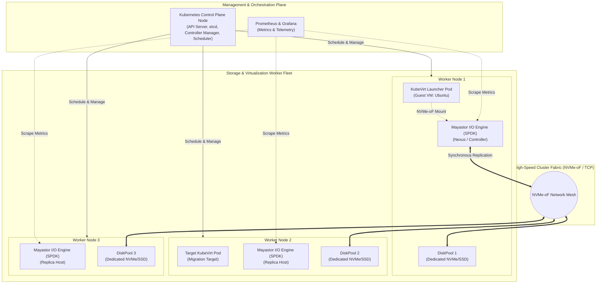

# Deploy High-Performance Storage for Kubernetes

**Project ID:** SWFW_5S_08  
**Program:** Zoho SETU — College Student Project Program  
**Category:** Cloud Infrastructure / Kubernetes / Virtualization / Distributed Storage / Systems Engineering  
**Repository Branch:** `main`  
**Status:** In Progress (Phase 2 — Target Infrastructure Preparation; Chunk 2.1 Strategy Realignment & Environment Assessment Complete)  

---

## 1. Executive Summary & Problem Statement

Modern cloud-native environments increasingly converge containerized microservices and virtual machine workloads onto unified orchestration platforms. Kubernetes, through extensions like **KubeVirt**, enables organizations to run legacy and monolithic virtual machines alongside containers. However, running I/O-intensive virtualized workloads inside Kubernetes introduces critical storage architectural challenges:

- **Kernel I/O Bottlenecks:** Traditional Linux kernel storage stacks (VFS, block layer, context switching, interrupt handling) introduce latency overheads that degrade high-throughput, low-latency NVMe performance.
- **Data Replication & Fault Tolerance:** Cloud-native storage must provide synchronous replication across failure domains without sacrificing NVMe wire speeds.
- **Workload Portability & Migration:** Virtual machine live migration requires persistent storage volumes to be accessible across nodes, creating architectural tension between high-speed local NVMe replicated block storage (typically ReadWriteOnce / RWO) and cluster-wide shared storage (ReadWriteMany / RWX) requirements.
- **Dynamic Resource Adaptation:** Production virtualization requires dynamic resource adjustments (CPU, memory, storage, and network interface hot-plugging) without VM restarts or workload interruptions.

This project investigates, designs, deploys, and benchmarks a high-performance cloud-native storage architecture centered on **OpenEBS Mayastor**, leveraging the **Storage Performance Development Kit (SPDK)** and **NVMe over Fabrics (NVMe-oF)** to service **KubeVirt** virtual machine workloads on a multi-node Kubernetes cluster.

> [!IMPORTANT]
> **Project Phase & Strategic Alignment (ADR-011):** This project has completed **Phase 1 Infrastructure Discovery (Chunks 0 through 1.11)**, **Chunk 2.0 Readiness Planning**, and **Chunk 2.1 Strategy Realignment & Development Environment Assessment**. In accordance with **ADR-011**, the complete 4-node Mayastor/KubeVirt architecture remains fully preserved as the target specification, while development and validation proceed decoupled from institutional hardware gating in accordance with the 10-milestone roadmap ([`docs/development-roadmap.md`](docs/development-roadmap.md)). No infrastructure claims are made prior to concrete test execution and data collection.

---

## 2. Motivation and Objectives

### 2.1 Motivation
Enterprise workloads demanding virtualization within Kubernetes require storage engines capable of saturating modern NVMe hardware while maintaining cloud-native elasticity. Traditional distributed file systems often suffer from protocol overheads and kernel context switching. By leveraging user-space polling-mode drivers via SPDK and NVMe-oF transport protocols within Mayastor, near-bare-metal I/O performance can theoretically be achieved for KubeVirt VMs.

### 2.2 Core Project Objectives
1. **Multi-Node Cluster Deployment:** Establish a 4-node Kubernetes cluster (1 Control Plane + 3 dedicated Worker nodes) using `kubeadm` and `containerd`.
2. **High-Performance Replicated Block Storage:** Deploy OpenEBS Mayastor utilizing dedicated block devices to construct multi-node `DiskPools`, provisioning synchronous replicated storage via NVMe-oF.
3. **Cloud-Native Virtualization Integration:** Install and configure KubeVirt, provisioning virtual machines backed by high-performance persistent volumes.
4. **Live Migration & Shared Storage Evaluation:** Evaluate live migration mechanics for KubeVirt VMs across worker nodes, comparing replicated block storage (RWO) with shared filesystem (RWX via NFS gateway) semantics.
5. **Runtime Resource Hot-Plugging:** Systematically test and validate dynamic hot-plugging of vCPU, memory, storage volumes, and network interfaces on running KubeVirt guest VMs.
6. **Empirical Benchmarking & Failure Analysis:** Execute comprehensive `fio` benchmarking matrices (IOPS, throughput, latency percentiles) across raw disk, container volumes, and virtual machines, followed by simulated disk and node failure recovery drills.
7. **Comprehensive Observability:** Deploy Prometheus and Grafana dashboards capturing node, storage pool, engine, and virtual machine metrics in real time.

---

## 3. Proposed Technology Stack

| Domain | Technology / Component | Planned Version / Spec | Role & Architectural Function |
| :--- | :--- | :--- | :--- |
| **Host Operating System** | Ubuntu Server 24.04 LTS | Linux 6.8 LTS kernel | Base OS across all bare-metal / virtual cluster nodes |
| **Cluster Orchestration** | Kubernetes (`kubeadm`) | v1.36.x (Candidate B preferred) / v1.35.x (Candidate A comparison) | Core container orchestration and resource scheduling |
| **Container Runtime** | `containerd` | v2.3.x LTS | OCI-compliant container runtime officially recommended for K8s 1.36+ |
| **Cluster Networking** | Calico v3.33 (CNI) | Pure routed BGP mode | Pod-to-Pod and Node-to-Pod networking fabric without VXLAN overhead |
| **Storage Engine** | OpenEBS Mayastor | OpenEBS v4.6.x (Mayastor subchart v2.12.2) | SPDK-based high-performance distributed block storage engine (Ports 8420 & 4421; canonical 20-port matrix) |
| **I/O Acceleration** | SPDK (User Space) | Integrated with Mayastor | Polled-mode NVMe driver (2 dedicated cores), zero-copy user-space I/O pipeline |
| **Storage Protocol** | NVMe-oF (TCP) | NVMe over Fabrics | High-throughput, low-latency block transport across cluster nodes |
| **Virtualization Layer** | KubeVirt | v1.9.x (or v1.8.x) | Kubernetes CRD controller managing QEMU/KVM VM pods |
| **Hypervisor / Emulator** | QEMU / KVM | Linux KVM module (`/dev/kvm`) | Hardware-assisted virtualization within VM launcher pods |
| **Shared Storage Gateway** | NFS Server / RWX Provisioner | `csi-driver-nfs` v4.9.0 | Comparative fallback mechanism for RWX live-migration shared storage |
| **Benchmarking Suite** | Flexible I/O Tester (`fio`) | v3.30+ | Multi-pattern synthetic I/O workload generation & measurement |
| **Metrics & Monitoring** | Prometheus & Grafana | `kube-prometheus-stack` v62.x | Cluster, storage engine, and guest VM telemetry (Internal management network only) |

---

## 4. Proposed High-Level Architecture

The target architecture decouples the Kubernetes control plane from storage-capable worker nodes. Worker nodes dedicate physical storage partitions to Mayastor DiskPools, while KubeVirt schedules VM launcher pods accessing volumes over NVMe-oF.



---

## 5. Planned Capabilities Matrix

All capabilities below represent project targets and will be updated as implementation proceeds:

| # | Capability Area | Specific Target Feature | Verification Status | Implementation Phase |
| :-: | :--- | :--- | :---: | :---: |
| 1 | **Cluster Core** | Multi-node `kubeadm` Kubernetes deployment | ⏳ NOT STARTED | Chunk 1–2 |
| 2 | **Storage Engine** | OpenEBS Mayastor installation & HugePages config | ⏳ NOT STARTED | Chunk 3 |
| 3 | **Storage Pools** | Multi-node `DiskPool` provisioning across raw disks | ⏳ NOT STARTED | Chunk 3 |
| 4 | **Replication** | Synchronous 2-way and 3-way volume replication | ⏳ NOT STARTED | Chunk 3–4 |
| 5 | **Virtualization** | KubeVirt Operator and CRD deployment | ⏳ NOT STARTED | Chunk 5 |
| 6 | **VM Workloads** | Cloud-init guest VM launch backed by Mayastor PV | ⏳ NOT STARTED | Chunk 5 |
| 7 | **Live Migration** | VM migration across workers without service drop | ⏳ NOT STARTED | Chunk 6 |
| 8 | **CPU Hot-Plug** | Dynamic vCPU scaling on running KubeVirt VM | ⏳ NOT STARTED | Chunk 7 |
| 9 | **Memory Hot-Plug** | Dynamic memory allocation adjustment on guest VM | ⏳ NOT STARTED | Chunk 7 |
| 10 | **Storage Hot-Plug** | Attaching secondary block volume to active VM | ⏳ NOT STARTED | Chunk 7 |
| 11 | **NIC Hot-Plug** | Attaching dynamic Multus secondary interface | ⏳ NOT STARTED | Chunk 7 |
| 12 | **Benchmarking** | Matrix testing using `fio` across R/W profiles | ⏳ NOT STARTED | Chunk 8 |
| 13 | **Failure Recovery** | Degraded pool rebuild and node offline failover | ⏳ NOT STARTED | Chunk 9 |
| 14 | **Observability** | Real-time dashboards for IOPS, latency, and health | ⏳ NOT STARTED | Chunk 10 |

---

## 6. Repository Layout

```text
k8s-high-performance-storage/
├── AGENTS.md               # Strict governance instructions for AI-assisted development
├── README.md               # Project landing page, overview, and roadmap
├── PROJECT_STATE.md        # Persistent single source of truth for progress tracking
├── ARCHITECTURE.md         # Detailed target architecture and technical design specifications
├── RESEARCH.md             # Theoretical foundations, API references, and open inquiries
├── LEARNING_NOTES.md       # Student engineering reference guide and interview preparation
├── DECISIONS.md            # Architectural Decision Records (ADRs) tracking design choices
├── .gitignore              # Exclusion rules preventing leakage of credentials, logs, and caches
├── LICENSE                 # Project open-source license (MIT)
│
├── infrastructure/         # Cluster manifests, node configs, networking, and storage primitives
│   ├── kubernetes/         # kubeadm configs, cluster initialization manifests
│   ├── networking/         # CNI configurations (Calico/Flannel)
│   └── storage/            # DiskPool CRDs, StorageClasses, and PVC templates
│
├── kubevirt/               # KubeVirt operator configs, VM specs, and migration policies
│   ├── installation/       # Operator and Subresource deployment manifests
│   ├── virtualmachines/    # VirtualMachine and VirtualMachineInstance specifications
│   ├── migration/          # VirtualMachineInstanceMigration CRDs and policies
│   └── hotplug/            # Configurations for CPU, memory, volume, and NIC hot-plugging
│
├── storage/                # Engine-specific configurations and experimental topologies
│   ├── mayastor/           # Mayastor Helm values, daemonsets, and engine settings
│   ├── nfs/                # NFS server and provisioner configs for RWX migration tests
│   └── experiments/        # Manifests for specialized storage testing scenarios
│
├── monitoring/             # Observability manifests and dashboards
│   ├── prometheus/         # Scrape configs, ServiceMonitors, and alert rules
│   └── grafana/            # Pre-configured JSON dashboards for Mayastor and KubeVirt
│
├── benchmarks/             # Storage benchmarking harness
│   ├── fio/                # FIO job profiles (sequential, random, variable block sizes)
│   ├── scripts/            # Automated benchmark runner scripts
│   └── results/            # Measured raw performance outputs, metrics, and JSON data
│
├── scripts/                # Reusable operational shell scripts
│   ├── setup/              # Cluster pre-flight, kernel module loading, HugePage config
│   ├── validation/         # Smoke tests and environment verification scripts
│   ├── tests/              # Automated functional testing scripts
│   └── cleanup/            # Teardown and resource reset scripts
│
├── tests/                  # Automated and manual verification suites
│   ├── storage/            # Mayastor PVC creation, IO stress, and integrity tests
│   ├── migration/          # KubeVirt live migration test sequences
│   └── recovery/           # Disk unplugging, engine crash, and pool rebuild tests
│
├── docs/                   # Extended project documentation
│   ├── architecture/       # Deep-dive design notes and network flow diagrams
│   ├── installation/       # Step-by-step reproduction runbooks
│   ├── experiments/        # Documented test methodology and hypothesis logs
│   └── submission/         # Zoho SETU program deliverables and project presentation
│
└── reports/                # Project reporting assets
    ├── screenshots/        # Verified terminal output captures and UI views
    ├── graphs/             # Performance comparison charts (IOPS, Latency vs Block Size)
    └── final-report/       # Compiled final engineering project report
```

---

## 7. Development Environment & Hybrid Workflow

Development follows a strict **hybrid infrastructure model**:

1. **Local Workstation (Windows 11 + WSL2 Ubuntu):**
   - **Hardware:** AMD Ryzen 5 7535HS (6 cores / 12 threads), 8 GB RAM, 512 GB NVMe SSD.
   - **Role:** Manifest authoring, shell script development, static analysis, documentation maintenance, and repository governance.
   - **Constraint:** Due to memory (8 GB) and nested virtualization limitations, the full multi-node cluster (requiring 3+ worker nodes with dedicated storage devices and HugePages) will **not** be hosted locally.

2. **Target Infrastructure (College Lab Servers / Remote Linux Environment):**
   - **Role:** Physical deployment of the 4-node Kubernetes cluster, allocation of raw block devices for Mayastor pools, KVM hardware acceleration for KubeVirt, and physical failure drills.
   - **Status:** Hardware confirmation and laboratory access are pending evaluation.

3. **Source of Truth:**
   - GitHub (`k8s-high-performance-storage`) maintains all versioned configuration, scripts, and documentation. No ad-hoc manual modifications occur on target nodes without matching version-controlled manifests.

---

## 8. Documentation Navigation

- [Architecture Specification (ARCHITECTURE.md)](ARCHITECTURE.md): Comprehensive system layers, SPDK/NVMe-oF pipelines, and KubeVirt live migration workflows.
- [Project Governance & Rules (AGENTS.md)](AGENTS.md): Operational guardrails, chunk development rules, and quality standards.
- [Project Progress State (PROJECT_STATE.md)](PROJECT_STATE.md): Real-time tracker for chunk completions, blockers, and verification evidence.
- [Technical Research Tracker (RESEARCH.md)](RESEARCH.md): Up-to-date theoretical investigations, kernel parameters, and official documentation links.
- [Student Learning Notes (LEARNING_NOTES.md)](LEARNING_NOTES.md): Step-by-step conceptual explanations, interview Q&A, and systems engineering concepts.
- [Architectural Decision Records (DECISIONS.md)](DECISIONS.md): Justifications and trade-off analyses for structural design choices.

### Infrastructure Discovery & Feasibility Reports (Chunk 1 Deliverables)
- [Local Infrastructure Inventory (docs/infrastructure-inventory.md)](docs/infrastructure-inventory.md): Hardware detection, memory limitations, and WSL2 assessment on the dev laptop.
- [College Infrastructure Questionnaire (docs/college-infrastructure-questionnaire.md)](docs/college-infrastructure-questionnaire.md): Formal inquiry and hardware sizing for lab administrators.
- [Software Version Compatibility Matrix (docs/compatibility-matrix.md)](docs/compatibility-matrix.md): Lifecycle research establishing supported modern baseline (Ubuntu 24.04 LTS, K8s 1.35.x, OpenEBS 4.6+, KubeVirt 1.8.x).
- [Storage Architecture Analysis (docs/storage-architecture-analysis.md)](docs/storage-architecture-analysis.md): RWO vs. RWX evaluation, Mayastor SPDK volume pipeline, and dual-tier storage strategy.
- [Network & Virtualization Requirements (docs/network-and-virtualization-requirements.md)](docs/network-and-virtualization-requirements.md): 15 verified ports, network topology, and hardware KVM pass-through requirements.
- [Deployment Options Evaluation (docs/deployment-options.md)](docs/deployment-options.md): Comparative evaluation of physical servers, lab PCs, hypervisor nested VMs, and cloud options.
- [Final Deployment Proposal (docs/final-deployment-proposal.md)](docs/final-deployment-proposal.md): Complete research-backed engineering blueprint for cluster deployment.

---

## 9. Future Implementation Roadmap


*Current Phase: Chunk 0 (In Progress). All downstream chunks remain locked pending explicit review and approval.*
