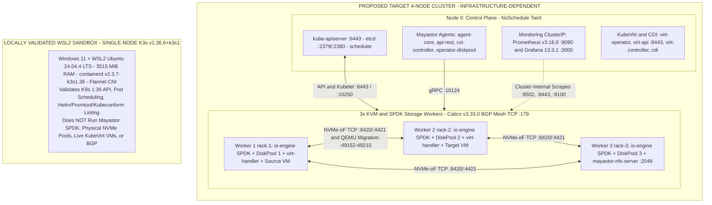
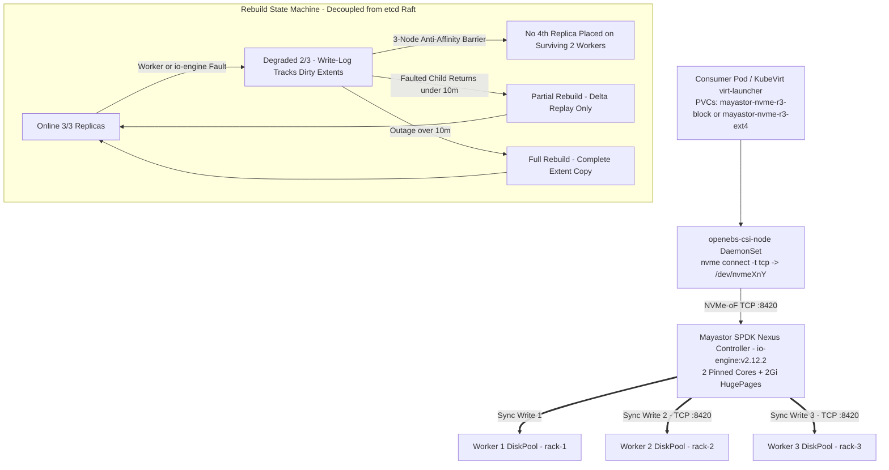
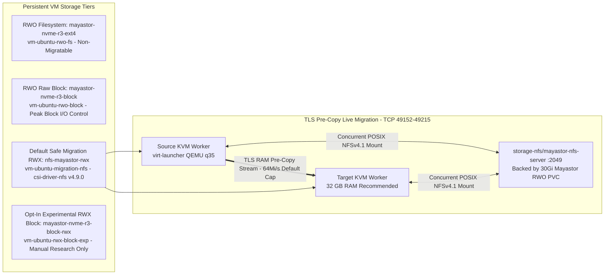
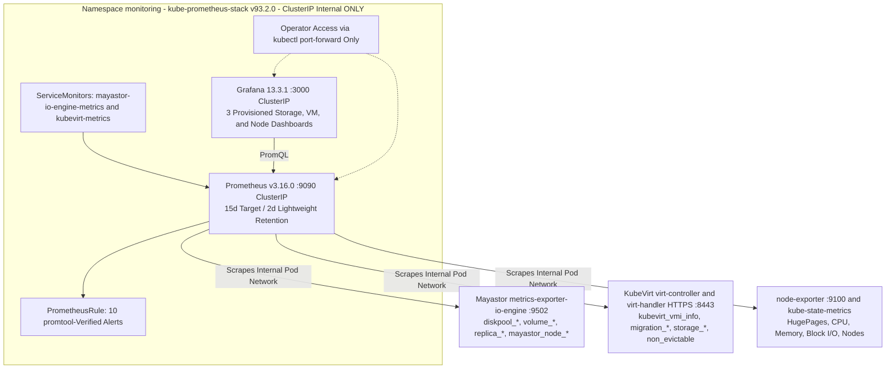

# Deploy High-Performance Storage for Kubernetes

**Problem Statement ID:** `SWFW_5S_08` · **Program:** Zoho SETU 2026

A reproducible, lifecycle-current Infrastructure-as-Code architecture integrating **OpenEBS Replicated PV Mayastor (SPDK + NVMe-oF TCP)** with **KubeVirt + CDI** on a four-node Kubernetes cluster for high-throughput VM block storage, live migration, failure-recovery testing, FIO benchmarking, and internal observability.

[](#19-official-submission-information)
[](#19-official-submission-information)
[](infrastructure/k8s/kubeadm-init-config.yaml)
[](infrastructure/storage/openebs/chart-metadata.yaml)
[](kubevirt/installation/release-metadata.yaml)
[](LICENSE)

> [!IMPORTANT]
> **Verification Boundary:** All cluster configurations, manifests, Helm values, CRD schemas, scripts, static checks, safety refusal gates, and single-node `K3s v1.36.6+k3s1` sandbox probes have been **implemented and locally validated** on WSL2 Ubuntu `24.04.4 LTS`. Multi-node `kubeadm` cluster deployment, live Mayastor SPDK/NVMe-oF pools, multi-node rebuild drills, VM live migration, runtime hot-plugging, live Prometheus scraping, and **all physical NVMe FIO benchmarks remain `INFRASTRUCTURE-DEPENDENT`** and have **not** been executed locally.

---

## Table of Contents

1. [Project Header](#deploy-high-performance-storage-for-kubernetes)
2. [Project Overview](#2-project-overview)
3. [Key Features](#3-key-features)
4. [Architecture Overview](#4-architecture-overview)
5. [Technology Stack](#5-technology-stack)
6. [System Requirements and Prerequisites](#6-system-requirements-and-prerequisites)
7. [Repository Structure](#7-repository-structure)
8. [Installation and Setup](#8-installation-and-setup)
9. [Storage Architecture and Configuration](#9-storage-architecture-and-configuration)
10. [KubeVirt and Virtual Machine Integration](#10-kubevirt-and-virtual-machine-integration)
11. [Storage Resilience and Failure Recovery](#11-storage-resilience-and-failure-recovery)
12. [Performance Benchmarking](#12-performance-benchmarking)
13. [Monitoring and Observability](#13-monitoring-and-observability)
14. [Validation and Testing](#14-validation-and-testing)
15. [Project Status](#15-project-status)
16. [Known Limitations and Future Work](#16-known-limitations-and-future-work)
17. [Reproduction and Demo Guide](#17-reproduction-and-demo-guide)
18. [Documentation and Resources](#18-documentation-and-resources)
19. [Official Submission Information](#19-official-submission-information)
20. [License](#20-license)

---

## 2. Project Overview

Stateful microservices and containerized virtual machines on Kubernetes require persistent storage that preserves data across pod rescheduling, node failures, and cluster maintenance. Traditional kernel-space software-defined storage stacks route every I/O operation through Linux Virtual File System (VFS) layers, page caches, kernel block scheduling, and context switches, leaving much of modern PCIe NVMe SSD bandwidth and sub-millisecond latency untapped.

Modern NVMe devices deliver parallel hardware submission and completion queues designed for low-latency polled execution. Running storage data paths directly on raw NVMe hardware without unnecessary kernel translation reduces I/O jitter—particularly when presenting raw block devices directly to hypervisors rather than nesting virtual disk images inside host filesystems.

At the same time, local NVMe storage alone creates a single point of failure. Distributed synchronous replication across independent worker failure domains preserves data availability (`RPO = 0`) when an engine pod restarts or a worker node leaves service, while keeping storage replication decoupled from Kubernetes control-plane `etcd` Raft consensus.

Running **KubeVirt** virtual machines introduces an additional constraint: live migration transfers a running QEMU/KVM domain between worker nodes while both source and target `virt-launcher` pods concurrently attach to the VM disk during cutover. Standard single-node `ReadWriteOnce` (RWO) block volumes prevent cross-node live migration unless paired with a shared `ReadWriteMany` (RWX) access tier.

**What this solution provides:**
- A **target four-node Kubernetes `v1.36.6` architecture** combining **Calico `v3.33.0` Pure BGP networking**, **OpenEBS `4.6.2` / Mayastor `v2.12.2` (SPDK + NVMe-oF TCP)**, and **KubeVirt `v1.9.1` + CDI `v1.66.1`**.
- **Four Mayastor CSI StorageClasses** plus a **standards-compliant NFSv4.1 RWX fallback tier (`nfs-mayastor-rwx`)** so production VM benchmarks use high-speed RWO Raw Block while live-migratable VMs default safely to POSIX RWX (with native Mayastor RWX Raw Block isolated behind opt-in experimental controls).
- **Non-destructive automation, strict offline CRD schema validation, WSL2 safety refusal gates, reversible fault-drill harnesses, FIO comparability pipelines, and `promtool`-verified Prometheus/Grafana observability**, cleanly partitioned between locally validated engineering artifacts and multi-node infrastructure-dependent execution.

---

## 3. Key Features

- **Target Multi-Node Kubernetes & Pure BGP CNI:** Version-pinned `kubeadm.k8s.io/v1beta4` initialization (`v1.36.6`), `containerd 2.3.x LTS` v3 configuration (`SystemdCgroup = true`), and Calico `v3.33.0` (`encapsulation: None`, BGP mesh `TCP 179`), alongside an isolated single-node `K3s v1.36.6+k3s1` local development cluster script ([`dev-cluster-local.sh`](scripts/setup/dev-cluster-local.sh)).
- **OpenEBS Mayastor Storage Integration:** Umbrella Helm chart `openebs/openebs` `4.6.2` bundling Mayastor `v2.12.2` with zero `:latest` tags and unused LVM/ZFS/rawfile/Loki/Alloy/callhome modules disabled ([`values.yaml`](infrastructure/storage/openebs/values.yaml)).
- **SPDK Polled-Mode I/O Engine:** Dedicated `io-engine` DaemonSet reserving `2` continuous busy-poll CPU cores and `2 GiB` of `2MiB` HugePages per labeled worker node (`openebs.io/engine=mayastor`).
- **NVMe-oF TCP Storage Mesh:** Kernel `nvme_tcp` initiator attachment (`io.openebs.csi-mayastor`) over TCP ports `8420`, `4421`, and `10124` without requiring specialized lossless RDMA NICs.
- **Three-Way Synchronous Replication & DiskPools:** `openebs.io/v1beta3` zoned `DiskPool` manifests (`rack-1`..`rack-3`) with placeholder `/dev/disk/by-id/*` device safety and strict 3-node anti-affinity decoupled from `etcd`.
- **Multi-Tier StorageClasses:** Covers RWO ext4 (`mayastor-nvme-r3-ext4`), RWO Raw Block (`mayastor-nvme-r3-block`), single-replica baseline (`mayastor-nvme-r1-dev`), Default Safe NFS RWX (`nfs-mayastor-rwx` via `csi-driver-nfs v4.9.0`), and Opt-In Experimental Mayastor RWX Block (`mayastor-nvme-r3-block-rwx`).
- **KubeVirt + CDI Virtualization Stack:** Hardware-KVM-enforced (`useEmulation: false`) KubeVirt `v1.9.1` and `CDI v1.66.1` `DataVolumeTemplate` workflows with non-root `kubevirt-workloads` isolation and dynamic SSH public-key `cloud-init` injection ([`cloud-init-secret.yaml`](kubevirt/virtualmachines/cloud-init-secret.yaml)).
- **Live Migration & Hot-Plugging Configs:** TLS-encrypted pre-copy `MigrationPolicy` (`64Mi/s` default cap, `allowPostCopy: false`) plus `LiveUpdate` CPU socket (`2 -> 4`), guest RAM (`2Gi -> 4Gi` within `4608Mi` pod limits), and SCSI disk hot-plugging (`virtctl addvolume`/`removevolume`) manifests *(Multus NIC hot-plugging deferred)*.
- **Storage Resilience & FIO Benchmarking Frameworks:** 4 reversible fault scenarios (`resilience-scenarios.yaml`), SHA-256 checksum pipeline (`verify-volume-checksum.sh`), REST/event rebuild observer, 6 filename-free FIO profiles (`benchmarks/fio/`), and a Python comparability parser (`summarize-results.py`) backed by `unittest`.
- **Internal Observability & Unified Validation:** ClusterIP-only `kube-prometheus-stack v93.2.0` (`Prometheus v3.16.0`, `Grafana 13.3.1`), 10 `promtool`-verified alerts, 3 Grafana dashboards, an 11-step static/tooling suite (`run-validation.sh`), and a 9-stage integrated demo orchestrator (`run-project-demo.sh`).

*(All multi-node SPDK, NVMe-oF, rebuild, migration, hot-plug, live scraping, and hardware FIO execution features are implemented as configurations/automation and await multi-node lab hardware; none were executed on a physical 4-node cluster.)*

---

## 4. Architecture Overview

Diagram source files are stored as Mermaid Markdown specifications in [`docs/diagrams/`](docs/diagrams/01-four-node-kubernetes-architecture.md) (no binary raster image files are checked into `docs/diagrams/`, so native Mermaid diagrams are embedded directly below alongside links to all five source files).

| Diagram ID | Focus Area | Primary Source File | Execution Status Boundary |
| :---: | :--- | :--- | :--- |
| **01** | Four-Node Target Cluster vs. Local K3s Dev Sandbox | [`01-four-node-kubernetes-architecture.md`](docs/diagrams/01-four-node-kubernetes-architecture.md) | 4-Node Target: `INFRASTRUCTURE-DEPENDENT`; K3s Dev Node: `VALIDATED` |
| **02** | Mayastor SPDK Data Path, N=3 Replication & Rebuild FSM | [`02-mayastor-storage-and-replication.md`](docs/diagrams/02-mayastor-storage-and-replication.md) | Manifests/Schemas: `VALIDATED`; Live Data Plane: `INFRASTRUCTURE-DEPENDENT` |
| **03** | KubeVirt VM Storage Tiers, Live Migration & Hot-Plugging | [`03-vm-storage-and-live-migration.md`](docs/diagrams/03-vm-storage-and-live-migration.md) | CRs/Policies/Dry-Runs: `VALIDATED`; Live VM Moves: `INFRASTRUCTURE-DEPENDENT` |
| **04** | Prometheus & Grafana ClusterIP Observability Plane | [`04-monitoring-and-observability.md`](docs/diagrams/04-monitoring-and-observability.md) | `promtool`/CRD/Dashboards: `VALIDATED`; Live Scrape: `INFRASTRUCTURE-DEPENDENT` |
| **05** | Development Validation & Target Deployment Workflow | [`05-deployment-and-validation-workflow.md`](docs/diagrams/05-deployment-and-validation-workflow.md) | Tier 1 WSL2 Gate: `VALIDATED`; Tier 2 Target Rollout: `INFRASTRUCTURE-DEPENDENT` |

### 4.1 Target 4-Node Architecture vs. Locally Validated WSL2 Environment

- **Target Architecture (`INFRASTRUCTURE-DEPENDENT` — Not Yet Deployed):** `1` dedicated control-plane node (`Node 0`) plus `3` converged KVM/Mayastor worker nodes (`Workers 1–3`) running Ubuntu Server `24.04 LTS`, `kubeadm v1.36.6`, `containerd 2.3.x LTS`, Calico `v3.33.0` Pure BGP mesh (`TCP 179`), OpenEBS `4.6.2` / Mayastor `v2.12.2` across dedicated raw NVMe `DiskPools`, KubeVirt `v1.9.1` + CDI `v1.66.1`, and internal `kube-prometheus-stack v93.2.0`.
- **Locally Validated Environment (`VALIDATED`):** Windows 11 + WSL2 (`Ubuntu 24.04.4 LTS`, kernel `6.6.87.2-microsoft-standard-WSL2`, `3515 MiB` total Linux RAM, `0` HugePages, `0` raw NVMe pool disks) hosting a single-node **K3s `v1.36.6+k3s1`** API sandbox (`containerd v2.3.7-k3s1.36`, Flannel CNI) solely for Kubernetes `1.36` API compatibility, CoreDNS/scheduling probes, Helm linting, offline strict schema validation, FIO parsing, `promtool`, and dry-run/safety-refusal testing.



### 4.2 Mayastor SPDK Replication Architecture



### 4.3 KubeVirt VM Storage and Live Migration Architecture



### 4.4 Monitoring and Observability Architecture



---

## 5. Technology Stack

All versions below are pinned directly in repository metadata, Helm values, manifests, and verified WSL2 tool installations:

| Component | Pinned Repository Version | Purpose & Compatibility Basis | Source File(s) |
| :--- | :--- | :--- | :--- |
| **Target Host OS** | Ubuntu Server `24.04 LTS` (`x86_64`, Linux `6.8 LTS`) | Target production OS providing `nvme-tcp` and `/dev/kvm`; dev host audited on WSL2 Ubuntu `24.04.4 LTS` (`6.6.87.2`) | [`ARCHITECTURE.md`](ARCHITECTURE.md), [`host-preflight-*.txt`](reports/environment/host-preflight-2026-11-09_17-06-37.txt) |
| **Kubernetes** | `v1.36.6` (`kubeadm.k8s.io/v1beta4`) | Orchestration control plane (Candidate B baseline active through June 2027); local dev sandbox runs `K3s v1.36.6+k3s1` | [`kubeadm-init-config.yaml`](infrastructure/k8s/kubeadm-init-config.yaml), [`dev-cluster-local.sh`](scripts/setup/dev-cluster-local.sh) |
| **Container Runtime** | `containerd 2.3.x LTS` | Recommended pairing for K8s `1.36+` (EOL Apr 2028) using schema v3 + `SystemdCgroup = true`; K3s embeds `v2.3.7-k3s1.36` | [`containerd-config-v3.toml`](infrastructure/k8s/containerd-config-v3.toml) |
| **CNI Networking** | Project Calico `v3.33.0` (`tigera/operator:v1.44.0`) | Unencapsulated Pure BGP mesh (`TCP 179`, Pod CIDR `10.244.0.0/16`) qualified for K8s `1.35–1.37` | [`installation.yaml`](infrastructure/k8s/calico/installation.yaml), [`bgp-configuration.yaml`](infrastructure/k8s/calico/bgp-configuration.yaml) |
| **OpenEBS Umbrella** | Chart `4.6.2` (`etcd` `3.6.4-debian-12-r0`, `nats` `2.9.17-alpine`) | Installs Mayastor replicated engine plus internal `localpv-provisioner` `4.6.0` for `mayastor-etcd-localpv` | [`chart-metadata.yaml`](infrastructure/storage/openebs/chart-metadata.yaml), [`values.yaml`](infrastructure/storage/openebs/values.yaml) |
| **OpenEBS Mayastor** | `v2.12.2` (`io-engine:v2.12.2`) | SPDK user-space target, NVMe-oF TCP fabric, and CSI (`io.openebs.csi-mayastor`); *upstream CI tested up to K8s `v1.35.6`; `v1.36.x` live check pending* | [`chart-metadata.yaml`](infrastructure/storage/openebs/chart-metadata.yaml) |
| **KubeVirt** | `v1.9.1` (`virtctl v1.9.0`) | Containerized KVM VMs, `LiveUpdate` hot-plugging, and TLS live migration (supports K8s `>=1.35 <1.37`) | [`release-metadata.yaml`](kubevirt/installation/release-metadata.yaml), [`kubevirt-cr.yaml`](kubevirt/installation/kubevirt-cr.yaml) |
| **CDI** | `v1.66.1` | Declarative VM disk imports (`DataVolumeTemplates`) into Mayastor/NFS PVCs (`HonorWaitForFirstConsumer`) | [`release-metadata.yaml`](kubevirt/installation/release-metadata.yaml), [`cdi-cr.yaml`](kubevirt/installation/cdi-cr.yaml) |
| **NFS CSI Driver** | `csi-driver-nfs v4.9.0` + `nfs-server-alpine:12` | Exports POSIX NFSv4.1 `nfs-mayastor-rwx` over a `30Gi` Mayastor RWO backing PVC (`nfs.csi.k8s.io`) | [`nfs-storageclass.yaml`](storage/nfs/nfs-storageclass.yaml), [`nfs-server-mayastor.yaml`](storage/nfs/nfs-server-mayastor.yaml) |
| **Prometheus** | `v3.16.0` (via `kube-prometheus-stack v93.2.0`, Operator `v0.95.2`) | Internal `ClusterIP` (`:9090`) telemetry scraper, alert evaluator (`promtool v3.16.0`), plus `node-exporter` `5.1.0` & `kube-state-metrics` `9.0.0` | [`monitoring/release-metadata.yaml`](monitoring/release-metadata.yaml), [`values.yaml`](monitoring/prometheus/values.yaml) |
| **Grafana** | `13.3.1` (chart `14.4.1`) | Internal `ClusterIP` (`:3000`) provisioned visualization with 3 custom storage, VM, and node dashboards | [`monitoring/release-metadata.yaml`](monitoring/release-metadata.yaml), [`monitoring/grafana/dashboards/`](monitoring/grafana/dashboards/mayastor-storage-performance.json) |
| **FIO** | `3.36` (min `>= 3.30`) | Parameterized 6-profile I/O benchmarking matrix (IOPS, `MiB/s`, mean & `p50/p95/p99/p99.9` latency) | [`matrix-config.yaml`](benchmarks/fio/matrix-config.yaml), [`docs/development-toolchain.md`](docs/development-toolchain.md) |
| **Helm & Core CLIs** | `helm v3.17.1`, `kubectl v1.36.0`, `kubeadm v1.36.6` | Chart linting/templating, Kubernetes API interactions, and `kubeadm` config schema checks | [`install-dev-tools.sh`](scripts/setup/install-dev-tools.sh), [`docs/development-toolchain.md`](docs/development-toolchain.md) |
| **Supporting Tooling** | `Python 3.12.3`, `kubeconform v0.8.0`, `yq v4.54.3`, `yamllint 1.33.0`, `shellcheck 0.9.0`, `shfmt 3.8.0`, `jq 1.7.1`, `curl 8.5.0`, `git 2.43.0` | Benchmark summarization & `unittest`, strict offline CRD schema verification, YAML/Bash/JSON static analysis | [`docs/development-toolchain.md`](docs/development-toolchain.md), [`run-validation.sh`](scripts/validate/run-validation.sh) |

---

## 6. System Requirements and Prerequisites

### A. Target Deployment Environment (`INFRASTRUCTURE-DEPENDENT`)

Designed for physical or bare-metal-equivalent servers (never pre-assumed available until allocated and verified via [`docs/infrastructure-readiness-tracker.md`](docs/infrastructure-readiness-tracker.md)):

| Category | Requirement Specification | Engineering Justification & Reference |
| :--- | :--- | :--- |
| **Cluster Topology** | `>= 4` `x86_64` nodes (`1` Control Plane + `3` Workers labeled `openebs.io/engine=mayastor`, zoned `rack-1`..`rack-3`) | Separates control-plane Raft quorum (`Node 0`) from 3 independent NVMe failure domains ([`ARCHITECTURE.md`](ARCHITECTURE.md)) |
| **OS & Kernel** | Ubuntu Server `24.04 LTS` (`Linux 6.8 LTS`), swap disabled (`swapoff` / `failSwapOn: true`), `overlay` + `br_netfilter` + `nvme_tcp` | Required for `kubeadm v1.36.6`, SPDK CSI attachment, and in-tree NVMe-oF TCP initiator ([`02-node-prerequisites.sh`](scripts/setup/02-node-prerequisites.sh)) |
| **CPU & Instructions** | `>= 6` physical cores per worker (preferred `8–16`), `sse4_2`, hardware `vmx` (Intel) or `svm` (AMD) + `/dev/kvm` rw | Reserves `2` 100%-busy SPDK polling cores (`io_engine.cpuCount: "2"`) plus host OS & QEMU VM cores; KubeVirt sets `useEmulation: false` |
| **Memory & HugePages** | **`32 GB` RAM (`MemTotal` `29.30–29.60 GiB`) strongly required per worker** + `2 GiB` `2MiB` HugePages (`1024 x 2MiB`) | Static stack consumes `5.90–8.70 GiB` (including `2 GiB` HugePages); `16 GB` hosts suffer a `-0.60 to -5.20 GiB` OOM deficit if a migration target already runs a 4 GiB VM ([`network-and-virtualization-requirements.md`](docs/network-and-virtualization-requirements.md)) |
| **Storage Devices** | `1` dedicated, blank, unmounted, unpartitioned raw NVMe/SSD `/dev/disk/by-id/*` device per storage worker | Only clean raw devices with explicit institutional wipe permission may be substituted into [`diskpools.yaml`](infrastructure/storage/mayastor/diskpools.yaml) |
| **Container & K8s** | `kubeadm` `v1.36.x` + `containerd 2.3.x LTS` (`systemd` cgroup driver) + Calico `v3.33.0` (`MTU 9000` target on storage NICs) | Prevents cgroup driver mismatch and avoids VXLAN tunneling overhead on same-L2 subnets |
| **Network Firewall** | **10 physical host firewall rules** across canonical 20-port matrix: `6443`, `2379`, `2380`, `10250`, `179`, optional `4789/udp`, `8420`, `4421`, `10124`, `49152–49215`, restricted `9100` | Port `4420` purged; Prometheus (`9090`), Grafana (`3000`), KubeVirt (`8443`), Mayastor metrics (`9502`), and NFS (`2049`) remain strictly cluster-internal (`ClusterIP`) |

### B. Local Development Environment (`AUDITED & VALIDATED` — Constrained Sandbox)

Audited on the project workstation via [`01-host-preflight.sh`](scripts/setup/01-host-preflight.sh) and [`02-node-prerequisites.sh`](scripts/setup/02-node-prerequisites.sh):

| Attribute | Audited Local Value | Operational Scope & Explicit Limitation |
| :--- | :--- | :--- |
| **Platform & OS** | Windows 11 + WSL2 Ubuntu `24.04.4 LTS` (`6.6.87.2-microsoft-standard-WSL2`) | Executes CLI tooling, ShellCheck/shfmt/yamllint, `kubeconform`, `helm`, `promtool`, `fio --parse-only`, and Python `unittest` |
| **CPU & KVM** | AMD Ryzen 5 7535HS (`12` vCPUs, `sse4_2`, `svm`), `/dev/kvm` (`crw-rw---- root:kvm`) | Hardware virtualization extensions visible; `virt-handler` KVM orchestration not deployed locally |
| **RAM & HugePages** | **`3515 MiB` total Linux RAM**, `1024 MiB` swap, **`0` `2MiB` HugePages** | Reserving `2 GiB` HugePages for SPDK leaves `< 1.0 GiB` OS RAM; live Mayastor, KubeVirt, and monitoring deployments are **blocked by safety gates** |
| **Block Devices** | WSL2 virtual disks (`ext4`/`swap` only; **0 raw `/dev/nvme*` devices**) | `nvme_tcp` module present in kernel tree, but raw NVMe `DiskPool` creation is **impossible** locally |
| **Local K8s Sandbox** | Single-node **K3s `v1.36.6+k3s1`** (`wsl2-dev-node`, `containerd v2.3.7-k3s1.36`, Flannel CNI) | Validates K8s `1.36` API, CoreDNS, pod scheduling, and strict schemas while isolating untouched host Docker `29.1.3` / containerd `2.2.1` |

> **Important:** The local WSL2 environment is **not suitable** for full Mayastor SPDK execution, raw NVMe `DiskPool` I/O, four-node Calico BGP networking, multi-node KubeVirt VM live migration, or physical storage benchmarking.

---

## 7. Repository Structure

```text
k8s-high-performance-storage/
├── AGENTS.md                       # Mandatory governance rules, safety gates & three-state tracking standard
├── PROJECT_STATE.md                # Single source of truth execution tracker across M1–M10 and Sprints 1–3
├── ARCHITECTURE.md                 # Permanent target 4-node architecture, memory math & canonical 20-port matrix
├── DECISIONS.md                    # Architectural Decision Records (ADR-001 through ADR-015)
├── RESEARCH.md & LEARNING_NOTES.md # Upstream investigations and viva engineering study reference
├── LICENSE                         # MIT License
├── infrastructure/
│   ├── k8s/                        # kubeadm v1.36.6 init config, containerd v3 config, Calico v3.33.0 & K8s schemas
│   └── storage/                    # OpenEBS 4.6.2 values/metadata, DiskPool v1beta3 schema/manifests & 4 CSI StorageClasses
├── storage/
│   └── nfs/                        # ClusterIP NFSv4.1 gateway (30Gi Mayastor RWO backing) & nfs-mayastor-rwx StorageClass
├── kubevirt/
│   ├── installation/               # KubeVirt v1.9.1 & CDI v1.66.1 namespaces, CRs, release metadata & extracted CRD schemas
│   ├── virtualmachines/            # cloud-init Secret template & 5 VM workload manifests (RWO FS/Block, NFS, Exp RWX, CirrOS)
│   ├── migration/                  # Default & experimental MigrationPolicies + declarative VirtualMachineInstanceMigration job
│   └── hotplug/                    # LiveUpdate hot-plug VM (vCPU/RAM/SCSI headroom) & staged 5Gi FS/Block DataVolumes
├── monitoring/
│   ├── release-metadata.yaml       # Pinned kube-prometheus-stack v93.2.0 metadata & verified upstream metric gaps
│   ├── prometheus/                 # Full & lightweight Helm values, prometheus.yml, ServiceMonitors, 10 PrometheusRules & CRD schemas
│   └── grafana/                    # Provisioning YAML + 3 dashboards (Mayastor Performance, KubeVirt Telemetry, Node/SPDK)
├── scripts/
│   ├── setup/                      # install-dev-tools, 01 preflight, 02 node-prereq, 03/04 kubeadm, dev-cluster-local, 05..08 deployers
│   ├── validate/                   # 11-step run-validation.sh, validate-project-integration.sh & per-subsystem validators
│   ├── tests/storage/              # Resilience drill runner, SHA-256 integrity verifier & Mayastor rebuild/REST observer
│   ├── benchmark/                  # Guarded FIO executor (run-fio-benchmarks.sh) & comparability summarizer (summarize-results.py)
│   └── demo/                       # 9-stage integrated demonstration orchestrator (run-project-demo.sh)
├── benchmarks/
│   └── fio/                        # 6 filename-free FIO workload profiles (4k, 64k, 1m) & multi-tier matrix-config.yaml
├── tests/
│   ├── benchmarks/                 # Python unittest suite verifying FIO JSON parsing & mixed-environment guards
│   └── storage/                    # 4 reproducible resilience & fault-recovery scenario specifications (YAML)
├── docs/
│   ├── diagrams/                   # 5 standalone Mermaid architecture, replication, migration, observability & workflow diagrams
│   └── *.md                        # 22 technical runbooks covering deployment, compatibility, feasibility, benchmarks & demo ops
└── reports/
    ├── environment/, kubernetes/, storage/, kubevirt/, monitoring/, integration/  # Timestamped WSL2 .txt & .json audit logs
    └── final/                      # Technical report (A–O), 15-slide .pptx deck, SUBMISSION_CHECKLIST.md & FINAL_PROJECT_STATUS.md
```

---

## 8. Installation and Setup

Safety legend used throughout all commands below:
- **[Safe Locally on WSL2]:** Read-only inspections, static linters, offline schema checks, local single-node K3s sandbox, or non-mutating `--dry-run` / `--mode local-validation`.
- **[Target Multi-Node Cluster Only]:** Requires provisioned Ubuntu `24.04` multi-node hardware; scripts enforce hard `exit 1` refusal when executed on WSL2.
- **[Destructive / Explicit Confirmation Required]:** Modifies host sysctls, formats pools on confirmed raw devices, injects faults, or writes FIO datasets; requires manual parameter replacement and explicit confirmation flags/tokens.

### Step 1 — Clone the Repository `[Safe Locally on WSL2]`

```bash
git clone https://github.com/Swapnil220705/k8s-high-performance-storage.git
cd k8s-high-performance-storage
```

### Step 2 — Inspect the Environment `[Safe Locally on WSL2]`

Review host readiness and prospective node prerequisites in strictly read-only mode:

```bash
./scripts/setup/01-host-preflight.sh
./scripts/setup/02-node-prerequisites.sh --report
```

### Step 3 — Install or Verify Development Tooling `[Safe Locally on WSL2]`

Installs APT linters/benchmark packages and verifies SHA-256 digests of `kubectl`, `helm`, `kubeconform`, `yq`, and `virtctl` without altering containerd or Docker:

```bash
sudo ./scripts/setup/install-dev-tools.sh
```

### Step 4 — Run Preflight & Unified Static Validation `[Safe Locally on WSL2]`

Run the 11-step repository validation suite (toolchain, permissions, `ShellCheck`, `shfmt`, `yamllint`, `kubeconform -strict`, `kubeadm config validate`, `jq`, preflight run, FIO `--parse-only`, `promtool v3.16.0`, and Python `unittest`):

```bash
./scripts/validate/run-validation.sh
```

### Step 5 — Understand and Use the Local Development Cluster Workflow `[Safe Locally on WSL2]`

Launch an isolated single-node `K3s v1.36.6+k3s1` cluster (~341 MiB RAM footprint; leaves host Docker/containerd untouched) for API validation, Pod/CoreDNS probes, and `--dry-run` checks:

```bash
sudo ./scripts/setup/dev-cluster-local.sh install
./scripts/setup/dev-cluster-local.sh status
./scripts/validate/validate-kubernetes-cluster.sh
sudo ./scripts/setup/dev-cluster-local.sh stop    # Reclaim RAM while preserving cluster state
```

*(Never represent this single-node K3s sandbox as a 4-node Mayastor/KubeVirt cluster.)*

### Step 6 — Bootstrap Target Multi-Node Cluster `[Target Multi-Node Cluster Only]` `[Confirmation Required]`

On dedicated Ubuntu `24.04` target nodes (`Node 0` and `Workers 1–3`), prepare OS prerequisites (`2MiB` HugePages, `nvme_tcp`, `swapoff`) and initialize `kubeadm v1.36.6` + Calico `v3.33.0`:

```bash
# On all 4 Ubuntu 24.04 target nodes (inspect with --report first; interactive confirmation required):
sudo ./scripts/setup/02-node-prerequisites.sh --apply

# Preview control-plane render safely on Node 0:
sudo ./scripts/setup/03-bootstrap-control-plane.sh --advertise-ip <CP_IP> --dry-run

# Initialize Node 0 (Control Plane) with Calico v3.33.0 BGP:
sudo ./scripts/setup/03-bootstrap-control-plane.sh --advertise-ip <CP_IP> --node-name <CP_NAME>

# Join each Worker 1..3 (pass kubeadm token securely via 0600 file or interactive prompt):
sudo ./scripts/setup/04-join-worker-node.sh \
  --endpoint <CP_IP>:6443 \
  --node-ip <WORKER_IP> \
  --node-name <WORKER_NAME> \
  --ca-cert-hash sha256:<DISCOVERY_HASH> \
  --token-file /root/kubeadm-token.txt
```

### Step 7 — Configure Storage Worker Labels and Verify DiskPool Targets `[Target Multi-Node Cluster Only]` `[Destructive If Mis-Targeted]`

Label only the `3` storage workers and inspect raw unmounted NVMe devices (`lsblk -f` / `/dev/disk/by-id/`) with institutional wipe approval before editing [`infrastructure/storage/mayastor/diskpools.yaml`](infrastructure/storage/mayastor/diskpools.yaml):

```bash
kubectl label node <WORKER_1> openebs.io/engine=mayastor topology.kubernetes.io/zone=rack-1 --overwrite
kubectl label node <WORKER_2> openebs.io/engine=mayastor topology.kubernetes.io/zone=rack-2 --overwrite
kubectl label node <WORKER_3> openebs.io/engine=mayastor topology.kubernetes.io/zone=rack-3 --overwrite

# Audit storage, HugePage, kernel, and label readiness non-destructively:
./scripts/validate/validate-mayastor-prerequisites.sh
```

### Step 8 — Deploy OpenEBS Mayastor & StorageClasses `[Dry-Run Safe Locally | Live Target Cluster Only]`

```bash
# Safe anywhere (lints chart, audits pinned v2.12.2 tags, checks prerequisites):
./scripts/setup/05-deploy-mayastor.sh --dry-run

# Target multi-node cluster only (prompts typed 'DEPLOY-MAYASTOR'; never auto-applies diskpools.yaml):
./scripts/setup/05-deploy-mayastor.sh

# Only AFTER replacing <WORKER_NODE_1..3> and <RAW_NVME_BY_ID_WORKER_1..3> on verified blank disks:
kubectl apply -f infrastructure/storage/mayastor/diskpools.yaml
./scripts/validate/validate-mayastor-deployment.sh --require-deployed
```

### Step 9 — Deploy KubeVirt, CDI, and Default NFS RWX Fallback `[Dry-Run Safe Locally | Live Target Cluster Only]`

```bash
# Safe anywhere:
./scripts/setup/06-deploy-kubevirt.sh --dry-run

# Target multi-node cluster (prompts typed 'DEPLOY-KUBEVIRT'; installs KubeVirt v1.9.1, CDI v1.66.1 & csi-driver-nfs v4.9.0):
./scripts/setup/06-deploy-kubevirt.sh --install-nfs-fallback
./scripts/validate/validate-kubevirt.sh --require-deployed
```

### Step 10 — Deploy KubeVirt VM Example Tiers `[Dry-Run Safe Locally | Live Target Cluster Only]`

`07-deploy-vm-examples.sh` renders the SSH public key in memory into `ubuntu-vm-cloudinit` (refuses placeholder `<OPERATOR_SSH_PUBLIC_KEY>`) and keeps experimental RWX block disabled by default:

```bash
# Safe schema + rendered secret validation on WSL2/CI:
./scripts/setup/07-deploy-vm-examples.sh --tier all-safe --ssh-key-file ~/.ssh/id_ed25519.pub --dry-run

# Target multi-node cluster (deploys standard non-experimental VMs + MigrationPolicy):
./scripts/setup/07-deploy-vm-examples.sh --tier all-safe --ssh-key-file ~/.ssh/id_ed25519.pub
./scripts/validate/validate-vm-storage.sh --require-deployed
```

### Step 11 — Deploy Internal Prometheus & Grafana Observability `[Dry-Run Safe Locally | Live Target Cluster Only]`

```bash
# Safe anywhere (promtool check config/rules, ServiceMonitor/PrometheusRule CRD check, Grafana JSON audit):
./scripts/setup/08-deploy-monitoring.sh --dry-run

# Target multi-node cluster (ClusterIP only; Grafana admin password read from file outside Git):
./scripts/setup/08-deploy-monitoring.sh --grafana-password-file /secure/path/grafana-admin-pass.txt
./scripts/validate/validate-observability.sh --require-deployed
```

### Step 12 — Run the 9-Stage Integrated Project Demonstration

```bash
# [Safe Locally on WSL2] Executes local checks and marks missing multi-node stages SKIP_INFRA honestly:
./scripts/demo/run-project-demo.sh --mode local-validation

# [Target Multi-Node Cluster Only] [Confirmation Required] Full live end-to-end verification:
./scripts/demo/run-project-demo.sh --mode target-live --confirm-demo YES-EXECUTE-LIVE-DEMO
```

---

## 9. Storage Architecture and Configuration

OpenEBS `4.6.2` bundles Replicated PV Mayastor `v2.12.2` ([`values.yaml`](infrastructure/storage/openebs/values.yaml), [`chart-metadata.yaml`](infrastructure/storage/openebs/chart-metadata.yaml)):
- **SPDK I/O Engine & DiskPools:** Each storage worker runs an `openebs-io-engine` DaemonSet pod consuming `2` dedicated busy-polling cores (`1Gi` memory, `2Gi` of `2MiB` HugePages) managed via `openebs.io/v1beta3` [`DiskPool`](infrastructure/storage/mayastor/diskpools.yaml) resources across zones `rack-1`, `rack-2`, and `rack-3`.
- **NVMe-oF TCP & Three-Way Replication:** Client worker nodes attach volumes through `openebs-csi-node` using kernel `nvme connect -t tcp` (`TCP 8420/4421`). The Mayastor Nexus controller synchronously mirrors writes across `repl: "3"` replicas before acknowledging completion (`RPO = 0`), remaining decoupled from Kubernetes `etcd` Raft consensus while maintaining its own internal `etcd` (`replicaCount: 3`, hard anti-affinity, `mayastor-etcd-localpv`).
- **CSI Provisioning Accuracy:** Verified against `openebs/mayastor-control-plane` `v2.12.2`: StorageClasses use provisioner `io.openebs.csi-mayastor` and omit the non-existent per-class `thin` parameter (global thin overcommitment is governed by `agents.core.capacity.thin.*` in `values.yaml`). Partial write-log rebuilds use `partial.enabled: true` and `waitPeriod: "10m"`.

| StorageClass Name | Provisioner | Access Mode | Volume Mode | Replicas | Reclaim / Binding | Intended Use & Status |
| :--- | :--- | :--- | :--- | :---: | :--- | :--- |
| **`mayastor-nvme-r3-ext4`** | `io.openebs.csi-mayastor` | `ReadWriteOnce` | `Filesystem` (`ext4`) | `3` | `Delete` / `WaitForFirstConsumer` | Production replicated RWO filesystem workloads, CDI scratch space, and NFS gateway backing store |
| **`mayastor-nvme-r3-block`** | `io.openebs.csi-mayastor` | `ReadWriteOnce` | `Block` (raw NVMe-oF) | `3` | `Retain` / `WaitForFirstConsumer` | Peak I/O non-migratable KubeVirt VM disks (`/dev/vdb` direct block bypassing host ext4) |
| **`nfs-mayastor-rwx`** | `nfs.csi.k8s.io` (`v4.9.0`) | `ReadWriteMany` | `Filesystem` (`nfsvers=4.1`) | `3` *(via backing RWO)* | `Retain` / `Immediate` | **Default Safe Live-Migration Tier** (`mayastor-nfs-server` exporting a `30Gi` `mayastor-nvme-r3-ext4` PVC) |
| **`mayastor-nvme-r3-block-rwx`** | `io.openebs.csi-mayastor` | `ReadWriteMany` | `Block` (`rwxBlock: "true"`) | `3` | `Retain` / `WaitForFirstConsumer` | **EXPERIMENTAL Opt-In Only** (`storage.k8s.io/maturity: experimental`); KubeVirt multi-attach migration research only |
| **`mayastor-nvme-r1-dev`** | `io.openebs.csi-mayastor` | `ReadWriteOnce` | `Filesystem` (`ext4`) | `1` | `Delete` / `Immediate` | Single-replica control baseline for measuring 3-way replication overhead (zero fault tolerance) |

**Why NFS-backed RWX (`nfs-mayastor-rwx`) is the default safe live-migration path:**
`io.openebs.csi-mayastor` rejects `ReadWriteMany` + `Filesystem` PVCs because ext4/xfs lack cluster-wide locking. Meanwhile, native Mayastor RWX Raw Block (`rwxBlock: "true"`) is classified upstream as **experimental** and provides no Distributed Lock Manager (DLM), relying solely on QEMU pre-copy fencing. Exporting POSIX NFSv4.1 (`nfsvers=4.1,hard,timeo=600,retrans=2`) from [`storage/nfs/nfs-server-mayastor.yaml`](storage/nfs/nfs-server-mayastor.yaml) mounted over a 3-replica `mayastor-nvme-r3-ext4` RWO volume preserves standards-compliant shared locking at the trade-off of NFSv4 RPC overhead (and a single-pod gateway restart boundary), keeping experimental block multi-attach strictly opt-in ([`ADR-013`](DECISIONS.md)).

---

## 10. KubeVirt and Virtual Machine Integration

KubeVirt `v1.9.1` ([`kubevirt-cr.yaml`](kubevirt/installation/kubevirt-cr.yaml)) and CDI `v1.66.1` ([`cdi-cr.yaml`](kubevirt/installation/cdi-cr.yaml)) orchestrate hardware-accelerated QEMU/KVM guests inside isolated `kubevirt-workloads` pods (`useEmulation: false`, `HonorWaitForFirstConsumer`, `vmRolloutStrategy: LiveUpdate` with retired `v1.9` GA feature gates omitted cleanly).

### 10.1 Virtual Machine & Cloud-Init Specifications

- **Cloud-Init & Guest Tooling ([`cloud-init-secret.yaml`](kubevirt/virtualmachines/cloud-init-secret.yaml)):** Provisions `quay.io/containerdisks/ubuntu:24.04-2610180208` with `qemu-guest-agent`, `fio`, `nvme-cli`, `lsscsi`, `lock_passwd: true`, and runtime SSH public-key injection.
- **Configured Workloads ([`kubevirt/virtualmachines/`](kubevirt/virtualmachines/)):**
  - [`vm-ubuntu-rwo-filesystem.yaml`](kubevirt/virtualmachines/vm-ubuntu-rwo-filesystem.yaml) — RWO `ext4` VM (`mayastor-nvme-r3-ext4`, `evictionStrategy: None`).
  - [`vm-ubuntu-mayastor-rwo-block.yaml`](kubevirt/virtualmachines/vm-ubuntu-mayastor-rwo-block.yaml) — Direct RWO Raw Block benchmark VM (`mayastor-nvme-r3-block`, `10Gi` `/dev/vdb` bench disk).
  - [`vm-ubuntu-rwx-nfs-migration.yaml`](kubevirt/virtualmachines/vm-ubuntu-rwx-nfs-migration.yaml) — **Default Safe** live-migratable VM (`nfs-mayastor-rwx`, `evictionStrategy: LiveMigrate`).
  - [`vm-ubuntu-rwx-block-experimental.yaml`](kubevirt/virtualmachines/vm-ubuntu-rwx-block-experimental.yaml) — **Opt-In Experimental** native Mayastor RWX Block VM (`runStrategy: Manual`, requires `--include-experimental-rwx`).
  - [`vm-cirros-dev-minimal.yaml`](kubevirt/virtualmachines/vm-cirros-dev-minimal.yaml) — `256Mi` ephemeral CirrOS sanity VM (`runStrategy: Manual`).

### 10.2 Live Migration & Runtime Hot-Plugging

- **Live Migration ([`kubevirt/migration/`](kubevirt/migration/)):** [`migration-policy.yaml`](kubevirt/migration/migration-policy.yaml) enforces TLS RAM pre-copy encryption (`disableTLS: false`), auto-converge throttling (`allowAutoConverge: true`), disabled post-copy (`allowPostCopy: false`), and `64Mi` default bandwidth capping (`128Mi` for experimental RWX) over `TCP 49152–49215`. Declarative trigger: [`live-migration-job.yaml`](kubevirt/migration/live-migration-job.yaml).
- **CPU, Memory & Disk Hot-Plugging ([`kubevirt/hotplug/`](kubevirt/hotplug/)):** [`vm-ubuntu-hotplug-ready.yaml`](kubevirt/hotplug/vm-ubuntu-hotplug-ready.yaml) pre-allocates container limits (`4` CPU cores / `4608Mi` RAM) above initial guest sizes (`2` sockets / `2Gi` guest RAM) to enable live scale-up (`maxSockets: 4`, `maxGuest: 4Gi`) plus dynamic SCSI attachment of staged `5Gi` PVCs/DataVolumes ([`hotplug-data-volume.yaml`](kubevirt/hotplug/hotplug-data-volume.yaml)) via `virtctl addvolume` / `removevolume`.

```bash
# Safe anywhere (schema, headroom, and precondition audit):
./scripts/validate/validate-kubevirt.sh --report-only
./scripts/validate/validate-vm-storage.sh --report-only
./scripts/validate/validate-live-migration.sh --dry-run
./scripts/validate/validate-vm-hotplug.sh --dry-run

# Target multi-node cluster ONLY (refused unconditionally on WSL2 / single-node clusters):
./scripts/validate/validate-live-migration.sh --execute --vmi vm-ubuntu-migration-nfs -n kubevirt-workloads
./scripts/validate/validate-vm-hotplug.sh --execute --operation all
```

**Prerequisites & Limitations:** Cross-node live migration requires `>= 2` Ready KVM workers (recommended `32 GB` RAM/worker) and `RWX` storage; `RWO` VMs cannot live migrate. CPU socket and memory **scale-down** requires a controlled VM restart, still-mounted hot-plugged SCSI filesystems must be `umount`ed prior to `virtctl removevolume`, and secondary Multus NIC hot-plugging is deferred.

---

## 11. Storage Resilience and Failure Recovery

Resilience planning, integrity checks, REST polling, and drill orchestration reside under [`tests/storage/`](tests/storage/resilience-scenarios.yaml) and [`scripts/tests/storage/`](scripts/tests/storage/run-resilience-drills.sh):

| Scenario / Tool | Purpose & Mechanism | Safety Guardrails |
| :--- | :--- | :--- |
| **`io-engine-restart`** | Deletes one worker `openebs-io-engine` pod, observes Nexus degradation (`2/3`), dirty write-log tracking, automatic Partial Rebuild within `< 10m`, and `Online (3/3)` recovery | Safe restart only; never deletes PVCs or `DiskPool` CRs |
| **`worker-cordon-drain`** | Cordons selected worker node to observe Mayastor 3-node anti-affinity barrier (prevents placing a 4th replica on 2 surviving nodes while data-plane I/O continues) | `EXIT` trap automatically runs `kubectl uncordon <TARGET_NODE>` |
| **`pool-degradation-check`** | Inspects `DiskPool` states (`Online`/`Degraded`/`Faulted`), capacity alerts, `> 10m` full-rebuild window boundaries, and Mayastor REST `/v0/pools` + `/v0/volumes` | Read-only observation |
| **`nfs-gateway-restart`** | Restarts `storage-nfs/mayastor-nfs-server` to verify clean Mayastor RWO `VolumeAttachment` handoff and `hard` NFSv4.1 client pause/resume without `EIO` | Non-destructive pod rollout only |
| **`verify-volume-checksum.sh`** | Deterministic `fsync` + `sha256sum` baseline & post-fault readback (`write`, `verify`, `cycle`, or [`pod-verify-integrity.yaml`](infrastructure/storage/examples/pod-verify-integrity.yaml) `k8s-pod` mode) | Local `cycle` uses safe temp directory up to `64 MiB` |
| **`observe-rebuild-events.sh`** | Non-destructive snapshot/poll of `DiskPools`, PVCs, `VolumeAttachments`, Warning events, `io-engine`/`agent-core` logs, and REST `/v0/volumes` | Read-only; supports `--dry-run` and `--duration` |

```bash
# [Safe Locally on WSL2] Audit resilience config & preview scenario execution plan cleanly:
./scripts/validate/validate-storage-resilience.sh
./scripts/tests/storage/run-resilience-drills.sh --scenario io-engine-restart --mode simulate
./scripts/tests/storage/observe-rebuild-events.sh --dry-run

# [Target Multi-Node Cluster Only] [Confirmation Required] Execute fault-injection drill:
./scripts/tests/storage/run-resilience-drills.sh \
  --scenario io-engine-restart \
  --mode execute \
  --target-node <WORKER_NODE_3> \
  --observe-sec 45 \
  --confirm-drill YES-EXECUTE-RESILIENCE-DRILL
```

> [!CAUTION]
> **WSL2 & Unprepared Cluster Warning:** Live fault injection (`--mode execute`) is **unconditionally refused on WSL2** (`exit 1`), requires explicit `--confirm-drill YES-EXECUTE-RESILIENCE-DRILL`, and must **never** be attempted on an unprepared or single-node environment without verified replicated backups/pools.

---

## 12. Performance Benchmarking

The benchmarking suite ([`benchmarks/fio/`](benchmarks/fio/matrix-config.yaml), [`scripts/benchmark/`](scripts/benchmark/run-fio-benchmarks.sh)) standardizes six filename-free `fio` (`>= 3.30`, local `3.36`) profiles (`direct=1`, `ioengine=libaio`, `clat_percentiles=1`, `percentile_list=50:95:99:99.9`):

| Profile File | Workload Pattern | Block Size | Default Queue Depth (`iodepth`) | Default `numjobs` | Target Metric Focus |
| :--- | :--- | :---: | :---: | :---: | :--- |
| [`4k-randread.fio`](benchmarks/fio/4k-randread.fio) | `randread` | `4k` | `32` *(matrix: `1, 16, 32, 64`)* | `1` *(matrix: `1, 4`)* | Peak random read IOPS & tail latency |
| [`4k-randwrite.fio`](benchmarks/fio/4k-randwrite.fio) | `randwrite` | `4k` | `32` *(matrix: `1, 16, 32, 64`)* | `1` *(matrix: `1, 4`)* | Synchronous 3-replica write latency cost |
| [`4k-randrw-70-30.fio`](benchmarks/fio/4k-randrw-70-30.fio) | `randrw` (`70%` read / `30%` write) | `4k` | `16` *(matrix: `16, 32`)* | `2` *(matrix: `2, 4`)* | Mixed transactional VM workload |
| [`64k-seqread.fio`](benchmarks/fio/64k-seqread.fio) | `read` | `64k` | `16` *(matrix: `8, 16`)* | `1` *(matrix: `1, 2`)* | Streaming read bandwidth (`MiB/s`) & IOPS |
| [`64k-seqwrite.fio`](benchmarks/fio/64k-seqwrite.fio) | `write` | `64k` | `16` *(matrix: `8, 16`)* | `1` *(matrix: `1, 2`)* | Streaming replicated write throughput (`MiB/s`) |
| [`1m-bandwidth.fio`](benchmarks/fio/1m-bandwidth.fio) | `read` + `write` | `1m` | `8` | `2` | Network / NVMe-oF TCP saturation ceiling (`MiB/s`) |

Measured outputs recorded by [`summarize-results.py`](scripts/benchmark/summarize-results.py) cover Read/Write **IOPS**, **Bandwidth (`MiB/s`)**, mean completion latency (`us`), and **`p50` / `p95` / `p99` / `p99.9` latency percentiles (`us`)** across five storage tiers (`local-baseline`, `mayastor-rwo-fs`, `mayastor-rwo-block`, `nfs-rwx`, and opt-in `mayastor-rwx-block-exp`), tagged with explicit evidence classification in `benchmark-metadata.json`:

- **`EMPIRICAL_HARDWARE`:** Genuine measurements executed on confirmed bare-metal / VM target NVMe storage (`bare-metal-4node`).
- **`WSL2_PIPELINE_ONLY`:** Strictly bounded (`<= 64M`, `--allow-wsl2-pipeline-test`, `local-baseline` only) temp-directory runner check inside WSL2—explicitly rejected as NVMe evidence.
- **`SYNTHETIC_FIXTURE`:** Generated fixture JSON used solely to validate the `summarize-results.py` aggregation pipeline.
- **`DRY_RUN`:** Zero-write `--parse-only` validation.

`summarize-results.py --compare` automatically rejects cross-environment comparisons (`exit 2`) unless overridden with `--allow-mixed-env`, which inserts mandatory mismatch warning banners.

```bash
# [Safe Locally on WSL2] Parse all 6 FIO profiles + Python syntax check (zero writes):
./scripts/benchmark/run-fio-benchmarks.sh --mode dry-run

# [Safe Locally on WSL2] Exercise summarization pipeline on explicitly labeled synthetic JSON:
./scripts/benchmark/run-fio-benchmarks.sh --mode synthetic-fixture

# [Target Hardware / Inside Benchmark VM Only] [Destructive Target Path Confirmation Required]:
./scripts/benchmark/run-fio-benchmarks.sh \
  --mode execute \
  --target-tier mayastor-rwo-block \
  --target-path /dev/vdb \
  --size 2G --runtime 120 --ramp 30 \
  --qds 1,16,32 --numjobs 1,4 \
  --confirm-target YES-I-CONFIRMED-TARGET

# Aggregate same-environment results safely:
python3 scripts/benchmark/summarize-results.py \
  --input benchmarks/results/<RUN_DIR> \
  --compare \
  --output-markdown benchmarks/results/<RUN_DIR>/summary.md \
  --output-json benchmarks/results/<RUN_DIR>/summary.json
```

> **No physical NVMe benchmark measurements have been recorded locally.** Only `fio --parse-only`, `--mode dry-run`, `--mode synthetic-fixture`, and Python unit tests (`test_summarize_results.py`) have been executed in this repository.

---

## 13. Monitoring and Observability

The observability layer pins **`prometheus-community/kube-prometheus-stack` `v93.2.0`** ([`monitoring/release-metadata.yaml`](monitoring/release-metadata.yaml)) bundling **Prometheus Operator `v0.95.2`**, **Prometheus `v3.16.0`**, **Grafana `13.3.1`** (chart `14.4.1`), **`kube-state-metrics` `9.0.0`**, and **`prometheus-node-exporter` `5.1.0`**. Both Prometheus (`:9090`) and Grafana (`:3000`) use `ClusterIP` services exclusively (zero NodePort/LoadBalancer/Ingress exposure) and are configured via [`monitoring/prometheus/values.yaml`](monitoring/prometheus/values.yaml) alongside a trimmed overlay [`values-dev-lightweight.yaml`](monitoring/prometheus/values-dev-lightweight.yaml).

- **Scrape Targets (`prometheus.yml` & [`servicemonitors.yaml`](monitoring/prometheus/servicemonitors.yaml)):** `prometheus-self`, `node-exporter` (`:9100`), `mayastor-io-engine-metrics` (`:9502 /metrics`, `app: metrics-exporter-io-engine`), `mayastor-nats-metrics`, and `kubevirt-metrics` (`HTTPS :8443 /metrics`, selector `prometheus.kubevirt.io: "true"`).
- **Alerting Rules ([`prometheus-rules.yaml`](monitoring/prometheus/prometheus-rules.yaml)):** `10` rules validated with `promtool check rules` covering `DiskPoolDegraded`, `DiskPoolFaultedOrOffline`, `DiskPoolIOStalled`, `DiskPoolIOErrorsElevated`, `DiskPoolCapacityCritical` (`> 85%`), `StorageNodeOffline`, `KubeVirtVMINonEvictableWithLiveMigrate`, `KubeVirtMigrationFailed`, `KubernetesNodeNotReady`, and `KubernetesPersistentVolumeFillingUp`.
- **Provisioned Grafana Dashboards ([`monitoring/grafana/dashboards/`](monitoring/grafana/dashboards/mayastor-storage-performance.json)):**
  1. `Mayastor SPDK & Pool Performance (v2.12.2)` ([`mayastor-storage-performance.json`](monitoring/grafana/dashboards/mayastor-storage-performance.json))
  2. `KubeVirt VM Storage & Live Migration Telemetry (v1.9.1)` ([`kubevirt-vm-telemetry.json`](monitoring/grafana/dashboards/kubevirt-vm-telemetry.json))
  3. `Cluster Node CPU, HugePages & SPDK Overhead` ([`cluster-node-resources.json`](monitoring/grafana/dashboards/cluster-node-resources.json))
- **Verified Exporter Limitations:** Upstream `mayastor-metrics-exporter-io-engine:v2.12.2` emits cumulative microsecond latency totals (`*_latency_us`) rather than Prometheus histogram `_bucket` percentiles (panels compute mean latency rates while tail percentiles come from FIO JSONs), omits `volume_rebuild_progress_percent` (queried instead via Mayastor REST `/v0/volumes`), and `nfs-server-alpine:12` lacks a bundled exporter (inferred via `kubevirt_vmi_storage_*` and backing Mayastor RWO metrics).

```bash
# [Safe Locally on WSL2] Verify prometheus.yml, 10 alert rules, CRDs, and 3 Grafana dashboards:
./scripts/setup/08-deploy-monitoring.sh --dry-run
./scripts/validate/validate-observability.sh

# [Target Multi-Node Cluster Only] Deploy & tunnel internally:
./scripts/setup/08-deploy-monitoring.sh --grafana-password-file /secure/path/grafana-admin-pass.txt
kubectl -n monitoring port-forward svc/kube-prometheus-stack-grafana 3000:3000
```

> **Note:** Offline `promtool`, CRD schema validation, and JSON dashboard verification do **not** establish successful live scraping or metric population against a running multi-node Mayastor/KubeVirt cluster (`INFRASTRUCTURE-DEPENDENT`).

---

## 14. Validation and Testing

All validation figures below come directly from latest repository test runs and archived `.txt`/`.json` reports under [`reports/`](reports/environment/host-preflight-2026-11-09_17-06-37.txt):

### 14.1 Static Analysis, Schema, Tooling & Unit Tests (`run-validation.sh`: **11 / 11 Steps PASS**)

| Suite / Step | Category | Observed Result | Scope Verified |
| :--- | :--- | :--- | :--- |
| **[`run-validation.sh`](scripts/validate/run-validation.sh)** *(Steps 1–5)* | Static / Tooling | **5 / 5 PASS** | 12 required CLIs verified; `+x` script bits; `ShellCheck` (`0` warnings/errors across `26` scripts); `shfmt -i 4` (`0` diffs); `yamllint` (`0` errors across `39` YAML files) |
| **`kubeconform` & `kubeadm`** *(Step 6)* | Static Schema | **PASS (44 / 44 Valid)** | `44` Kubernetes/CRD resources across `26` files valid (`Invalid: 0, Errors: 0, Skipped: 0`); `kubeadm config validate` `[ok]`; zero `:latest` image tags |
| **JSON Integrity (`jq`)** *(Step 7)* | Static / Reports | **PASS (38 / 38 Valid)** | All `38` JSON audit reports, CRD schemas, and dashboards parse cleanly |
| **Preflight Smoke Check** *(Step 8)* | Dry-Run / Host | **PASS** | `01-host-preflight.sh -q` executes non-destructively and generates text + JSON reports |
| **FIO `--parse-only`** *(Step 9)* | Dry-Run / Config | **PASS (6 / 6 Profiles)** | All `6` `.fio` profiles parse cleanly under `fio-3.36` without writing storage |
| **`promtool v3.16.0` & Dashboards** *(Step 10)* | Static / Telemetry | **PASS** | `promtool check config` (`5` jobs) and `promtool check rules` (`10` rules) + 3 Grafana JSONs valid |
| **Python Parser & `unittest`** *(Step 11)* | Unit Test | **PASS (3 / 3 Tests)** | `py_compile` + `unittest` on [`test_summarize_results.py`](tests/benchmarks/test_summarize_results.py) pass (`randread` percentiles, metadata fallback, `--compare` mixed-env guard) |

### 14.2 Archived Subsystem Audit Reports & Local Runtime Sandbox (`reports/`)

| Report Category | Latest Archived Report File | Empirical Result | Classification |
| :--- | :--- | :--- | :--- |
| **Host Preflight** | [`host-preflight-2026-11-09_17-06-37.txt`](reports/environment/host-preflight-2026-11-09_17-06-37.txt) | `27 PASS \| 8 WARN \| 0 FAIL \| 1 N/T` | Local Host Audit (`VALIDATED`) |
| **Node Prerequisites** | [`node-prerequisites-2026-11-09_17-01-32.txt`](reports/environment/node-prerequisites-2026-11-09_17-01-32.txt) | `10 MET \| 5 WARN \| 0 UNMET` | Local Node Audit (`VALIDATED`) |
| **Local K3s Cluster** | [`k8s-cluster-validation-2026-11-11_10-45-42.txt`](reports/kubernetes/k8s-cluster-validation-2026-11-11_10-45-42.txt) | `12 PASS \| 1 WARN \| 0 FAIL \| 1 N/T` | Local Runtime (`VALIDATED` on `K3s v1.36.6+k3s1`: Pod scheduling, CoreDNS, HTTP 200) |
| **Mayastor Prerequisites** | [`mayastor-prerequisites-2026-11-11_11-15-43.txt`](reports/storage/mayastor-prerequisites-2026-11-11_11-15-43.txt) | `11 PASS \| 4 WARN \| 6 FAIL \| 1 N/T` | Expected WSL2 gap (`FAIL` reflects `0` HugePages, `0` raw NVMe disks, `< 3` workers) |
| **Mayastor Deployment** | [`mayastor-deployment-validation-2026-11-11_11-16-16.txt`](reports/storage/mayastor-deployment-validation-2026-11-11_11-16-16.txt) | `0 PASS \| 1 WARN \| 0 FAIL \| 8 N/T` | Honest Absent Detection |
| **KubeVirt & CDI** | [`kubevirt-validation-2026-11-11_12-07-04.txt`](reports/kubevirt/kubevirt-validation-2026-11-11_12-07-04.txt) | `3 PASS \| 4 WARN \| 0 FAIL \| 5 N/T` | Static / Local Probe |
| **VM Storage Tiers** | [`vm-storage-validation-2026-11-11_12-07-07.txt`](reports/kubevirt/vm-storage-validation-2026-11-11_12-07-07.txt) | `5 PASS \| 1 WARN \| 0 FAIL \| 4 N/T` | Manifest Access-Mode Audit |
| **Live Migration** | [`live-migration-validation-2026-11-11_12-07-08.txt`](reports/kubevirt/live-migration-validation-2026-11-11_12-07-08.txt) | `2 PASS \| 1 WARN \| 0 FAIL \| 3 N/T` | Config & Schema Audit |
| **VM Hot-Plugging** | [`vm-hotplug-validation-2026-11-11_12-07-10.txt`](reports/kubevirt/vm-hotplug-validation-2026-11-11_12-07-10.txt) | `4 PASS \| 1 WARN \| 0 FAIL \| 3 N/T` | Config & Headroom Audit |
| **Storage Resilience** | [`storage-resilience-2026-11-11_12-35-48.txt`](reports/storage/storage-resilience-2026-11-11_12-35-48.txt) | `3 PASS \| 1 WARN \| 0 FAIL \| 5 N/T` | Config & Scenario Audit |
| **Observability** | [`observability-validation-2026-11-11_12-29-40.txt`](reports/monitoring/observability-validation-2026-11-11_12-29-40.txt) | `4 PASS \| 1 WARN \| 0 FAIL \| 3 N/T` | Static `promtool` + CRD + Dashboard Audit |
| **Integrated Demo** | [`project-demo-2026-11-11_12-36-44.txt`](reports/integration/project-demo-2026-11-11_12-36-44.txt) | `1 PASS \| 0 WARN \| 8 SKIP_INFRA \| 0 FAIL` | `local-validation` + [`integration-check-*.json`](reports/integration/integration-check-2026-11-11_12-36-23.json) (`PASS`, `14` required docs) |
| **WSL2 Safety Refusal Gates** | Recorded across Sprint 1 & Sprint 2 runs | **`12 / 12` enforced refusals (`exit 1`)** | Refused live runs on WSL2 for `03`–`08`, `run-resilience-drills --mode execute`, unpermitted FIO target writes, `--mode target-live`, and `--require-deployed` |

*(Checks showing `N/T` or `SKIP_INFRA` reflect capabilities requiring physical multi-node Ubuntu hardware (`INFRASTRUCTURE-DEPENDENT`) and are never reported as live cluster passes.)*

---

## 15. Project Status

Following [`FINAL_PROJECT_STATUS.md`](reports/final/FINAL_PROJECT_STATUS.md) (`AGENTS.md` §6, `ADR-011`), feature completion is tracked strictly across three independent states with zero fabricated completion percentages:

### 1. `IMPLEMENTED`
- Target 4-node Kubernetes `v1.36.6` (`kubeadm`), `containerd 2.3.x LTS`, and Calico `v3.33.0` Pure BGP manifests and bootstrap scripts (`01`–`04`, `dev-cluster-local.sh`).
- OpenEBS `4.6.2` / Mayastor `v2.12.2` values, `DiskPool v1beta3` schemas/templates, 4 Mayastor StorageClasses, NFSv4.1 RWX gateway (`csi-driver-nfs v4.9.0`), `05-deploy-mayastor.sh`, and prerequisites/deployment validators.
- KubeVirt `v1.9.1`, `CDI v1.66.1`, offline CRD schemas, `cloud-init`, 5 VM definitions, `MigrationPolicy`, `VMIM`, `LiveUpdate` hot-plug VM & DataVolumes, plus scripts `06`–`07` and validators.
- Storage resilience scenarios & fault-drill runner (`run-resilience-drills.sh`), SHA-256 verifier, REST observer, 6 FIO `.fio` profiles, guarded benchmark runner & Python summarizer (`unittest`), `kube-prometheus-stack v93.2.0` configs/ServiceMonitors/rules/dashboards, `08-deploy-monitoring.sh`, 9-stage demo orchestrator, 5 Mermaid diagrams, Final Technical Report, Presentation Deck, and Submission Checklist. *(Multus secondary NIC hot-plugging remains explicitly deferred as `NOT STARTED`).*

### 2. `VALIDATED`
- Local host & prerequisite audits (`host-preflight` `27/8/0/1`, `node-prerequisites` `10/5/0`) on WSL2 Ubuntu `24.04.4 LTS`.
- `11/11` unified suite checks (`run-validation.sh`): 12 CLI tools, permissions, `ShellCheck` (`26` scripts), `shfmt`, `yamllint` (`39` YAML files), `kubeconform -strict` (`44/44` resources across `26` files), `kubeadm config validate`, `38` JSONs (`jq`), `6/6` FIO `--parse-only`, `promtool v3.16.0` (5 jobs & 10 rules) + 3 Grafana dashboards, and Python `unittest` (`3/3`).
- Single-node `K3s v1.36.6+k3s1` (`12 PASS / 1 WARN / 0 FAIL / 1 N/T`) runtime probe (pod scheduling, CoreDNS, HTTP 200), Helm lint/template (`openebs 4.6.2`), dry-runs (`05`–`08`, resilience `simulate`, FIO `dry-run` & `synthetic-fixture`, `run-project-demo.sh --mode local-validation`), local SHA-256 checksum cycle, and `12/12` WSL2/destructive safety refusal gates (`exit 1`).

### 3. `INFRASTRUCTURE-DEPENDENT`
- 4-node `kubeadm` cluster bootstrap and multi-node Calico Pure BGP mesh verification (`TCP 179`).
- Live Mayastor `v2.12.2` SPDK `io-engine` DaemonSet execution on Kubernetes `v1.36.x`, live `DiskPool` creation on dedicated blank raw NVMe/SSD devices, and synchronous 3-way NVMe-oF TCP replication.
- Live KubeVirt `v1.9.1` + CDI `v1.66.1` hypervisor execution, CDI DataVolume imports into Mayastor/NFS PVCs, and running `4 GiB` Ubuntu KVM guest VMs.
- Cross-node live VM migration (Default NFS RWX and Opt-In Experimental RWX Block suites) and live CPU, memory, and `virtctl addvolume` SCSI disk hot-plugging.
- Empirical `fio` performance benchmarks (`local-baseline`, `mayastor-rwo-fs`, `mayastor-rwo-block`, `nfs-rwx`) measuring real IOPS, `MiB/s`, and tail latency percentiles.
- Live storage fault-injection drills (`io-engine-restart`, `worker-cordon-drain`, `pool-degradation-check`, `nfs-gateway-restart`), partial/full replica rebuild timing, and live cluster Prometheus/Grafana scraping.

---

## 16. Known Limitations and Future Work

1. **Physical NVMe Benchmarking Not Executed Locally:** Zero empirical NVMe IOPS, throughput, or `p95`/`p99` latency data exists in this workspace; multi-tier FIO runs await target nodes/VMs.
2. **Mayastor Deployment & Raw `DiskPool` Operation:** Live `io-engine` pods and `DiskPool` formatting require `>= 3` workers with `>= 6` cores, `2 GiB` `2MiB` HugePages/worker, and blank raw `/dev/disk/by-id/*` NVMe devices with institutional wipe permission. Upstream Mayastor `v2.12.2` E2E qualification stops at Kubernetes `v1.35.6`, so live operation on `v1.36.x` must also be verified experimentally during cluster deployment.
3. **Multi-Node Replica Fault & Rebuild Drills:** Controlled `io-engine` restarts, worker cordons, `< 10m` Partial Rebuild delta replay, and post-fault SHA-256 verification require a live 3-worker replicated pool cluster.
4. **Cross-Node KubeVirt Live Migration:** Testing both the default `nfs-mayastor-rwx` tier and experimental `mayastor-nvme-r3-block-rwx` concurrency requires `>= 2` Ready KVM worker nodes (with `>= 32 GB` RAM recommended per worker to avoid `-0.60 to -5.20 GiB` loaded cutover OOM).
5. **Runtime Hot-Plugging Verification:** Live ACPI vCPU socket expansion, memory hot-add (`maxGuest: 4Gi`), and SCSI `virtctl addvolume`/`removevolume` require live `virt-handler` `/dev/kvm` nodes; CPU/memory shrink still requires VM restart.
6. **Live Prometheus & Grafana Operation:** Scraping real metrics across `:9502`, `:8443`, and `:9100` and rendering populated Grafana dashboards requires a deployed target cluster.
7. **Deferred Scope — Multus Secondary NIC Hot-Plugging:** Excluded prior to final submission packaging; remains future work atop the already enabled `LiveUpdate` KubeVirt configuration.

**Minimum Target Resources to Validate Remaining Scope:** `4` `x86_64` Ubuntu Server `24.04 LTS` nodes (`1` control plane + `3` KVM storage workers, `>= 6` physical cores and `>= 32 GB` RAM/worker, `3` blank NVMe/SSD drives, Layer-2 subnet permitting the 10 host firewall ports, and `root`/`sudo` access).

---

## 17. Reproduction and Demo Guide

Run this sequence locally on Linux / WSL2 Ubuntu `24.04` to reproduce all validated workflows safely without modifying host disks or requiring multi-node servers (full target workflow detailed in [`docs/demo-runbook.md`](docs/demo-runbook.md)):

```bash
# 1. Unified 11-step static, schema, promtool, FIO parse, and Python unittest validation
./scripts/validate/run-validation.sh

# 2. Integrated documentation check + 9-stage safe local demonstration
./scripts/demo/run-project-demo.sh --mode local-validation

# 3. Storage resilience static check, SHA-256 local cycle & fault-drill simulation
./scripts/validate/validate-storage-resilience.sh
./scripts/tests/storage/run-resilience-drills.sh --scenario io-engine-restart --mode simulate
./scripts/tests/storage/verify-volume-checksum.sh --dry-run

# 4. FIO profile parsing & synthetic parser pipeline check (zero real hardware claims)
./scripts/benchmark/run-fio-benchmarks.sh --mode dry-run
./scripts/benchmark/run-fio-benchmarks.sh --mode synthetic-fixture

# 5. Prometheus / Alert / Grafana offline validation
./scripts/setup/08-deploy-monitoring.sh --dry-run
./scripts/validate/validate-observability.sh

# 6. KubeVirt, CDI, VM storage tiers, live migration & hot-plug dry-run validation
./scripts/setup/06-deploy-kubevirt.sh --dry-run
./scripts/setup/07-deploy-vm-examples.sh --tier all-safe --ssh-key-file ~/.ssh/id_ed25519.pub --dry-run
./scripts/validate/validate-live-migration.sh --dry-run
./scripts/validate/validate-vm-hotplug.sh --dry-run
```

---

## 18. Documentation and Resources

### Core Governance, Architecture & Final Submission Deliverables
- **Technical Architecture:** [`ARCHITECTURE.md`](ARCHITECTURE.md)
- **Final Technical Report (Sections A–O):** [`reports/final/Zoho_SETU_High_Performance_Kubernetes_Storage_Report.md`](reports/final/Zoho_SETU_High_Performance_Kubernetes_Storage_Report.md)
- **Presentation Deck (15 Slides):** [`reports/final/Zoho_SETU_Project_Presentation.pptx`](reports/final/Zoho_SETU_Project_Presentation.pptx)
- **Final Three-State Project Status:** [`reports/final/FINAL_PROJECT_STATUS.md`](reports/final/FINAL_PROJECT_STATUS.md)
- **Submission & Verification Checklist:** [`reports/final/SUBMISSION_CHECKLIST.md`](reports/final/SUBMISSION_CHECKLIST.md)
- **Project State Ledger & ADRs:** [`PROJECT_STATE.md`](PROJECT_STATE.md) · [`DECISIONS.md`](DECISIONS.md) · [`AGENTS.md`](AGENTS.md)

### Architecture Diagrams ([`docs/diagrams/`](docs/diagrams/01-four-node-kubernetes-architecture.md))
- [`01-four-node-kubernetes-architecture.md`](docs/diagrams/01-four-node-kubernetes-architecture.md)
- [`02-mayastor-storage-and-replication.md`](docs/diagrams/02-mayastor-storage-and-replication.md)
- [`03-vm-storage-and-live-migration.md`](docs/diagrams/03-vm-storage-and-live-migration.md)
- [`04-monitoring-and-observability.md`](docs/diagrams/04-monitoring-and-observability.md)
- [`05-deployment-and-validation-workflow.md`](docs/diagrams/05-deployment-and-validation-workflow.md)

### Subsystem Runbooks & Environment Specifications (`docs/`)
- **Development Environment & Toolchain:** [`docs/development-environment-assessment.md`](docs/development-environment-assessment.md) · [`docs/development-toolchain.md`](docs/development-toolchain.md) · [`docs/compatibility-matrix.md`](docs/compatibility-matrix.md)
- **Kubernetes & Calico Networking:** [`docs/kubernetes-deployment-guide.md`](docs/kubernetes-deployment-guide.md) · [`docs/kubernetes-architecture.md`](docs/kubernetes-architecture.md) · [`docs/calico-networking.md`](docs/calico-networking.md) · [`docs/network-and-virtualization-requirements.md`](docs/network-and-virtualization-requirements.md)
- **OpenEBS Mayastor:** [`docs/mayastor-architecture.md`](docs/mayastor-architecture.md) · [`docs/mayastor-networking.md`](docs/mayastor-networking.md) · [`docs/mayastor-testing-plan.md`](docs/mayastor-testing-plan.md) · [`docs/storage-architecture-analysis.md`](docs/storage-architecture-analysis.md)
- **KubeVirt, Storage, Migration & Hot-Plug:** [`docs/kubevirt-architecture.md`](docs/kubevirt-architecture.md) · [`docs/vm-storage-integration.md`](docs/vm-storage-integration.md) · [`docs/live-migration.md`](docs/live-migration.md) · [`docs/vm-hotplug.md`](docs/vm-hotplug.md)
- **Resilience, Benchmarking, Observability & Demo:** [`docs/storage-resilience.md`](docs/storage-resilience.md) · [`docs/performance-benchmarking.md`](docs/performance-benchmarking.md) · [`docs/observability.md`](docs/observability.md) · [`docs/demo-runbook.md`](docs/demo-runbook.md)

---

## 19. Official Submission Information

| Field | Project Metadata |
| :--- | :--- |
| **Program** | Zoho SETU 2026 |
| **Problem Statement ID** | `SWFW_5S_08` |
| **Project Title** | Deploy High-Performance Storage for Kubernetes |
| **Target Repository** | [`https://github.com/Swapnil220705/k8s-high-performance-storage`](https://github.com/Swapnil220705/k8s-high-performance-storage) |
| **Primary Deliverables** | [`README.md`](README.md) · [`reports/final/Zoho_SETU_High_Performance_Kubernetes_Storage_Report.md`](reports/final/Zoho_SETU_High_Performance_Kubernetes_Storage_Report.md) · [`reports/final/Zoho_SETU_Project_Presentation.pptx`](reports/final/Zoho_SETU_Project_Presentation.pptx) · [`reports/final/FINAL_PROJECT_STATUS.md`](reports/final/FINAL_PROJECT_STATUS.md) · [`reports/final/SUBMISSION_CHECKLIST.md`](reports/final/SUBMISSION_CHECKLIST.md) |

---

## 20. License

This project is licensed under the **MIT License** — see [`LICENSE`](LICENSE) for the full text.
