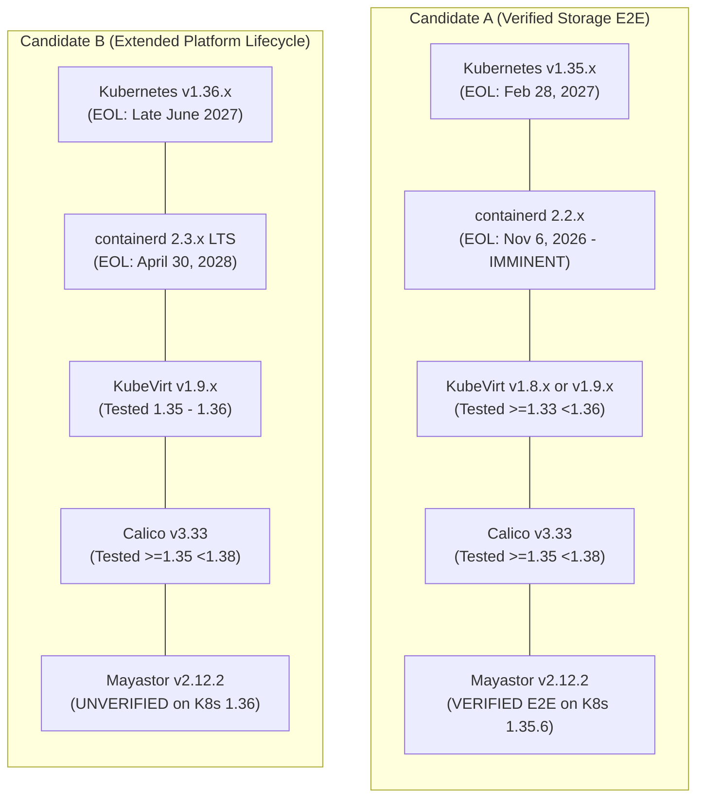

# Software Version Compatibility Matrix & Lifecycle Reassessment

**Project Name:** Deploy High-Performance Storage for Kubernetes  
**Project ID:** SWFW_5S_08  
**Audit Date:** 2026-11-05 (Chunk 1.10 Final Reconciliation)  
**Document Status:** AUDITED TECHNICAL COMPATIBILITY SPECIFICATION  
**Governance Standard:** Zero Fabricated Claims — Upstream Recommendation Matrix & Lifecycle Reconciled  

---

> [!CRITICAL]
> **Chunk 1.10 Key Compatibility & Lifecycle Findings:**  
> 1. **containerd Recommendation Matrix Alignment:** The official containerd Kubernetes recommendation matrix specifies:
>    - Kubernetes 1.35: `containerd` 2.2.0+, 2.1.5+, or 1.7.28+.
>    - Kubernetes 1.36: `containerd` 2.3.0+ or 2.2.0+.
>    - Kubernetes 1.37: `containerd` 2.4.0+ or 2.3.0+.  
>    Therefore, `containerd` 2.3 is **not** the officially recommended pairing for Kubernetes 1.35.
> 2. **containerd 2.2 Lifecycle Boundary:** `containerd` 2.2.x reaches official upstream End-of-Life on **November 6, 2026**.
> 3. **Mayastor 2.12.2 E2E Testing:** Mayastor v2.12.2 (OpenEBS Helm chart v4.7.0) is officially verified via automated E2E testing against **Kubernetes v1.35.6**. It has **not** been tested against Kubernetes v1.36. Compatibility with Kubernetes 1.36 must **never** be inferred from 1.35 tests.
> 4. **Native RWX Block Status:** Retains upstream **EXPERIMENTAL** status in Mayastor v2.12.2.

---

## 1. Upstream Kubernetes Release Lifecycles (Audited November 5, 2026)

Upstream Kubernetes maintains an active support window of approximately 14 months per minor release under a rolling $N-2$ maintenance policy:

| Kubernetes Minor Release | Upstream Release Date | Upstream End-of-Life (EOL) Date | Current Status (Nov 2026) | Compatibility Assessment & Project Stance |
| :--- | :--- | :--- | :--- | :--- |
| **v1.28** | August 2023 | October 22, 2024 | **EOL** | **REJECTED:** Deprecated; unmaintained upstream. |
| **v1.29** | December 2023 | February 2025 | **EOL** | **REJECTED:** Deprecated; unmaintained upstream. |
| **v1.30** | April 2024 | July 15, 2025 | **EOL** | **REJECTED:** Out of community support. |
| **v1.31** | August 2024 | November 11, 2025 | **EOL** | **REJECTED:** Out of community support. |
| **v1.32** | December 2024 | February 28, 2026 | **EOL** | **REJECTED:** Out of community support. |
| **v1.33** | April 2025 | June 28, 2026 | **EOL** | **REJECTED:** Out of community support. |
| **v1.34** | August 2025 | **October 27, 2026** | **EOL** | **REJECTED / REMOVED:** Crossed official upstream EOL boundary. Cannot serve as an approved fallback. |
| **v1.35** | December 2025 | **February 28, 2027** | **ACTIVE (SUPPORTED)** | **CANDIDATE A BASELINE (TIME-LIMITED):** In active community maintenance (~3 months remaining). Verified by Mayastor 2.12.2 E2E. |
| **v1.36** | April 2026 | Late June 2027 | **ACTIVE (SUPPORTED)** | **CANDIDATE B BASELINE:** Active upstream support (~8 months remaining). Supported by containerd 2.3 LTS and KubeVirt 1.9, but unverified by Mayastor E2E. |
| **v1.37** | August 2026 | Late October 2027 | **ACTIVE (LATEST)** | **UNVALIDATED:** Bleeding-edge release. Significant operator qualification lag across both KubeVirt and Mayastor. |

*Official References:* [Kubernetes Releases Schedule](https://kubernetes.io/releases/) | [Kubernetes End of Life Data](https://endoflife.date/kubernetes) (Audited 2026-11-05).

---

## 2. Container Runtime Lifecycle & Official Recommendation Matrix

### 2.1 The Official containerd-Kubernetes Pairing Matrix
Upstream `containerd` publishes specific compatibility and recommendation matrices:

| Kubernetes Release | Officially Recommended containerd Versions | Status of containerd 2.3.x on this K8s Release |
| :--- | :--- | :--- |
| **Kubernetes v1.35** | `containerd` **2.2.0+**, `2.1.5+`, or `1.7.28+` | **Non-Standard Pairing:** Not listed in containerd 1.35 recommendation matrix; backward-compatible with CRI v1, but not officially recommended. |
| **Kubernetes v1.36** | `containerd` **2.3.0+** or `2.2.0+` | **Officially Recommended:** Primary target release pairing. |
| **Kubernetes v1.37** | `containerd` **2.4.0+** or `2.3.0+` | **Supported / Recommended.** |

### 2.2 containerd Upstream Lifecycles
| containerd Version | Upstream Release Date | End-of-Life (EOL) Date | Current Status (Nov 5, 2026) | Compatibility Assessment & Decision |
| :--- | :--- | :--- | :--- | :--- |
| **v1.7.x (LTS)** | March 10, 2023 | **September 30, 2026** | **EOL** | **REJECTED / REMOVED:** Crossed extended support boundary. Insecure for new deployments. |
| **v2.1.x** | September 2025 | June 1, 2026 | **EOL** | **REJECTED:** Superseded. |
| **v2.2.x** | November 6, 2025 | **November 6, 2026** | **IMMINENT EOL (TOMORROW)** | **LIFECYCLE RISK:** Officially recommended for K8s 1.35, but reaches upstream EOL on November 6, 2026. |
| **v2.3.x (LTS)** | April 30, 2026 | **April 30, 2028** | **ACTIVE LTS** | **LONG-TERM CANDIDATE:** Modern enterprise LTS release. Supported through April 2028. Officially recommended for K8s 1.36+. |
| **v2.4.x** | September 16, 2026 | May 15, 2027 | **ACTIVE (REGULAR)** | Short-lived interim release. Less suitable than 2.3 LTS. |

*Official References:* [containerd Releases & Support Horizon](https://containerd.io/releases/) | [containerd End of Life Tracker](https://endoflife.date/containerd) (Audited 2026-11-05).

---

## 3. Mayastor 2.12.2 Release, Chart Mapping & RWX Assessment

### 3.1 Helm Chart Version Mapping
- **OpenEBS Umbrella Helm Chart:** `openebs` chart version **v4.7.0** ([OpenEBS Chart Repository](https://openebs.github.io/charts)).
- **Mayastor Standalone Chart:** `mayastor` chart version **v2.12.2** ([Mayastor Extensions Repository](https://openebs.github.io/mayastor-extensions)).
- **Engine Container Image:** `openebs/mayastor-io-engine:v2.12.2`.
- **CSI Plugin Images:** `openebs/mayastor-csi-controller:v2.12.2` and `openebs/mayastor-csi-node:v2.12.2`.

### 3.2 Kubernetes Version Testing Evidence
- **Verified E2E Testing:** Mayastor v2.12.2 CI/CD automation includes explicit integration and end-to-end (E2E) testing against **Kubernetes v1.35.6** in its GitHub Actions validation suite.
- **Kubernetes v1.36 Status:** Mayastor v2.12.2 **does not include Kubernetes v1.36** in its documented E2E test matrix.
- **Strict Rule:** We do **not** infer Kubernetes 1.36 compatibility from the 1.35.6 E2E test.

### 3.3 Status of Native Mayastor RWX Block Volumes in v2.12.2
- **Upstream Classification:** **EXPERIMENTAL**.
- **Supported Mode:** Strictly raw block mode (`volumeMode: Block`, `accessModes: [ReadWriteMany]`). Filesystem mode (`volumeMode: Filesystem`) is rejected by the CSI driver.
- **Key Enhancements in v2.12.2:**
  - Improved Nexus child device state machine handling during transient multi-attach NVMe-oF reconnection.
  - Enhanced connection timeout resilience in `mayastor-csi-node` when attaching to existing Nexus instances.
- **Limitations:** No in-band distributed lock manager (DLM). Write coordination relies strictly on external hypervisor serialization (QEMU/KubeVirt).

---

## 4. Candidate Combination Evaluation & Trade-Off Analysis

| Evaluation Dimension | Candidate A | Candidate B |
| :--- | :--- | :--- |
| **Kubernetes Version** | `v1.35.x` | `v1.36.x` |
| **Kubernetes Upstream EOL** | February 28, 2027 (~3 months) | Late June 2027 (~8 months) |
| **containerd Version** | `v2.2.x` (or `v2.3 LTS` unrecommended) | **`v2.3.x LTS`** |
| **containerd Upstream EOL** | **November 6, 2026 (Imminent EOL)** | **April 30, 2028 (Enterprise LTS)** |
| **containerd Recommendation Alignment**| Matches containerd matrix for 1.35 (`2.2.0+`) | Matches containerd matrix for 1.36 (`2.3.0+`) |
| **Calico CNI Version** | Calico `v3.33` (Officially tested) | Calico `v3.33` (Officially tested) |
| **KubeVirt Version** | KubeVirt `v1.8.x` or `v1.9.x` (Officially tested) | KubeVirt `v1.9.x` (Officially tested) |
| **Mayastor Storage Version** | OpenEBS `v4.7.0` (Mayastor `v2.12.2`) | OpenEBS `v4.7.0` (Mayastor `v2.12.2`) |
| **Mayastor E2E Verification** | **VERIFIED:** CI runs against K8s **1.35.6** | **UNVERIFIED:** No published 1.36 E2E tests |
| **Primary Architectural Friction** | containerd 2.2 EOL; k8s 1.35 short window | Storage operator qualification lag on k8s 1.36 |
| **Overall Classification** | **STORAGE-VERIFIED CANDIDATE** | **PLATFORM-LIFECYCLE CANDIDATE** |

---

## 5. Qualification Gap & Experimental Qualification Strategy

Neither Candidate A nor Candidate B represents an entirely frictionless, 100% verified stack without qualification gaps:
- In **Candidate A**, the storage data plane and hypervisor are explicitly verified against Kubernetes 1.35.6, but the recommended container runtime (`containerd` 2.2) reaches EOL on November 6, 2026. If `containerd` 2.3 LTS is paired with Kubernetes 1.35, it operates outside containerd's official recommendation table (though CRI v1 protocol compatibility exists).
- In **Candidate B**, the host OS, runtime, and Kubernetes control plane possess extended LTS support (k8s 1.36 + containerd 2.3 LTS), but Mayastor 2.12.2 has not been officially qualified on Kubernetes 1.36.

### The Two-Tier Experimental Qualification Protocol (Chunk 2 Execution)
To maintain complete scientific and engineering integrity:
1. **Primary Experimental Path (Candidate A + containerd 2.3 LTS Qualification):**
   - Bootstrap the cluster with **Kubernetes v1.35.x + containerd 2.3 LTS**.
   - Validate CRI v1 compliance (`crictl info`, pod lifecycle, systemd cgroup v2 integration).
   - Deploy Mayastor v2.12.2 and verify that the CSI driver, `io-engine`, and REST agents function without API deprecation errors on k8s 1.35.
2. **Alternative Experimental Path (Candidate B Qualification):**
   - If institutional policies strictly forbid running Kubernetes 1.35 due to its February 2027 EOL, bootstrap **Kubernetes v1.36.x + containerd 2.3 LTS**.
   - Execute the Mayastor CSI qualification test suite to empirically determine if Mayastor v2.12.2 functions on Kubernetes 1.36.
   - Record all findings as **SIMULATED / EXPERIMENTAL** until verified on hardware.
