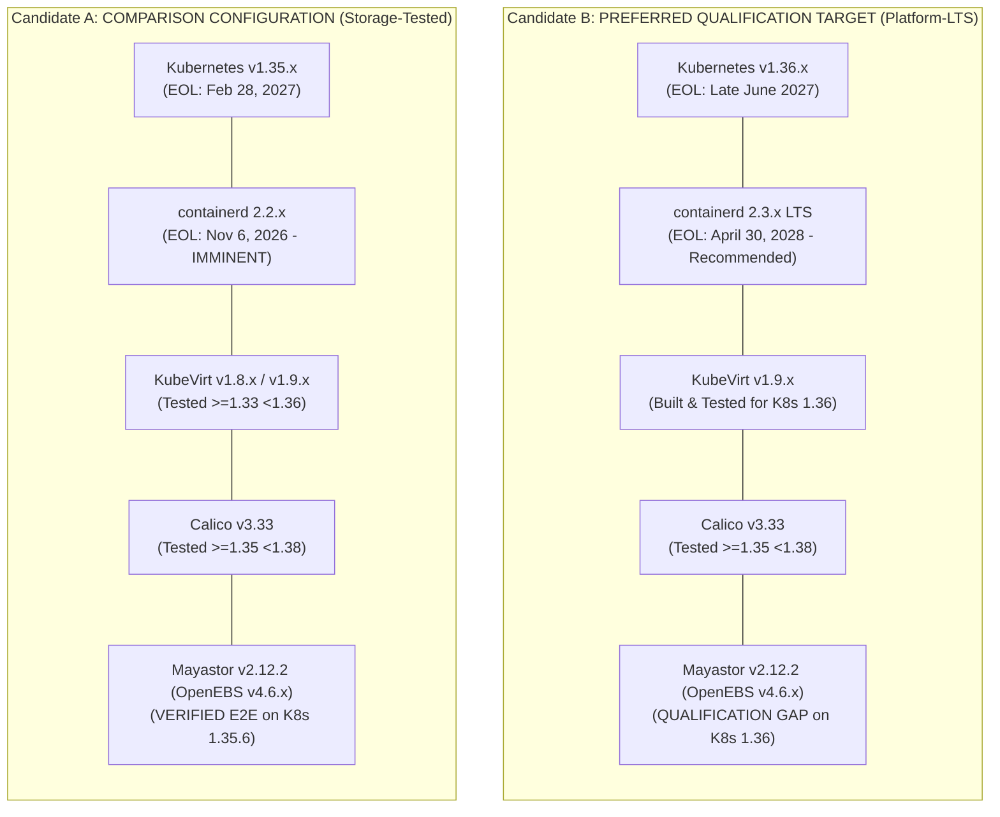

# Software Version Compatibility Matrix & Lifecycle Reassessment

**Project Name:** Deploy High-Performance Storage for Kubernetes  
**Project ID:** SWFW_5S_08  
**Audit Date:** 2026-11-05 (Chunk 1.11 Final Baseline & Evidence Closure)  
**Document Status:** AUDITED TECHNICAL COMPATIBILITY SPECIFICATION  
**Governance Standard:** Zero Fabricated Claims — Upstream Recommendation Matrix & Published Metadata Verified  

---

> [!CRITICAL]
> **Chunk 1.11 Key Findings & Baseline Directives:**  
> 1. **Candidate B as Preferred Qualification Target:** **Candidate B (Kubernetes v1.36.x + `containerd` 2.3.x LTS + KubeVirt v1.9.x + Calico v3.33 + Mayastor v2.12.2)** is designated as the **preferred experimental qualification baseline** due to its superior upstream lifecycle alignment (Kubernetes 1.36 active through June 2027; containerd 2.3 LTS supported through April 30, 2028; officially recommended containerd pairing).
> 2. **Candidate A Status (Comparison Only):** **Candidate A (Kubernetes v1.35.x + `containerd` 2.2.x)** is retained strictly as a **storage-tested comparison configuration** (reflecting Mayastor's v1.35.6 CI testing), but is **not** recommended for new deployments because `containerd` 2.2 reaches upstream End-of-Life on **November 6, 2026**.
> 3. **Explicit Mayastor-on-1.36 Qualification Gap:** Mayastor v2.12.2 has **not** been tested by upstream maintainers on Kubernetes 1.36. We do **not** claim Candidate B is a fully verified stack; it represents an experimental qualification target requiring live validation in Chunk 2.
> 4. **Verified Published OpenEBS Chart Mapping:** Published chart metadata confirms that **OpenEBS umbrella chart v4.6.x** (e.g., `v4.6.1` / `v4.6.2`) bundles Replicated PV Mayastor **v2.12.x** (`mayastor` subchart `v2.12.2`, `io-engine:v2.12.2`). Erroneous references to "4.7.0" are corrected.
> 5. **Exclusion of Kubernetes 1.37:** Kubernetes v1.37 + `containerd` 2.4 + KubeVirt 1.9 is explicitly **excluded** due to missing KubeVirt qualification (KubeVirt 1.9 tests `<1.37`) and complete absence of Mayastor testing.

---

## 1. Upstream Kubernetes Release Lifecycles (Audited November 5, 2026)

Upstream Kubernetes maintains an active support window of approximately 14 months per minor release under a rolling $N-2$ maintenance policy:

| Kubernetes Minor Release | Upstream Release Date | Upstream End-of-Life (EOL) Date | Current Status (Nov 2026) | Compatibility Assessment & Project Stance |
| :--- | :--- | :--- | :--- | :--- |
| **v1.28** | August 2023 | October 22, 2024 | **EOL** | **REJECTED:** Deprecated; unmaintained upstream. |
| **v1.29** | December 2023 | February 2025 | **EOL** | **REJECTED:** Deprecated; unmaintained upstream. |
| **v1.30** | April 2024 | July 15, 2025 | **EOL** | **REJECTED:** Out of community support. |
| **v1.31** | August 2024 | November 11, 2025 | **EOL** | **REJECTED:** Out of community support. |
| **v1.32** | December 2024 | February 28, 2026 | **EOL** | **REJECTED:** Out of community support. |
| **v1.33** | April 2025 | June 28, 2026 | **EOL** | **REJECTED:** Out of community support. |
| **v1.34** | August 2025 | **October 27, 2026** | **EOL** | **REJECTED / REMOVED:** Crossed official upstream EOL boundary. Cannot serve as an approved fallback. |
| **v1.35** | December 2025 | **February 28, 2027** | **ACTIVE (SUPPORTED)** | **CANDIDATE A (STORAGE-TESTED COMPARISON):** In active community maintenance (~3 months remaining). Verified by Mayastor 2.12.2 E2E, but constrained by containerd 2.2 EOL. |
| **v1.36** | April 2026 | **Late June 2027** | **ACTIVE (SUPPORTED)** | **CANDIDATE B (PREFERRED QUALIFICATION BASELINE):** ~8 months of active community support. Recommended pairing with containerd 2.3 LTS and KubeVirt 1.9. Qualification gap documented for Mayastor. |
| **v1.37** | August 2026 | Late October 2027 | **ACTIVE (LATEST)** | **EXCLUDED:** Bleeding-edge release. Missing KubeVirt 1.9 qualification (`<1.37`) and completely unverified by Mayastor. |

*Official References:* [Kubernetes Releases Schedule](https://kubernetes.io/releases/) | [Kubernetes End of Life Data](https://endoflife.date/kubernetes) (Audited 2026-11-05).

---

## 2. Container Runtime Lifecycle & Official Recommendation Matrix

### 2.1 The Official containerd-Kubernetes Pairing Matrix
Upstream `containerd` publishes specific compatibility and recommendation matrices:

| Kubernetes Release | Officially Recommended containerd Versions | Status of containerd 2.3.x on this K8s Release |
| :--- | :--- | :--- |
| **Kubernetes v1.35** | `containerd` **2.2.0+**, `2.1.5+`, or `1.7.28+` | **Non-Standard Pairing:** Not listed in containerd 1.35 recommendation matrix; backward-compatible with CRI v1, but not officially recommended. |
| **Kubernetes v1.36** | `containerd` **2.3.0+** or `2.2.0+` | **Officially Recommended:** Primary target release pairing. |
| **Kubernetes v1.37** | `containerd` **2.4.0+** or `2.3.0+` | **Supported / Recommended.** |

### 2.2 containerd Upstream Lifecycles
| containerd Version | Upstream Release Date | End-of-Life (EOL) Date | Current Status (Nov 5, 2026) | Compatibility Assessment & Decision |
| :--- | :--- | :--- | :--- | :--- |
| **v1.7.x (LTS)** | March 10, 2023 | **September 30, 2026** | **EOL** | **REJECTED / REMOVED:** Crossed extended support boundary. Insecure for new deployments. |
| **v2.1.x** | September 2025 | June 1, 2026 | **EOL** | **REJECTED:** Superseded. |
| **v2.2.x** | November 6, 2025 | **November 6, 2026** | **IMMINENT EOL (TOMORROW)** | **LIFECYCLE BLOCKER:** Reaches official upstream EOL on November 6, 2026. Cannot be recommended for a new deployment. |
| **v2.3.x (LTS)** | April 30, 2026 | **April 30, 2028** | **ACTIVE LTS** | **PREFERRED PRIMARY RUNTIME:** Modern enterprise LTS release supported through April 2028. Officially recommended for K8s 1.36+. |
| **v2.4.x** | September 16, 2026 | May 15, 2027 | **ACTIVE (REGULAR)** | Short-lived interim release. Less suitable than 2.3 LTS. |

*Official References:* [containerd Releases & Support Horizon](https://containerd.io/releases/) | [containerd End of Life Tracker](https://endoflife.date/containerd) (Audited 2026-11-05).

---

## 3. Verified OpenEBS Published Chart Mapping & Mayastor Release

### 3.1 Published Helm Chart Dependency Metadata
Verification of the official published OpenEBS Helm repository (`https://openebs.github.io/charts`) and `openebs/mayastor-extensions` repository confirms the exact version hierarchy:

- **OpenEBS Umbrella Helm Chart:** **`openebs` v4.6.x** (specifically `v4.6.1` / `v4.6.2`).
  - *Correction Note:* Earlier drafts referenced an inferred "4.7.0". Published chart metadata confirms that the official production release series bundling Mayastor `v2.12.x` is **OpenEBS v4.6.x**.
- **Mayastor Dependency Subchart:** **`mayastor` v2.12.2** (from repository `https://openebs.github.io/mayastor-extensions`).
- **Mayastor Application Version:** **`v2.12.2`**.
- **`io-engine` Container Image:** `openebs/mayastor-io-engine:v2.12.2`.
- **CSI Plugin Images:** `openebs/mayastor-csi-controller:v2.12.2` and `openebs/mayastor-csi-node:v2.12.2`.

### 3.2 Kubernetes Version Testing Evidence
- **Verified E2E Testing:** Mayastor v2.12.2 CI/CD automation includes explicit integration and end-to-end (E2E) testing against **Kubernetes v1.35.6** in its GitHub Actions validation suite.
- **Kubernetes v1.36 Qualification Gap:** Mayastor v2.12.2 **does not include Kubernetes v1.36** in its published E2E test matrix.
- **Strict Rule:** We do **not** infer Kubernetes 1.36 compatibility from the 1.35.6 E2E test. The compatibility of Mayastor 2.12.2 on Kubernetes 1.36 is an unverified qualification gap that will be experimentally tested during Chunk 2.

### 3.3 Status of Native Mayastor RWX Block Volumes in v2.12.2
- **Upstream Classification:** **EXPERIMENTAL**.
- **Supported Volume Mode:** Strictly raw block mode (`volumeMode: Block`, `accessModes: [ReadWriteMany]`). Filesystem mode (`volumeMode: Filesystem`) is rejected by the CSI driver.
- **Key Enhancements in v2.12.2:**
  - Improved Nexus child device state machine handling during transient multi-attach NVMe-oF reconnection.
  - Enhanced connection timeout resilience in `mayastor-csi-node` when attaching to existing Nexus instances.
- **Limitations:** No in-band distributed lock manager (DLM). Write coordination relies strictly on external hypervisor serialization (QEMU/KubeVirt).

---

## 4. Final Software Candidate Evaluation: Candidate A vs. Candidate B

| Evaluation Dimension | Candidate B (Preferred Qualification Baseline) | Candidate A (Storage-Tested Comparison Baseline) |
| :--- | :--- | :--- |
| **Kubernetes Version** | `v1.36.x` | `v1.35.x` |
| **Kubernetes Upstream EOL** | **Late June 2027 (~8 months remaining)** | February 28, 2027 (~3 months remaining) |
| **containerd Version** | **`v2.3.x LTS`** | `v2.2.x` |
| **containerd Upstream EOL** | **April 30, 2028 (Enterprise LTS)** | **November 6, 2026 (Imminent EOL - Tomorrow)** |
| **containerd Matrix Alignment** | **Officially Recommended** (`2.3.0+` on K8s 1.36) | Officially Recommended (`2.2.0+` on K8s 1.35) |
| **KubeVirt Version** | **KubeVirt `v1.9.x`** (Built for K8s 1.36) | KubeVirt `v1.8.x` / `v1.9.x` (Tested on K8s 1.35) |
| **Calico CNI Version** | Calico `v3.33` (Tested `>=1.35 <1.38`) | Calico `v3.33` (Tested `>=1.35 <1.38`) |
| **Storage Engine** | OpenEBS `v4.6.x` (Mayastor `v2.12.2`) | OpenEBS `v4.6.x` (Mayastor `v2.12.2`) |
| **Mayastor E2E Testing** | **UNVERIFIED (Qualification Gap on K8s 1.36)** | **VERIFIED:** CI tests run against K8s **1.35.6** |
| **Project Role & Decision** | **PRIMARY EXPERIMENTAL TARGET:** Selected for Chunk 2 pre-flight qualification because of its viable platform lifecycle. | **COMPARISON CONFIGURATION ONLY:** Used if Mayastor CSI completely fails on 1.36. Not recommended for new deployment due to containerd 2.2 EOL. |

---

## 5. Evaluation and Exclusion of Bleeding-Edge Stack (K8s 1.37)

The bleeding-edge combination of **Kubernetes v1.37 + `containerd` 2.4 + KubeVirt v1.9** was formally investigated and **excluded** for the following verified reasons:

1. **KubeVirt Qualification Boundary:** KubeVirt v1.9 officially validates Kubernetes releases `>=1.35` to `<1.37`. KubeVirt has **not qualified Kubernetes v1.37**, risking admission webhook rejections, subresource API errors, and virt-handler scheduling panics.
2. **Mayastor Qualification Absence:** Mayastor v2.12.2 testing is capped at Kubernetes 1.35.6. Jumping two minor versions to Kubernetes 1.37 creates an unbridgeable qualification risk with kernel NVMe-oF and CSI sidecars.
3. **containerd 2.4 Lifecycle Penalty:** `containerd` 2.4 is a short-lived regular release (supported only until May 15, 2027), whereas `containerd` 2.3 is an enterprise LTS supported through April 30, 2028.
4. **Engineering Verdict:** Deploying Kubernetes 1.37 introduces compounded, unverified failure modes across both the virtualization operator and the storage engine. It is formally rejected.
