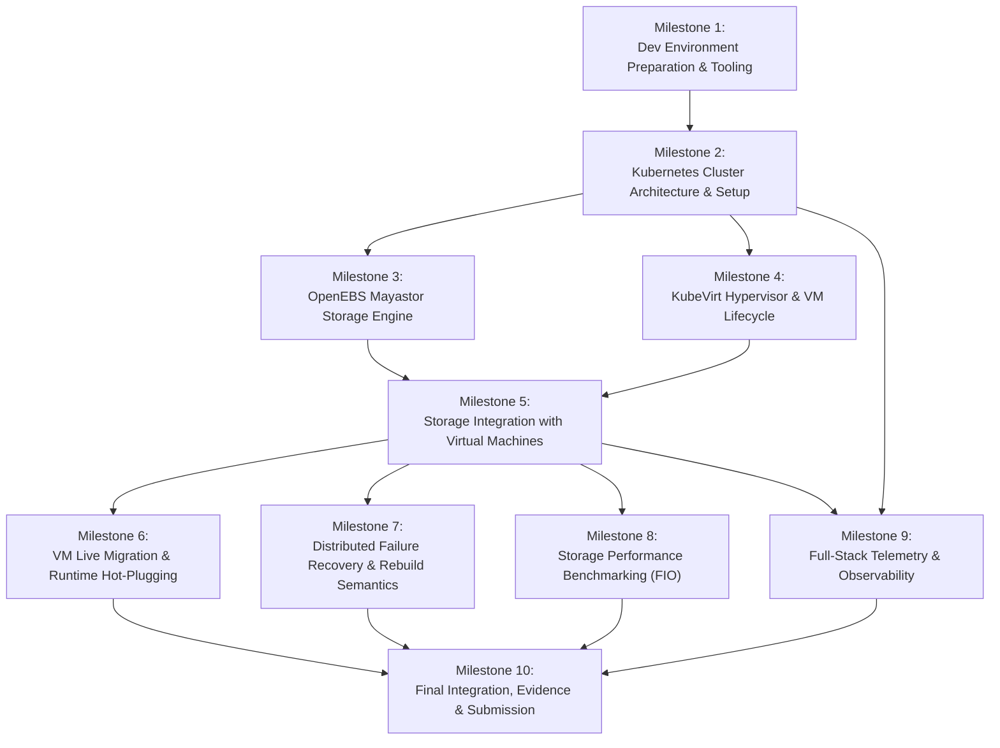

# Project Development Roadmap & Milestone Architecture

**Project Name:** Deploy High-Performance Storage for Kubernetes  
**Project ID:** SWFW_5S_08  
**Program:** Zoho SETU — College Student Project Program  
**Roadmap Version:** 2.0 (Decoupled Comprehensive Execution Architecture)  
**Document Status:** AUTHORITATIVE IMPLEMENTATION ROADMAP  
**Governance Standard:** Zero Fabricated Claims — Realistic Dependency-Preserving Pipeline  

---

> [!IMPORTANT]
> **Implementation Architecture & Strategic Decoupling:**  
> This roadmap structures the complete project implementation into **ten (10) comprehensive, logically consolidated milestones**. To eliminate artificial fragmentation, small tasks are unified into end-to-end execution blocks.
>
> In accordance with the Chunk 2.1 strategy alignment:
> 1. The **complete original technical scope is fully preserved** (Multi-node K8s, Mayastor SPDK, NVMe-oF, KubeVirt, live migration, hot-plugging, failure drills, FIO benchmarks, and full-stack observability).
> 2. College hardware allocation is treated as an **optional resource opportunity** rather than a blocking project gate. Development, manifest generation, schema validation, and local functional tests proceed immediately.
> 3. Every milestone maintains clear distinction between **`IMPLEMENTED`**, **`VALIDATED`**, and **`INFRASTRUCTURE-DEPENDENT`** states.

---

## 1. High-Level Dependency Graph

---

## 2. Comprehensive Milestone Specifications

---

### Milestone 1: Development Environment Preparation & Automated Tooling

- **Objective:** Establish a robust local development and automation toolchain in WSL2 Ubuntu 24.04, ensuring all necessary CLI utilities, linting tools, and non-destructive host pre-flight verification scripts are functional.
- **Task Scope:**
  1. Install client-side CLI tools in WSL2: `kubectl` (v1.36.x / v1.35.x compatible), `helm` (v3.15+), and `virtctl` (v1.9.x).
  2. Configure YAML and bash static analysis linters (`kubeconform`, `yamllint`, `shellcheck`).
  3. Author non-destructive Linux host preflight inspection scripts (`scripts/setup/01-host-preflight.sh`) capable of auditing CPU flags (`sse4_2`, `svm`/`vmx`), `/dev/kvm`, HugePages, and `nvme-tcp` across local or remote target nodes.
  4. Author baseline node preparation scripts (`scripts/setup/02-node-prerequisites.sh`) for kernel module loading (`nvme-tcp`, `vfio_pci`) and HugePage sysctl allocation.
- **Dependencies:** None (operates entirely in local WSL2).
- **Expected Deliverables:**
  - Automated preflight inspection script: [`scripts/setup/01-host-preflight.sh`](../scripts/setup/01-host-preflight.sh).
  - Node prerequisites configuration script: [`scripts/setup/02-node-prerequisites.sh`](../scripts/setup/02-node-prerequisites.sh).
  - Linter configuration files (`.yamllint`, script test harnesses).
- **Verification Criteria:**
  - All shell scripts pass `shellcheck` with zero errors.
  - Preflight script successfully detects WSL2 environment capabilities (AMD Ryzen, 6C/12T, `/dev/kvm`, 3.4 GiB RAM) and logs formatted JSON/text reports.
- **Resource Requirements:** Local development machine + WSL2 Ubuntu 24.04 (< 500 MB disk, < 200 MB RAM).
- **Definition of Done:** Automated preflight script executes cleanly on local WSL2 and is verified ready for deployment against remote target nodes.

---

### Milestone 2: Kubernetes Cluster Architecture & Multi-Node Provisioning

- **Objective:** Design, author, and validate reproducible Kubernetes cluster deployment automation using `kubeadm` v1.36.x (Candidate B preferred qualification target) and containerd 2.3 LTS, alongside a lightweight local single-node cluster harness for offline manifest verification.
- **Task Scope:**
  1. Author parameterized `kubeadm` cluster initialization configuration (`infrastructure/k8s/kubeadm-init-config.yaml`) specifying API server endpoints, pod/service CIDRs, and systemd cgroup driver integration, alongside target `containerd` 2.3.x schema v3 configuration (`infrastructure/k8s/containerd-config-v3.toml`).
  2. Author reproducible cluster bootstrap scripts:
     - Control plane initialization script (`scripts/setup/03-bootstrap-control-plane.sh`).
     - Worker node join script with secure token handling (`scripts/setup/04-join-worker-node.sh`).
  3. Author Calico v3.33.0 pure routed BGP CNI manifests (`infrastructure/k8s/calico/installation.yaml`, `infrastructure/k8s/calico/bgp-configuration.yaml`) and OpenAPI schemas.
  4. Establish a lightweight local single-node test cluster (`k3s v1.36.6+k3s1`) with strictly bounded memory limits (`scripts/setup/dev-cluster-local.sh`) and cluster validation automation (`scripts/validate/validate-kubernetes-cluster.sh`).
- **Dependencies:** Milestone 1 (Linters and CLI tooling).
- **Expected Deliverables:**
  - `kubeadm` configuration: `infrastructure/k8s/kubeadm-init-config.yaml` and `infrastructure/k8s/containerd-config-v3.toml`.
  - Cluster bootstrap automation: `scripts/setup/03-bootstrap-control-plane.sh`.
  - Worker node join script: `scripts/setup/04-join-worker-node.sh`.
  - Calico CNI manifests: `infrastructure/k8s/calico/installation.yaml` and `infrastructure/k8s/calico/bgp-configuration.yaml`.
  - Local dev cluster script: `scripts/setup/dev-cluster-local.sh` and cluster validator `scripts/validate/validate-kubernetes-cluster.sh`.
  - Architecture & deployment docs: `docs/kubernetes-architecture.md`, `docs/kubernetes-deployment-guide.md`, `docs/calico-networking.md`.
- **Verification Criteria:**
  - `kubeadm config validate` and `kubeconform -strict` validate target configurations against Kubernetes v1.36 / Calico v3.33.0 schemas.
  - Local dev cluster starts up within memory bounds (< 2.0 GiB, observed ~341 MiB delta), reports `Ready` node status, passes CoreDNS and Pod scheduling/networking probes.
- **Resource Requirements:**
  - *Local Dev:* Observed ~341 MiB RAM, ~626 MB disk (pre-check enforces $\ge 1500\text{ MiB}$ RAM, $\ge 2\text{ GiB}$ disk).
  - *Production Target:* 4 physical nodes (1 Control Plane + 3 Workers) on Layer-2 network.
- **Definition of Done:** Cluster manifests syntactically validated; local K3s dev cluster verified; multi-node bootstrap scripts tested in WSL2 refusal guard and staged for target hardware. (**Status: `COMPLETED` 2026-11-11**).

---

### Milestone 3: OpenEBS Mayastor Storage Engine Deployment & Volume Provisioning

- **Objective:** Deploy and configure the OpenEBS Mayastor distributed storage engine (subchart v2.12.2 from published OpenEBS chart v4.6.x), establish DiskPool custom resources, and configure storage classes.
- **Task Scope:**
  1. Configure OpenEBS Helm values file (`storage/mayastor/values.yaml`) pinning Mayastor v2.12.2 images, reserving 2 dedicated SPDK busy-polling cores per worker, setting 2 GiB HugePage requests, and setting `--faulted-child-wait-period=10m`.
  2. Author Helm release deployment script (`scripts/setup/05-deploy-mayastor.sh`).
  3. Author Mayastor `DiskPool` custom resource manifests (`storage/mayastor/diskpool-definitions.yaml`) for Worker 1, Worker 2, and Worker 3 with dedicated raw block devices.
  4. Author StorageClass definitions for 3-way synchronous replication (`storage/mayastor/storageclasses.yaml`):
     - `mayastor-nvme-r3-block` (`volumeMode: Block`, `repl: 3`).
     - `mayastor-nvme-r3-fs` (`volumeMode: Filesystem`, `repl: 3`).
     - `mayastor-nvme-r1-dev` (Single replica for constrained local/testing environments).
  5. Author automated PersistentVolumeClaim (PVC) provisioning and validation tests (`tests/storage-provisioning-test.sh`).
- **Dependencies:** Milestone 2 (Running Kubernetes API).
- **Expected Deliverables:**
  - Mayastor Helm values: `storage/mayastor/values.yaml`.
  - Deployment automation: `scripts/setup/05-deploy-mayastor.sh`.
  - DiskPool definitions: `storage/mayastor/diskpool-definitions.yaml`.
  - StorageClass manifests: `storage/mayastor/storageclasses.yaml`.
  - Volume provisioning test suite: `tests/storage-provisioning-test.sh`.
- **Verification Criteria:**
  - Helm templates render valid Kubernetes manifests without errors (`helm template`).
  - StorageClass parameters adhere to Mayastor CSI specification (`io.openebs.csi-mayastor`).
  - PVC test script generates valid Block and Filesystem PVC manifests.
- **Resource Requirements:**
  - *Local Dev:* Configuration and schema linting.
  - *Target Cluster:* 3 storage workers with 2 cores dedicated, 2 GiB HugePages, dedicated raw SSD/NVMe.
- **Definition of Done:** Complete storage configuration implemented; Helm chart values audited; volume provisioning test harness ready for cluster execution.

---

### Milestone 4: KubeVirt Virtualization Stack Integration & VM Lifecycle

- **Objective:** Deploy the KubeVirt virtualization operator, validate hardware KVM pass-through (`/dev/kvm`), deploy the Containerized Data Importer (CDI), and implement declarative virtual machine lifecycle management.
- **Task Scope:**
  1. Author KubeVirt operator and custom resource manifests (`kubevirt/operator/kubevirt-operator.yaml`, `kubevirt-cr.yaml`) pinning v1.9.x.
  2. Author CDI operator and storage manifests (`kubevirt/operator/cdi-operator.yaml`, `cdi-cr.yaml`) pinning v1.61.x.
  3. Author base virtual machine manifests (`kubevirt/vms/`):
     - `micro-vm-cirros.yaml`: 256 MB RAM lightweight test VM for local functional validation.
     - `production-vm-ubuntu.yaml`: 4 GiB RAM, 2 vCPU Ubuntu 24.04 server VM with cloud-init configuration.
  4. Author VM lifecycle automation scripts (`scripts/vm/vm-lifecycle-manager.sh`) providing start, stop, restart, console, and status operations via `virtctl`.
  5. Validate local hardware KVM integration using the confirmed `/dev/kvm` device in WSL2.
- **Dependencies:** Milestone 2 (Running Kubernetes API).
- **Expected Deliverables:**
  - KubeVirt & CDI operator manifests: `kubevirt/operator/`.
  - Declarative VM manifests: `kubevirt/vms/micro-vm-cirros.yaml`, `kubevirt/vms/production-vm-ubuntu.yaml`.
  - Cloud-init user-data and network-data templates: `kubevirt/cloud-init/`.
  - VM lifecycle management script: `scripts/vm/vm-lifecycle-manager.sh`.
- **Verification Criteria:**
  - KubeVirt CRD schemas pass validation.
  - Local micro-VM launches successfully in local dev cluster using `/dev/kvm` hardware acceleration.
  - `virtctl` commands interact cleanly with the VM API.
- **Resource Requirements:**
  - *Local Dev:* 512 MB – 1.0 GiB RAM for lightweight CirrOS VM with `/dev/kvm`.
  - *Target Cluster:* Full 4 GiB Ubuntu VM on dedicated worker node.
- **Definition of Done:** KubeVirt manifests deployed and verified; local test VM boots with hardware KVM acceleration; management scripts operational.

---

### Milestone 5: Storage Subsystem Integration with Virtual Machines

- **Objective:** Interconnect OpenEBS Mayastor persistent volumes with KubeVirt guest virtual machines, establishing direct raw block attachment and comparative shared filesystem attachment.
- **Task Scope:**
  1. Implement direct NVMe raw block attachment (`volumeMode: Block`, `accessModes: [ReadWriteOnce]`) mapping Mayastor persistent volumes directly to KubeVirt guest VM `virtio-scsi` disks (`kubevirt/vms/vm-mayastor-block-direct.yaml`).
  2. Implement the Clustered NFS Gateway fallback tier (`storage/nfs-gateway/`):
     - Deploy NFS Ganesha gateway pod mounting Mayastor RWO volume (`nfs-server-deployment.yaml`).
     - Configure `csi-driver-nfs` v4.9.0 provisioner and RWX StorageClass (`nfs-storageclass.yaml`).
     - Bind VM disks over NFS filesystem RWX (`kubevirt/vms/vm-nfs-rwx.yaml`).
  3. Implement Native Mayastor RWX Block volume integration (`kubevirt/vms/vm-mayastor-rwx-native.yaml`) using experimental multi-attach support.
  4. Author in-guest I/O sanity test harness (`tests/vm-storage-sanity.sh`) checking guest block device recognition (`lsblk`), filesystem mounting, and data integrity.
- **Dependencies:** Milestone 3 (Mayastor Storage Engine) and Milestone 4 (KubeVirt).
- **Expected Deliverables:**
  - Direct block VM manifest: `kubevirt/vms/vm-mayastor-block-direct.yaml`.
  - Clustered NFS Gateway manifests: `storage/nfs-gateway/`.
  - Native RWX block VM manifest: `kubevirt/vms/vm-mayastor-rwx-native.yaml`.
  - Storage integration test suite: `tests/vm-storage-sanity.sh`.
- **Verification Criteria:**
  - Guest VM mounts block device as virtio disk without kernel warnings.
  - Comparative 3-tier storage architecture is fully realized in declarative YAML.
- **Resource Requirements:**
  - *Local Dev:* Manifest generation, NFS gateway local testing, schema validation.
  - *Target Cluster:* Multi-node storage attachment across Worker 1 and Worker 2.
- **Definition of Done:** All 3 storage integration tiers configured, verified syntactically, and validated via storage test harness.

---

### Milestone 6: Virtual Machine Live Migration & Runtime Resource Hot-Plugging

- **Objective:** Implement and validate cross-node virtual machine live migration across both native RWX block and NFS tiers, accompanied by dynamic runtime hot-plugging of vCPU, memory, persistent storage, and network interfaces.
- **Task Scope:**
  1. Author KubeVirt `VirtualMachineInstanceMigration` (KVIM) manifests and migration policies (`kubevirt/migration/migration-policies.yaml`) configuring bandwidth limits, max downtime, and parallel migration streams.
  2. Implement the **Evidence-Based Single-Writer Live Migration Verification Harness** (`tests/migration/test-single-writer-concurrency.py`):
     - Implements 512-byte fixed binary record format with atomic sequence counter, writer epoch, and CRC32C checksums.
     - Collects QEMU QMP `STOP`/`RESUME` events, KubeVirt CRD status, and Mayastor multi-attach logs.
     - Evaluates the **6-Scenario Test Suite** (Clean, Cancel/Retry, Source Crash, Partition, Target Eviction, Concurrency Audit).
  3. Implement the Clustered NFS Gateway fallback live-migration comparison test.
  4. Implement dynamic runtime resource hot-plugging automation (`scripts/hotplug/`):
     - vCPU hot-plug test (`test-cpu-hotplug.sh` via `virtctl`).
     - Memory dynamic expansion test (`test-memory-hotplug.sh`).
     - Storage secondary volume hot-plug test (`test-volume-hotplug.sh` via `virtctl addvolume`).
     - Network interface hot-plug test (`test-nic-hotplug.sh` via dynamic interface binding).
  5. Author guest-side verification scripts auditing Linux guest kernel response (`/sys/devices/system/cpu`, `/sys/devices/system/memory`).
- **Dependencies:** Milestone 5 (Storage & VM Integration).
- **Expected Deliverables:**
  - Live migration manifests & policies: `kubevirt/migration/`.
  - Single-writer verification harness: `tests/migration/test-single-writer-concurrency.py`.
  - 6-Scenario test runner: `tests/migration/run-migration-suite.sh`.
  - Dynamic hot-plug automation scripts: `scripts/hotplug/`.
- **Verification Criteria:**
  - Single-writer verification harness passes unit tests on synthetic binary streams (verifying sequence gap, duplicate, stale, and torn write detection).
  - Hot-plug scripts validate syntax against `virtctl` subresource specifications.
- **Resource Requirements:**
  - *Local Dev:* Harness unit testing and local lightweight hot-plug execution.
  - *Target Cluster:* 2+ active worker nodes (Worker 1 $\rightarrow$ Worker 2) with 32 GB RAM recommended.
- **Definition of Done:** Single-writer verification harness operational; hot-plug scripts completed; live-migration test suite ready for execution.

---

### Milestone 7: Distributed Storage Failure Recovery & Replica Rebuild Drills

- **Objective:** Systematically test and benchmark Mayastor's distributed fault tolerance, replica degradation states, partial rebuild write-log replaying, and full rebuild mechanisms under controlled failure drills.
- **Task Scope:**
  1. Author fault-injection and recovery automation scripts (`scripts/fault-injection/`):
     - Disk pulling simulation (`simulate-disk-failure.sh`).
     - Storage worker network partition injection via iptables (`simulate-network-partition.sh`).
     - Worker node abrupt termination and reboot drill (`simulate-node-crash.sh`).
  2. Implement volume health monitoring scripts tracking Nexus state (`Online` $\rightarrow$ `Degraded` $\rightarrow$ `Rebuilding` $\rightarrow$ `Online`).
  3. Validate partial rebuild mechanics within the `--faulted-child-wait-period` window (10 minutes) vs. full rebuild triggers.
  4. Measure client I/O latency impact and throughput degradation during active background replica rebuilds.
  5. Verify Mayastor 3-node anti-affinity barrier behavior when 1 node is lost in an $N=3$ cluster.
- **Dependencies:** Milestone 3 (Mayastor) and Milestone 5 (Storage VM Integration).
- **Expected Deliverables:**
  - Fault injection test suite: `scripts/fault-injection/`.
  - Rebuild tracking and telemetry logger: `scripts/fault-injection/track-rebuild-status.sh`.
  - Failure recovery test runbook and analysis: `docs/failure-recovery-runbook.md`.
- **Verification Criteria:**
  - Scripts execute non-destructively with clear dry-run and safety checks.
  - Automated assertions verify zero data loss (RPO = 0) and volume recovery semantics.
- **Resource Requirements:**
  - *Local Dev:* Script authoring, dry-run validation, and documentation.
  - *Target Cluster:* 3 storage worker nodes with physical disks.
- **Definition of Done:** Fault injection harness implemented with safety gates; rebuild monitoring operational; failure recovery runbook documented.

---

### Milestone 8: Comprehensive Storage Performance Benchmarking (FIO Matrix)

- **Objective:** Execute standardized, reproducible empirical storage benchmarks across all infrastructure layers using Flexible I/O Tester (`fio`), measuring IOPS, throughput (MB/s), and tail latency percentiles ($p_{50}, p_{95}, p_{99}, p_{99.9}$).
- **Task Scope:**
  1. Author standardized FIO job profiles (`benchmarks/fio/profiles/`):
     - `4k-randread.fio`, `4k-randwrite.fio`, `4k-randrw-70-30.fio`.
     - `64k-seqread.fio`, `64k-seqwrite.fio`.
     - `1m-bandwidth.fio`.
     - Configurations enforce `direct=1`, asynchronous engines (`ioengine=libaio` or `io_uring`), runtime $\ge 120\text{s}$, and 30s warmup.
  2. Author multi-tier benchmarking orchestration script (`benchmarks/scripts/run-fio-suite.sh`):
     - Tier A: Raw Host Physical NVMe Disk (Baseline Control).
     - Tier B: Container Volume backed by Mayastor RWO (No VM overhead).
     - Tier C: KubeVirt Guest VM backed by Mayastor RWO Direct Block.
     - Tier D: KubeVirt Guest VM backed by Mayastor Native RWX Block.
     - Tier E: KubeVirt Guest VM backed by Clustered NFS Gateway RWX.
  3. Implement automated JSON parser and result aggregator (`benchmarks/scripts/parse-fio-results.py`) extracting IOPS, bandwidth, and latency distributions.
  4. Quantify the "Hypervisor Tax" (Tier B vs. Tier C) and the "NFS Translation Tax" (Tier D vs. Tier E).
- **Dependencies:** Milestone 5 (Storage & VM Integration).
- **Expected Deliverables:**
  - Standardized FIO job profiles: `benchmarks/fio/profiles/`.
  - Automated benchmark runner: `benchmarks/scripts/run-fio-suite.sh`.
  - Result extraction and aggregation script: `benchmarks/scripts/parse-fio-results.py`.
  - Benchmark methodology and profiles runbook: `benchmarks/README.md`.
- **Verification Criteria:**
  - FIO job profiles pass syntax validation against `fio --showcmd`.
  - JSON parser correctly processes sample output and generates structured summary tables.
- **Resource Requirements:**
  - *Local Dev:* Job file authoring, syntax checking, parser development.
  - *Target Cluster:* High-speed NVMe storage and dedicated SPDK worker nodes for official metrics.
- **Definition of Done:** FIO profiles standardized; benchmark automation script validated; parser and reporting pipelines operational.

---

### Milestone 9: Full-Stack Telemetry, Monitoring & Observability

- **Objective:** Deploy an integrated Prometheus and Grafana monitoring stack configured to scrape Mayastor SPDK performance counters, KubeVirt hypervisor metrics, and host operating system resources in real time.
- **Task Scope:**
  1. Author `kube-prometheus-stack` Helm values (`monitoring/prometheus/values.yaml`) configuring internal scrape targets, custom storage ServiceMonitors, and retention policies.
  2. Configure Mayastor SPDK metrics exporter (`TCP 9502`) ServiceMonitor (`monitoring/prometheus/mayastor-servicemonitor.yaml`).
  3. Configure KubeVirt metrics server ServiceMonitor (`monitoring/prometheus/kubevirt-servicemonitor.yaml`).
  4. Author custom Grafana dashboards (`monitoring/grafana/dashboards/`):
     - `mayastor-storage-performance.json`: Volume IOPS, latency histograms, DiskPool utilization, and SPDK core saturation.
     - `kubevirt-vm-telemetry.json`: Guest CPU utilization, memory ballooning, virtio-scsi queue depths, and live migration progress.
     - `cluster-node-resources.json`: Host CPU, memory pressure, HugePage allocations, and network interface throughput.
  5. Enforce security isolation: monitoring endpoints restricted to internal management network only (no public exposure).
- **Dependencies:** Milestone 2 (Kubernetes API), Milestone 3 (Mayastor), and Milestone 4 (KubeVirt).
- **Expected Deliverables:**
  - Prometheus Helm configuration: `monitoring/prometheus/values.yaml`.
  - Mayastor & KubeVirt ServiceMonitors: `monitoring/prometheus/`.
  - Custom Grafana dashboard JSON models: `monitoring/grafana/dashboards/`.
  - Observability deployment automation: `scripts/setup/06-deploy-monitoring.sh`.
- **Verification Criteria:**
  - Prometheus custom resources (ServiceMonitor) validate against Prometheus Operator CRDs.
  - Grafana dashboard JSON schemas validate against Grafana schema definitions.
  - Dashboards can be rendered and viewed locally in Grafana.
- **Resource Requirements:**
  - *Local Dev:* Dashboard JSON modeling and local Grafana container viewing.
  - *Target Cluster:* Live Prometheus scraping across all 4 cluster nodes.
- **Definition of Done:** All ServiceMonitors authored; 3 custom Grafana dashboards developed; deployment automation operational.

---

### Milestone 10: Final System Integration, Evidence Collection & Submission Documentation

- **Objective:** Execute the complete end-to-end integration test suite, aggregate empirical benchmark results into publication-grade graphs and tables, author the comprehensive student engineering final project report, and assemble the viva examination defense kit.
- **Task Scope:**
  1. Author master end-to-end integration verification test runner (`tests/run-all-integration-tests.sh`).
  2. Generate empirical performance comparison charts (IOPS vs. Block Size, Latency vs. Queue Depth, Live Migration Handover Time, and Degraded Rebuild Throughput) using Matplotlib/Seaborn (`reports/generate-charts.py`).
  3. Author comprehensive Final Project Technical Report (`reports/final-project-report.md`) detailing problem statement, system architecture, empirical findings, and architectural conclusions.
  4. Update student engineering study notes and viva defense reference (`LEARNING_NOTES.md`) covering SPDK internals, NVMe-oF protocol capsules, live migration synchronization invariants, and distributed storage fault tolerance.
  5. Finalize repository state: update `PROJECT_STATE.md` to 100% completion, ensure all test logs and artifacts are properly archived, and verify clean Git history.
- **Dependencies:** Milestones 1 through 9.
- **Expected Deliverables:**
  - Master integration test suite: `tests/run-all-integration-tests.sh`.
  - Automated chart generation tool: `reports/generate-charts.py`.
  - Publication-grade Final Project Report: `reports/final-project-report.md`.
  - Complete Viva Defense & Learning Guide: `LEARNING_NOTES.md`.
  - Synchronized repository state: `PROJECT_STATE.md`.
- **Verification Criteria:**
  - All automated test suites execute with zero failures or explicitly documented hardware exemptions.
  - All graphs, data tables, and diagrams are rendered and verified.
  - Documentation is comprehensive, grammatically sound, and adheres strictly to the zero-fabrication standard.
- **Resource Requirements:** Full repository workspace and harvested benchmark logs.
- **Definition of Done:** Project is 100% complete, fully documented, backed by concrete evidence, and ready for official academic submission and viva defense.

---

## 3. Milestone Execution Summary Table

| Milestone | Title & Functional Area | Local Development Scope | Target Infrastructure Scope | Primary Deliverables | Target Phase |
| :---: | :--- | :--- | :--- | :--- | :---: |
| **M1** | **Dev Environment & Tooling** | Full execution (WSL2 tools, linters, preflight) | Remote preflight execution | `01-host-preflight.sh`, linters | Phase 2 |
| **M2** | **Kubernetes Cluster Setup** | Schema linting, local dev cluster harness | 4-node `kubeadm` bootstrap | `kubeadm-init-config.yaml`, Calico BGP | Phase 2 |
| **M3** | **Mayastor Storage Engine** | Helm values (`openebs 4.6.2` / `2.12.2`), `DiskPool v1beta3` schema, StorageClasses, prereq/deploy/validation scripts & docs (`COMPLETED 2026-11-11`) | Live 3-worker SPDK deployment & NVMe-oF I/O | `values.yaml`, `diskpools.yaml`, `storageclasses.yaml`, `05-deploy-mayastor.sh` | Phase 2 |
| **M4** | **KubeVirt & VM Lifecycle** | KubeVirt `v1.9.1`, CDI `v1.66.1`, strict CRD schemas, `/dev/kvm` preflight & refusal gates (`COMPLETED 2026-11-11`) | Production Ubuntu 24.04 KVM VM workloads | `kubevirt-cr.yaml`, `cdi-cr.yaml`, `06-deploy-kubevirt.sh` | Phase 2 |
| **M5** | **Storage & VM Integration** | RWO FS, RWO Block, Default NFS RWX (`csi-driver-nfs v4.9.0`), Opt-In Exp RWX Block & cloud-init (`COMPLETED 2026-11-11`) | Multi-tier NVMe-oF & NFS VM storage attachment | `kubevirt/virtualmachines/`, `storage/nfs/`, `07-deploy-vm-examples.sh` | Phase 2 |
| **M6** | **Live Migration & Hot-Plug** | Default NFS RWX & Opt-In RWX MigrationPolicy/VMIM, CPU/Memory/Disk hot-plug specs & runners (`CORE IMPLEMENTED 2026-11-11`; Multus NIC hot-plug pending) | Multi-node live migration & hot-plug validation | `migration-policy.yaml`, `vm-ubuntu-hotplug-ready.yaml`, `validate-live-migration.sh`, `validate-vm-hotplug.sh` | Phase 3 |
| **M7** | **Failure Recovery & Rebuild** | `resilience-scenarios.yaml`, SHA-256 verifier, event observer, drill harness dry-run & WSL2 refusal (`COMPLETED 2026-11-11`) | Live `io-engine-restart`, cordon, & pool recovery drills | `validate-storage-resilience.sh`, `scripts/tests/storage/*`, `docs/storage-resilience.md` | Phase 3 |
| **M8** | **FIO Benchmarking Matrix** | 6 FIO profiles (`--parse-only`), `matrix-config.yaml`, safety checks, `summarize-results.py` & `unittest` (`COMPLETED 2026-11-11`) | Multi-tier bare-metal NVMe/Mayastor/NFS benchmarking | `benchmarks/fio/*.fio`, `run-fio-benchmarks.sh`, `summarize-results.py` | Phase 3 |
| **M9** | **Full-Stack Observability** | `kube-prometheus-stack v93.2.0` configs, `promtool v3.16.0` check config/rules, CRD schemas, 3 dashboards (`COMPLETED 2026-11-11`) | Live ClusterIP Prometheus scraping & Grafana dashboards | `monitoring/*`, `08-deploy-monitoring.sh`, `validate-observability.sh` | Phase 3 |
| **M10**| **Final Integration & Report** | 9-stage demo orchestrator, 5 Mermaid diagrams (`docs/diagrams/`), Final Report (A–O), 15-slide `.pptx`, Submission Checklist & Three-State Status (`COMPLETED 2026-11-11`) | Live end-to-end target demonstration & bare-metal charts | `Zoho_SETU_High_Performance_Kubernetes_Storage_Report.md`, `Zoho_SETU_Project_Presentation.pptx` | Phase 4 |
