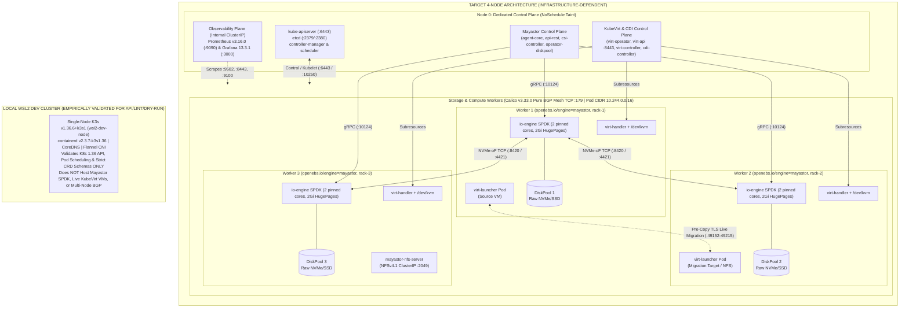

# Diagram 01 — Overall Four-Node Kubernetes Architecture

**Project:** Deploy High-Performance Storage for Kubernetes (`SWFW_5S_08`)  
**Architecture Distinction:**  
- **Top Topology (`INFRASTRUCTURE-DEPENDENT` Target Cluster):** Four Ubuntu Server `24.04 LTS` nodes (`kubeadm v1.36.6`, `containerd 2.3.x LTS`, `Calico v3.33.0` Pure BGP, OpenEBS `4.6.2` / Mayastor `v2.12.2`, KubeVirt `v1.9.1`, `kube-prometheus-stack v93.2.0`).  
- **Bottom Box (`VALIDATED` Local Dev Cluster):** Single-node K3s `v1.36.6+k3s1` (`containerd v2.3.7-k3s1.36`, Flannel CNI) validated on WSL2 Ubuntu `24.04.4 LTS` (`3515 MiB` RAM, zero HugePages, zero raw NVMe devices).

