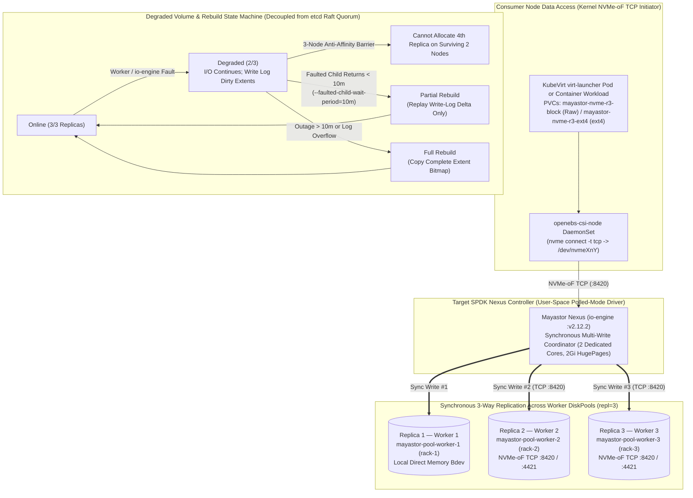

# Diagram 02 — Mayastor Storage Architecture, Replication & Rebuild Flow

**Project:** Deploy High-Performance Storage for Kubernetes (`SWFW_5S_08`)  
**Scope Notice:** OpenEBS `4.6.2` / Mayastor `v2.12.2` configuration, `DiskPool v1beta3` schemas, StorageClasses, and safety gates are `IMPLEMENTED` and statically `VALIDATED`; SPDK data-plane execution and replica rebuilds are **`INFRASTRUCTURE-DEPENDENT`** (target `>=3` NVMe workers).

