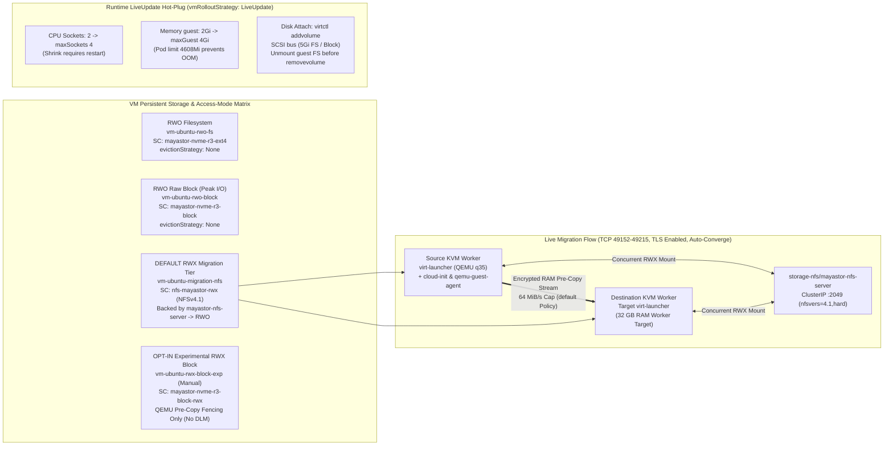

# Diagram 03 — KubeVirt VM Storage Tiers, Live Migration & Hot-Plugging

**Project:** Deploy High-Performance Storage for Kubernetes (`SWFW_5S_08`)  
**Scope Notice:** Manifests (`KubeVirt v1.9.1`, `CDI v1.66.1`, `csi-driver-nfs v4.9.0`), strict CRD schemas, and `--dry-run` checks are `VALIDATED`; live VM boot, cross-node migration, and live hot-plug mutations remain **`INFRASTRUCTURE-DEPENDENT`**.

