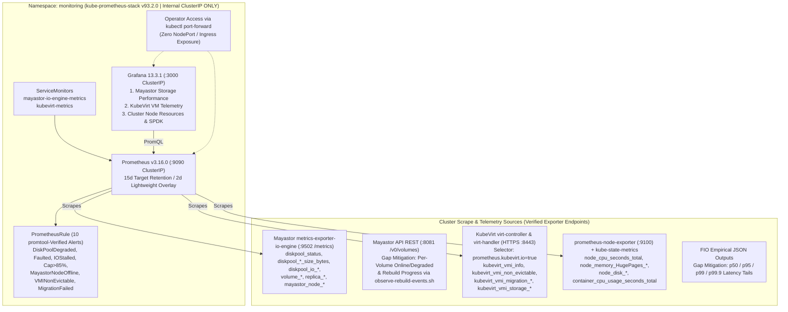

# Diagram 04 — Monitoring & Observability Architecture

**Project:** Deploy High-Performance Storage for Kubernetes (`SWFW_5S_08`)  
**Scope Notice:** `promtool v3.16.0` config/rules validation, `monitoring.coreos.com/v1` CRD schemas, and 3 Grafana dashboard JSONs are `VALIDATED`; live cluster scraping and UI rendering remain **`INFRASTRUCTURE-DEPENDENT`**.

