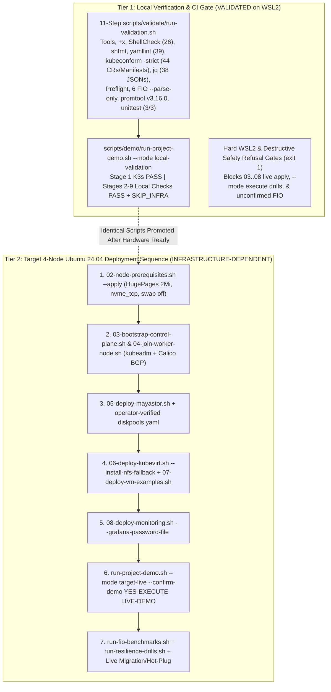

# Diagram 05 — Project Deployment, Validation & End-to-End Demo Workflow

**Project:** Deploy High-Performance Storage for Kubernetes (`SWFW_5S_08`)  
**Scope Notice:** All 11 `run-validation.sh` checks, 9-stage `run-project-demo.sh --mode local-validation`, and WSL2 refusal gates passed on WSL2 (`v1.36.6+k3s1`); full `target-live` deployment requires multi-node Ubuntu hardware.

