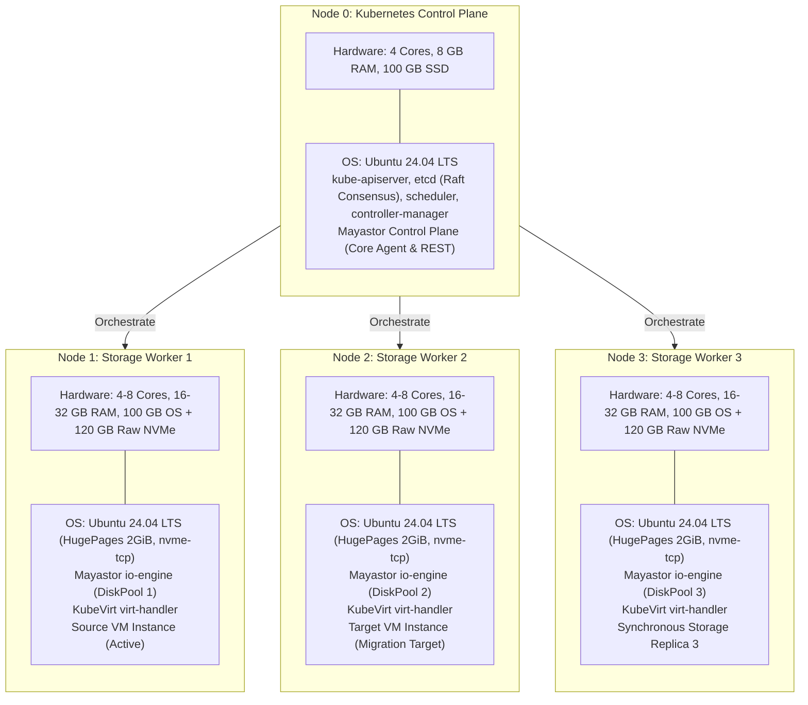

# Final Target Deployment Architecture Proposal

**Project Name:** Deploy High-Performance Storage for Kubernetes  
**Project ID:** SWFW_5S_08  
**Proposal Date:** 2026-11-05 (Reassessed & Corrected)  
**Document Status:** PROPOSED (Target Engineering Architecture)  
**Governance Standard:** Zero Fabricated Claims — Research-Backed Proposal  

---

> [!IMPORTANT]
> **Engineering Rigor & Lifecycle Standard:**  
> This proposal consolidates the findings of Chunk 1 and Chunk 1.8 infrastructure discovery, software lifecycle research, native Mayastor RWX block investigations, and worker node resource budgeting. All capabilities are labeled as **PROPOSED** or **DOCUMENTED**. No capability is claimed as **DEPLOYMENT VERIFIED** until experimentally executed on live target nodes.

---

## 1. Executive Deployment Specification

| Architectural Component | Selected Target Specification | Technical Classification | Engineering Justification & Upstream Validation |
| :--- | :--- | :--- | :--- |
| **Cluster Topology** | 4 Dedicated Nodes (1 Control Plane + 3 Storage Workers) | **PROPOSED** | Provides 3-way synchronous volume replication, worker node failure tolerance, and cross-node VM live migration domains. |
| **Host Operating System** | Ubuntu Server 24.04 LTS (Noble Numbat) | **DOCUMENTED** | Official enterprise LTS release; ships with modern Linux 6.8 kernel, systemd cgroup v2, and optimized `nvme-tcp` and `/dev/kvm` drivers. |
| **Linux Kernel** | 6.8.0 LTS | **DOCUMENTED** | Exceeds Mayastor minimum ($\ge$5.15); delivers improved NVMe-oF multipath handling and KVM memory mapping efficiency. |
| **Cluster Bootstrapper** | `kubeadm` v1.35.x (or v1.34.x fallback) | **DOCUMENTED** | Standard upstream cluster provisioning tool; deterministic, scriptable, and reproducible across bare-metal environments. |
| **Kubernetes Version** | **Kubernetes v1.35.x (Fallback: v1.34.x)** | **PROPOSED** | In active upstream support in late 2026 (EOL Feb 2027). Replaces deprecated EOL v1.28/v1.29 baselines. |
| **Container Runtime** | `containerd` v1.7.22 (LTS) | **DOCUMENTED** | Stable LTS runtime branch using the `systemd` cgroup driver; avoids breaking CRI changes present in containerd v2.x. |
| **Cluster CNI Plugin** | Calico v3.28.2 / v3.29.0 | **DOCUMENTED** | Pure routed pod networking without VXLAN encapsulation penalty; maximizes storage wire throughput and simplifies MTU tuning. |
| **Distributed Storage Engine**| **OpenEBS v4.6.x (Mayastor v2.11+)** | **DOCUMENTED / PROPOSED** | User-space SPDK engine running lockless polling loops; NVMe-oF over TCP data transport; synchronous multi-replica volume management; **supports native experimental RWX block volumes**. |
| **Virtualization Engine** | **KubeVirt v1.8.x + CDI v1.61.x** | **DOCUMENTED** | Cloud-native virtualization operator managing QEMU/KVM virtual machines inside Kubernetes pods with hardware `/dev/kvm` acceleration. Supports K8s 1.33–1.35. |
| **Secondary Network Plugin** | Multus CNI v4.1.2 | **DOCUMENTED** | In-process CNI meta-plugin invoked via local domain socket; enables attaching secondary virtual network interfaces to running KubeVirt guest VMs. |
| **Shared Storage Mechanism** | **Comparative Dual-Path:** Native Mayastor RWX Block (Primary) + Clustered NFS Gateway (Fallback) | **PROPOSED** | Evaluates native Mayastor RWX block volumes for live migration while retaining an NFS gateway (via `csi-driver-nfs` v4.9.0) as the conservative fallback baseline. |
| **Observability Suite** | `kube-prometheus-stack` v62.x + Grafana v11.x | **DOCUMENTED** | Real-time Prometheus scraping of Mayastor SPDK metrics, KubeVirt hypervisor metrics, and node I/O stats visualized on Grafana dashboards. |

---

## 2. Target Node Specifications & Resource Dimensioning

### Worker Node Sizing Standards
- **Baseline Idle Infrastructure Overhead:** **~8.5 GiB RAM** (OS kernel 2 GiB + K8s/containerd 2 GiB + SPDK HugePages 2 GiB + `io-engine` heap 1.5 GiB + `virt-handler` 0.5 GiB + monitoring 0.5 GiB).
- **Minimum Planning Target:** **16 GB RAM per Worker Node** (Permits 1 active 4 GB guest VM with ~3.0 GiB headroom during migration handover).
- **Preferred Target:** **32 GB RAM per Worker Node** (Recommended benchmark baseline; accommodates 8 GB workload VMs, live-migration transient dual-allocation, and NFS gateway buffers without risk of OOM eviction).
- **CPU Allocation:** Minimum 4 physical cores (1 dedicated to SPDK polling, 1 for K8s/OS, 2 for VM vCPUs); Preferred 8 physical cores.

---

## 3. Storage & Live Migration Strategy

### 3.1 Comparative Dual-Path Strategy
The project directly benchmarks two live-migration storage architectures against raw block I/O:
1. **Direct Mayastor RWO Block (Benchmark Baseline):**
   - High-throughput VMs bind directly to raw Mayastor block volumes (`volumeMode: Block`, `accessModes: [ReadWriteOnce]`).
   - Serves as the performance control group measuring peak NVMe wire speeds and minimum latency percentiles. Pinned to node; live migration disabled.
2. **Path A — Native Mayastor RWX Block Live Migration (Primary Innovation):**
   - Live-migratable VMs bind to native Mayastor RWX block volumes (`volumeMode: Block`, `accessModes: [ReadWriteMany]`).
   - Mayastor allows simultaneous multi-attach to the Nexus target during migration. QEMU and KubeVirt hypervisor serialization ensures only the active VM issues writes, preventing corruption without requiring an in-band distributed lock manager.
3. **Path B — Clustered NFS Gateway RWX (Conservative Fallback):**
   - An NFS gateway pod mounts a Mayastor RWO volume and exports an RWX filesystem via `csi-driver-nfs`.
   - Evaluated to quantify the "NFS Translation Tax" (latency and IOPS delta) and retained as the proven fallback if native RWX block triggers edge-case faults during network partitions.

---

## 4. Known Technical Limitations & Constraints

1. **SPDK Core Dedication:** Worker nodes must reserve 1–2 physical CPU cores exclusively for Mayastor's user-space polling threads (runs at 100% core utilization by design).
2. **HugePages Memory Lockout:** 2048 MiB (2 GiB of 2 MiB HugePages) must be reserved at boot time per storage worker, permanently removing this memory from general Linux kernel allocations.
3. **Native RWX Block Experimental Designation:** OpenEBS Mayastor native RWX block support carries an upstream experimental status; behavior during sudden network partitions during migration requires empirical failure testing in Chunk 9.
4. **Hardware KVM Dependency:** Storage benchmarking validity strictly depends on physical hardware virtualization (`/dev/kvm`). Software emulation (TCG) is not permissible for benchmark data collection.

---

## 5. Unresolved Infrastructure Dependencies

The following dependencies remain pending confirmation before Chunk 2 (Cluster Bootstrap) can proceed:
- **Lab Server Allocation:** Approval and reservation of 4 machines meeting minimum specifications (16 GB RAM min, 32 GB preferred, dedicated raw SSD/NVMe) via [`docs/college-infrastructure-questionnaire.md`](docs/college-infrastructure-questionnaire.md).
- **Network Permissions:** Confirmation of static IP addresses, subnets, and unrestricted node-to-node firewall ports across the 20 validated ports.
- **Root / Sudo Privileges:** Confirmation of administrative credentials required for `kubeadm`, kernel module loading (`nvme-tcp`), and HugePages reservations.
