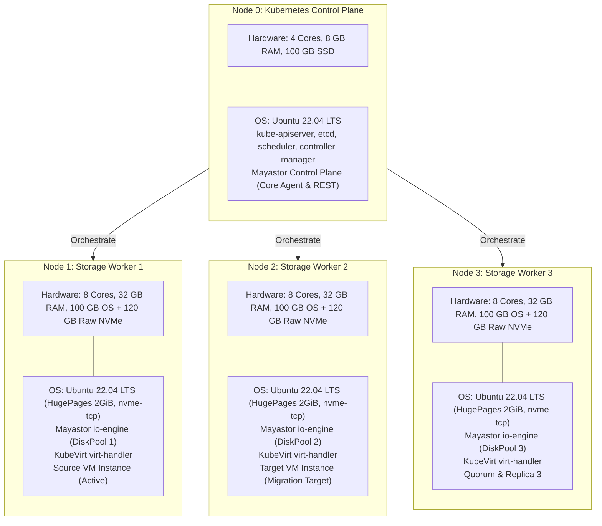

# Final Target Deployment Architecture Proposal

**Project Name:** Deploy High-Performance Storage for Kubernetes  
**Project ID:** SWFW_5S_08  
**Proposal Date:** 2026-11-04  
**Document Status:** PROPOSED (Target Engineering Architecture)  
**Governance Standard:** Zero Fabricated Claims — Research-Backed Proposal  

---

> [!IMPORTANT]
> **Engineering Rigor & Verification Standard:**  
> This proposal consolidates the findings of Chunk 1 infrastructure discovery, software compatibility matrices, and storage feasibility research. All capabilities are labeled as **PROPOSED** or **DOCUMENTED**. No capability is claimed as **DEPLOYMENT VERIFIED** until experimentally executed on live target nodes.

---

## 1. Executive Deployment Specification

| Architectural Component | Selected Target Specification | Technical Classification | Engineering Justification & Upstream Validation |
| :--- | :--- | :--- | :--- |
| **Cluster Topology** | 4 Dedicated Nodes (1 Control Plane + 3 Storage Workers) | **PROPOSED** | Provides genuine 3-way replication quorum, tie-breaking failure recovery, and cross-node VM live migration domains. |
| **Host Operating System** | Ubuntu Server 22.04 LTS (Jammy Jellyfish) | **DOCUMENTED** | Official enterprise LTS release; native Linux 5.15 kernel includes `nvme-tcp` and `/dev/kvm`; standard systemd cgroup v2 integration. |
| **Linux Kernel** | 5.15.0 LTS | **DOCUMENTED** | Meets Mayastor kernel requirement ($\ge$5.13) without requiring non-standard third-party kernel patches. |
| **Cluster Bootstrapper** | `kubeadm` v1.28.8 | **DOCUMENTED** | Standard upstream cluster provisioning tool; deterministic, scriptable, and reproducible across bare-metal environments. |
| **Kubernetes Version** | Kubernetes v1.28.8 | **DOCUMENTED** | Extensively documented compatibility baseline for OpenEBS Mayastor v2.5.x and KubeVirt v1.1.x. |
| **Container Runtime** | `containerd` v1.7.15 | **DOCUMENTED** | Stable LTS runtime branch using the `systemd` cgroup driver; avoids breaking CRI changes present in containerd v2.x. |
| **Cluster CNI Plugin** | Calico v3.27.3 | **DOCUMENTED** | Pure routed pod networking without VXLAN encapsulation penalty; maximizes storage wire throughput and simplifies MTU tuning. |
| **Distributed Storage Engine**| OpenEBS Mayastor v2.5.0 | **DOCUMENTED** | User-space SPDK engine running lockless polling loops; NVMe-oF over TCP data transport; synchronous multi-replica volume management. |
| **Virtualization Engine** | KubeVirt v1.1.1 + CDI v1.58.1 | **DOCUMENTED** | Cloud-native virtualization operator managing QEMU/KVM virtual machines inside Kubernetes pods with hardware `/dev/kvm` acceleration. |
| **Secondary Network Plugin** | Multus CNI v4.0.2 | **DOCUMENTED** | Enables attaching secondary virtual network interfaces to running KubeVirt guest VMs for dedicated storage or management fabrics. |
| **Shared Storage Gateway** | Clustered NFS Gateway (via `csi-driver-nfs` v4.6.0) | **PROPOSED** | Provides RWX filesystem access required for KubeVirt VM live migration, backed by a high-performance 3-way replicated Mayastor RWO volume. |
| **Observability Suite** | `kube-prometheus-stack` v57.x + Grafana v10.4 | **DOCUMENTED** | Real-time Prometheus scraping of Mayastor SPDK metrics, KubeVirt hypervisor metrics, and node I/O stats visualized on Grafana dashboards. |

---

## 2. Target Node Specifications

---

## 3. Storage & Live Migration Strategy

### 3.1 Dual-Tier Workload Segregation
To reconcile the conflicting demands of maximum NVMe block performance and virtual machine live migration, the target system deploys a two-tier storage model:
1. **Tier 1 — High-Performance Direct Block Workloads (`ReadWriteOnce`):**
   - High-throughput database or synthetic FIO benchmark VMs bind directly to raw Mayastor RWO block volumes (`volumeMode: Block`).
   - *Advantage:* Near-bare-metal NVMe saturation, zero filesystem translation overhead, sub-millisecond tail latency.
   - *Limitation:* Pinned to the host worker node; live migration disabled.
2. **Tier 2 — Elastic Live-Migratable Workloads (`ReadWriteMany`):**
   - General-purpose virtual machines requiring zero-downtime rebalancing bind to RWX PVCs exported by a clustered NFS gateway backed by an underlying 3-way replicated Mayastor volume.
   - *Advantage:* Full KubeVirt live migration compatibility across all 3 worker nodes.
   - *Trade-off:* Moderate throughput and latency penalty, evaluated and documented during benchmarking.

---

## 4. Known Technical Limitations & Constraints

1. **SPDK Core Dedication:** Worker nodes must reserve 1 physical CPU core exclusively for Mayastor's user-space polling thread. This core will register 100% CPU utilization continuously.
2. **Pre-allocated HugePages:** 1024 pages of 2 MiB HugePages (2048 MiB) must be reserved at boot time on each storage worker, reducing memory available for general Kubernetes pods.
3. **NFS Gateway Single Point of Failure:** In the proposed RWX live-migration tier, the NFS server pod represents a temporary single point of failure if its hosting worker node experiences an ungraceful hardware failure.
4. **Hardware KVM Dependency:** Storage benchmarking validity strictly depends on physical hardware virtualization (`/dev/kvm`). Software emulation (TCG) is not permissible for benchmark data collection.

---

## 5. Unresolved Infrastructure Dependencies

The following concrete dependencies remain pending confirmation before Chunk 2 (Cluster Deployment) can be executed:
- **Lab Server Allocation:** Approval and reservation of 4 machines meeting minimum specifications via the discovery questionnaire (`docs/college-infrastructure-questionnaire.md`).
- **Network Permissions:** Confirmation of static IP addresses, subnets, and unrestricted node-to-node firewall ports.
- **Root / Sudo Privileges:** Confirmation of administrative credentials required for `kubeadm`, kernel module loading, and HugePages reservations.
