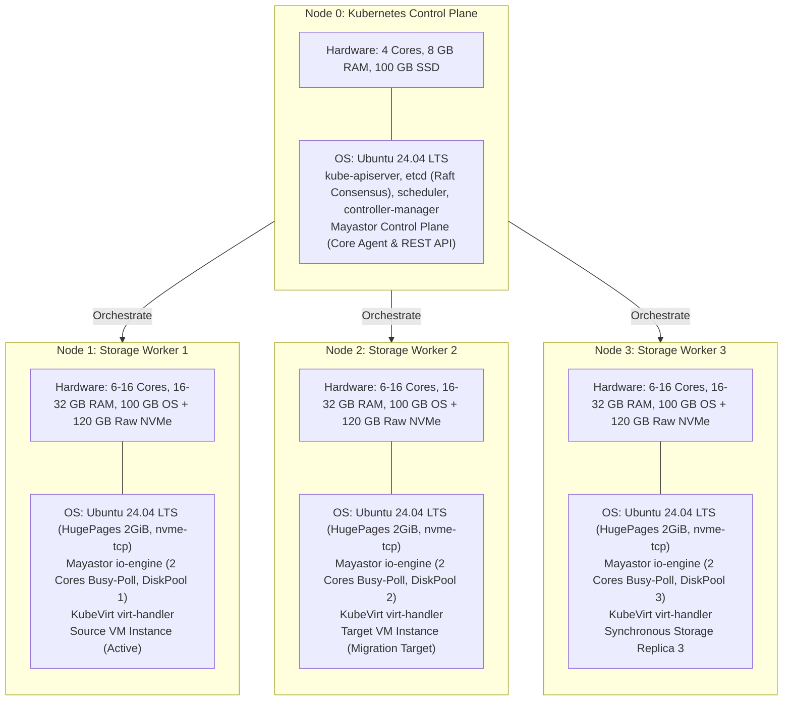

# Final Target Deployment Architecture Proposal

**Project Name:** Deploy High-Performance Storage for Kubernetes  
**Project ID:** SWFW_5S_08  
**Proposal Date:** 2026-11-05 (Chunk 1.9 Final Audit)  
**Document Status:** PROPOSED (Target Engineering Architecture)  
**Governance Standard:** Zero Fabricated Claims — Upstream Lifecycle & Resource Audited  

---

> [!IMPORTANT]
> **Engineering Rigor & Lifecycle Standard:**  
> This proposal synthesizes the findings of Chunk 1, Chunk 1.8, and the Chunk 1.9 final lifecycle and resource audit. All capabilities are classified under strict governance levels (**DOCUMENTED**, **PROPOSED**, or **EXPERIMENTAL**). No capability is claimed as **DEPLOYMENT VERIFIED** until experimentally executed on live target hardware.

---

## 1. Executive Deployment Specification

| Architectural Component | Selected Target Specification | Technical Classification | Upstream Lifecycle & Engineering Justification |
| :--- | :--- | :--- | :--- |
| **Cluster Topology** | 4 Dedicated Nodes (1 Control Plane + 3 Storage Workers) | **PROPOSED** | Provides 3-way synchronous volume replication ($N=3$), independent failure domains, and cross-node VM live migration. |
| **Host Operating System** | Ubuntu Server 24.04 LTS (Noble Numbat) | **DOCUMENTED** | Supported through 2029/2034; ships with modern Linux 6.8 LTS kernel, systemd cgroup v2, and optimized `nvme-tcp` and `/dev/kvm` drivers. |
| **Linux Kernel** | 6.8.0 LTS | **DOCUMENTED** | In-tree kernel NVMe-oF initiator (`nvme-tcp`), advanced TCP socket pacing, and native KVM memory mapping efficiency. |
| **Cluster Bootstrapper** | `kubeadm` v1.35.x | **DOCUMENTED** | Standard upstream cluster provisioning tool; deterministic, scriptable, and reproducible across bare-metal environments. |
| **Kubernetes Version** | **Kubernetes v1.35.x (Time-Limited Primary Candidate)** | **PROPOSED** | In active upstream support in late 2026 (EOL: February 28, 2027). Replaces EOL v1.34 (EOL Oct 27, 2026) and EOL v1.28/v1.29. Qualification gap documented for v1.36/v1.37. |
| **Container Runtime** | **`containerd` 2.3 LTS (Alternative: 2.4)** | **DOCUMENTED** | Long-Term Support release supported through April 30, 2028; replaces EOL containerd 1.7.22 (EOL Sept 30, 2026); native CRI v1 implementation. |
| **Cluster CNI Plugin** | **Calico v3.33** | **DOCUMENTED** | Officially tested and qualified for Kubernetes v1.35–v1.37; pure routed BGP networking without VXLAN encapsulation penalty; maximizes NVMe wire throughput. |
| **Distributed Storage Engine**| **OpenEBS v4.6.x (Mayastor v2.11+)** | **DOCUMENTED / PROPOSED** | User-space SPDK engine with lockless polling; NVMe-oF over TCP transport; 3-way synchronous replication; **supports native experimental RWX block volumes**. |
| **Virtualization Engine** | **KubeVirt v1.8.x + CDI v1.61.x** | **DOCUMENTED** | Cloud-native virtualization operator managing QEMU/KVM virtual machines inside Kubernetes pods with hardware `/dev/kvm` acceleration. |
| **Secondary Network Plugin** | Multus CNI v4.1.2 | **DOCUMENTED** | In-process CNI meta-plugin invoked via local UNIX domain sockets (zero network port overhead); attaches secondary virtual network interfaces to guest VMs. |
| **Shared Storage Mechanism** | **Comparative Dual-Path:** Native Mayastor RWX Block (Primary) + Clustered NFS Gateway (Fallback) | **PROPOSED** | Evaluates native Mayastor RWX block volumes for live migration across 6 failure scenarios while retaining an NFS gateway (`csi-driver-nfs` v4.9.0) as the proven fallback. |
| **Observability Suite** | `kube-prometheus-stack` v62.x + Grafana v11.x | **DOCUMENTED** | Real-time Prometheus scraping of Mayastor SPDK metrics, KubeVirt hypervisor metrics, and node I/O stats visualized on Grafana dashboards. |

---

## 2. Target Node Specifications & Resource Dimensioning

### 2.1 Worker Node CPU Budgeting & SPDK Polling Dynamics
- **SPDK Busy-Polling Behavior:** Mayastor's `io-engine` utilizes SPDK Polled Mode Drivers (PMD). These worker threads execute continuous polling loops across NVMe-oF completion queues and lockless ring buffers. By design, **allocated I/O Engine CPU cores show 100% utilization in `top`/`htop` regardless of actual I/O load**.
- **Mandatory Reservation:** Exactly **2 CPU cores** must be reserved exclusively for Mayastor `io-engine` polling threads to prevent lockless ring contention and queue stalls.
- **Minimum Worker CPU Budget:** **6 physical cores minimum**:
  - 2 cores dedicated to Mayastor SPDK busy-polling.
  - 2 cores for host OS, Linux kernel networking, containerd, kubelet, and observability daemons.
  - 2 cores for guest VM virtual CPUs (vCPUs).
- **Preferred Worker CPU Budget:** **8–16 physical cores** (accommodates 4–8 vCPU database workloads, concurrent live-migration memory compression threads, and multi-queue NVMe processing without core starvation).
- **Engineering Verdict on 4 Physical Cores:** Four physical cores cannot be described as a comfortable benchmark configuration; running SPDK busy-polling on 2 cores of a 4-core system leaves only 2 cores for the operating system, container runtime, Kubernetes daemons, virt-handler, and guest VM, resulting in high context-switch latency and benchmark skew.

### 2.2 Worker Node Memory Sizing (GB vs. GiB Analysis)
Hardware manufacturers measure RAM in decimal Gigabytes ($1\text{ GB} = 10^9\text{ Bytes}$), whereas Linux kernel and Kubernetes orchestrators allocate memory in binary Gibibytes ($1\text{ GiB} = 2^{30}\text{ Bytes} = 1,073,741,824\text{ Bytes}$).
- **16 GB Physical Host:** Yields approximately **14.3 GiB** visible to the Linux kernel.
- **32 GB Physical Host:** Yields approximately **29.3 GiB** visible to the Linux kernel.

| Component / Layer | Memory Allocation | Cumulative Budget (GiB) | Technical Notes |
| :--- | :---: | :---: | :--- |
| **SPDK 2 MiB HugePages** | **2.0 GiB** | 2.0 GiB | Pre-allocated at boot time via `nr_hugepages=1024`; permanently locked out from host OS. |
| **Mayastor `io-engine` Heap** | **1.0 – 1.5 GiB** | 3.5 GiB | Dynamic user-space allocator for NVMe-oF command capsules, write log buffers, and gRPC threads. |
| **Host OS, Kernel & K8s Daemons** | **3.5 – 4.0 GiB** | 7.5 GiB | Ubuntu 24.04 kernel buffers, systemd, containerd 2.3, kubelet, Calico v3.33, and node-exporter. |
| **KubeVirt `virt-handler` & CDI** | **0.5 – 0.8 GiB** | 8.3 GiB | DaemonSet monitoring VM status, QEMU process cgroups, and domain socket communication. |
| **Guest VM RAM Allocation** | **4.0 GiB** | 12.3 GiB | Guest VM allocated system memory for benchmark operating system and application execution. |
| **QEMU Process Memory Overhead** | **0.6 – 1.2 GiB** | 13.5 GiB | Host memory consumed by QEMU emulated devices, page tables, virtio descriptor rings, and vhost. |
| **Live Migration Handover Allocation** | **~4.5 GiB (Transient)** | 18.0 GiB | Target node pre-allocates incoming guest RAM and QEMU overhead during pre-copy phase. |

- **Planning Standards:**
  - **16 GB Physical RAM (Minimum):** Leaves $\sim 0.8\text{ GiB}$ host headroom. Can run a single 4 GB VM, but **cannot comfortably accommodate a live migration target** unless the node is otherwise completely idle.
  - **32 GB Physical RAM (Preferred Baseline):** Leaves $\sim 11.3\text{ GiB}$ host headroom. Fully accommodates 8 GB workload VMs, transient live-migration dual allocations, and NFS gateway file caches without risk of OOM eviction.

---

## 3. Storage Replication, Failure Tolerance & Rebuild Semantics

### 3.1 Three-Node Failure Dynamics ($N=3$ Replicas)
- **Synchronous Mirroring:** For an $N=3$ volume, writes are synchronously acknowledged by the Mayastor Nexus once committed across Worker 1, Worker 2, and Worker 3 DiskPools.
- **Single Node Failure:** When 1 worker node drops offline, the Nexus transitions the volume to **Degraded** status (2 surviving replicas).
- **Redundancy Reduction:** The volume is **not** in a fully protected state; client I/O continues, but resilience is impaired.
- **Anti-Affinity Constraint:** Mayastor enforces pool and node anti-affinity. In a 3-node cluster with 1 node offline, exactly 2 worker nodes remain online. Because both surviving nodes already host replicas, **Mayastor cannot allocate a replacement replica**. The volume remains Degraded until the failed node recovers.

### 3.2 Write Log vs. Discredited Bitmap Rebuild
- **Write Log Mechanism:** Mayastor tracks modifications to faulted replicas using a **Nexus write log** recording dirty address ranges and extents (not an in-memory dirty-block bitmap).
- **Default Partial Rebuild Grace Period:** The Nexus retains dirty extents for disconnected child replicas for **10 minutes** (`--faulted-child-wait-period=10m`). If the faulted node recovers within 10 minutes, a **Partial Rebuild** is executed, replaying only dirty extents across the network.
- **Conditions Triggering Full Rebuild:**
  1. Grace period timeout expiration (node offline $>10$ minutes).
  2. Storage pool / physical NVMe drive destruction or replacement.
  3. Nexus controller host crash while a child is faulted (loss of in-memory write log).
  4. Write log buffer overflow under heavy random write volume.

---

## 4. Shared Storage & Live Migration Strategy

### 4.1 Comparative Dual-Path Strategy
1. **Path A — Native Mayastor RWX Block Live Migration (Primary Innovation Focus):**
   - Live-migratable VMs bind to native Mayastor RWX block volumes (`volumeMode: Block`, `accessModes: [ReadWriteMany]`).
   - Mayastor allows simultaneous multi-attach to the Nexus target during migration. QEMU and KubeVirt hypervisor serialization ensures only the active VM issues writes, preventing corruption without requiring an in-band distributed lock manager.
   - Evaluated across the **6-Scenario Live-Migration Test Suite** documented in [`docs/storage-architecture-analysis.md`](storage-architecture-analysis.md#4-native-mayastor-rwx-live-migration-test-plan).
2. **Path B — Clustered NFS Gateway RWX (Conservative Fallback Baseline):**
   - An NFS gateway pod mounts a Mayastor RWO volume and exports an RWX filesystem via `csi-driver-nfs`.
   - Retained to quantify the "NFS Translation Tax" (latency and IOPS delta) and serve as the proven fallback if native RWX exhibits unhandled edge cases during failure drills.

---

## 5. Unresolved Infrastructure Dependencies

The following dependencies remain pending confirmation before Chunk 2 (Cluster Bootstrap) can proceed:
- **Lab Server Allocation:** Approval and reservation of 4 machines meeting audited specifications (6-core min, 16 GB RAM min, 32 GB preferred, dedicated raw SSD/NVMe) via [`docs/college-infrastructure-questionnaire.md`](docs/college-infrastructure-questionnaire.md).
- **Network Permissions:** Confirmation of static IP addresses, subnets, and unrestricted node-to-node firewall ports across the 20 validated ports.
- **Root / Sudo Privileges:** Confirmation of administrative credentials required for `kubeadm`, kernel module loading (`nvme-tcp`), and HugePages reservations.
