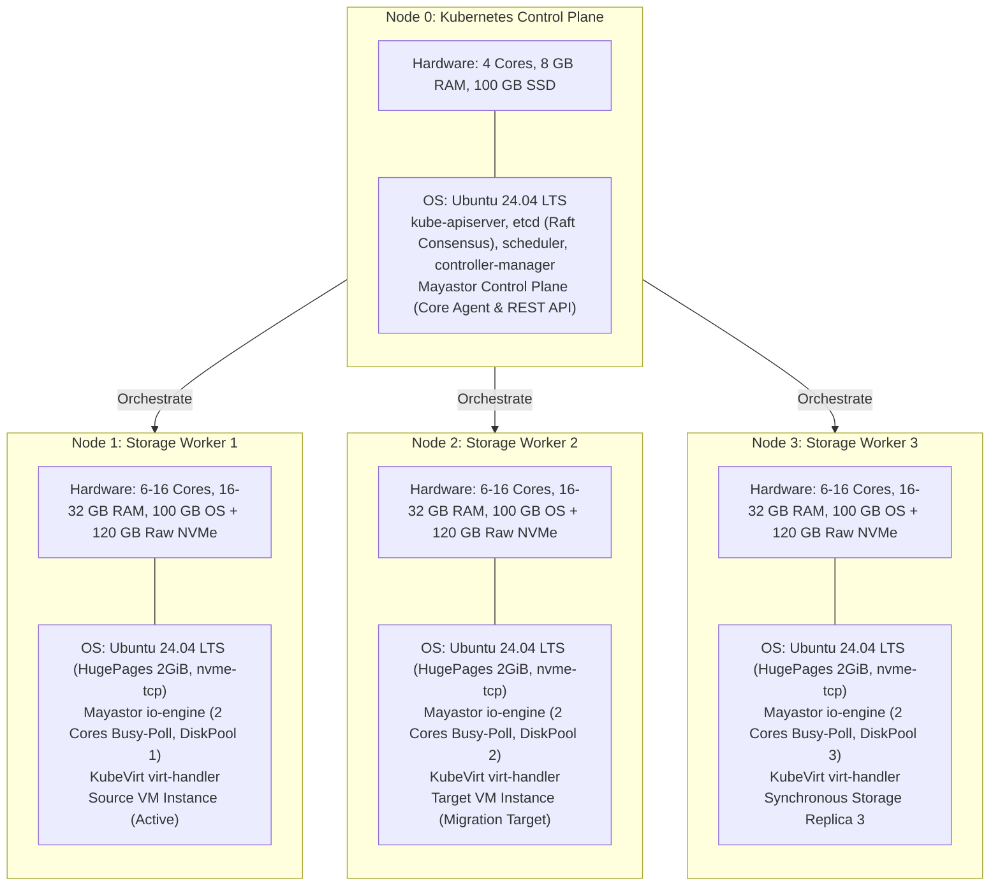

# Final Target Deployment Architecture Proposal

**Project Name:** Deploy High-Performance Storage for Kubernetes  
**Project ID:** SWFW_5S_08  
**Proposal Date:** 2026-11-05 (Chunk 1.11 Final Baseline & Evidence Closure)  
**Document Status:** PROPOSED (Target Engineering Architecture)  
**Governance Standard:** Zero Fabricated Claims — Upstream Recommendation Matrix & Resource Audited  

---

> [!IMPORTANT]
> **Engineering Rigor & Lifecycle Standard:**  
> This proposal consolidates the findings of Chunk 1, Chunk 1.8, Chunk 1.9, Chunk 1.10, and Chunk 1.11. All capabilities are classified under strict governance levels (**DOCUMENTED**, **PROPOSED**, or **EXPERIMENTAL**). No capability is claimed as **DEPLOYMENT VERIFIED** until experimentally executed on live target hardware.

---

## 1. Executive Deployment Specification

| Architectural Component | Selected Target Specification | Technical Classification | Upstream Lifecycle & Engineering Justification |
| :--- | :--- | :--- | :--- |
| **Cluster Topology** | 4 Dedicated Nodes (1 Control Plane + 3 Storage Workers) | **PROPOSED** | Provides 3-way synchronous volume replication ($N=3$), independent failure domains, and cross-node VM live migration. |
| **Host Operating System** | Ubuntu Server 24.04 LTS (Noble Numbat) | **DOCUMENTED** | Supported through 2029/2034; ships with modern Linux 6.8 LTS kernel, systemd cgroup v2, and optimized `nvme-tcp` and `/dev/kvm` drivers. |
| **Linux Kernel** | 6.8.0 LTS | **DOCUMENTED** | In-tree kernel NVMe-oF initiator (`nvme-tcp`), advanced TCP socket pacing, and native KVM memory mapping efficiency. |
| **Cluster Bootstrapper** | `kubeadm` v1.36.x (Candidate B preferred) or v1.35.x (Candidate A comparison) | **DOCUMENTED** | Standard upstream cluster provisioning tool; deterministic, scriptable, and reproducible across bare-metal environments. |
| **Kubernetes Version** | **Candidate B: v1.36.x (Preferred Experimental Qualification Target)** *Comparison Baseline: Candidate A v1.35.x (Storage-Tested Comparison)* | **PROPOSED** | **Candidate B is the preferred qualification target** due to long-term lifecycle alignment (EOL June 2027) and containerd 2.3 LTS pairing. Its qualification gap with Mayastor 2.12.2 will be experimentally evaluated. **Candidate A** is retained strictly as a storage-tested comparison configuration (Mayastor CI tested on 1.35.6; K8s EOL Feb 28, 2027; containerd 2.2 EOL Nov 6, 2026). Kubernetes 1.37 is excluded due to lack of KubeVirt/Mayastor qualification. |
| **Container Runtime** | **`containerd` 2.3.x LTS** | **DOCUMENTED** | containerd 2.3 LTS is supported through April 30, 2028; officially recommended by containerd for Kubernetes 1.36+. containerd 2.2 reached upstream EOL on November 6, 2026 and is not acceptable for new deployments. |
| **Cluster CNI Plugin** | **Calico v3.33** | **DOCUMENTED** | Officially tested and qualified for Kubernetes v1.35–v1.37; pure routed BGP networking without VXLAN encapsulation penalty; maximizes NVMe wire throughput. |
| **Distributed Storage Engine**| **OpenEBS v4.6.x (Mayastor subchart v2.12.2, `io-engine:v2.12.2`)** | **DOCUMENTED / PROPOSED** | SPDK user-space engine with 2 dedicated busy-polling cores; NVMe-oF over TCP transport; 3-way synchronous replication; **supports native experimental RWX block volumes**. Packaged in official published OpenEBS umbrella chart v4.6.x (e.g. v4.6.1/v4.6.2). |
| **Virtualization Engine** | **KubeVirt v1.9.x (or v1.8.x) + CDI v1.61.x** | **DOCUMENTED** | Cloud-native virtualization operator managing QEMU/KVM virtual machines inside Kubernetes pods with hardware `/dev/kvm` acceleration. KubeVirt 1.9 is built for Kubernetes 1.36. |
| **Secondary Network Plugin** | Multus CNI v4.1.2 | **DOCUMENTED** | In-process CNI meta-plugin invoked via local UNIX domain sockets (**zero network port overhead**); attaches secondary virtual network interfaces to guest VMs. |
| **Shared Storage Mechanism** | **Comparative Dual-Path:** Native Mayastor RWX Block (Primary) + Clustered NFS Gateway (Fallback) | **PROPOSED** | Evaluates native Mayastor RWX block volumes for live migration across 6 evidence-based failure scenarios while retaining an NFS gateway (`csi-driver-nfs` v4.9.0) as the proven fallback. |
| **Observability Suite** | `kube-prometheus-stack` v62.x + Grafana v11.x | **DOCUMENTED** | Internal management network only. Real-time Prometheus scraping of Mayastor SPDK metrics, KubeVirt hypervisor metrics, and node I/O stats visualized on Grafana dashboards. |

---

## 2. Target Node Specifications & Resource Dimensioning

### 2.1 Worker Node CPU Budgeting & SPDK Polling Dynamics
- **SPDK Busy-Polling Behavior:** Mayastor's `io-engine` utilizes SPDK Polled Mode Drivers (PMD). These worker threads execute continuous polling loops across NVMe-oF completion queues and lockless ring buffers. By design, **allocated I/O Engine CPU cores show 100% utilization in `top`/`htop` regardless of actual I/O load**.
- **Mandatory Reservation:** Exactly **2 CPU cores** must be reserved exclusively for Mayastor `io-engine` polling threads to prevent lockless ring contention and queue stalls.
- **Minimum Worker CPU Budget:** **6 physical cores minimum**:
  - 2 cores dedicated to Mayastor SPDK busy-polling.
  - 2 cores for host OS, Linux kernel networking, containerd, kubelet, and observability daemons.
  - 2 cores for guest VM virtual CPUs (vCPUs).
- **Preferred Worker CPU Budget:** **8–16 physical cores** (accommodates 4–8 vCPU database workloads, concurrent live-migration memory compression threads, and multi-queue NVMe processing without core starvation).
- **Engineering Verdict on 4 Physical Cores:** Four physical cores cannot be described as a comfortable benchmark configuration; running SPDK busy-polling on 2 cores of a 4-core system leaves only 2 cores for the operating system, container runtime, Kubernetes daemons, virt-handler, and guest VM, resulting in high context-switch latency and benchmark skew.

### 2.2 Worker Node Memory Sizing (Exact Decimal-to-Binary Math & Ranges)
- **16 GB Physical Host:** $16 \times 10^9 / 1024^3 = \mathbf{14.90\text{ GiB}}$ raw capacity installed.
- **32 GB Physical Host:** $32 \times 10^9 / 1024^3 = \mathbf{29.80\text{ GiB}}$ raw capacity installed.
- **Firmware/Hardware Reservations:** Typically $0.20 - 0.50\text{ GiB}$ reserved for UEFI/ACPI tables and PCI MMIO apertures. Usable host memory (`MemTotal`): $\approx \mathbf{14.40 - 14.70\text{ GiB}}$ on 16 GB hosts, and $\approx \mathbf{29.30 - 29.60\text{ GiB}}$ on 32 GB hosts.
- **Planning Estimate Disclaimer:** *These figures represent planning estimates based on typical enterprise server hardware; exact `MemTotal` and runtime overhead must be determined empirically from `/proc/meminfo` on target laboratory servers during Chunk 2.*

| Subsystem Component | Allocation Range (GiB) | Underlying Technical Mechanism & Notes |
| :--- | :---: | :--- |
| **SPDK 2 MiB HugePages (Mandatory)** | **2.00 GiB** | 1024 pages of 2 MiB HugePages pre-allocated at boot. Permanently locked out from kernel pool. |
| **Mayastor `io-engine` Heap** | **1.00 – 1.50 GiB** | User-space process heap, NVMe-oF command capsules, write log dirty extent buffers, gRPC threads. |
| **Host OS, Runtime & K8s Daemons** | **2.30 – 4.00 GiB** | Linux kernel slab, network socket buffers, systemd, containerd 2.3, kubelet, Calico v3.33. |
| **KubeVirt `virt-handler` Overhead** | **0.40 – 0.80 GiB** | DaemonSet managing libvirtd and QEMU cgroup status. |
| **Monitoring Daemons (Exporters)** | **0.20 – 0.40 GiB** | `node-exporter` and Mayastor metrics exporters (Internal only). |
| **Total Base Infrastructure Load** | **5.90 – 8.70 GiB** | **Baseline static memory consumed before any virtual machine is started.** |
| **Guest Virtual Machine RAM** | **4.00 GiB** (Standard) | Explicit guest physical RAM configured in VMI resource spec. |
| **QEMU Process Memory Overhead** | **0.60 – 1.20 GiB** | MMIO emulation, vhost network buffers, virtio-scsi ring descriptors, vCPU thread stacks. |

### 2.3 Independent Migration Budgets: Source vs. Destination
- **Source Node During Migration:**
  - Base stack ($5.90 - 8.70\text{ GiB}$) + Running VM ($4.60 - 5.20\text{ GiB}$) + Dirty page tracking & send socket buffers ($0.20 - 0.55\text{ GiB}$) = **10.70 – 14.45 GiB committed**.
  - Headroom on 16 GB host (`MemTotal`: $14.40 - 14.70\text{ GiB}$): **$-0.05\text{ to }+4.00\text{ GiB}$**. *(Under worst-case peak consumption of $14.45\text{ GiB}$ on a host with $14.40\text{ GiB}$ `MemTotal`, headroom drops into a $-0.05\text{ GiB}$ deficit).*
  - Headroom on 32 GB host (`MemTotal`: $29.30 - 29.60\text{ GiB}$): **$+14.85\text{ to }+18.90\text{ GiB}$** (fully stable).
- **Destination Node (Case 1: Target Node Initially Idle):**
  - Base stack ($5.90 - 8.70\text{ GiB}$) + Incoming VM pre-allocation & receive buffers ($4.80 - 5.70\text{ GiB}$) = **10.70 – 14.40 GiB committed**.
  - Headroom on 16 GB host (`MemTotal`: $14.40 - 14.70\text{ GiB}$): **$0.00\text{ to }+4.00\text{ GiB}$**. *(At high base load of $14.40\text{ GiB}$ on a $14.40\text{ GiB}$ `MemTotal` host, available headroom reaches exactly $0.00\text{ GiB}$).*
  - Headroom on 32 GB host (`MemTotal`: $29.30 - 29.60\text{ GiB}$): **$+14.90\text{ to }+18.90\text{ GiB}$** (fully stable).
- **Destination Node (Case 2: Target Node Already Hosts an Existing 4 GiB VM):**
  - Base stack ($5.90 - 8.70\text{ GiB}$) + Existing VM 1 ($4.60 - 5.20\text{ GiB}$) + Incoming VM 2 ($4.80 - 5.70\text{ GiB}$) = **15.30 – 19.60 GiB committed**.
  - Headroom on 16 GB host (`MemTotal`: $14.40 - 14.70\text{ GiB}$): **$-0.60\text{ to }-5.20\text{ GiB}$ (FATAL DEFICIT)**.
  - **Engineering Sizing Verdict:** Under no circumstances can a 16 GB worker node host a VM live-migration target if another VM is already running on it. Initiating live migration into a loaded 16 GB node triggers immediate Linux kernel OOM termination. **32 GB physical RAM per worker node is the mandatory recommended standard for production and benchmarking**.

---

## 3. Storage Replication, Failure Tolerance & Rebuild Semantics

### 3.1 Three-Node Failure Dynamics ($N=3$ Replicas)
- **Synchronous Mirroring:** For an $N=3$ volume, writes are synchronously acknowledged by the Mayastor Nexus once committed across Worker 1, Worker 2, and Worker 3 DiskPools.
- **Single Node Failure:** When 1 worker node drops offline, the Nexus transitions the volume to **Degraded** status (2 surviving replicas).
- **Redundancy Reduction:** The volume is **not** in a fully protected state; client I/O continues, but resilience is impaired.
- **Anti-Affinity Constraint:** Mayastor enforces pool and node anti-affinity. In a 3-node cluster with 1 node offline, exactly 2 worker nodes remain online. Because both surviving nodes already host replicas, **Mayastor cannot allocate a replacement replica**. The volume remains Degraded until the failed node recovers.

### 3.2 Rebuild Configuration Timers (Nexus Data Plane vs. Control Plane)
1. **Partial Rebuild Wait Period (`--faulted-child-wait-period`):** Configured on `mayastor-agent-core` (default **10 minutes** / `600s`). If a faulted replica reconnects within this period, the Nexus replays dirty ranges recorded in the write log (**Partial Rebuild**).
2. **Node Unreachable Handling (Kernel & Orchestrator Governance):** A standalone parameter named `--node-unreachable-timeout` is **unverified / non-existent** as an upstream Mayastor configuration flag. Node disconnection is governed by Kubernetes node eviction tolerations (`tolerations.node.kubernetes.io/unreachable`, default 300s) and NVMe initiator timeout (`ctrl_loss_tmo`, default 1800s or 120s).
3. **Published vs. Unpublished Volume Behavior:** Published volumes actively log dirty extents; unpublished volumes are quiescent and evaluate generation counter equality upon publication.
4. **Conditions Triggering Full Rebuild:** Faulted child wait period expiration ($>10\text{m}$), disk pool destruction/replacement, Nexus crash while child is faulted, or write log buffer overflow.

---

## 4. Shared Storage & Live Migration Strategy

### 4.1 Comparative Dual-Path Strategy
1. **Path A — Native Mayastor RWX Block Live Migration (Primary Innovation Focus):**
   - Live-migratable VMs bind to native Mayastor RWX block volumes (`volumeMode: Block`, `accessModes: [ReadWriteMany]`).
   - Mayastor allows simultaneous multi-attach to the Nexus target during migration. QEMU and KubeVirt hypervisor serialization ensures only the active VM issues writes.
   - Evaluated across the **6-Scenario Live-Migration Test Suite** documented in [`docs/storage-architecture-analysis.md`](storage-architecture-analysis.md#4-native-mayastor-rwx-live-migration-test-plan).
   - Scenario 6 implements an **evidence-based concurrency audit** combining KubeVirt migration states, QEMU QMP `STOP`/`RESUME` events, Mayastor multi-attach logs, in-guest strictly monotonic sequence-numbered writes (512-byte fixed binary record layout with CRC32C checksums), and transparent documentation of NTP clock drift boundaries.
2. **Path B — Clustered NFS Gateway RWX (Conservative Fallback Baseline):**
   - An NFS gateway pod mounts a Mayastor RWO volume and exports an RWX filesystem via `csi-driver-nfs`.
   - Retained to quantify the "NFS Translation Tax" (latency and IOPS delta) and serve as the proven fallback if native RWX exhibits unhandled edge cases during failure drills.

---

## 5. Unresolved Infrastructure Dependencies

The following dependencies remain pending confirmation before Chunk 2 (Cluster Bootstrap) can proceed:
- **Lab Server Allocation:** Approval and reservation of 4 machines meeting audited specifications (6-core min, 16 GB RAM min, 32 GB preferred, dedicated raw SSD/NVMe) via [`docs/college-infrastructure-questionnaire.md`](docs/college-infrastructure-questionnaire.md).
- **Network Permissions:** Confirmation of static IP addresses, subnets, and unrestricted node-to-node firewall rules across the authoritative **reconciled 20-port matrix** (10 physical host firewall rules, 10 cluster-internal/loopback services), with TCP 4420 purged and monitoring/service ports restricted to cluster-internal CIDR.
- **Candidate Selection Alignment:** Candidate B (Kubernetes 1.36.x + containerd 2.3.x LTS) is established as the preferred experimental qualification target; Candidate A (Kubernetes 1.35.x + containerd 2.2.x) is retained as the storage-tested comparison baseline. The qualification gap of Mayastor 2.12.2 on Kubernetes 1.36 will be experimentally evaluated.
