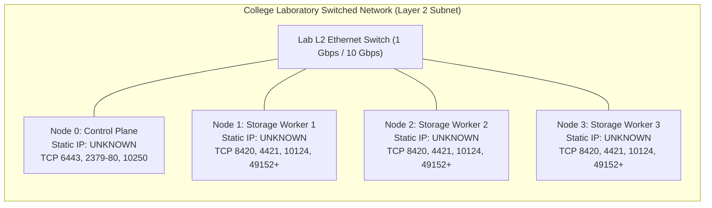

# Infrastructure Readiness Tracker & Access Planning

**Project Name:** Deploy High-Performance Storage for Kubernetes  
**Project ID:** SWFW_5S_08  
**Program:** Zoho SETU — College Student Project Program  
**Document Status:** ACTIVE READINESS TRACKER  
**Last Updated:** 2026-11-05 (Chunk 2.1 Strategy Realignment & ADR-011 Decoupling)  
**Governance Standard:** Zero Fabricated Claims — Evidence-Based Tracking Only  

---

> [!IMPORTANT]
> **Readiness Evaluation & Strategy Realignment (ADR-011):**  
> This tracker serves as the authoritative, evidence-based ledger of target laboratory infrastructure availability, access permissions, and hardware capabilities.
>
> In accordance with the **Chunk 2.1 Strategy Realignment & ADR-011**:
> 1. **Complete Original Scope Preserved:** All 12 architectural capabilities remain target project deliverables.
> 2. **Decoupled Development Continuity:** Institutional hardware allocation is an **optional resource opportunity rather than a mandatory blocking gate**. Project development, configuration authoring, static schema validation, and local functional tests proceed immediately without stalling.
> 3. **Three-State Tracking:** Capabilities are tracked across `IMPLEMENTED`, `VALIDATED`, and `INFRASTRUCTURE-DEPENDENT` states.
>
> Every requirement is classified strictly under one of five standardized statuses:
> - `UNKNOWN`: Information has not yet been determined or inquired.
> - `REQUESTED`: Formal inquiry or allocation request has been submitted to laboratory administration.
> - `CONFIRMED`: Verified with concrete evidence, administrative approval, or direct inspection.
> - `UNAVAILABLE`: Resource or permission is unavailable in the target environment.
> - `BLOCKED`: Dependency is missing or denied, preventing further forward progress on that specific item.

---

## 1. Master Infrastructure Readiness Tracker

The proposed topology requires **1 Kubernetes Control Plane Node** and **3 Dedicated Storage & Virtualization Worker Nodes** running OpenEBS Mayastor and KubeVirt.

| ID | Requirement Category & Specific Item | Technical Justification (Why It Is Needed) | Required / Preferred Specification | Current Status | Evidence / Source | Responsible Entity | Follow-Up Action |
| :-: | :--- | :--- | :--- | :---: | :--- | :--- | :--- |
| **HW-01** | **Physical Node Count** | Required for 3-way synchronous storage replication ($N=3$), independent failure domains, and VM live migration. | **Required:** 4 independent nodes (1 CP + 3 Workers).<br/>*Fallback:* 3 nodes (1 combined CP/Worker + 2 Workers). | **REQUESTED** | Formulated in questionnaire (`docs/college-infrastructure-questionnaire.md`). | College Lab Administrator / Dept Coordinator | Await completed questionnaire and machine assignment. |
| **HW-02** | **Worker CPU Capacity** | Mayastor SPDK `io-engine` requires 2 dedicated busy-polling cores (100% saturation by design). 2 cores needed for host OS/K8s daemons, and 2+ cores for guest VM vCPUs. | **Required:** $\ge 6$ Physical Cores per worker.<br/>**Preferred:** 8–16 Physical Cores (x86_64). | **UNKNOWN** | Lab server hardware not yet inspected. | College Lab Administrator / Systems Engineer | Inspect `/proc/cpuinfo` and `lscpu` upon access. |
| **HW-03** | **Worker Memory Capacity** | Base stack consumes 5.90–8.70 GiB. Guest VM requires 4.60–5.20 GiB. Live migration target requires 10.70–14.40 GiB (idle) or 15.30–19.60 GiB (loaded). | **Required:** 16 GB physical RAM (constrained baseline).<br/>**Preferred:** 32 GB physical RAM (mandatory for multi-VM live migration). | **UNKNOWN** | Lab server hardware not yet inspected. | College Lab Administrator / Systems Engineer | Inspect `/proc/meminfo` (`MemTotal`) upon access. |
| **HW-04** | **Dedicated Raw Storage Disks** | Mayastor `DiskPool` primitives require dedicated, unpartitioned block devices. Cannot share filesystem with OS. | **Required:** 1 dedicated raw SSD/NVMe ($\ge 50\text{ GB}$) per worker node.<br/>**Preferred:** Dedicated 120+ GB NVMe SSD. | **UNKNOWN** | Drive allocation unconfirmed. | College Lab Administrator / Systems Engineer | Inspect `lsblk`, `fdisk -l`, and `nvme list` upon access. |
| **HW-05** | **Hardware Virtualization (KVM)** | KubeVirt requires hardware KVM acceleration (`/dev/kvm`). Software emulation (TCG) ruins benchmark validity. | **Required:** Intel VT-x (`vmx`) or AMD-V (`svm`) enabled in BIOS/UEFI; `/dev/kvm` accessible. | **UNKNOWN** | Host BIOS settings unconfirmed. (Local WSL2 has `/dev/kvm` verified). | College Lab Administrator | Run `kvm-ok` and inspect `ls -l /dev/kvm` upon access. |
| **HW-06** | **CPU SSE4.2 Instruction Set** | SPDK user-space driver compilation and CRC32C hardware acceleration require SSE4.2 instructions. | **Required:** `sse4_2` CPU flag present in `/proc/cpuinfo`. | **UNKNOWN** | Host CPU architecture unconfirmed. (Local CPU has `sse4_2` verified). | College Lab Administrator | Run `grep -i sse4_2 /proc/cpuinfo` upon access. |
| **HW-07** | **2 MiB HugePages Support** | SPDK memory pool management and lockless ring buffers require pre-allocated 2 MiB HugePages locked out of kernel swap. | **Required:** 1024 pages of 2 MiB HugePages (2048 MiB = 2 GiB) per storage worker. | **UNKNOWN** | Kernel HugePage support unconfirmed. | College Lab Administrator / Systems Engineer | Test `sysctl -w vm.nr_hugepages=1024` in preflight. |
| **ACC-01** | **Root / Sudo Privileges** | Mandatory for loading kernel modules, installing containerd/kubeadm, configuring HugePages, and raw disk formatting. | **Required:** Full root or passwordless `sudo` on all 4 cluster nodes. | **REQUESTED** | Listed in questionnaire Section B. | College Lab Administrator / Dept Coordinator | Request formal administrative grant. |
| **ACC-02** | **Remote SSH Access** | Required for executing remote cluster bootstrap, automation scripts, and benchmark telemetry. | **Required:** SSH key authentication from local development machine to all nodes. | **REQUESTED** | Listed in questionnaire Section E. | College Lab Administrator / Network Admin | Obtain IP/jump-host details and configure SSH keys. |
| **ACC-03** | **Storage Wipe Permission** | Mayastor creates raw SPDK storage pools by formatting target disks. Accidental formatting of active OS/data drives must be prevented. | **Required:** Explicit, unambiguous administrative sign-off to dedicate and format designated secondary disks. | **UNKNOWN** | Specific device identifiers unassigned. | College Lab Administrator / Lab In-Charge | Formally confirm device path (e.g., `/dev/sdb`) before formatting. |
| **ACC-04** | **Reboot & Benchmark Windows** | Boot-time kernel parameter testing (`hugepagesz=2M`), node failure injection drills, and sustained multi-hour FIO tests. | **Required:** Permission to reboot nodes during maintenance windows; continuous multi-hour execution window. | **REQUESTED** | Listed in questionnaire Section E. | College Lab Administrator / Lab In-Charge | Agree on scheduled testing and maintenance windows. |
| **NET-01** | **Layer-2 Switched Connectivity** | Low-latency node-to-node NVMe-oF packet transport and QEMU live migration memory streaming. | **Required:** All 4 nodes on the same switched Layer-2 subnet with sub-millisecond RTT. | **UNKNOWN** | Lab network topology unconfirmed. | College Network Administrator | Verify with `ping`, `arp-scan`, and `traceroute`. |
| **NET-02** | **Static IPv4 Allocation** | Kubernetes API server and kubelet TLS certificates bind to node IP addresses; DHCP lease changes break etcd/K8s. | **Required:** 4 dedicated static private IPv4 addresses (or permanent MAC-IP DHCP reservations). | **REQUESTED** | Listed in questionnaire Section D. | College Network Administrator | Obtain static IP assignments and subnet mask/gateway. |
| **NET-03** | **Inter-Node Port Openness** | Required for Kubernetes control plane (6443, 2379-80, 10250), Calico BGP (179), Mayastor (8420, 4421, 10124), and QEMU (49152-49215). | **Required:** Unrestricted inter-node communication across the canonical 10 physical host firewall ports. | **REQUESTED** | Documented in `docs/network-and-virtualization-requirements.md`. | College Network Administrator / System Admin | Submit canonical 10-port matrix for firewall whitelist. |
| **NET-04** | **Time Synchronization (NTP)** | Required for etcd Raft consensus, KubeVirt migration event correlation, and accurate distributed benchmark logging. | **Required:** Active `systemd-timesyncd` or `chrony` synchronizing to NTP server ($\le 2\text{ ms}$ skew). | **UNKNOWN** | Host NTP status unconfirmed. | College System Administrator | Check `timedatectl status` upon host access. |
| **NET-05** | **DNS Resolution** | Package installation, container image pulls from container registries, and internal cluster service resolution. | **Required:** Upstream DNS resolver accessible from all cluster nodes. | **UNKNOWN** | Host `/etc/resolv.conf` unconfirmed. | College Network Administrator | Test DNS query resolution (`nslookup`, `dig`). |
| **INS-01** | **Laboratory Space & Power** | Physical lab environment must provide stable power, cooling, and continuous uptime during long benchmark drills. | **Required:** Dedicated lab rack or workstation bench with uninterrupted power. | **REQUESTED** | Listed in questionnaire Section E. | College Lab In-Charge | Confirm lab operating schedule and power reliability. |

---

## 2. Machine Hardware Allocation Ledger

Below is the candidate machine tracking ledger. As physical systems are allocated by the college laboratory administration, their measured specifications will be recorded here based on direct terminal audit:

### Node 0: Proposed Kubernetes Control Plane
- **Assigned Machine Identifier / Hostname:** `UNKNOWN` (Target: `k8s-control-plane-01`)
- **System Nature:** `UNKNOWN` (Physical Bare-Metal or High-Spec Hypervisor VM)
- **CPU Model & Generation:** `UNKNOWN`
- **CPU Cores & Threads:** `UNKNOWN` (Requirement: $\ge 2$ physical cores; 4 preferred)
- **Total Physical RAM:** `UNKNOWN` (Requirement: $\ge 4\text{ GB}$; 8 GB preferred)
- **Primary OS Disk:** `UNKNOWN` (Requirement: $\ge 40\text{ GB}$ SSD)
- **Dedicated Storage Disk:** `NOT REQUIRED` (Control plane does not host Mayastor storage pools)
- **Network Interface & Speed:** `UNKNOWN` (Requirement: $\ge 1\text{ Gbps}$ NIC)
- **Operating System & Kernel:** `UNKNOWN` (Target: Ubuntu Server 24.04 LTS, Linux 6.8.0)
- **Virtualization Flags (VT-x/AMD-V):** `UNKNOWN` (Optional on Control Plane)
- **Administrative Access:** `UNKNOWN` (Target: Full sudo / root)

### Node 1: Proposed Storage Worker 1 (Mayastor + KubeVirt)
- **Assigned Machine Identifier / Hostname:** `UNKNOWN` (Target: `k8s-storage-worker-01`)
- **System Nature:** `UNKNOWN` (Physical Bare-Metal or High-Spec Hypervisor VM)
- **CPU Model & Generation:** `UNKNOWN`
- **CPU Cores & Threads:** `UNKNOWN` (Requirement: $\ge 6$ physical cores [2 dedicated SPDK + 2 OS/K8s + 2 VM]; 8–16 preferred)
- **Total Physical RAM:** `UNKNOWN` (Requirement: 16 GB constrained baseline; 32 GB preferred)
- **Primary OS Disk:** `UNKNOWN` (Requirement: $\ge 40\text{ GB}$)
- **Dedicated Raw SSD/NVMe:** `UNKNOWN` (Requirement: 1x unformatted $\ge 50\text{ GB}$ block device; 120+ GB NVMe preferred)
- **Network Interface & Speed:** `UNKNOWN` (Requirement: $\ge 1\text{ Gbps}$ NIC; 10 Gbps preferred)
- **Operating System & Kernel:** `UNKNOWN` (Target: Ubuntu Server 24.04 LTS, Linux 6.8.0)
- **Virtualization Flags (VT-x/AMD-V):** `UNKNOWN` (Requirement: Enabled in BIOS/UEFI; `/dev/kvm` accessible)
- **CPU SSE4.2 Support:** `UNKNOWN` (Requirement: `sse4_2` instruction flag present)
- **2 MiB HugePages Capability:** `UNKNOWN` (Requirement: 2 GiB / 1024 pages reservable)
- **Administrative Access:** `UNKNOWN` (Target: Full sudo / root)

### Node 2: Proposed Storage Worker 2 (Mayastor + KubeVirt)
- **Assigned Machine Identifier / Hostname:** `UNKNOWN` (Target: `k8s-storage-worker-02`)
- **System Nature:** `UNKNOWN` (Physical Bare-Metal or High-Spec Hypervisor VM)
- **CPU Model & Generation:** `UNKNOWN`
- **CPU Cores & Threads:** `UNKNOWN` (Requirement: $\ge 6$ physical cores [2 dedicated SPDK + 2 OS/K8s + 2 VM]; 8–16 preferred)
- **Total Physical RAM:** `UNKNOWN` (Requirement: 16 GB constrained baseline; 32 GB preferred)
- **Primary OS Disk:** `UNKNOWN` (Requirement: $\ge 40\text{ GB}$)
- **Dedicated Raw SSD/NVMe:** `UNKNOWN` (Requirement: 1x unformatted $\ge 50\text{ GB}$ block device; 120+ GB NVMe preferred)
- **Network Interface & Speed:** `UNKNOWN` (Requirement: $\ge 1\text{ Gbps}$ NIC; 10 Gbps preferred)
- **Operating System & Kernel:** `UNKNOWN` (Target: Ubuntu Server 24.04 LTS, Linux 6.8.0)
- **Virtualization Flags (VT-x/AMD-V):** `UNKNOWN` (Requirement: Enabled in BIOS/UEFI; `/dev/kvm` accessible)
- **CPU SSE4.2 Support:** `UNKNOWN` (Requirement: `sse4_2` instruction flag present)
- **2 MiB HugePages Capability:** `UNKNOWN` (Requirement: 2 GiB / 1024 pages reservable)
- **Administrative Access:** `UNKNOWN` (Target: Full sudo / root)

### Node 3: Proposed Storage Worker 3 (Mayastor + Quorum)
- **Assigned Machine Identifier / Hostname:** `UNKNOWN` (Target: `k8s-storage-worker-03`)
- **System Nature:** `UNKNOWN` (Physical Bare-Metal or High-Spec Hypervisor VM)
- **CPU Model & Generation:** `UNKNOWN`
- **CPU Cores & Threads:** `UNKNOWN` (Requirement: $\ge 6$ physical cores [2 dedicated SPDK + 2 OS/K8s + 2 VM]; 8–16 preferred)
- **Total Physical RAM:** `UNKNOWN` (Requirement: 16 GB constrained baseline; 32 GB preferred)
- **Primary OS Disk:** `UNKNOWN` (Requirement: $\ge 40\text{ GB}$)
- **Dedicated Raw SSD/NVMe:** `UNKNOWN` (Requirement: 1x unformatted $\ge 50\text{ GB}$ block device; 120+ GB NVMe preferred)
- **Network Interface & Speed:** `UNKNOWN` (Requirement: $\ge 1\text{ Gbps}$ NIC; 10 Gbps preferred)
- **Operating System & Kernel:** `UNKNOWN` (Target: Ubuntu Server 24.04 LTS, Linux 6.8.0)
- **Virtualization Flags (VT-x/AMD-V):** `UNKNOWN` (Requirement: Enabled in BIOS/UEFI; `/dev/kvm` accessible)
- **CPU SSE4.2 Support:** `UNKNOWN` (Requirement: `sse4_2` instruction flag present)
- **2 MiB HugePages Capability:** `UNKNOWN` (Requirement: 2 GiB / 1024 pages reservable)
- **Administrative Access:** `UNKNOWN` (Target: Full sudo / root)

---

## 3. Administrative Access & Permissions Matrix

To comply with the non-destructive security directive (`AGENTS.md` Directive 5), administrative permissions must be explicitly confirmed before executing setup or mutating commands:

| Permission Category | Required Privilege Level | Operational Necessity | Grant Status | Evidence / Sign-off |
| :--- | :--- | :--- | :---: | :--- |
| **Root / Sudo Access** | Passwordless `sudo` or root shell | Installing `kubeadm`, `containerd`, and system packages. | **UNKNOWN** | Pending questionnaire return. |
| **Remote SSH Access** | Port 22 SSH key authentication | Headless node administration, automated scripting, telemetry. | **UNKNOWN** | Pending questionnaire return. |
| **Kernel Module Loading** | `modprobe nvme-tcp`, `uio`, `vfio_pci` | Required for SPDK user-space polling and NVMe-oF network initiator. | **UNKNOWN** | Pending questionnaire return. |
| **HugePage Allocation** | `vm.nr_hugepages=1024` via sysctl | Mandatory SPDK memory buffers locked from swap. | **UNKNOWN** | Pending questionnaire return. |
| **Firewall Administration** | `iptables` / `ufw` configuration | Allowing 10 physical host ports for Kubernetes, Mayastor, and QEMU. | **UNKNOWN** | Pending questionnaire return. |
| **Storage Device Dedication** | Exclusive raw block device ownership | Prevents data loss; Mayastor requires complete device ownership. | **UNKNOWN** | Specific drive assignment pending. |
| **Disk Wipe & Formatting** | `wipefs`, `fdisk`, SPDK pool init | Formatting secondary block device for storage pool creation. | **UNKNOWN** | **A device is NEVER considered available until explicit wipe permission is confirmed.** |
| **Node Reboot Authorization** | `systemctl reboot` | Testing boot-time persistent configs and failure recovery drills. | **UNKNOWN** | Maintenance window pending agreement. |
| **Long-Duration Benchmarks** | Multi-hour sustained I/O | FIO stress tests generating continuous disk and network load. | **UNKNOWN** | Permitted lab schedule pending. |
| **KVM / Nested Virtualization**| `/dev/kvm` read/write access | Hardware-assisted virtual machine execution via KubeVirt. | **UNKNOWN** | Hardware audit pending access. |

---

## 4. Network Readiness Specification



### 4.1 Network Configuration Checklist
- **Subnet & IP Topology:** All 4 nodes must reside within the same Layer-2 broadcast domain (e.g., `192.168.1.0/24` or `10.x.x.0/24`). Status: **UNKNOWN**.
- **Static IP Assignment:** Static IPv4 addresses or permanent router DHCP MAC reservations are mandatory to prevent etcd and kubelet TLS certificate invalidation across reboots. Status: **REQUESTED**.
- **DNS & Name Resolution:** Reliable upstream DNS resolver must be reachable from all nodes for container image retrieval (`registry.k8s.io`, `quay.io`, `docker.io`). Status: **UNKNOWN**.
- **Time Synchronization (NTP):** Time synchronization across all nodes is mandatory; clock drift must remain $\le 2\text{ ms}$ to maintain etcd Raft consensus and valid live-migration sequence verification. Status: **UNKNOWN**.
- **Separate Storage Network Assessment:** A dedicated secondary NIC or isolated storage VLAN is *highly desirable* to separate NVMe-oF bulk traffic from management traffic, but is **not mandatory**. If only a single 1 Gbps NIC is available per node, storage, pod CNI, and live-migration traffic will share the physical link, and bandwidth contention during live migration will be quantified during Chunk 8 benchmarks. Status: **UNKNOWN**.
- **Firewall Policy & Port Exposure:** Unrestricted node-to-node communication across the **canonical 10 physical host firewall ports** is required. Cluster-internal services (CoreDNS, KubeVirt webhooks, Mayastor REST API, Prometheus) reside on pod networks or loopback and must **never be exposed to the external campus network**. Status: **REQUESTED**.

---

## 5. Institutional Governance & Operational Constraints

| Institutional Operational Area | Target Policy / Constraint | Current Status | Notes & Impact on Project Execution |
| :--- | :--- | :---: | :--- |
| **Department / Lab Responsible** | Computer Science / IT / Systems Engineering Laboratory | **UNKNOWN** | Specific department lab assigning the servers. |
| **Infrastructure Administrator** | Designated Department Lab Assistant or Faculty Project Mentor | **UNKNOWN** | Primary administrative point of contact. |
| **Allocation & Approval Process**| Formal submission and review of project questionnaire | **IN PROGRESS** | Questionnaire prepared; awaiting submission and departmental response. |
| **Machine Reservation Window** | Continuous allocation for 4–8 weeks | **REQUESTED** | Machines must not be repurposed by other lab classes during testing. |
| **Permitted Operating Hours** | 24/7 continuous uptime preferred (or scheduled daily lab hours) | **UNKNOWN** | If systems are powered off daily, cluster bootstrap must be fully resilient to reboots. |
| **Scheduled Maintenance / Reboots**| Fixed maintenance windows (e.g., weekends) | **UNKNOWN** | Must avoid scheduling FIO benchmarks during college maintenance cycles. |
| **Physical Lab Access Policy** | In-person access during working hours; remote SSH for evening runs | **UNKNOWN** | Determines whether troubleshooting can be conducted remotely. |
| **Power & Thermal Stability** | Uninterrupted Power Supply (UPS) on lab rack/desktops | **UNKNOWN** | Sudden power cuts during SPDK write drills can cause dirty pool degradation. |
| **Campus Security Policies** | Outbound internet access permitted for container image downloads | **UNKNOWN** | Institutional proxy configurations must be documented if present. |

---

## 6. Infrastructure Fallback Hierarchy

To maintain scientific integrity and prevent project stalling if ideal 4-node bare-metal hardware cannot be allocated, the following operational hierarchy is established:

```
┌─────────────────────────────────────────────────────────────────────────────────────────────────┐
│                                INFRASTRUCTURE FALLBACK HIERARCHY                                │
│                                                                                                 │
│  [Tier 1 - Preferred] : 4 Dedicated College Physical Linux Servers (1 CP + 3 Workers)          │
│                                       │ (If unavailable)                                        │
│                                       ▼                                                         │
│  [Tier 2 - Secondary] : 4 College Lab Desktop Workstations (Ubuntu Server, $\ge 6$ Cores, KVM)  │
│                                       │ (If unavailable)                                        │
│                                       ▼                                                         │
│  [Tier 3 - Fallback]  : Nested Virtualization (4 Linux VMs on single high-spec server)          │
│                                       │ (If approved by institution)                            │
│                                       ▼                                                         │
│  [Tier 4 - Degraded]  : Degraded 3-Node Topology (1 Combined CP/Worker + 2 Storage Workers)     │
│                                                                                                 │
│  [PROHIBITED]         : Commercial Paid Cloud Infrastructure (Violates SETU zero-cost mandate)  │
│  [EXCLUDED]           : Local Development Laptop (Development & Governance only; 8 GB RAM)      │
└─────────────────────────────────────────────────────────────────────────────────────────────────┘
```

1. **Tier 1: Dedicated College Physical Linux Servers (Preferred Baseline):**
   - 4 independent rackmount or tower servers running Ubuntu Server 24.04 LTS.
   - Provides true physical NVMe-oF network benchmarking and bare-metal SPDK polling measurements.
2. **Tier 2: College Laboratory Desktop Workstations:**
   - 4 standard laboratory PCs equipped with modern multi-core x86_64 processors ($\ge 6$ physical cores) and secondary SSDs, temporarily repurposed with Ubuntu Server.
   - Fully supports all features; benchmarking reflects desktop SSD/NVMe controllers.
3. **Tier 3: Nested Virtualization on a High-Specification Server:**
   - 4 virtual machines hosted on a large institutional hypervisor (e.g., Proxmox VE or VMware ESXi server with $\ge 64\text{ GB}$ RAM and 16+ cores).
   - **Prerequisite:** Hypervisor must explicitly support and enable nested virtualization (`host-passthrough` and `/dev/kvm`).
   - Benchmarks will reflect hypervisor abstraction overhead, but all protocols, live migration, and hot-plugging can be validated.
4. **Tier 4: Degraded 3-Node Cluster (Emergency Fallback):**
   - 1 combined Control Plane/Worker + 2 dedicated Storage Workers.
   - Compromise: Node 0 hosts both K8s control plane and Mayastor workloads. Live migration is limited to Node 1 $\leftrightarrow$ Node 2. Tolerates 0 node failures during migration.
5. **Prohibited Alternatives:**
   - **Paid Cloud Infrastructure:** AWS, Azure, GCP, or DigitalOcean are strictly prohibited under SETU program directives to ensure 100% cost-free academic reproducibility.
   - **Local Development Laptop:** Explicitly ruled out as a cluster host (`docs/infrastructure-inventory.md`). With only 8 GB total RAM (~750 MB free) and a single 512 GB SSD (~17 GB free), hosting 4 nodes, 6 GiB HugePages, and KVM virtual machines locally is mathematically impossible.

---

## 7. Readiness Decision & Objective Evaluation

### 7.1 Readiness Assessment Criteria

To maintain scientific rigor and eliminate premature deployment assumptions, cluster readiness is evaluated against objective criteria:

```
┌─────────────────────────────────────────────────────────────────────────────────────────────────┐
│                                READINESS DECISION CRITERIA                                      │
├──────────────────────────────┬──────────────────────────────────────────────────────────────────┤
│ READY FOR HOST PREFLIGHT     │ • 4 candidate nodes assigned with confirmed hostnames/IPs.       │
│                              │ • Root/sudo access and SSH keys verified.                        │
│                              │ • Physical core count ($\ge 6$) and RAM ($\ge 16$ GB) confirmed. │
│                              │ • Dedicated raw secondary SSD/NVMe identified on each worker.    │
│                              │ • `/dev/kvm` hardware virtualization verified on all workers.    │
├──────────────────────────────┼──────────────────────────────────────────────────────────────────┤
│ CONDITIONALLY READY          │ • Machines assigned, but secondary drive or BIOS setting pending. │
│                              │ • Non-destructive host preflight scripts authorized to inspect.  │
├──────────────────────────────┼──────────────────────────────────────────────────────────────────┤
│ NOT READY (Remote Target)    │ • Physical hardware has not been formally allocated.             │
│                              │ • Administrative access has not been granted.                    │
│                              │ • IP addresses and network topology remain unassigned.           │
│                              │ • Questionnaire pending departmental review and completion.      │
└──────────────────────────────┴──────────────────────────────────────────────────────────────────┘
```

### 7.2 Current Assessment Verdict

$$\mathbf{READINESS\ VERDICT:\ NOT\ READY\ (REMOTE\ LAB\ ALLOCATION)}$$

**Engineering Justification:**
1. **Zero Hardware Allocated:** No physical servers or virtual machines have been formally designated, assigned, or reserved by the college laboratory administration.
2. **Administrative Access Unconfirmed:** Neither root credentials, sudo privileges, nor SSH keys have been issued to the project team.
3. **Storage Disks Unassigned:** Specific secondary raw block devices have not been identified or approved for Mayastor storage pool wiping/formatting.
4. **Network Unassigned:** Static IP addresses, subnet configurations, and switch ports are currently unknown.
5. **Questionnaire In Progress:** `docs/college-infrastructure-questionnaire.md` has been refined and prepared, but formal institutional feedback has not yet been received.

### 7.3 Decoupled Project Execution (ADR-011)

In accordance with **ADR-011**, while the remote laboratory hardware status is objectively **`NOT READY`**, **the project implementation pipeline is NOT BLOCKED**:
- **Local Engineering Track:** Automated pre-flight inspection scripts, `kubeadm` manifests, Helm configurations, KubeVirt micro-VM tests (`/dev/kvm` verified), FIO job profiles, and Grafana dashboards are developed and verified locally in WSL2.
- **Remote Institutional Track:** `docs/college-infrastructure-questionnaire.md` remains submitted to laboratory administration to secure physical hardware for final multi-node execution and wire-speed NVMe-oF benchmarks.

---

## 8. Summary & Next Steps

This readiness tracker establishes a transparent, evidence-based baseline:
- Remote college infrastructure allocation continues to be tracked as an optional resource opportunity.
- All implementation and validation proceed in accordance with the 10-milestone roadmap ([`docs/development-roadmap.md`](development-roadmap.md)).
- Features dependent on physical multi-node hardware or dedicated NVMe drives remain categorized as **`INFRASTRUCTURE-DEPENDENT`** until remote deployment.
