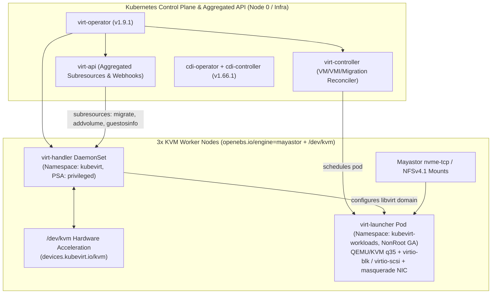

# KubeVirt Virtualization Architecture & Deployment Specification

**Project Name:** Deploy High-Performance Storage for Kubernetes  
**Project ID:** SWFW_5S_08  
**Program:** Zoho SETU — College Student Project Program  
**Sprint Scope:** KubeVirt `v1.9.1` + CDI `v1.66.1` Integration  
**Three-State Classification:** `IMPLEMENTED` + `VALIDATED` (Manifests, CRD Schemas, Dry-Runs, KVM/CPU Host Checks, Refusal Gates) | `INFRASTRUCTURE-DEPENDENT` (Multi-Node Operator Execution & Live VM Workloads)

---

## 1. Pinned Software Versions & Compatibility Verification

| Component | Pinned Version | Verification Basis | Notes & Compatibility Boundaries |
| :--- | :--- | :--- | :--- |
| **KubeVirt Core & Operator** | **`v1.9.1`** | GitHub release (`2026-10-12`), `go.mod` (`k8s.io/api v0.34.2`), `pkg/virt-config/featuregate/` | Qualified Kubernetes window `>=1.35 <1.37`; aligns directly with Candidate B target `v1.36.6`. |
| **CDI (Containerized Data Importer)** | **`v1.66.1`** | GitHub release (`2026-09-06`), `go.mod` (`k8s.io/api v0.31.5`) | Replaces preliminary draft `v1.61.x` (March 2025) so CDI aligns with K8s `1.36` and fixes 4k block imports (`ADR-013`). |
| **`virtctl` Client CLI** | **`v1.9.0`** | Installed & SHA-256 verified in M1 (`scripts/setup/install-dev-tools.sh`) | Matches KubeVirt `v1.9.x` minor series cleanly; operators may optionally bump `virtctl` to `v1.9.1`. |
| **RWX Fallback CSI Provisioner** | **`csi-driver-nfs` `v4.9.0`** | Helm repo index verified (`helm search repo` confirmed `v4.9.0`); `storage/nfs/` passes `kubeconform -strict` & `yamllint` | Exposes `nfs.csi.k8s.io` (`nfs-mayastor-rwx`) backed by `docker.io/itsthenetwork/nfs-server-alpine:12` over Mayastor RWO. |

---

## 2. Control Plane & Worker Node Topology

---

## 3. Declarative CR Decisions (`v1.9.1` & `v1.66.1`)

### 3.1 `KubeVirt` CR (`kubevirt/installation/kubevirt-cr.yaml`)
- **Feature Gates Verified Against `v1.9.1` Source (`pkg/virt-config/featuregate/active.go` & `inactive.go`):**
  - `LiveMigration`, `VMLiveUpdateFeatures` (GA `v1.5.0`), `HotplugVolumes`, `HotplugNICs` (GA `v1.4.0`), and `VMExport` (GA `v1.9.0`) are **always enabled**; putting retired GA gates into `featureGates` triggers webhook warnings and is deliberately omitted.
  - `DeclarativeHotplugVolumes` is **Beta** (enabled by default in `v1.9.1`).
- **Live Update Configuration:** Sets `spec.configuration.vmRolloutStrategy: LiveUpdate` alongside `liveUpdateConfiguration` (`maxHotplugRatio: 4`, `maxCpuSockets: 8`, `maxGuest: "16Gi"`) enabling dynamic CPU socket and memory expansion.
- **Hardware Acceleration Enforcement:** Sets `developerConfiguration.useEmulation: false` so benchmarks never silently fall back to slow QEMU TCG software emulation.
- **Migration Defaults:** Enables pre-copy TLS encryption (`disableTLS: false`), enables auto-converge (`allowAutoConverge: true`), disables unsafe post-copy (`allowPostCopy: false`), limits outbound stream bandwidth (`bandwidthPerMigration: "64Mi"`), and retains SELinux coordination safety (`matchSELinuxLevelOnMigration: false`).

### 3.2 `CDI` CR (`kubevirt/installation/cdi-cr.yaml`)
- Enables `HonorWaitForFirstConsumer` so DataVolume PVC binding waits for `virt-launcher` scheduling topology.
- Directs transient decompression scratch space onto replicated storage (`scratchSpaceStorageClass: "mayastor-nvme-r3-ext4"`) instead of ephemeral node root disks.
- Omits `dataVolumeTTLSeconds` because that field was deprecated/removed in CDI `v1.62`.

---

## 4. Preflight Requirements, WSL2 Limitations & Deployment Flow

1. **Cluster & Host Prerequisites:** Verified by [`scripts/validate/validate-kubevirt.sh`](../scripts/validate/validate-kubevirt.sh) and [`scripts/setup/06-deploy-kubevirt.sh`](../scripts/setup/06-deploy-kubevirt.sh):
   - CPU virtualization flags (`vmx` Intel or `svm` AMD).
   - Character device `/dev/kvm` present (`stat` check + non-destructive `ioctl(KVM_GET_API_VERSION, 0xAE00)` when user holds `kvm` group read/write).
   - Multi-node Ubuntu worker topology (`>= 3` workers recommended for storage + migration headroom).
2. **Explicit WSL2 Boundary (No Fake Claims):**
   - On the local WSL2 development host (`3515 MiB` total RAM, `~2.4 GiB` available, single-node K3s `v1.36.6+k3s1`), `amd` `svm` and `/dev/kvm` exist (`crw-rw---- root:kvm`), while user `swapn2207` lacks `kvm` group ACL and system RAM cannot host live KubeVirt + CDI + 4 GiB VM workloads safely.
   - `06-deploy-kubevirt.sh` supports offline `--dry-run` validation (zero mutations) and **unconditionally refuses** live cluster installation inside WSL2 (`exit 1`).
3. **Offline Schema Validation:** All KubeVirt, CDI, and Migration CRs validate locally with `kubeconform -strict` against pinned schemas archived under [`kubevirt/installation/schemas/`](../kubevirt/installation/schemas/).
