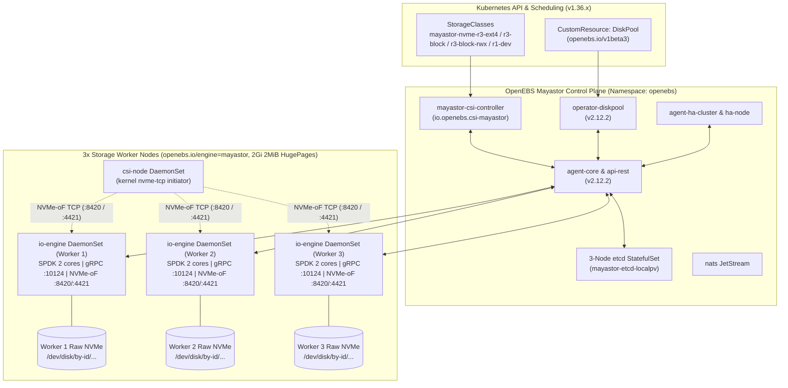

# OpenEBS Mayastor Storage Architecture Specification

**Project Name:** Deploy High-Performance Storage for Kubernetes  
**Project ID:** SWFW_5S_08  
**Program:** Zoho SETU — College Student Project Program  
**Milestone:** M3 — OpenEBS Mayastor Storage Engine & Volume Provisioning  
**Target Chart & Engine Baseline:** `openebs/openebs` **`4.6.2`** bundling Mayastor **`v2.12.2`**  
**Verification Honesty Classification:** `IMPLEMENTED` + `VALIDATED` (Helm lint/template, schemas, safety gates on WSL2) | `INFRASTRUCTURE-DEPENDENT` (Live 3-node SPDK/NVMe-oF deployment)

---

## 1. Software Compatibility & Version Baseline

| Component | Pinned Version | Verification Source | Notes & Qualification Boundary |
| :--- | :--- | :--- | :--- |
| **Umbrella Helm Chart** | `openebs/openebs` **`4.6.2`** | `https://openebs.github.io/openebs` (`helm show chart`) | Verified bundling `mayastor` subchart `2.12.2` (`chart-metadata.yaml`). |
| **Mayastor Engine & CSI** | **`v2.12.2`** | `docker.io/openebs/mayastor-*:v2.12.2` | Upstream E2E/CI qualified up to Kubernetes **`v1.35.6`**. |
| **Kubernetes Cluster Target** | `v1.36.x` (Candidate B, WSL2 K3s `v1.36.6+k3s1`) | `ADR-010`, M2 deployment | Upstream K8s `1.36` qualification for Mayastor `v2.12.2` remains uncertified by OpenEBS CI (**explicit compatibility gap**). |
| **Container Runtime** | `containerd` `2.3.x` LTS | `ADR-010`, M2 config | Official pairing for Kubernetes 1.36+. |
| **Host Operating System** | Ubuntu Server `24.04` LTS (`x86_64`) | Target node spec | Requires `sse4_2`, `nvme_tcp`, and `2MiB` HugePages. |
| **Internal Coordination Store** | `openebs/etcd:3.6.4-debian-12-r0` | Rendered `4.6.2` chart | Backed by internal `localpv-provisioner:4.6.0` (`mayastor-etcd-localpv`). |
| **Event Bus** | `nats:2.9.17-alpine` | Rendered `4.6.2` chart | JetStream eventing between Mayastor core and agents. |

> [!WARNING]
> **Kubernetes 1.36 vs. Mayastor v2.12.2 Compatibility Boundary:**  
> OpenEBS Mayastor `v2.12.2` upstream release documentation records automated E2E validation through Kubernetes `v1.35.6`. Because Project `SWFW_5S_08` adopted Candidate B (`Kubernetes 1.36.x` + `containerd 2.3.x LTS`) per [`DECISIONS.md`](../DECISIONS.md) (`ADR-010`), static Helm rendering (`openebs 4.6.2`) was verified against live Kubernetes `v1.36.6` server API dry-run in M3, whereas live Mayastor pod startup and NVMe-oF CSI operation on `1.36.x` remain `INFRASTRUCTURE-DEPENDENT` until multi-node execution.

---

## 2. Control Plane, Data Plane & Chart Scoping

The umbrella chart `openebs/openebs` (`4.6.2`) is configured declaratively in [`infrastructure/storage/openebs/values.yaml`](../infrastructure/storage/openebs/values.yaml) and scoped to namespace `openebs` ([`namespace.yaml`](../infrastructure/storage/openebs/namespace.yaml)) with Pod Security Admission (`enforce: privileged`, required strictly for SPDK PCI/HugePages/host `/dev` access in `io-engine` and NVMe-oF initiator mounting in `csi-node`).

### 2.1 Intentional Umbrella Chart Inclusions & Exclusions
1. **Disabled Unused Local Engines:** `engines.local.lvm.enabled=false`, `engines.local.zfs.enabled=false`, and `engines.local.rawfile.enabled=false` exclude LVM, ZFS, and rawfile provisioners from deployment.
2. **Retained Internal `hostpath` Backing Only:** `engines.local.hostpath.enabled=true` is intentionally retained with `localpv-provisioner.hostpathClass.enabled=false` because Mayastor's internal 3-node `etcd` StatefulSet requests PersistentVolumeClaims against `mayastor-etcd-localpv` (`openebs.io/local`). Disabling `localpv-provisioner` completely leaves Mayastor's internal etcd `Pending`.
3. **Observability Scoping:** Chart-bundled `loki.enabled=false`, `alloy.enabled=false`, and `mayastor.obs.callhome.enabled=false` prevent heavy log aggregation pipelines and external telemetry from consuming constrained worker RAM; M8 will integrate Prometheus `base.metrics` scraping on port `9502`.
4. **Upstream Template Caveat (`hugepages-1Gi`):** The upstream `openebs 4.6.2` `io-engine-daemonset.yaml` template renders an unpopulated `hugepages-1Gi: null` key when omitted from `values.yaml`. Passing `hugepages1Gi: ""` fails Kubernetes Quantity validation (`kubectl apply --dry-run=server`), whereas leaving it omitted/null passes live Kubernetes `v1.36.6` server validation (`--dry-run=server`). This upstream quirk is preserved intentionally and documented so template linters do not misinterpret it.

---

## 3. Data-Plane Tuning & Rebuilding Semantics

Configured in [`infrastructure/storage/openebs/values.yaml`](../infrastructure/storage/openebs/values.yaml):
- **Node Affinity:** `openebs.io/engine: mayastor` and `kubernetes.io/arch: amd64` ensure `io-engine` pods never schedule onto the dedicated Kubernetes control plane node.
- **Dedicated CPU & Memory:** `cpuCount: "2"`, `cpu: "2"` requests/limits, `memory: "1Gi"`, and `hugepages2Mi: "2Gi"` (1024 x `2MiB` hugepages pinned per storage worker). Because SPDK runs user-space polled-mode reactor loops at 100% duty cycle on pinned cores, control-plane overhead and workload pods must retain sufficient non-SPDK headroom (`>= 16 GiB` worker minimum, `32 GiB` preferred per `ARCHITECTURE.md`).
- **NVMe-oF TCP & Partial Rebuild:** `target.nvmf.rdma.enabled=false`, persistent reservations (`ptpl: true`), `nvme.ioTimeout="110s"`, `agents.core.rebuild.partial.enabled=true`, and `waitPeriod="10m"` (`--faulted-child-wait-period=10m`). Transient replica disconnects within the 10-minute window replay incremental write logs instead of triggering immediate full replica reconstruction.

---

## 4. DiskPool (`openebs.io/v1beta3`) & Safety Discipline

Verified directly against `openebs/mayastor-control-plane` `v2.12.2` Rust CRD definition (`k8s/operators/src/pool/diskpool/crd/v1beta3.rs`):
- **Manifest:** [`infrastructure/storage/mayastor/diskpools.yaml`](../infrastructure/storage/mayastor/diskpools.yaml)
- **Local Strict JSON Schema:** [`infrastructure/storage/mayastor/schemas/openebs.io/diskpool_v1beta3.json`](../infrastructure/storage/mayastor/schemas/openebs.io/diskpool_v1beta3.json)
- **Safety Gate:** Pool manifests intentionally use explicit placeholders (`<WORKER_NODE_1..3>`, `/dev/disk/by-id/<RAW_NVME_BY_ID_WORKER_1..3>`) rather than guessed kernel names (`/dev/nvme0n1`). `05-deploy-mayastor.sh` **never auto-applies `diskpools.yaml`** — operators must first verify blank, unmounted, institutionally approved NVMe devices via `lsblk` / `validate-mayastor-prerequisites.sh`.

---

## 5. StorageClasses & CSI Parameter Truthfulness (`v2.12.2`)

CSI driver provisioner name verified from `v2.12.2` (`utils/utils-lib/src/constants.rs`): **`io.openebs.csi-mayastor`**.  
Implemented in [`infrastructure/storage/examples/storageclasses.yaml`](../infrastructure/storage/examples/storageclasses.yaml):

| StorageClass Name | `repl` | `volumeMode` / Target Use | `reclaimPolicy` | `volumeBindingMode` | Special Parameters |
| :--- | :---: | :--- | :--- | :--- | :--- |
| `mayastor-nvme-r3-ext4` | `3` | `Filesystem` (`ext4`), RWO replicated workloads | `Delete` | `WaitForFirstConsumer` | `protocol: "nvmf"`, `fsType: "ext4"` |
| `mayastor-nvme-r3-block` | `3` | Raw `Block`, KubeVirt VM RWO disks | `Retain` | `WaitForFirstConsumer` | `protocol: "nvmf"` |
| `mayastor-nvme-r3-block-rwx` | `3` | Raw `Block` RWX (KubeVirt migration testing, **EXPERIMENTAL**) | `Retain` | `WaitForFirstConsumer` | `protocol: "nvmf"`, `rwxBlock: "true"` |
| `mayastor-nvme-r1-dev` | `1` | `Filesystem` (`ext4`), single-replica dev/baseline (ZERO redundancy) | `Delete` | `Immediate` | `protocol: "nvmf"`, `fsType: "ext4"` |

### Upstream v2.12.2 CSI Parameter Findings
1. **No `thin` Parameter:** Inspection of `control-plane/csi-driver/src/context.rs` at `v2.12.2` confirms Mayastor volumes are thin-provisioned natively via global `agents.core.capacity.thin.*` settings in `values.yaml` (`poolCommitment: "250%"`, `volumeCommitment: "40%"`); no `thin` StorageClass key exists in `v2.12.2`.
2. **RWX Constraint (`rwxBlock`):** Native Mayastor `ReadWriteMany` requires **both** `rwxBlock: "true"` on the StorageClass **and** `volumeMode: Block` on the PVC. General `Filesystem` `RWX` remains outside native Mayastor scope and is addressed by the M4/M5 Ganesha NFS gateway (`csi-driver-nfs`).
