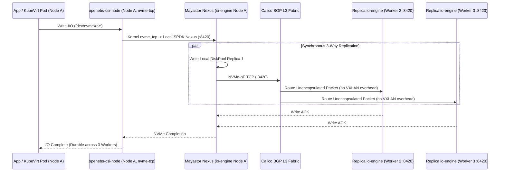

# OpenEBS Mayastor & NVMe-oF TCP Networking Design

**Project Name:** Deploy High-Performance Storage for Kubernetes  
**Project ID:** SWFW_5S_08  
**Program:** Zoho SETU — College Student Project Program  
**Milestone:** M3 — OpenEBS Mayastor Storage Engine & Volume Provisioning  
**Related Port Audit:** See canonical 20-port firewall specification in [`ARCHITECTURE.md`](../ARCHITECTURE.md)

---

## 1. Transport Protocol Selection: NVMe-oF over TCP

Mayastor `v2.12.2` supports NVMe-oF TCP and RDMA (RoCEv2). Because college lab servers and standard gigabit/10GbE switched testbeds commonly lack uniform RDMA-capable NICs and lossless PFC Ethernet switching, [`infrastructure/storage/openebs/values.yaml`](../infrastructure/storage/openebs/values.yaml) pins:
- `target.nvmf.rdma.enabled: false`
- StorageClass `parameters.protocol: "nvmf"`
- Kernel initiator prerequisite: Linux `nvme_tcp` (`nvme-tcp` module checked by `validate-mayastor-prerequisites.sh`)

When a pod schedules onto any cluster node, `openebs-csi-node` invokes kernel `nvme connect -t tcp` toward the volume Nexus endpoint (`port 8420`), presenting an `/dev/nvmeXnY` block namespace to kubelet or KubeVirt `virt-launcher`.

---

## 2. Mayastor TCP Port Matrix

All Mayastor control-plane and NVMe-oF data-plane ports strictly adhere to the canonical project port matrix (note port `4420` is purged and not used by Mayastor `v2.12.2` target services):

| TCP Port | Protocol / Component | Traffic Path | Operational Purpose |
| :---: | :--- | :--- | :--- |
| **`10124`** | Mayastor gRPC (`io-engine`) | `agent-core` $\leftrightarrow$ `io-engine` pods | Pool/Nexus/Replica management RPC |
| **`8420`** | NVMe-oF / TCP I/O Target | Initiator (`csi-node`) & Nexus $\leftrightarrow$ `io-engine` | High-throughput NVMe block read/write queues & replica mirroring |
| **`4421`** | NVMe-oF / TCP Discovery | `io-engine` internal NVMe target | Subsystem discovery and persistent reservation coordination |
| **`50051`** | Core Agent gRPC | `io-engine` / `csi-controller` / `operator-diskpool` $\rightarrow$ `agent-core` | Registration, volume reconciliation, and health heartbeats |
| **`50052` / `50053`** | HA Cluster / Node gRPC | `agent-ha-cluster` $\leftrightarrow$ `agent-ha-node` | Fast path failure switching & Nexus target relocation |
| **`2379` / `2380`** | Internal `openebs-etcd` | Mayastor control plane $\leftrightarrow$ internal etcd peers | Dedicated persistent storage metadata state (decoupled from K8s Raft etcd) |
| **`4222`** | NATS Event Bus | `io-engine` / agents $\leftrightarrow$ `openebs-nats` | Asynchronous pool/nexus state event streaming |
| **`9502`** | Prometheus Exporter | Prometheus $\rightarrow$ `metrics-exporter-io-engine` | Pool capacity, IOPS, latency, and queue depth metrics |

> [!IMPORTANT]
> **`validate-mayastor-prerequisites.sh`** checks local host socket availability (`ss -tlnH`) for ports `10124`, `8420`, and `4421` without opening listeners or altering firewall rules (`ufw`/`nftables`). Cross-node reachability is explicitly recorded as `NOT_TESTABLE` on single-node hosts.

---

## 3. Data-Path Flow & Calico Routed Fabric Interaction

---

## 4. Timeout, Rebuild Window & MTU Tuning

1. **MTU Guidance:**
   - **Standard Lab Baseline (`1500` bytes):** Safe default across mixed campus switches and WSL2 bridges; avoids silent path-MTU blackholes.
   - **Jumbo Frames (`9000` bytes):** Recommended ONLY when verified end-to-end across switch ports, host NICs, and Calico (`CALICO_IPV4POOL` / Felix `vethMTU`) without fragmentation drops.
2. **NVMe-oF Timeouts vs. Partial Rebuild:**
   - `values.yaml` sets `nvme.ioTimeout: "110s"`, `adminTimeout: "30s"`, `keepAliveTimeout: "10s"`, and `agents.core.rebuild.partial.waitPeriod: "10m"`.
   - When an intermediate network flap or worker reboot lasts `< 10 minutes`, `agent-core` holds the disconnected child in degraded state and replays delta write-log blocks upon reconnect rather than wiping and re-copying the full terabyte-scale replica over TCP.
   - If using single-NIC gigabit Ethernet in campus labs, synchronous `repl: "3"` multiplies write egress by $2\times$ (two remote mirrors); this bandwidth ceiling must be accounted for in M8 FIO analysis.

---

## 5. Local WSL2 Verification Limits

- Kernel module `nvme_tcp` availability (`CONFIG_NVME_TCP=m` or built-in), filesystem drivers (`ext4`, `xfs`), and local port absence (`10124`, `8420`, `4421`) are inspectable read-only on WSL2 via `validate-mayastor-prerequisites.sh`.
- Inter-node NVMe-oF TCP fabric saturation, multi-NIC isolation, firewall rule opening, and degraded-network latency remain **`NOT_TESTABLE` / `INFRASTRUCTURE-DEPENDENT`** until deployment onto the target 4-node network.
