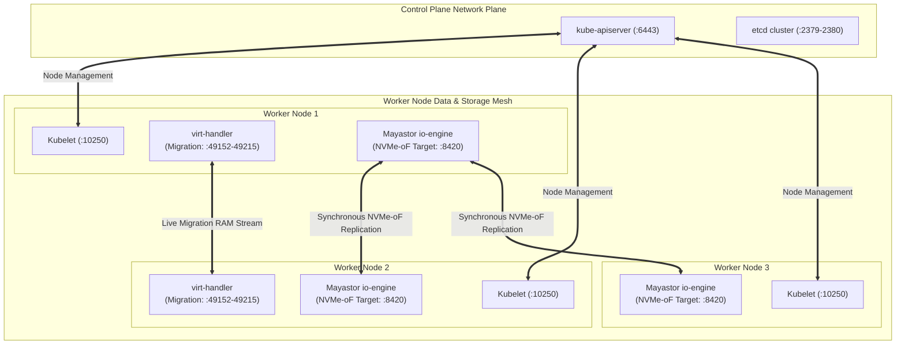

# Network Topology & Virtualization Feasibility Requirements

**Project Name:** Deploy High-Performance Storage for Kubernetes  
**Project ID:** SWFW_5S_08  
**Research Date:** 2026-11-04  
**Document Status:** TECHNICAL SPECIFICATION & PORT MATRIX  
**Classification:** VERIFIED AGAINST UPSTREAM DOCUMENTATION  

---

## 1. Target Network Architecture & Data Flow

The target cluster network must accommodate four distinct traffic classifications:
1. **Cluster Management & Control Traffic:** Kubernetes API calls, `etcd` raft consensus, Kubelet health probes, and operator reconcile loops.
2. **Pod-to-Pod CNI Overlay/Routed Fabric:** General inter-service communication managed by Calico.
3. **Storage Data Fabric (NVMe-oF / TCP):** High-throughput, sub-millisecond block transport carrying NVMe command and completion capsules between the Mayastor Nexus and distributed `DiskPool` replicas.
4. **Live-Migration Memory Streaming:** High-bandwidth TCP socket stream transferring dirty RAM pages between source and target `virt-handler` daemons.

---

## 2. Verified Firewall Port & Protocol Matrix

All ports below have been confirmed against official upstream project documentation:

| Component / Subsystem | Port / Range | Protocol | Source | Destination | Official Architectural Purpose | Documentation Source |
| :--- | :--- | :--- | :--- | :--- | :--- | :--- |
| **Kubernetes API** | `6443` | TCP | Workers, Admins, Controllers | Control Plane | Core Kubernetes API Server entry point | [K8s Ports & Protocols](https://kubernetes.io/docs/reference/networking/ports-and-protocols/) |
| **etcd Database** | `2379–2380` | TCP | kube-apiserver, etcd peers | Control Plane | etcd client API and Raft peer communication | [K8s Ports & Protocols](https://kubernetes.io/docs/reference/networking/ports-and-protocols/) |
| **Kubelet API** | `10250` | TCP | Control Plane, Metrics Server | All Nodes | Pod lifecycle management, logs, and exec streams | [K8s Ports & Protocols](https://kubernetes.io/docs/reference/networking/ports-and-protocols/) |
| **Controller Manager** | `10257` | TCP | Localhost / Self | Control Plane | kube-controller-manager health endpoint | [K8s Ports & Protocols](https://kubernetes.io/docs/reference/networking/ports-and-protocols/) |
| **Scheduler** | `10259` | TCP | Localhost / Self | Control Plane | kube-scheduler health endpoint | [K8s Ports & Protocols](https://kubernetes.io/docs/reference/networking/ports-and-protocols/) |
| **Calico BGP** | `179` | TCP | Worker Nodes | Worker Nodes | Calico native routed pod networking (BGP peer) | [Calico Network Requirements](https://docs.tigera.io/calico/latest/getting-started/kubernetes/requirements) |
| **Calico VXLAN (Alt)** | `4789` | UDP | Worker Nodes | Worker Nodes | Fallback overlay encapsulation port (if BGP restricted) | [Calico Network Requirements](https://docs.tigera.io/calico/latest/getting-started/kubernetes/requirements) |
| **Mayastor NVMe-oF** | `8420` | TCP | Worker CSI Initiators | Worker Nexus / Replicas | NVMe over TCP storage protocol data transport | [Mayastor Networking Docs](https://openebs.io/docs/user-guides/mayastor/prerequisites) |
| **Mayastor gRPC** | `10124` | TCP | Mayastor Core Agent | Worker `io-engine` | Internal SPDK daemon control and pool management | [Mayastor Architecture Reference](https://openebs.io/docs/user-guides/mayastor/architecture) |
| **Mayastor Metrics** | `9502` | TCP | Prometheus Server | Worker `io-engine` | Storage engine Prometheus metrics exporter | [Mayastor Monitoring Docs](https://openebs.io/docs/user-guides/mayastor/monitoring) |
| **KubeVirt API** | `8443` | TCP | kube-apiserver | `virt-api` Pods | Aggregated API server webhook and console router | [KubeVirt Install Guide](https://kubevirt.io/user-guide/operations/installation/) |
| **KubeVirt Migration** | `49152–49215` | TCP | Target `virt-handler` | Source `virt-handler` | QEMU pre-copy live migration socket stream | [KubeVirt Live Migration Guide](https://kubevirt.io/user-guide/compute/live_migration/) |
| **KubeVirt Metrics** | `8186` | TCP | Prometheus Server | `virt-handler` Pods | KubeVirt hypervisor and VM runtime metrics | [KubeVirt Monitoring](https://kubevirt.io/user-guide/operations/monitoring/) |
| **NFS Gateway** | `2049` | TCP | KubeVirt VMs, Workers | NFS Server Pod / Service | Shared filesystem mount for RWX live-migratable VMs | [Linux NFS Documentation](https://linux-nfs.org/wiki/index.php/Main_Page) |
| **RPCbind (NFS)** | `111` | TCP/UDP | KubeVirt VMs, Workers | NFS Server Pod | RPC port mapper for NFS client mounts | [Linux NFS Documentation](https://linux-nfs.org/wiki/index.php/Main_Page) |

---

## 3. Virtualization Feasibility & Hypervisor Primitives

### 3.1 The Virtualization Stack Taxonomy
To ensure technical precision, the four layers of virtualization relevant to this project are defined:

1. **Linux Virtual Machine (e.g., standard KVM guest):**  
   An isolated guest operating system running on a host hypervisor. The guest kernel has no awareness that it is virtualized unless paravirtualized drivers (`virtio`) are utilized.
2. **Kubernetes Worker Node:**  
   A Linux OS instance (either physical or virtual) executing the Kubelet and container runtime. Workloads running on a worker node are containerized Linux processes sharing the worker's kernel.
3. **KubeVirt inside a Kubernetes Worker:**  
   A specialized container architecture where the containerized process inside the pod wrapper (`virt-launcher`) is a full QEMU emulator backed by the Linux KVM kernel module (`/dev/kvm`). Instead of running microservices, the container hosts a virtual hardware platform executing an independent guest OS.
4. **Nested Virtualization:**  
   The execution of a hypervisor *inside* a virtual machine that is itself hosted on an underlying hypervisor (Hypervisor $\rightarrow$ Guest VM 1 / Hypervisor $\rightarrow$ Nested Guest VM 2). Requires the physical host CPU to virtualize its own hardware virtualization instructions (`vmx` or `svm`).

### 3.2 Hardware KVM Requirements & `/dev/kvm`
- **KVM Acceleration:** KubeVirt requires access to the character device `/dev/kvm` created by the Linux `kvm` and `kvm_intel` / `kvm_amd` kernel modules.
- **TCG Software Fallback:** If `/dev/kvm` is unavailable, KubeVirt can theoretically be forced into QEMU software emulation (TCG - Tiny Code Generator) via the `developerConfiguration: useEmulation: true` flag in the `KubeVirt` CR.  
  *Benchmark Impact:* Software emulation is **10x to 50x slower** than hardware virtualization. In-guest storage benchmarking (`fio`) under TCG measures CPU instruction translation bottlenecks rather than NVMe storage performance, rendering benchmark data invalid.
- **Bare-Metal Linux Preference:** Physical bare-metal hosts directly expose `/dev/kvm` without nested translation latency, providing the only scientifically valid platform for storage benchmarking.
