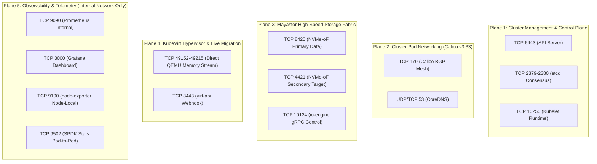
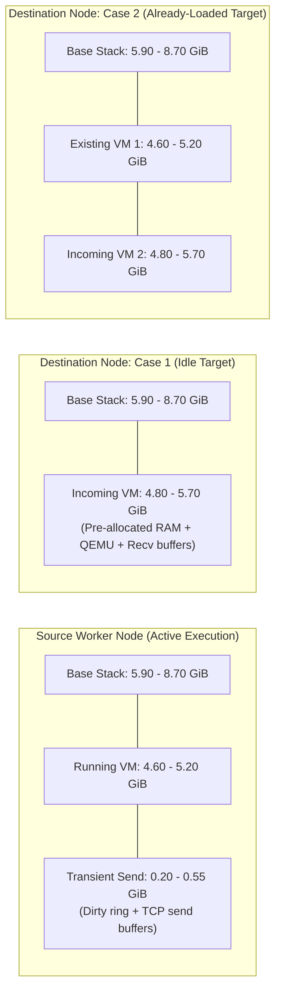

# Network Topology, Port Matrix & Virtualization Resource Requirements

**Project Name:** Deploy High-Performance Storage for Kubernetes  
**Project ID:** SWFW_5S_08  
**Audit Date:** 2026-11-05 (Chunk 1.10 Final Reconciliation)  
**Document Status:** AUDITED TECHNICAL RESOURCE & PORT SPECIFICATION  
**Governance Scope:** Bare-Metal Host Sizing, Precise Decimal-to-Binary Memory Math, Migration Budgets, and Authoritative Port Audit  

---

> [!CRITICAL]
> **Chunk 1.10 Key Resource & Network Audits:**  
> 1. **Precise Decimal-to-Binary Memory Math:** 16 GB = **14.90 GiB** ($16 \times 10^9 / 1024^3$); 32 GB = **29.80 GiB** ($32 \times 10^9 / 1024^3$). All derived headroom values must account for explicit component ranges and hardware/firmware reservations.
> 2. **Independent Migration Budgets:** Source and destination nodes experience asymmetric memory demands during live migration. Destination nodes already hosting an existing VM require **15.30 – 19.60 GiB** during cutover, causing guaranteed OOM failure on 16 GB hosts.
> 3. **Authoritative Mayastor Ports:** Official prerequisites mandate **TCP 10124** (gRPC), **TCP 8420** (primary NVMe-oF target), and **TCP 4421** (secondary NVMe-oF target). TCP 4420 is purged. TCP 8011 (REST API) is removed from the mandatory host-to-host firewall.
> 4. **Monitoring Port Isolation:** Metrics and service ports (9090, 3000, 9100) are classified as internal management only and must **never** be exposed publicly.

---

## 1. Cluster Network Topology & Traffic Segmentation

---

## 2. Authoritative Firewall Port & Traffic Specification

Every port below has been verified against official upstream component prerequisites. Directionality, source/destination components, traffic scope, and network boundaries are explicitly specified:

| Port / Range | Protocol | Source Component | Destination Component | Direction | Scope / Network Boundary | Mandatory or Optional | Official Documentation Source |
| :--- | :--- | :--- | :--- | :--- | :--- | :--- | :--- |
| **`6443`** | TCP | Worker Nodes / Admin | Control Plane (`kube-apiserver`) | Inbound to CP | Inter-Node (Cluster-Wide) | **Mandatory** | [Kubernetes Ports](https://kubernetes.io/docs/reference/networking/ports-and-protocols/) |
| **`2379`** | TCP | `kube-apiserver` | Control Plane (`etcd` Client) | Local / Inter-CP | Node-to-CP (Internal) | **Mandatory** (CP) | [Kubernetes Ports](https://kubernetes.io/docs/reference/networking/ports-and-protocols/) |
| **`2380`** | TCP | `etcd` Peers | Control Plane (`etcd` Peer) | Bi-directional | CP-to-CP only | **Mandatory** (Multi-CP) | [Kubernetes Ports](https://kubernetes.io/docs/reference/networking/ports-and-protocols/) |
| **`10250`** | TCP | `kube-apiserver` | Kubelet on Workers | Inbound to Worker | Inter-Node (Cluster-Wide) | **Mandatory** | [Kubernetes Ports](https://kubernetes.io/docs/reference/networking/ports-and-protocols/) |
| **`10257`** | TCP | Localhost / Self | `kube-controller-manager` | Localhost | Localhost only | **Mandatory** (Localhost) | [Kubernetes Ports](https://kubernetes.io/docs/reference/networking/ports-and-protocols/) |
| **`10259`** | TCP | Localhost / Self | `kube-scheduler` | Localhost | Localhost only | **Mandatory** (Localhost) | [Kubernetes Ports](https://kubernetes.io/docs/reference/networking/ports-and-protocols/) |
| **`179`** | TCP | `calico-node` (Worker A) | `calico-node` (Worker B) | Bi-directional | Inter-Node (Worker Mesh) | **Mandatory** (BGP mode) | [Calico Requirements](https://docs.tigera.io/calico/latest/getting-started/kubernetes/requirements) |
| **`4789`** | UDP | `calico-node` | `calico-node` | Bi-directional | Inter-Node | **Optional** (VXLAN only; unused in BGP) | [Calico Requirements](https://docs.tigera.io/calico/latest/getting-started/kubernetes/requirements) |
| **`8420`** | TCP | Host NVMe Initiator / Nexus | Mayastor `io-engine` Target | Inbound to Target | Inter-Node (Storage Mesh) | **Mandatory** | [Mayastor Prerequisites](https://openebs.io/docs/main/quickstart-guide/prerequisites) |
| **`4421`** | TCP | Host NVMe Initiator / Nexus | Mayastor Secondary Target | Inbound to Target | Inter-Node (Storage Mesh) | **Mandatory** | [Mayastor Prerequisites](https://openebs.io/docs/main/quickstart-guide/prerequisites) |
| **`10124`** | TCP | Mayastor Control Agents | Mayastor `io-engine` Pod | Inbound to Worker | Inter-Node / CP-to-Worker | **Mandatory** | [Mayastor Prerequisites](https://openebs.io/docs/main/quickstart-guide/prerequisites) |
| **`8443`** | TCP | `kube-apiserver` | KubeVirt `virt-api` Pod | Inbound to Pod | Cluster-Internal (Pod Network) | **Mandatory** | [KubeVirt Operations](https://kubevirt.io/user-guide/operations/installation/) |
| **`8444`** | TCP | `kube-apiserver` | KubeVirt `virt-operator` Pod | Inbound to Pod | Cluster-Internal (Pod Network) | **Mandatory** | [KubeVirt Operations](https://kubevirt.io/user-guide/operations/installation/) |
| **`49152–49215`**| TCP | Source `virt-launcher` QEMU | Destination `virt-launcher` QEMU| Outbound $\rightarrow$ Inbound | Inter-Node (Worker to Worker) | **Mandatory** (Live Migration) | [KubeVirt Live Migration](https://kubevirt.io/user-guide/compute/live_migration/) |
| **`8186`** | TCP | Prometheus Scraper | KubeVirt `virt-handler` Pod | Inbound to Pod | Cluster-Internal (Metrics) | **Optional** (Monitoring) | [KubeVirt Monitoring](https://kubevirt.io/user-guide/operations/monitoring/) |
| **`9502`** | TCP | Prometheus Scraper | Mayastor Stats Exporter | Inbound to Pod | Cluster-Internal (Metrics) | **Optional** (Monitoring) | [Mayastor Monitoring](https://openebs.io/docs/user-guides/mayastor/monitoring) |
| **`9090`** | TCP | Admin / Grafana | Prometheus Server Pod | Inbound to Pod | Internal Management Only | **Optional** (Never expose publicly) | [Prometheus Documentation](https://prometheus.io/docs/) |
| **`3000`** | TCP | Admin Web Browser | Grafana Dashboard Pod | Inbound to Pod | Internal Management Only | **Optional** (Never expose publicly) | [Grafana Documentation](https://grafana.com/docs/) |
| **`9100`** | TCP | Prometheus Scraper | `node-exporter` DaemonSet | Inbound to Node | Cluster-Internal / Management | **Optional** (Monitoring) | [Prometheus node-exporter](https://github.com/prometheus/node_exporter) |
| **`2049`** | TCP | NFS Client Pod / Worker | NFS Gateway Pod | Inbound to Pod | Cluster-Internal (Pod Network) | **Optional** (NFS Fallback only) | [Linux NFS Documentation](https://linux-nfs.org/wiki/index.php/Main_Page) |

### Port Clarifications & Purged Ports
1. **TCP 4420 Purged:** Standard IANA NVMe-oF uses port 4420. However, OpenEBS Mayastor explicitly configures **TCP 8420** for its primary data-plane target and **TCP 4421** for its secondary target listeners. Port 4420 is not used by Mayastor and is purged from the firewall configuration.
2. **TCP 8011 Removed from Mandatory Host Firewall:** In Mayastor 2.x, the REST API gateway (`mayastor-api-rest`) is exposed internally as a Kubernetes `ClusterIP` service (default port 8080/8011 on pod network). It is accessed securely via `kubectl-mayastor` using Kubernetes API proxying. It does not require host-to-host firewall openings between physical servers.
3. **Multus CNI Socket Mechanism:** Multus CNI operates in-process via local UNIX domain sockets (`/run/multus/` or `/run/containerd/containerd.sock`) and local binary exec calls (`/opt/cni/bin/`). It opens **zero network ports** on the host.

---

## 3. Worker Node CPU Engineering & SPDK Polling Sizing

### 3.1 SPDK Polled Mode Driver (PMD) Execution
- Mayastor’s `io-engine` bypasses kernel interrupts by utilizing user-space polling threads.
- SPDK worker threads execute infinite loops querying NVMe-oF submission and completion queues.
- **100% Core Utilization by Design:** Allocated CPU cores will continuously display **100% CPU utilization in Linux system monitors (`top`/`htop`)**, even when the system is idle.
- **Mandatory Two-Core Reservation:** Official Mayastor engineering mandates reserving **2 physical cores exclusively for each `io-engine` instance**.

### 3.2 Worker Node CPU Allocation Budget

| Subsystem Component | Minimum Allocation | Preferred Allocation | Operational Function & CPU Behavior |
| :--- | :---: | :---: | :--- |
| **Mayastor SPDK `io-engine`** | **2 Dedicated Cores** | **2 Dedicated Cores** | User-space PMD busy-poll loops (100% continuous core saturation). |
| **Host Linux OS & Kernel** | **1 Core** | **2 Cores** | Interrupt handling, TCP/IP stack execution, SSH, page cache sync. |
| **Kubernetes Node Daemons** | **1 Core** | **2 Cores** | `kubelet`, `containerd`, Calico BGP agent (`calico-node`), `kube-proxy`. |
| **KubeVirt `virt-handler`** | **Shared with OS** | **1 Core** | libvirt/QEMU lifecycle events and cgroup management. |
| **Guest Virtual Machine vCPUs**| **2 vCPUs** | **4 – 8 vCPUs** | Guest OS execution, synthetic benchmarking (`fio`), database engines. |
| **Total Worker CPU Budget:** | **6 Physical Cores (Minimum)** | **8 – 16 Physical Cores (Preferred)** | **A 4-core CPU is rejected: dedicating 2 cores to SPDK leaves only 2 cores shared across OS, K8s, and the VM, resulting in high context-switch latency.** |

---

## 4. Worker Node Memory Engineering: Exact Binary Math & Allocation Ranges

### 4.1 Exact Decimal-to-Binary Conversion
- **Decimal Gigabyte (GB):** $10^9 = 1,000,000,000$ bytes.
- **Binary Gibibyte (GiB):** $2^{30} = 1,073,741,824$ bytes.
- **Conversion Factor:** $\frac{10^9}{2^{30}} \approx 0.9313225746$.
- **16 GB Physical Module:** $16 \times 0.9313225746 = \mathbf{14.90116\text{ GiB}} \approx \mathbf{14.90\text{ GiB}}$.
- **32 GB Physical Module:** $32 \times 0.9313225746 = \mathbf{29.80232\text{ GiB}} \approx \mathbf{29.80\text{ GiB}}$.

### 4.2 Explicit Hardware & Subsystem Allocation Ranges

| Subsystem / Allocation Component | Nominal Range (GiB) | Underlying Technical Mechanism & Assumptions |
| :--- | :---: | :--- |
| **Physical Memory Installed** | **14.90 GiB** (16 GB) / **29.80 GiB** (32 GB) | Total physical silicon capacity. |
| **Firmware / Hardware Reservations** | **0.20 – 0.50 GiB** | UEFI firmware, ACPI tables, PCI MMIO apertures, and kernel crashdump buffers. Assumes server lacks integrated GPU (if iGPU active, reservation increases by 0.5–1.0 GiB). |
| **Usable Physical Memory (`MemTotal`)** | **14.40 – 14.70 GiB** (16 GB) / **29.30 – 29.60 GiB** (32 GB) | Actual memory visible to Linux kernel page allocator. |
| **SPDK 2 MiB HugePages (Mandatory)** | **2.00 GiB** | Pre-allocated at boot (`nr_hugepages=1024`). Subtracted permanently from kernel page pool; unusable by ordinary processes. |
| **Mayastor `io-engine` Heap** | **1.00 – 1.50 GiB** | User-space process heap, NVMe-oF command capsules, write log dirty extent buffers, gRPC threads. |
| **Host OS, Runtime & K8s Daemons** | **2.30 – 4.00 GiB** | Linux kernel slab, network socket buffers, systemd, containerd 2.3, kubelet, Calico v3.33. |
| **KubeVirt `virt-handler` Overhead** | **0.40 – 0.80 GiB** | DaemonSet managing libvirtd and QEMU cgroup status. |
| **Monitoring Daemons (Exporters)** | **0.20 – 0.40 GiB** | `node-exporter` and Mayastor metrics exporters. |
| **Total Base Infrastructure Load** | **5.90 – 8.70 GiB** | **Baseline static memory consumed before any virtual machine is started.** (Nominal midpoint: ~7.20 GiB). |
| **Guest Virtual Machine RAM** | **4.00 GiB** (Standard) / **8.00 GiB** (Heavy) | Explicit guest physical RAM configured in VMI resource spec. |
| **QEMU Process Memory Overhead** | **0.60 – 1.20 GiB** (per VM) | MMIO emulation, vhost network buffers, virtio-scsi ring descriptors, vCPU thread stacks. |

---

## 5. Independent Live-Migration Memory Budgets: Source vs. Destination

Live migration generates asymmetric memory pressure on the participating nodes during iterative RAM pre-copy and handover:

### 5.1 Source Node Memory Budget During Live Migration

The source node hosts the active executing VM while tracking and transmitting modified memory pages:

| Source Node Component | Allocation Range (GiB) | Technical Notes |
| :--- | :---: | :--- |
| Base Infrastructure (OS, K8s, Mayastor, FW) | 5.90 – 8.70 GiB | Baseline static reservation (HugePages + daemons). |
| Active Guest VM Memory | 4.00 GiB | Guest system RAM. |
| QEMU Process Overhead | 0.60 – 1.20 GiB | Virtio descriptors, MMIO emulation, KVM structures. |
| Dirty Page Tracking Overhead | 0.10 – 0.25 GiB | KVM dirty ring buffers and QEMU dirty page logging. |
| Migration Streaming Socket Send Buffers | 0.10 – 0.30 GiB | Kernel TCP send buffers transmitting memory over port 49152+. |
| **Total Source Memory Committed:** | **10.70 – 14.45 GiB** | **Peak footprint during iterative memory pre-copy.** |
| **Headroom on 16 GB Host (14.90 GiB total):**| **0.45 – 4.20 GiB** | **Feasible, but memory headroom is narrow.** |
| **Headroom on 32 GB Host (29.80 GiB total):**| **15.35 – 19.10 GiB** | **Extremely safe; zero risk of OOM.** |

---

### 5.2 Destination Node Memory Budget: Case 1 vs. Case 2

The destination node must pre-allocate the target QEMU process, initialize virtual devices, and buffer incoming memory pages before execution cutover.

#### Case 1: Normal Single-VM Migration (Destination Initially Idle)
The destination node currently hosts zero virtual machines:

| Destination Component (Case 1) | Allocation Range (GiB) | Technical Notes |
| :--- | :---: | :--- |
| Base Infrastructure (OS, K8s, Mayastor, FW) | 5.90 – 8.70 GiB | Baseline static reservation. |
| Incoming Guest VM RAM Pre-allocation | 4.00 GiB | Target QEMU allocates full guest memory upfront. |
| Target QEMU Process Overhead | 0.60 – 1.20 GiB | Virtio emulation structures on destination. |
| Migration Receive & Decompression Buffers | 0.20 – 0.50 GiB | TCP receive socket buffers and page unpacking queues. |
| **Total Destination Memory (Case 1):** | **10.70 – 14.40 GiB** | **Peak footprint on destination during handover.** |
| **Headroom on 16 GB Host (14.90 GiB total):** | **0.50 – 4.20 GiB** | **Feasible on an idle 16 GB host.** |
| **Headroom on 32 GB Host (29.80 GiB total):** | **15.40 – 19.10 GiB** | **Fully stable.** |

---

#### Case 2: Conservative Destination-Already-Loaded Case (Target Hosts Existing VM)
The destination node is already running an active 4.0 GiB VM when migration begins:

| Destination Component (Case 2) | Allocation Range (GiB) | Technical Notes |
| :--- | :---: | :--- |
| Base Infrastructure (OS, K8s, Mayastor, FW) | 5.90 – 8.70 GiB | Baseline static reservation. |
| Existing VM 1 Guest Memory | 4.00 GiB | Guest system RAM of active VM 1. |
| Existing VM 1 QEMU Overhead | 0.60 – 1.20 GiB | Running QEMU process overhead for VM 1. |
| **Pre-Migration Existing Load:** | **10.50 – 13.90 GiB** | **Node memory committed before incoming migration starts.** |
| Incoming VM 2 Guest Memory Pre-allocation | 4.00 GiB | Target QEMU pre-allocates guest memory for VM 2. |
| Incoming VM 2 QEMU Process Overhead | 0.60 – 1.20 GiB | Target QEMU emulated devices and thread stacks. |
| Migration Receive Buffers | 0.20 – 0.50 GiB | Inbound TCP receive queue for incoming VM 2. |
| **Total Destination Memory During Cutover:**| **15.30 – 19.60 GiB** | **Simultaneous presence of both VMs during handover.** |
| **Headroom on 16 GB Host (14.90 GiB total):** | **-0.40 to -4.70 GiB (DEFICIT)** | **FATAL FAILURE: Guaranteed Linux OOM Kill or Kubelet Pod Eviction!** |
| **Headroom on 32 GB Host (29.80 GiB total):** | **10.20 – 14.50 GiB** | **COMFORTABLE & SAFE: Accommodates dual-VM presence with abundant safety margin.** |

---

### 5.3 Architectural Sizing Conclusion
- **16 GB Physical RAM Limitation:** A 16 GB worker node can participate in live migration **only if the destination node hosts zero other workloads**. If a worker node already hosts a running VM, initiating live migration to that node will trigger immediate Out-Of-Memory termination.
- **32 GB Physical RAM Mandate for Production & Benchmarking:** To allow flexible workload balancing, multi-VM live migration, and steady-state FIO benchmarking without eviction risk, **32 GB physical RAM per worker node is the mandatory recommended standard**.
