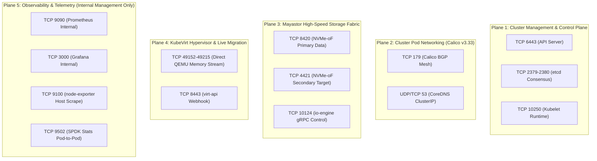
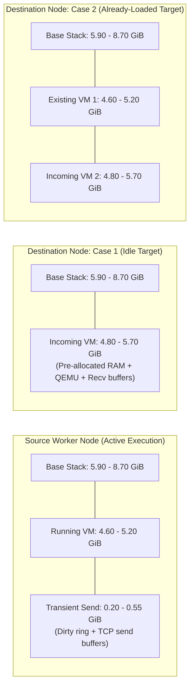

# Network Topology, Port Matrix & Virtualization Resource Requirements

**Project Name:** Deploy High-Performance Storage for Kubernetes  
**Project ID:** SWFW_5S_08  
**Audit Date:** 2026-11-05 (Chunk 1.11 Final Baseline & Evidence Closure)  
**Document Status:** AUDITED TECHNICAL RESOURCE & PORT SPECIFICATION  
**Governance Scope:** Bare-Metal Host Sizing, Precise `MemTotal` Headroom Math, Asymmetric Migration Budgets, and Canonical 20-Port Audit  

---

> [!CRITICAL]
> **Chunk 1.11 Key Resource & Network Audits:**  
> 1. **Canonical 20-Port Reconciled Matrix:** Exactly 20 verified network ports and ranges are audited, explicitly distinguishing inter-node physical host firewall requirements from cluster-internal pod-network services and localhost loopbacks.
> 2. **`MemTotal` Headroom Calculations:** Headroom is calculated against visible kernel memory (`MemTotal`: $\approx \mathbf{14.40 - 14.70\text{ GiB}}$ on 16 GB hosts, and $\approx \mathbf{29.30 - 29.60\text{ GiB}}$ on 32 GB hosts), rather than unadjusted raw physical capacity.
> 3. **Planning Estimates Disclaimer:** All memory figures represent planning estimates; actual `MemTotal` must be confirmed on allocated hardware via `/proc/meminfo`.
> 4. **Loaded Destination Infeasibility:** On a 16 GB host, a destination node already running an active VM faces a **$-0.60\text{ to } -5.20\text{ GiB}$ memory deficit** during incoming migration cutover, causing guaranteed Linux OOM termination. 32 GB physical RAM is the mandatory standard for multi-VM live migration.

---

## 1. Cluster Network Topology & Traffic Planes

---

## 2. Canonical 20-Port Reconciled Port Specification

Every port below has been verified against official component documentation. Physical host firewall rules are strictly separated from cluster-internal pod-network services and localhost-only loopbacks:

| # | Port / Range | Protocol | Component | Direction | Source $\rightarrow$ Destination | Traffic Scope | Host Firewall Rule Required? | Status | Official Source Reference |
| :-: | :--- | :--- | :--- | :--- | :--- | :--- | :---: | :--- | :--- |
| **1** | **`6443`** | TCP | Kubernetes API | Inbound to CP | Workers / Admin $\rightarrow$ `kube-apiserver` | Inter-Node (Cluster-Wide) | **YES (Control Plane)** | **Mandatory** | [Kubernetes Ports](https://kubernetes.io/docs/reference/networking/ports-and-protocols/) |
| **2** | **`2379`** | TCP | etcd Client | Inbound to CP | `kube-apiserver` $\rightarrow$ `etcd` Client | Node-to-CP (Internal) | **YES (Control Plane)** | **Mandatory** (CP) | [Kubernetes Ports](https://kubernetes.io/docs/reference/networking/ports-and-protocols/) |
| **3** | **`2380`** | TCP | etcd Peer | Bi-directional | `etcd` $\leftrightarrow$ `etcd` Peers | CP-to-CP only | **YES (Control Plane)** | **Mandatory** (Multi-CP) | [Kubernetes Ports](https://kubernetes.io/docs/reference/networking/ports-and-protocols/) |
| **4** | **`10250`** | TCP | Kubelet API | Inbound to Worker | `kube-apiserver` $\rightarrow$ Kubelet on Workers | Inter-Node (Cluster-Wide) | **YES (All Workers)** | **Mandatory** | [Kubernetes Ports](https://kubernetes.io/docs/reference/networking/ports-and-protocols/) |
| **5** | **`10257`** | TCP | Controller-Mgr | Localhost | Localhost $\rightarrow$ `kube-controller-manager` | Localhost only | **NO (Loopback)** | **Mandatory** (Localhost) | [Kubernetes Ports](https://kubernetes.io/docs/reference/networking/ports-and-protocols/) |
| **6** | **`10259`** | TCP | Scheduler | Localhost | Localhost $\rightarrow$ `kube-scheduler` | Localhost only | **NO (Loopback)** | **Mandatory** (Localhost) | [Kubernetes Ports](https://kubernetes.io/docs/reference/networking/ports-and-protocols/) |
| **7** | **`179`** | TCP | Calico BGP | Bi-directional | `calico-node` $\leftrightarrow$ `calico-node` | Inter-Node (Worker Mesh) | **YES (All Nodes)** | **Mandatory** (BGP mode) | [Calico Requirements](https://docs.tigera.io/calico/latest/getting-started/kubernetes/requirements) |
| **8** | **`4789`** | UDP | Calico VXLAN | Bi-directional | `calico-node` $\leftrightarrow$ `calico-node` | Inter-Node (Overlay Mesh) | **YES (If VXLAN)** | **Optional** (Unused in BGP) | [Calico Requirements](https://docs.tigera.io/calico/latest/getting-started/kubernetes/requirements) |
| **9** | **`53`** | UDP | CoreDNS | Inbound to Pod | Workload Pods $\rightarrow$ CoreDNS ClusterIP | Cluster-Internal (Pod Net) | **NO (CNI Overlay)** | **Mandatory** | [Kubernetes DNS](https://kubernetes.io/docs/concepts/services-networking/dns-pod-service/) |
| **10**| **`53`** | TCP | CoreDNS | Inbound to Pod | Workload Pods $\rightarrow$ CoreDNS ClusterIP | Cluster-Internal (Pod Net) | **NO (CNI Overlay)** | **Mandatory** | [Kubernetes DNS](https://kubernetes.io/docs/concepts/services-networking/dns-pod-service/) |
| **11**| **`8420`** | TCP | Mayastor NVMf | Inbound to Target | Host NVMe Initiator $\rightarrow$ Mayastor Primary | Inter-Node (Storage Mesh) | **YES (All Workers)** | **Mandatory** | [Mayastor Prerequisites](https://openebs.io/docs/main/quickstart-guide/prerequisites) |
| **12**| **`4421`** | TCP | Mayastor NVMf | Inbound to Target | Host NVMe Initiator $\rightarrow$ Mayastor Secondary | Inter-Node (Storage Mesh) | **YES (All Workers)** | **Mandatory** | [Mayastor Prerequisites](https://openebs.io/docs/main/quickstart-guide/prerequisites) |
| **13**| **`10124`** | TCP | Mayastor gRPC | Inbound to Worker | Mayastor Control Agents $\rightarrow$ `io-engine` Pod | Inter-Node / CP-to-Worker | **YES (All Workers)** | **Mandatory** | [Mayastor Prerequisites](https://openebs.io/docs/main/quickstart-guide/prerequisites) |
| **14**| **`8443`** | TCP | KubeVirt API | Inbound to Pod | `kube-apiserver` $\rightarrow$ `virt-api` Pod | Cluster-Internal (Pod Net) | **NO (ClusterIP)** | **Mandatory** | [KubeVirt Operations](https://kubevirt.io/user-guide/operations/installation/) |
| **15**| **`8444`** | TCP | KubeVirt Oper | Inbound to Pod | `kube-apiserver` $\rightarrow$ `virt-operator` Pod | Cluster-Internal (Pod Net) | **NO (ClusterIP)** | **Mandatory** | [KubeVirt Operations](https://kubevirt.io/user-guide/operations/installation/) |
| **16**| **`49152–49215`**| TCP | KubeVirt Migr | Outbound $\rightarrow$ Inbound| Source QEMU $\rightarrow$ Destination QEMU | Inter-Node (Worker to Worker) | **YES (All Workers)** | **Mandatory** (Live Migr) | [KubeVirt Live Migration](https://kubevirt.io/user-guide/compute/live_migration/) |
| **17**| **`8186`** | TCP | KubeVirt Mon | Inbound to Pod | Prometheus $\rightarrow$ `virt-handler` Pod | Cluster-Internal (Metrics) | **NO (Pod Network)** | **Optional** (Monitoring) | [KubeVirt Monitoring](https://kubevirt.io/user-guide/operations/monitoring/) |
| **18**| **`9502`** | TCP | Mayastor Stats| Inbound to Pod | Prometheus $\rightarrow$ `io-engine` Stats Endpoint| Cluster-Internal (Metrics) | **NO (Pod Network)** | **Optional** (Monitoring) | [Mayastor Monitoring](https://openebs.io/docs/user-guides/mayastor/monitoring) |
| **19**| **`9100`** | TCP | `node-exporter`| Inbound to Node | Prometheus $\rightarrow$ `node-exporter` DaemonSet | Host-Scrape / Internal Mgmt| **YES (Internal Only)** | **Optional** (Monitoring) | [node-exporter Documentation](https://github.com/prometheus/node_exporter) |
| **20**| **`2049`** | TCP | NFS Server | Inbound to Pod | Client Pod $\rightarrow$ NFS Gateway Pod | Cluster-Internal (Pod Net) | **NO (ClusterIP)** | **Optional** (NFS Fallback) | [Linux NFS Documentation](https://linux-nfs.org/wiki/index.php/Main_Page) |

### Reconciled Port Audit Notes
- **Total Canonical Entries:** Exactly **20 distinct verified entries** (Entries 1 through 20).
- **Physical Host Firewall Rules Required:** Exactly **10 entries** require host packet-filter rules on physical nodes (Ports 6443, 2379, 2380, 10250, 179, 4789 [conditional], 8420, 4421, 10124, 49152–49215, and 9100 [restricted]).
- **Cluster-Internal & Loopback Entries:** Exactly **10 entries** operate strictly within the CNI pod network (ClusterIPs) or local loopback interfaces (Ports 10257, 10259, 53 UDP, 53 TCP, 8443, 8444, 8186, 9502, 2049) and do **not** require opening physical host firewall ports.
- **TCP 4420 Purged:** Standard IANA NVMe-oF uses 4420. However, OpenEBS Mayastor explicitly configures **TCP 8420** for primary traffic and **TCP 4421** for secondary targets. Port 4420 is not used by Mayastor and is excluded.
- **TCP 8011 & Monitoring UIs (9090 / 3000):** Mayastor REST API (8011/8080), Prometheus UI (9090), and Grafana (3000) are internal ClusterIP services accessed via Kubernetes API proxy (`kubectl port-forward`). They are **never exposed on physical host firewalls**.
- **Multus CNI Socket Mechanism:** Operates in-process via local UNIX domain sockets (`/run/multus/` or containerd socket) and local binary execution (`/opt/cni/bin/`). It opens **zero network ports**.

---

## 3. Worker Node CPU Engineering & SPDK Polling Sizing

### 3.1 SPDK Polled Mode Driver (PMD) Execution
- Mayastor’s `io-engine` bypasses kernel interrupts by utilizing user-space polling threads.
- SPDK worker threads execute infinite loops querying NVMe-oF submission and completion queues.
- **100% Core Utilization by Design:** Allocated CPU cores will continuously display **100% CPU utilization in Linux system monitors (`top`/`htop`)**, even when the system is idle.
- **Mandatory Two-Core Reservation:** Official Mayastor engineering mandates reserving **2 physical cores exclusively for each `io-engine` instance**.

### 3.2 Worker Node CPU Allocation Budget

| Subsystem Component | Minimum Allocation | Preferred Allocation | Operational Function & CPU Behavior |
| :--- | :---: | :---: | :--- |
| **Mayastor SPDK `io-engine`** | **2 Dedicated Cores** | **2 Dedicated Cores** | User-space PMD busy-poll loops (100% continuous core saturation). |
| **Host Linux OS & Kernel** | **1 Core** | **2 Cores** | Interrupt handling, TCP/IP stack execution, SSH, page cache sync. |
| **Kubernetes Node Daemons** | **1 Core** | **2 Cores** | `kubelet`, `containerd`, Calico BGP agent (`calico-node`), `kube-proxy`. |
| **KubeVirt `virt-handler`** | **Shared with OS** | **1 Core** | libvirt/QEMU lifecycle events and cgroup management. |
| **Guest Virtual Machine vCPUs**| **2 vCPUs** | **4 – 8 vCPUs** | Guest OS execution, synthetic benchmarking (`fio`), database engines. |
| **Total Worker CPU Budget:** | **6 Physical Cores (Minimum)** | **8 – 16 Physical Cores (Preferred)** | **A 4-core CPU is rejected: dedicating 2 cores to SPDK leaves only 2 cores shared across OS, K8s, and the VM, resulting in high context-switch latency.** |

---

## 4. Worker Node Memory Engineering: Exact Binary Math & Allocation Ranges

### 4.1 Exact Decimal-to-Binary Conversion
- **Decimal Gigabyte (GB):** $10^9 = 1,000,000,000$ bytes.
- **Binary Gibibyte (GiB):** $2^{30} = 1,073,741,824$ bytes.
- **Conversion Factor:** $\frac{10^9}{2^{30}} \approx 0.9313225746$.
- **16 GB Physical Module:** $16 \times 0.9313225746 = \mathbf{14.90116\text{ GiB}} \approx \mathbf{14.90\text{ GiB}}$ total installed.
- **32 GB Physical Module:** $32 \times 0.9313225746 = \mathbf{29.80232\text{ GiB}} \approx \mathbf{29.80\text{ GiB}}$ total installed.

### 4.2 Explicit Hardware & Subsystem Allocation Ranges

> [!NOTE]
> **Planning Estimates Disclaimer:**  
> All memory calculations below represent architectural planning estimates based on standard enterprise Linux overheads. Actual `MemTotal` must be empirically measured on allocated hardware via `/proc/meminfo` before final resource reservation. HugePages are pre-allocated at boot and permanently subtracted from ordinary host-available memory.

| Subsystem / Allocation Component | Nominal Range (GiB) | Underlying Technical Mechanism & Notes |
| :--- | :---: | :--- |
| **Physical Memory Installed** | **14.90 GiB** (16 GB) / **29.80 GiB** (32 GB) | Total silicon hardware capacity. |
| **Firmware / Hardware Reservations** | **0.20 – 0.50 GiB** | UEFI firmware, ACPI tables, and PCI MMIO mapping (assumes headless server without active integrated GPU). |
| **Usable Physical Memory (`MemTotal`)** | **14.40 – 14.70 GiB** (16 GB) / **29.30 – 29.60 GiB** (32 GB) | **Actual memory visible to Linux kernel page allocator (`/proc/meminfo`).** |
| **SPDK 2 MiB HugePages (Mandatory)** | **2.00 GiB** | `nr_hugepages=1024` pre-allocated at boot. Subtracted permanently from kernel page pool. |
| **Mayastor `io-engine` Heap** | **1.00 – 1.50 GiB** | User-space process heap, NVMe-oF command capsules, write log dirty extent buffers, gRPC threads. |
| **Host OS, Runtime & K8s Daemons** | **2.30 – 4.00 GiB** | Linux kernel slab, network socket buffers, systemd, containerd 2.3, kubelet, Calico v3.33. |
| **KubeVirt `virt-handler` Overhead** | **0.40 – 0.80 GiB** | DaemonSet managing libvirtd and QEMU cgroup status. |
| **Monitoring Daemons (Exporters)** | **0.20 – 0.40 GiB** | `node-exporter` and Mayastor metrics exporters (Internal only). |
| **Total Base Infrastructure Load** | **5.90 – 8.70 GiB** | **Baseline static memory consumed before any virtual machine is started.** (Nominal midpoint: ~7.20 GiB). |
| **Guest Virtual Machine RAM** | **4.00 GiB** (Standard) / **8.00 GiB** (Heavy) | Explicit guest physical RAM configured in VMI resource spec. |
| **QEMU Process Memory Overhead** | **0.60 – 1.20 GiB** (per VM) | MMIO emulation, vhost network buffers, virtio-scsi ring descriptors, vCPU thread stacks. |

---

## 5. Independent Live-Migration Memory Budgets: Source vs. Destination

Live migration generates asymmetric memory pressure on the participating nodes during iterative RAM pre-copy and handover:

### 5.1 Source Node Headroom Analysis During Live Migration
- **Total Memory Committed on Source:** **10.70 – 14.45 GiB**.
  - Base stack: $5.90 - 8.70\text{ GiB}$.
  - Active VM (RAM + QEMU): $4.60 - 5.20\text{ GiB}$.
  - Dirty page tracking & send socket buffers: $0.20 - 0.55\text{ GiB}$.
- **Headroom on 16 GB Host (`MemTotal`: 14.40 – 14.70 GiB):**
  - **Range: $-0.05\text{ to } +4.00\text{ GiB}$**.
  - *Engineering Analysis:* Under nominal load (~11.50 GiB committed), headroom is $2.90 - 3.20\text{ GiB}$. However, if system load peaks (14.45 GiB committed) on a host with lower `MemTotal` (14.40 GiB), headroom drops to a deficit of **$-0.05\text{ GiB}$**, demonstrating that a 16 GB host operates at the absolute edge of memory stability.
- **Headroom on 32 GB Host (`MemTotal`: 29.30 – 29.60 GiB):**
  - **Range: $+14.85\text{ to } +18.90\text{ GiB}$** (Abundant, completely safe).

---

### 5.2 Destination Node Headroom Analysis: Case 1 vs. Case 2

#### Case 1: Normal Single-VM Migration (Destination Initially Idle)
The destination node currently hosts zero virtual machines:
- **Total Memory Committed on Destination (Case 1):** **10.70 – 14.40 GiB**.
  - Base stack: $5.90 - 8.70\text{ GiB}$.
  - Incoming VM pre-allocation & receive buffers: $4.80 - 5.70\text{ GiB}$.
- **Headroom on 16 GB Host (`MemTotal`: 14.40 – 14.70 GiB):**
  - **Range: $0.00\text{ to } +4.00\text{ GiB}$** (Nominal: $\sim 2.50 - 3.00\text{ GiB}$).
  - *Engineering Analysis:* Operable on an idle host, but if daemon memory spikes to maximum (14.40 GiB committed) on a 14.40 GiB `MemTotal` node, headroom drops to **$0.00\text{ GiB}$**, risking eviction.
- **Headroom on 32 GB Host (`MemTotal`: 29.30 – 29.60 GiB):**
  - **Range: $+14.90\text{ to } +18.90\text{ GiB}$** (Completely stable).

---

#### Case 2: Conservative Destination-Already-Loaded Case (Target Hosts Existing VM)
The destination node is already running an active 4.0 GiB VM when migration begins:
- **Total Memory Committed on Destination (Case 2):** **15.30 – 19.60 GiB**.
  - Base stack: $5.90 - 8.70\text{ GiB}$.
  - Existing Active VM 1: $4.60 - 5.20\text{ GiB}$.
  - Incoming VM 2 Arrival (Target QEMU pre-allocation + receive buffers): $4.80 - 5.70\text{ GiB}$.
- **Headroom on 16 GB Host (`MemTotal`: 14.40 – 14.70 GiB):**
  - Best-case scenario ($14.70 - 15.30$): **$-0.60\text{ GiB}$ DEFICIT**.
  - Worst-case scenario ($14.40 - 19.60$): **$-5.20\text{ GiB}$ DEFICIT**.
  - **Overall Headroom: $-0.60\text{ to } -5.20\text{ GiB}$ (FATAL FAILURE)**.
  - *Engineering Verdict:* **A 16 GB host CANNOT support the loaded-destination migration scenario under any conditions.** Attempting migration into a loaded 16 GB node triggers guaranteed Linux kernel Out-Of-Memory (OOM) kills and catastrophic pod eviction.
- **Headroom on 32 GB Host (`MemTotal`: 29.30 – 29.60 GiB):**
  - **Range: $+9.70\text{ to } +14.30\text{ GiB}$** (Abundant headroom; fully stable).

---

### 5.3 Hardware Selection Standard
1. **16 GB Host Classification:** Constrained experimental evaluation only; strictly limited to single-VM tests where destination nodes are completely idle.
2. **32 GB Host Classification:** **Mandatory Preferred Worker Specification.** Accommodates multi-VM live migration, transient dual-allocation cutovers, and high-throughput FIO benchmarking with continuous $\ge 9.7\text{ GiB}$ safety margins.
