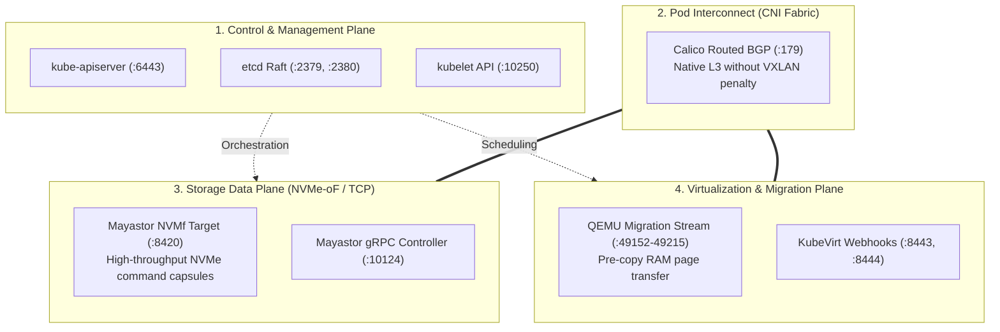

# Network Topology, Port Audit & Worker Resource Engineering

**Project Name:** Deploy High-Performance Storage for Kubernetes  
**Project ID:** SWFW_5S_08  
**Audit Date:** 2026-11-05 (Chunk 1.9 Final Lifecycle & Port Audit)  
**Document Status:** AUDITED TECHNICAL SPECIFICATION & RESOURCE BUDGET  
**Classification:** VERIFIED AGAINST UPSTREAM DOCUMENTATION  

---

## 1. Network Architecture & Traffic Separation

To maintain sub-millisecond storage latency and prevent I/O starvation during virtual machine memory streaming, cluster networking is partitioned into four distinct logical traffic planes:

---

## 2. Granular Network Port Audit & Protocol Matrix

Every port below has been individually audited against official component documentation. Traffic categories, connection boundaries, and optional designations are explicitly recorded:

| Port / Range | Protocol | Component | Traffic Scope | Connection Boundary | Operational Purpose | Mandatory or Optional | Official Documentation Source |
| :--- | :--- | :--- | :--- | :--- | :--- | :--- | :--- |
| **`6443`** | TCP | Kubernetes API | Control Plane | Client-to-Node / Node-to-CP | Core Kubernetes API Server ingress | **Mandatory** | [Kubernetes Ports](https://kubernetes.io/docs/reference/networking/ports-and-protocols/) |
| **`2379`** | TCP | etcd Client | Control Plane | Node-to-CP / Pod-to-CP | etcd client database queries | **Mandatory** (CP) | [Kubernetes Ports](https://kubernetes.io/docs/reference/networking/ports-and-protocols/) |
| **`2380`** | TCP | etcd Peer | Control Plane | Node-to-Node (CP only) | etcd Raft peer consensus | **Mandatory** (Multi-CP) / Optional (Single-node CP) | [Kubernetes Ports](https://kubernetes.io/docs/reference/networking/ports-and-protocols/) |
| **`10250`** | TCP | Kubelet | Control Plane | Node-to-Node / CP-to-Node | Kubelet node runtime API, logs, exec | **Mandatory** | [Kubernetes Ports](https://kubernetes.io/docs/reference/networking/ports-and-protocols/) |
| **`10257`** | TCP | Controller-Mgr | Control Plane | Localhost / Self | kube-controller-manager health | **Mandatory** (Localhost) | [Kubernetes Ports](https://kubernetes.io/docs/reference/networking/ports-and-protocols/) |
| **`10259`** | TCP | Scheduler | Control Plane | Localhost / Self | kube-scheduler health | **Mandatory** (Localhost) | [Kubernetes Ports](https://kubernetes.io/docs/reference/networking/ports-and-protocols/) |
| **`179`** | TCP | Calico BGP | CNI Network | Node-to-Node (Mesh) | Calico native routed BGP peering mesh | **Mandatory** (for BGP mode) | [Calico Network Requirements](https://docs.tigera.io/calico/latest/getting-started/kubernetes/requirements) |
| **`4789`** | UDP | Calico VXLAN | CNI Network | Node-to-Node | VXLAN overlay encapsulation | **Optional** (Disabled when BGP is used) | [Calico Network Requirements](https://docs.tigera.io/calico/latest/getting-started/kubernetes/requirements) |
| **`5473`** | TCP | Calico Typha | CNI Network | Node-to-Pod | Calico datastore proxy | **Optional** (Only used in clusters $>$50 nodes) | [Calico Network Requirements](https://docs.tigera.io/calico/latest/getting-started/kubernetes/requirements) |
| **`8420`** | TCP | Mayastor NVMf | Storage Data | Node-to-Node / Pod-to-Node | Primary NVMf target (NVMe over TCP data path) | **Mandatory** | [Mayastor Prerequisites](https://openebs.io/docs/user-guides/mayastor/prerequisites) |
| **`4421`** | TCP | Mayastor NVMf | Storage Data | Node-to-Node | Secondary NVMf target port | **Optional** (Legacy/alternate data port) | [Mayastor Prerequisites](https://openebs.io/docs/user-guides/mayastor/prerequisites) |
| **`10124`** | TCP | Mayastor gRPC | Storage Control| Pod-to-Pod / Node-to-Pod | `io-engine` daemonset management RPCs | **Mandatory** | [Mayastor Architecture](https://openebs.io/docs/user-guides/mayastor/architecture) |
| **`8080` / `8081`** | TCP | Mayastor REST | Storage Control| Client-to-Pod / Pod-to-Pod | Core Agent REST API and CSI Controller | **Mandatory** | [Mayastor Architecture](https://openebs.io/docs/user-guides/mayastor/architecture) |
| **`9502`** | TCP | Mayastor Stats| Monitoring | Pod-to-Pod | SPDK engine Prometheus metrics exporter | **Optional** (Observability stack) | [Mayastor Monitoring](https://openebs.io/docs/user-guides/mayastor/monitoring) |
| **`8443`** | TCP | KubeVirt API | Virt Control | Node-to-Pod / CP-to-Pod | `virt-api` webhook validator and subresource console | **Mandatory** | [KubeVirt Operations](https://kubevirt.io/user-guide/operations/installation/) |
| **`8444`** | TCP | KubeVirt Oper | Virt Control | Node-to-Pod / CP-to-Pod | `virt-operator` controller webhooks | **Mandatory** | [KubeVirt Operations](https://kubevirt.io/user-guide/operations/installation/) |
| **`49152–49215`**| TCP | KubeVirt Migr | Virt Data | Node-to-Node | Libvirt/QEMU live-migration memory socket stream | **Mandatory** (for Live Migration) | [KubeVirt Live Migration](https://kubevirt.io/user-guide/compute/live_migration/) |
| **`8186`** | TCP | KubeVirt Mon | Monitoring | Pod-to-Pod | `virt-handler` Prometheus metrics exporter | **Optional** (Observability stack) | [KubeVirt Monitoring](https://kubevirt.io/user-guide/operations/monitoring/) |
| **`2049`** | TCP | NFS Server | Shared Storage| Client-to-Pod / Pod-to-Pod | NFSv4 filesystem share (Live migration fallback) | **Optional** (Fallback Tier only) | [Linux NFS Documentation](https://linux-nfs.org/wiki/index.php/Main_Page) |
| **`111`** | TCP/UDP | RPCbind (NFS) | Shared Storage| Client-to-Pod | RPC portmapper for NFS mounts | **Optional** (Only needed if NFSv3 compatibility required) | [Linux NFS Documentation](https://linux-nfs.org/wiki/index.php/Main_Page) |

### Multus CNI Socket Architecture
- **In-Process Invocation:** Multus CNI does **not** listen on any TCP or UDP network port.
- It operates as a local CNI meta-binary called by `containerd` via local UNIX domain sockets (`/run/containerd/containerd.sock`) and CNI plugin interfaces (`/opt/cni/bin/`). Secondary interfaces provisioned by Multus (e.g., macvlan or bridge) operate directly on physical/virtual network adapters at Layer 2.

---

## 3. Worker Node CPU Engineering & Busy-Poll Sizing

### 3.1 SPDK Polling Thread Behavior (Busy-Polling)
Mayastor’s `io-engine` uses the Storage Performance Development Kit (SPDK), which operates via **Polled Mode Drivers (PMD)**:
1. **Core Dedication:** SPDK pins designated CPU cores to infinite polling loops checking NVMe completion queues.
2. **100% Saturation by Design:** The allocated SPDK CPU cores register **100% CPU utilization in `top`/`htop` continuously**, even when zero I/O operations are occurring. This is not a malfunction; it is the deliberate design mechanism that eliminates interrupt latency.
3. **Mandatory Two-Core Reservation:** Official Mayastor documentation mandates **reserving 2 CPU cores exclusively for each `io-engine` pod**.

### 3.2 Worker Node CPU Allocation Budget

| Subsystem Component | Minimum Cores Required | Preferred Cores Required | Operational Function & CPU Behavior |
| :--- | :--- | :--- | :--- |
| **Mayastor SPDK `io-engine`** | **2 Dedicated Cores** | **2 Dedicated Cores** | Locked in user-space PMD busy-poll loops (100% core utilization). |
| **Linux Host OS & Kernel** | **1 Core** | **2 Cores** | Systemd, kernel interrupts, TCP/IP stack processing, SSH, page cache sync. |
| **Kubernetes Node Daemons** | **1 Core** | **2 Cores** | `kubelet`, `containerd`, Calico BGP agent (`calico-node`), `kube-proxy`. |
| **KubeVirt Hypervisor Daemons**| **Shared with System** | **1 Core** | `virt-handler` process and libvirt event loops. |
| **Guest Virtual Machine vCPUs**| **2 vCPUs** | **4 – 8 vCPUs** | Active execution of guest OS, benchmarking scripts (`fio`), and database threads. |
| **Total Worker CPU Budget:** | **6 Physical Cores (Minimum)** | **8 – 16 Physical Cores (Preferred)** | **A 4-core physical CPU is severely constrained: dedicating 2 cores to SPDK leaves only 2 cores shared between OS, K8s, and the VM.** |

---

## 4. Worker Node Memory Engineering: GB vs. GiB Rigorous Sizing

### 4.1 Unit Definitions & Physical Memory Reality
To prevent memory starvation, engineering calculations must distinguish decimal from binary units:
- **Gigabyte (GB):** $10^9 = 1,000,000,000$ bytes (standard commercial RAM module rating).
- **Gibibyte (GiB):** $2^{30} = 1,073,741,824$ bytes (standard Linux kernel and Kubernetes memory unit).
- **The "16 GB" Module Deficit:** A physical 16 GB DDR4/DDR5 memory stick provides $16,000,000,000 \text{ bytes} \approx \mathbf{14.90\text{ GiB}}$.
  - Motherboard UEFI firmware, ACPI tables, and hardware device reservations typically consume $0.4 - 0.7\text{ GiB}$.
  - **Usable Host Physical Memory on a "16 GB" node is only $\approx \mathbf{14.20 - 14.50\text{ GiB}}$!**
- **The "32 GB" Module Reality:** A physical 32 GB RAM module provides $32 \times 10^9 \text{ bytes} \approx \mathbf{29.80\text{ GiB}}$ ($\approx \mathbf{29.20\text{ GiB}}$ usable).

---

### 4.2 Comprehensive Worker Memory Allocation Table

| Memory Category | Minimum Constrained Test Config (16 GB Physical RAM) | Preferred Benchmark Config (32 GB Physical RAM) | Accounting Category & Allocation Mechanism |
| :--- | :--- | :--- | :--- |
| **Physical RAM Installed** | **16 GB ($16 \times 10^9$ bytes)** | **32 GB ($32 \times 10^9$ bytes)** | Commercial hardware rating. |
| **Usable Host Memory** | **$\approx$ 14.30 GiB** | **$\approx$ 29.30 GiB** | Total memory recognized by Linux kernel (`MemTotal`). |
| **SPDK HugePages (Mandatory)**| **2.00 GiB (2048 MiB)** | **2.00 GiB (2048 MiB)** | **1024 pages of 2 MiB HugePages pre-allocated at boot.** Subtracted permanently from kernel general pool; unusable by ordinary pods. |
| **Mayastor `io-engine` Heap** | **1.00 GiB (1024 MiB)** | **1.50 GiB** | User-space process heap, gRPC buffers, NVMe-oF queue metadata. |
| **Host OS & Kernel Base** | **1.50 GiB** | **2.00 GiB** | Linux kernel slab, page tables, systemd, SSH, buffer caches. |
| **Kubernetes Node Daemons** | **1.50 GiB** | **2.00 GiB** | `kubelet`, `containerd`, Calico CNI (`calico-node`), `kube-proxy`. |
| **KubeVirt `virt-handler`** | **0.50 GiB** | **0.80 GiB** | Hypervisor daemonset and libvirtd event monitors. |
| **Monitoring Daemons (Optional)**| **0.30 GiB** | **0.60 GiB** | `node-exporter` and Mayastor metrics exporters. |
| **Subtotal (Base Infrastructure)**| **6.80 GiB Host RAM + 2.00 GiB HugePages = 8.80 GiB** | **8.90 GiB Host RAM + 2.00 GiB HugePages = 10.90 GiB** | **Baseline memory consumed before launching any virtual machines.** |
| **Guest VM RAM Allocation** | **4.00 GiB (1x Small VM)** | **8.00 – 12.00 GiB (Multi-VM / Large VM)** | Dedicated guest physical memory assigned to the VM. |
| **QEMU Process Overhead** | **0.60 GiB (per VM)** | **1.20 GiB (total for VMs)** | Virtio ring buffers, MMIO device emulation, vCPU stacks, launcher wrapper. |
| **Live Migration Handover Buffer**| **1.00 GiB (Marginal)** | **4.50 GiB (Transient Dual Allocation)** | Transient memory footprint on target node during incoming RAM pre-copy. |
| **Total Memory Consumed** | **$\approx$ 14.40 GiB (Near 100% Capacity)** | **$\approx$ 24.60 – 26.60 GiB (Comfortable)** | Total memory committed. |
| **Safety Headroom / Page Cache**| **$\approx$ 0.00 – 0.50 GiB (HIGH RISK)** | **$\approx$ 2.70 – 4.70 GiB (HEALTHY)** | Uncommitted RAM preventing Kubelet OOM eviction. |

---

### 4.3 Sizing Verdicts & Architectural Conclusions

1. **16 GB Physical RAM Node:**
   - **Verdict:** **CONSTRAINED TESTING ONLY.**
   - Usable memory ($\approx 14.3 \text{ GiB}$) can support the base infrastructure stack ($8.8 \text{ GiB}$) and **exactly one single 4.0 GiB VM** ($4.6 \text{ GiB}$ total VM footprint).
   - *Operational Warning:* Running an 8.0 GiB VM, launching a second VM, or running heavy page-cache operations on a 16 GB node will cause immediate Linux kernel Out-Of-Memory (OOM) kills or Kubelet pod evictions.
2. **32 GB Physical RAM Node:**
   - **Verdict:** **RECOMMENDED BENCHMARK BASELINE.**
   - Usable memory ($\approx 29.3 \text{ GiB}$) comfortably accommodates the base stack, an 8.0 GiB high-performance benchmarking VM (or two 4.0 GiB VMs), the transient dual-allocation buffer during live-migration cutover, the NFS gateway, and high-throughput FIO I/O queue buffers with $\ge 3 \text{ GiB}$ of safety headroom.
