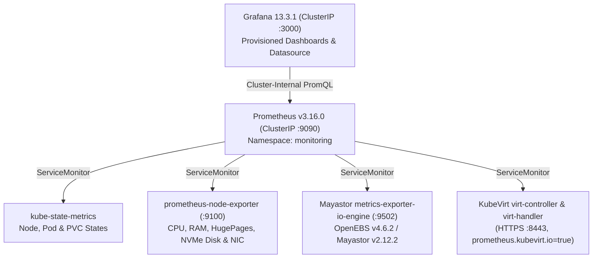

# Prometheus & Grafana Observability Architecture

**Project Name:** Deploy High-Performance Storage for Kubernetes  
**Project ID:** SWFW_5S_08  
**Program:** Zoho SETU — College Student Project Program  
**Pinned Stack:** `kube-prometheus-stack` **`v93.2.0`** (`prometheus-operator v0.95.2`, `prometheus v3.16.0`, `grafana 13.3.1` / chart `14.4.1`, `kube-state-metrics 9.0.0`, `prometheus-node-exporter 5.1.0`)  
**Three-State Classification:** `IMPLEMENTED` + `VALIDATED` (`promtool check config`, `promtool check rules`, `kubeconform -strict` with CRD schemas, 3 Grafana dashboard JSONs, WSL2 live refusal) | `INFRASTRUCTURE-DEPENDENT` (Live cluster scraping & Grafana runtime UI)

---

## 1. Telemetry Collection Topology & Security Boundary



- **ClusterIP-Only Exposure:** Per canonical 20-port security rules (`ARCHITECTURE.md` §2.2), Prometheus (`:9090`) and Grafana (`:3000`) use `ClusterIP` services exclusively (zero NodePort/LoadBalancer/Ingress rules) and are accessed via `kubectl port-forward`.
- **Configurable Footprint:** [`values.yaml`](../monitoring/prometheus/values.yaml) targets 4-node clusters (`15d` retention, Alertmanager enabled), while [`values-dev-lightweight.yaml`](../monitoring/prometheus/values-dev-lightweight.yaml) trims memory limits and disables Alertmanager for constrained lab testbeds (live install still refused on 3.5 GiB WSL2 dev laptop).

---

## 2. Verified Metric Inventory & Explicit Upstream Gaps

All PromQL alert expressions ([`prometheus-rules.yaml`](../monitoring/prometheus/prometheus-rules.yaml)) and Grafana panels were verified directly against upstream **`openebs/mayastor-extensions v2.12.2`** Rust exporter code and **`kubevirt/kubevirt v1.9.1`** Go metric collectors:

| Subsystem | Verified Prometheus Metrics | Verified Labels | Documented Upstream Gap / Mitigation |
| :--- | :--- | :--- | :--- |
| **Mayastor `v2.12.2` Pool & Node** | `diskpool_status`, `diskpool_total_size_bytes`, `diskpool_used_size_bytes`, `diskpool_committed_size_bytes`, `diskpool_io_error_count`, `diskpool_io_stalled`, `mayastor_node_online`, `mayastor_node_cordoned` | `node`, `name`, `node_id` | Exporter does **not** emit `volume_status` or `volume_rebuild_progress_percent`; retrieve live replica rebuild state from Mayastor REST `/v0/volumes` (`observe-rebuild-events.sh`). |
| **Mayastor `v2.12.2` I/O Stats** | `volume_num_read_ops`, `volume_num_write_ops`, `volume_bytes_read`, `volume_bytes_written`, `volume_read_latency_us`, `volume_write_latency_us`, `replica_*` | `node`, `pv_name`, `pool_name` | Exporter emits cumulative microsecond latency totals (`*_latency_us`), **not** Prometheus histogram `_bucket` series (`p50`/`p95`/`p99`). Grafana displays exact mean latency rates; tail percentiles come from FIO empirical JSONs. |
| **KubeVirt `v1.9.1`** | `kubevirt_vmi_info`, `kubevirt_vmi_non_evictable`, `kubevirt_vmi_migrations_in_*`, `kubevirt_vmi_migration_succeeded`, `kubevirt_vmi_migration_failed`, `kubevirt_vmi_migration_phase_transition_time_from_creation_seconds_bucket`, `kubevirt_vmi_storage_iops_*`, `kubevirt_vmi_storage_*_traffic_bytes_total`, `kubevirt_vmi_storage_*_times_seconds_total`, `kubevirt_vmi_cpu_usage_seconds_total`, `kubevirt_vmi_memory_resident_bytes`, `kubevirt_vmi_network_*` | `namespace`, `name`, `drive`, `phase`, `node` | Scraped over HTTPS `:8443` via `ServiceMonitor` selector `prometheus.kubevirt.io: "true"` (`insecureSkipVerify: true`). |
| **NFS RWX Gateway** | *None native on `nfs-server-alpine:12`* | — | Alpine `nfsd` has no Prometheus exporter; observed via `kubevirt_vmi_storage_*`, Mayastor backing RWO `volume_*`, and `node-exporter` stats. |
| **Kubernetes / Host** | `kube_node_status_condition`, `kube_pod_status_phase`, `kubelet_volume_stats_*`, `node_cpu_seconds_total`, `node_memory_MemAvailable_bytes`, `node_memory_HugePages_*`, `node_disk_*`, `container_cpu_usage_seconds_total` | `node`, `instance`, `namespace`, `pod` | SPDK busy-polling cores show ~100% container CPU usage on `io-engine` pods by design (`ADR-003`). |

---

## 3. Custom Dashboards, Alerting & Validation Commands

- **Grafana Provisioning & Dashboards ([`monitoring/grafana/`](../monitoring/grafana/)):**
  - [`mayastor-storage-performance.json`](../monitoring/grafana/dashboards/mayastor-storage-performance.json)
  - [`kubevirt-vm-telemetry.json`](../monitoring/grafana/dashboards/kubevirt-vm-telemetry.json)
  - [`cluster-node-resources.json`](../monitoring/grafana/dashboards/cluster-node-resources.json)
- **Alert Rules (`10` `promtool`-verified rules in [`prometheus-rules.yaml`](../monitoring/prometheus/prometheus-rules.yaml)):** Covers `MayastorDiskPoolDegraded`, `MayastorDiskPoolFaultedOrOffline`, `MayastorDiskPoolIOStalled`, `MayastorDiskPoolIOErrorsElevated`, `MayastorDiskPoolCapacityCritical`, `MayastorStorageNodeOffline`, `KubeVirtVMINonEvictableWithLiveMigrate`, `KubeVirtMigrationFailed`, `KubernetesNodeNotReady`, and `KubernetesPersistentVolumeFillingUp`.

```bash
# Offline & WSL2-safe verification (yamllint, kubeconform CRDs, promtool v3.16.0, Grafana JSONs)
./scripts/setup/08-deploy-monitoring.sh --dry-run
./scripts/validate/validate-observability.sh

# Target cluster deployment (never store Grafana password file inside Git)
./scripts/setup/08-deploy-monitoring.sh --grafana-password-file /secure/path/grafana-pass.txt
kubectl -n monitoring port-forward svc/kube-prometheus-stack-grafana 3000:3000
```

