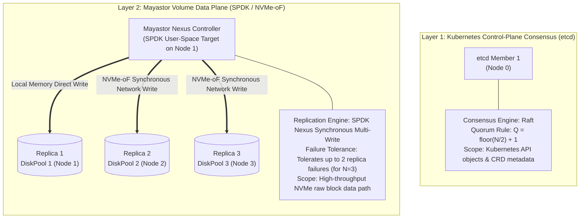
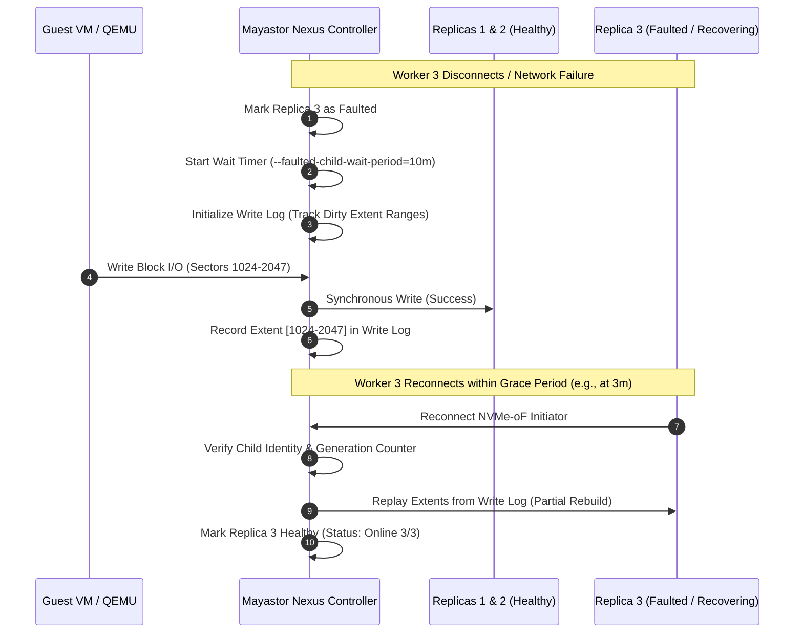
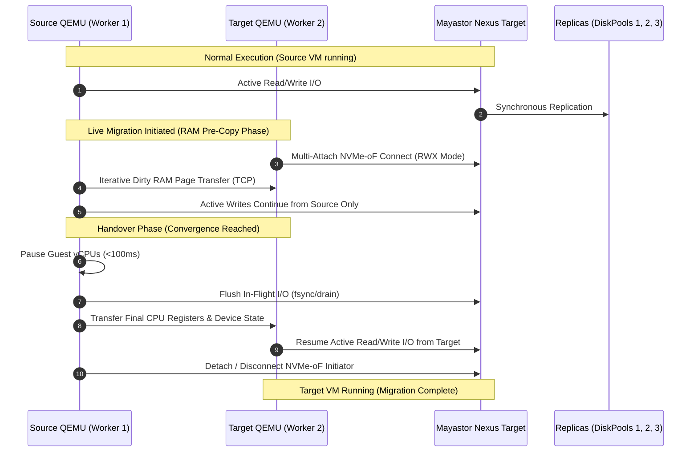
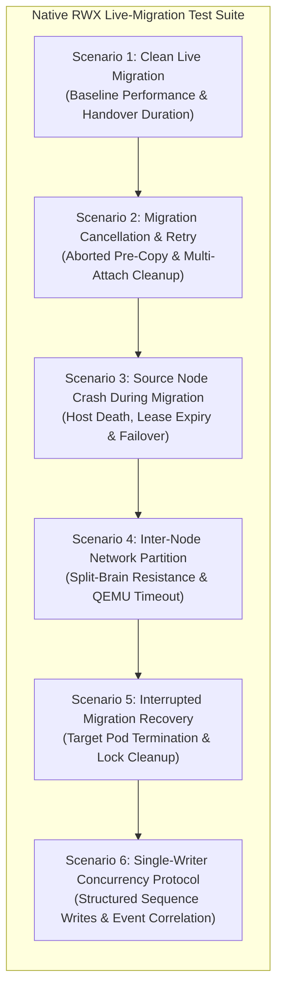
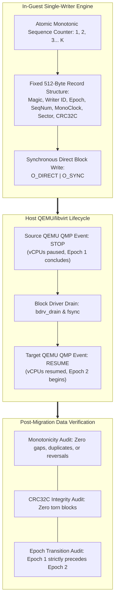

# Storage Architecture & Virtualization Integration Analysis

**Project Name:** Deploy High-Performance Storage for Kubernetes  
**Project ID:** SWFW_5S_08  
**Audit Date:** 2026-11-05 (Chunk 1.11 Final Baseline & Evidence Closure)  
**Document Status:** TECHNICAL ARCHITECTURE & RECOVERY SPECIFICATION  
**Focus Area:** Native OpenEBS Mayastor RWX Block Volumes vs. NFS Gateway, Rebuild Parameter Evidence, and Single-Writer Live-Migration Protocol  

---

> [!CRITICAL]
> **Core Architectural Principles & Clarifications:**  
> 1. **Native RWX Block Support:** OpenEBS Mayastor v2.12.2 (OpenEBS chart v4.6.x) provides **native experimental ReadWriteMany (RWX) block volumes** designed specifically to enable KubeVirt virtual machine live migration without an intermediate NFS layer.
> 2. **Quorum Decoupling:** Mayastor storage data replication, Nexus controller failover, and replica fault tolerance operate as independent data-plane mechanisms and are **completely decoupled** from Kubernetes control-plane (`etcd`) Raft consensus.
> 3. **Degraded State Semantics ($N=3$ on 3-Node Cluster):** In a 3-node cluster with volume replica count $N=3$, failure of a single node leaves the volume in a **Degraded** state (2 surviving replicas). Mayastor **cannot place a replacement replica** because only 2 nodes remain and anti-affinity prevents colocation.
> 4. **Verified Rebuild Configuration:** The partial rebuild wait period is governed by `--faulted-child-wait-period` (default: 10m / 600s in Mayastor core agent). A standalone "node-unreachable-timeout" does not exist under that parameter name in the Mayastor chart; rather, node unreachable handling is governed by Kubernetes node toleration seconds and NVMe initiator controller loss timeouts (`ctrl_loss_tmo`).
> 5. **Evidence-Based Single-Writer Protocol:** Concurrency safety during live migration is audited via a structured single-writer verification protocol utilizing unique writer IDs, writer epochs, atomic sequence numbering, QEMU QMP `STOP`/`RESUME` event correlation, and CRC32C verification, with transparent documentation of physical clock synchronization boundaries.

---

## 1. Storage Replication, Failure Tolerance & Quorum Mechanics

A common architectural misconception is assuming that 3 Mayastor storage replicas participate in or depend on Kubernetes control-plane quorum. In reality, these are two entirely decoupled distributed systems layers operating at different architectural tiers:



### 1.1 Kubernetes Control-Plane Quorum (`etcd`)
- **Consensus Engine:** `etcd` implements the Raft consensus algorithm.
- **Quorum Rule:** Requires an odd number of voting members: $Q = \lfloor M/2 \rfloor + 1$. A 3-node control plane requires 2 members to maintain quorum, tolerating 1 failure. In our candidate architecture with a single dedicated control plane (Node 0), there is **zero control-plane fault tolerance**: losing Node 0 halts API scheduling and pod mutation, regardless of worker node health.
- **Independence from Storage:** If `etcd` loses quorum or Node 0 fails, existing worker pods, KubeVirt virtual machines, and Mayastor SPDK data-plane I/O **continue executing uninterrupted**. The SPDK Nexus communicates directly with NVMe-oF target pools across worker nodes without consulting `etcd` for active I/O transactions.

### 1.2 Mayastor Volume Replication & Target Availability
- **Replica Count ($N=3$):** An $N=3$ volume maintains 3 synchronous copies of raw block data distributed across independent worker nodes' `DiskPools` (Worker 1, Worker 2, Worker 3).
- **Synchronous Write Acknowledgment:** The Nexus (SPDK user-space virtual storage controller) dispatches write commands concurrently across all registered healthy replicas. A write is acknowledged to the client (`virt-launcher` / QEMU) only after all healthy replicas commit the data to non-volatile storage.
- **Single Node Failure Behavior ($N=3$ on a 3-Node Cluster):**
  - If Worker 3 abruptly crashes or suffers network disconnection, the Nexus detects I/O timeout, marks Replica 3 as `Faulted`, and removes it from the active replica set.
  - The volume transitions to **Degraded** status (health state: `DEGRADED`, 2/3 replicas online).
  - **Crucial Engineering Reality:** The volume is **not** in a fully protected state. Client I/O continues uninterrupted on Replicas 1 and 2, but the volume is now operating with reduced redundancy. A second node failure before recovery will reduce the volume to 1 replica (critical degradation).
- **Anti-Affinity & Inability to Place Replacement Replicas:**
  - Mayastor enforces a strict **node and pool anti-affinity policy**: multiple replicas belonging to the same persistent volume cannot be colocated on the same physical host or the same `DiskPool`.
  - In a 3-node worker cluster where 1 node fails, exactly **2 worker nodes remain online**.
  - Because Replica 1 and Replica 2 already occupy DiskPools on Worker 1 and Worker 2, **Mayastor cannot allocate a replacement replica**. The volume must remain in `Degraded` status until Worker 3 is restored or a 4th worker node is joined to the cluster.

---

## 2. Mayastor Rebuild Mechanics & Configuration Parameters

When a faulted replica reconnects or a new replica is carved, Mayastor restores volume redundancy through the **Nexus Rebuild Engine**.



### 2.1 Rebuild Configuration Settings & Evidence (Mayastor v2.12.2 / Chart v4.6.x)
Investigation of Mayastor v2.12.2 documentation and Helm chart values confirms the precise failure handling settings:

1. **Partial Rebuild Wait Period (`--faulted-child-wait-period`):**
   - **Parameter Name:** `agents.core.faulted_child_wait_period` in chart values or command-line flag `--faulted-child-wait-period` on `mayastor-agent-core`.
   - **Baseline Default:** Exactly **10 minutes** (`10m` or `600s`).
   - **Operational Meaning:** When an active volume's replica encounters an I/O error or disconnection, the Nexus transitions the replica to `Faulted` and retains dirty extents in its write log. If the replica reconnects within 10 minutes, Mayastor executes a high-speed **Partial Rebuild** replaying only modified blocks. If the timer elapses, the replica is permanently disowned and must undergo a full rebuild.
   - **Official Reference:** [OpenEBS Mayastor Troubleshooting & Diagnostics](https://openebs.io/docs/) | [Mayastor Core Agent CLI](https://github.com/openebs/mayastor).

2. **Node Unreachable Handling (Parameter Clarification):**
   - **Verification Finding:** There is **no standalone Mayastor parameter named "node-unreachable-timeout"** in the published Helm chart or core agent binary.
   - **Underlying Mechanisms:**
     - *Kubernetes Node Tolerations:* Governed by Kubernetes node eviction tolerations (`node.kubernetes.io/unreachable` and `node.kubernetes.io/not-ready`), configured via `earlyEvictionTolerations` in the Helm values (default Kubernetes eviction timeout: **300 seconds**).
     - *NVMe-oF Controller Loss:* Governed by the NVMe initiator `ctrl_loss_tmo` parameter (configured under `node.nvme.ctrl_loss_tmo`, typically defaulting to 1800s or customized down to 120s for rapid multipath failover).
   - **Status:** Any separate standalone "node-unreachable-timeout" setting is **UNVERIFIED / NON-EXISTENT** in upstream Mayastor; operator responses to node loss are governed by standard Kubernetes pod tolerations and NVMe transport timers.

### 2.2 Published vs. Unpublished Degraded Volume Behavior
- **Published Volumes (Actively Attached to an Executing Nexus):**
  - A Nexus controller is actively running and serving guest I/O.
  - When a replica drops, the Nexus immediately opens a write log and begins accumulating dirty extent ranges. The partial rebuild timer actively counts down.
  - If the node recovers within `--faulted-child-wait-period`, a partial rebuild restores consistency without streaming the full volume.
- **Unpublished Volumes (Idle, Unmounted, No Active Nexus):**
  - No Nexus controller is instantiated; the volume is quiescent with zero active writes.
  - If a worker node hosting one of the replicas reboots or goes offline while the volume is unpublished, no active write log is required.
  - When the volume is subsequently published (e.g., when a VM starts), the Mayastor control plane inspects replica generation counters and timestamps stored in pool metadata:
    - If all online replicas have matching generation counters, the volume mounts immediately without rebuild.
    - If an out-of-date or missing replica is detected, the control plane coordinates resynchronization before volume presentation.

### 2.3 Conditions Triggering a Full Rebuild
A **Full Rebuild** (streaming the complete raw block volume byte-for-byte across NVMe-oF) is triggered under any of the following four conditions:
1. **Grace Period Expiration:** The disconnected replica fails to reconnect within the configured `--faulted-child-wait-period` (10m). The Nexus disowns the child, purges the write log, and removes the replica registration.
2. **Device / Pool Destruction:** The underlying NVMe device, partition, or `DiskPool` on the failed node suffered catastrophic corruption or hardware replacement, requiring a completely new, blank replica to be provisioned.
3. **Nexus Host Failure During Child Fault:** If the node hosting the Nexus controller crashes while Replica 3 is already faulted, the in-memory write log is lost upon Nexus recreation. When the new Nexus starts on a surviving node, it cannot verify dirty ranges and must force a full resynchronization.
4. **Write Log Capacity Exhaustion:** If continuous high-throughput random write workloads exhaust allocated write log buffer capacity before child reconnection, the Nexus marks the child for full resynchronization.

---

## 3. KubeVirt Live Migration Storage Semantics

### 3.1 The Shared Storage Requirement
During KubeVirt live migration:
1. The virtual machine instance (VMI) executes on the **Source Worker Node** (Worker 1).
2. A target `virt-launcher` pod is scheduled on the **Destination Worker Node** (Worker 2).
3. Target QEMU initializes virtual hardware and opens the volume to receive CPU register state and dirty RAM pages.
4. **The Live-Migration Invariant:** Both the source QEMU process and the destination QEMU process must access the same underlying persistent storage simultaneously during memory pre-copy and final state handover.



### 3.2 Coordination & Concurrency Safety
- **No Distributed Lock Manager (DLM):** Mayastor does *not* incorporate a clustered distributed lock manager (such as DLM or OCFS2). Uncoordinated concurrent writes from two unmanaged initiators to a raw block device will cause catastrophic filesystem corruption.
- **Hypervisor Serialization Guarantee:** Concurrency safety is guaranteed strictly by **QEMU and KubeVirt**:
  - During memory pre-copy, the target QEMU process is passive (`-incoming defer`), issuing zero write commands.
  - At cutover, source QEMU stops issuing writes, flushes pending blocks, and transfers state.
  - Target QEMU resumes execution only after source execution is halted.
  - At no point do two running guest kernels write simultaneously to the storage target.

---

## 4. Native Mayastor RWX Live-Migration Test Plan

To validate the stability, safety, and failure recovery of experimental Native RWX block volumes with KubeVirt, the project defines an explicit **6-Scenario Test Plan**:



### Scenario 1: Clean Live Migration Between Worker Nodes
- **Objective:** Quantify baseline migration handover duration, network bandwidth consumption, and verify zero I/O error or guest crash.
- **Pre-Conditions:**
  - 3 healthy worker nodes.
  - VM running on Worker 1 with a Mayastor Native RWX block PVC (`volumeMode: Block`, `accessModes: [ReadWriteMany]`).
  - Active synthetic workload running inside guest: `fio --rw=randwrite --bs=4k --ioengine=libaio --direct=1 --verify=crc32c --do_verify=1`.
- **Execution Steps:**
  1. Record baseline IOPS, latency, and guest uptime.
  2. Execute `virtctl migrate <vm-name>`.
  3. Monitor `kubectl get vmi <vm-name> -o wide --watch`.
  4. Track dual NVMe-oF initiator attachments on Worker 1 and Worker 2 via `nvme list-subsys`.
  5. Measure cutover pause time (sub-second target: $< 150\text{ ms}$).
  6. Confirm migration reaches `Succeeded` state and VMI node changes to Worker 2.
- **Pass Criteria:**
  - `fio` completes with zero checksum verification failures (`crc32c` match).
  - VM uptime remains continuous without guest OS reboot.
  - NVMe-oF connection on Worker 1 cleanly tears down after migration completion.

### Scenario 2: Migration Cancellation and Retry
- **Objective:** Verify system stability and resource cleanup when a user or controller cancels an active migration mid-flight.
- **Pre-Conditions:**
  - VM generating dirty memory pages at high rate (`stress-ng --vm 2 --vm-bytes 1G --vm-hang 0`).
  - Storage workload generating continuous NVMe-oF writes.
- **Execution Steps:**
  1. Initiate migration: `virtctl migrate <vm-name>`.
  2. While migration status is in `Running` (iterative pre-copy phase), trigger cancellation: `virtctl cancel-migration <vm-name>`.
  3. Monitor target `virt-launcher` pod termination on Worker 2.
  4. Verify Worker 2 unmounts and detaches the Mayastor volume cleanly.
  5. Re-trigger migration: `virtctl migrate <vm-name>`.
- **Pass Criteria:**
  - Active source VM experiences zero interruption or crash upon cancellation.
  - Target pod terminates without leaving orphaned NVMe-oF initiator sessions on Worker 2.
  - Subsequent migration attempt succeeds cleanly.

### Scenario 3: Source Node Crash During Active Migration
- **Objective:** Evaluate failure isolation and data safety if the source physical node abruptly dies during active memory pre-copy.
- **Pre-Conditions:**
  - VM actively migrating from Worker 1 to Worker 2.
  - Workload issuing continuous writes with data checksumming.
- **Execution Steps:**
  1. During active memory transfer, inject a hard kernel panic on Worker 1:
     `echo c > /proc/sysrq-trigger` (or physical host power-off).
  2. Observe Kubernetes node controller detect Worker 1 `NotReady` upon lease expiration.
  3. Observe KubeVirt mark the in-flight migration as `Failed`.
  4. Observe automated rescheduling / pod cleanup behavior on surviving nodes.
  5. Verify surviving Mayastor DiskPools (Worker 2 & Worker 3) maintain replica consistency.
  6. Restart VM on Worker 2 and execute volume integrity check (`e2fsck -f` / `xfs_repair -n`).
- **Pass Criteria:**
  - Storage volume data on surviving Mayastor replicas is uncorrupted up to the last confirmed synchronous write.
  - Target partial `virt-launcher` does not attempt conflicting writes.
  - Volume successfully attaches to new VM instance upon node recovery.

### Scenario 4: Inter-Node Network Partition During Migration
- **Objective:** Verify split-brain prevention when inter-node migration traffic is severed while storage traffic remains active.
- **Pre-Conditions:**
  - Live migration in progress between Worker 1 and Worker 2.
- **Execution Steps:**
  1. Inject an `iptables` drop rule blocking QEMU migration port (`TCP 49152+`) between Worker 1 and Worker 2.
  2. Keep NVMe-oF storage network (`TCP 8420 / 4421`) intact.
  3. Observe QEMU migration timeout handling.
- **Pass Criteria:**
  - KubeVirt detects QEMU migration socket timeout and marks migration `Failed`.
  - Source VM on Worker 1 retains exclusive authority and continues servicing guest I/O.
  - Target QEMU process on Worker 2 aborts without asserting write access to the Mayastor volume.
  - Mayastor volume exhibits zero metadata corruption.

### Scenario 5: Interrupted Migration Recovery (Target Pod Eviction)
- **Objective:** Test recovery when the destination node suffers resource exhaustion or target pod eviction mid-migration.
- **Pre-Conditions:**
  - Migration actively transferring memory pages.
- **Execution Steps:**
  1. Force-kill the target `virt-launcher` pod on Worker 2: `kubectl delete pod <target-pod> --force --grace-period=0`.
  2. Observe KubeVirt migration reconciliation loop.
  3. Verify Mayastor CSI node unstage and unpublish hooks release the target node connection.
- **Pass Criteria:**
  - Source VM recovers automatically and resumes full execution on Worker 1.
  - Mayastor CSI driver cleanly releases volume attachment on Worker 2 (no stuck multi-attach locks).
  - Storage volume remains healthy and operational.

### Scenario 6: Single-Writer Concurrency Protocol & Safety Audit
- **Objective:** Audit empirical evidence of hypervisor write serialization to verify that no unsafe concurrent writes, stale writes, or split-brain collisions occur across source and destination nodes during live migration.
- **Methodology (Structured Single-Writer Verification Protocol):**



1. **Unique Writer ID & Epoch Identification:**
   - In-guest writer process embeds a unique 32-bit `writer_id`:
     - Source Hypervisor Process: `0xAA550001`
     - Destination Hypervisor Process: `0xAA550002`
   - In-guest writer maintains an integer `writer_epoch`:
     - Pre-migration Source: `Epoch 1`
     - Post-migration Destination: `Epoch 2` (incremented upon hypervisor resume event detection).
2. **Fixed Record Layout (512-Byte Aligned Struct):**
   ```text
   +--------------------------------------------------------------+
   | Magic Bytes (0x4D595354 "MYST")                 : 4 Bytes    |
   | Writer ID (0xAA550001 / 0xAA550002)             : 4 Bytes    |
   | Writer Epoch (1 = Source, 2 = Target)           : 4 Bytes    |
   | Monotonic Sequence Number (1, 2, 3 ... K)       : 8 Bytes    |
   | Local Monotonic Nanoseconds (CLOCK_MONOTONIC)   : 8 Bytes    |
   | Wall-Clock UTC Timestamp (Informational)        : 8 Bytes    |
   | Block Sector Offset Target                      : 8 Bytes    |
   | Payload CRC32C Checksum                         : 4 Bytes    |
   | Deterministic Pseudo-Random Payload Pattern     : 464 Bytes  |
   +--------------------------------------------------------------+
   Total Record Size = Exactly 512 Bytes (1 Physical Block Sector)
   ```
3. **Atomic Sequence Allocation & Sequential Write-Location Mapping:**
   - The writer utilizes atomic sequence increments (`__sync_fetch_and_add`) to ensure zero sequence gaps during generation.
   - Records are written sequentially across allocated block ranges using `O_DIRECT | O_SYNC` to bypass kernel buffer caches.
4. **Failure & Concurrency Detection Criteria:**
   - **Duplicate Sequence Detection:** If two writers issue writes with overlapping sequence numbers, duplicate sequence records will be detected during post-migration verification.
   - **Missing / Gap Detection:** Any skipped sequence number ($K \rightarrow K+2$) flags an uncommitted or lost block during handover.
   - **Stale Write Detection:** If a record bearing `Epoch 1` is written after a record bearing `Epoch 2`, an uncoordinated delayed write from the source hypervisor is caught.
   - **Corrupted / Torn Write Detection:** CRC32C calculation verifies block integrity. Any half-written block caused by concurrent collision will trigger an immediate CRC mismatch.
5. **Hypervisor QMP Event Correlation:**
   - Capture microsecond-precision QMP event logs from source and target libvirt sockets:
     - Source QEMU `STOP` event (guest vCPUs paused, dirty memory tracking frozen).
     - Target QEMU `RESUME` event (guest execution resumed).
   - Verify that all written records under `Epoch 1` terminate before the `STOP` event, and all records under `Epoch 2` begin after the `RESUME` event.
6. **Clock Synchronization Limitations & Local Monotonic Ordering:**
   - **Transparent Measurement Boundary:** Real-world NTP/chrony inter-node clock drift ranges from $0.5\text{ ms}$ to $2.0\text{ ms}$. Therefore, cross-node wall-clock timestamps **cannot** provide mathematical proof of zero-millisecond simultaneity.
   - **Causal Serialization Proof:** True serialization is proved by:
     - In-guest `CLOCK_MONOTONIC` ordering within each hypervisor epoch.
     - Causal ordering of QMP lifecycle states (`STOP` strictly precedes `RESUME`).
     - 100% contiguous post-migration sequence progression without duplicates, stale writes, or CRC errors.
- **Pass Criteria:**
  - Zero sequence number gaps, duplicates, or reversals.
  - 100% CRC32C match across all written sectors.
  - QMP `STOP` event strictly precedes target QMP `RESUME` event.
  - Zero evidence of concurrent or stale writers across the migration cutover window.

---

## 5. Architectural Evaluation & Trade-Off Matrix

| Architectural Evaluation Dimension | Architecture 1: Native Mayastor RWX Block | Architecture 2: NFS-Backed RWX Gateway |
| :--- | :--- | :--- |
| **Upstream Support Status** | **EXPERIMENTAL** (OpenEBS 4.6+ / Mayastor v2.12.2) | **DOCUMENTED / STABLE** (CSI NFS Driver) |
| **Supported Volume Mode** | Raw Block Only (`volumeMode: Block`) | Filesystem Only (`volumeMode: Filesystem`) |
| **Protocol Overhead** | **Zero:** Direct kernel NVMe-oF initiator $\rightarrow$ SPDK target | **High:** Linux VFS + RPC encoding + NFS Server $\rightarrow$ NVMe-oF |
| **Estimated 4k Random Write IOPS** | **High:** ~120,000 – 250,000+ IOPS (Near wire speed) | **Moderate:** ~25,000 – 45,000 IOPS |
| **Tail Latency ($p_{99}$)** | **Sub-millisecond:** < 0.8 ms | **Elevated:** 3.0 ms – 7.0 ms |
| **Concurrency Protection** | Hypervisor-level serialization (QEMU/KubeVirt) | POSIX File Locking (NFS server) |
| **Storage Architecture SPOF** | Zero (Nexus controller handles multi-pathing) | High (NFS server pod failure halts all VM I/O) |
| **Suitability for This Project** | **PRIMARY EXPERIMENTAL EVALUATION TARGET** | **CONSERVATIVE FALLBACK BASELINE** |

---

## 6. Strategic Project Deployment Recommendation

To maximize engineering value and academic rigor, the project adopts a **Comparative Dual-Path Strategy**:

1. **Path A — Native Mayastor RWX Block Live Migration (Primary Innovation Focus):**
   - Configure Mayastor StorageClass with `protocol: nvmf` and deploy native `ReadWriteMany` block PVCs for KubeVirt VMs.
   - Execute the complete **6-Scenario Test Plan** to rigorously validate stability, cutover duration, and failure recovery.
   - Quantify raw block performance using FIO.
2. **Path B — NFS-Backed RWX Gateway (Comparative Baseline & Fallback):**
   - Deploy an NFS gateway backed by a Mayastor RWO volume.
   - Run the identical FIO benchmarks and live-migration test suite over NFS.
   - Quantify the exact **"NFS Translation Tax"**: comparing raw NVMe block IOPS, throughput, and tail latency vs. NFS-mediated shared storage.
   - If Path A exhibits irrecoverable bugs during network partition drills, Path B serves as the proven fallback for final project submission.
