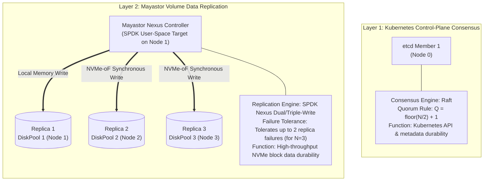
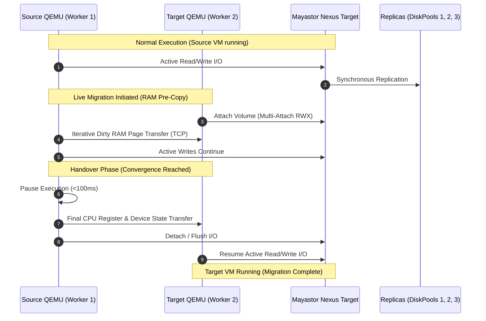

# Storage Architecture & Virtualization Integration Analysis

**Project Name:** Deploy High-Performance Storage for Kubernetes  
**Project ID:** SWFW_5S_08  
**Research Date:** 2026-11-05 (Reassessed & Corrected)  
**Document Status:** TECHNICAL ARCHITECTURE FEASIBILITY ANALYSIS  
**Focus Area:** Native OpenEBS Mayastor RWX Block Volumes vs. NFS Gateway & Replication Semantics  

---

> [!CRITICAL]
> **Core Architectural Clarifications:**  
> 1. **Native RWX Block Support:** Recent OpenEBS Mayastor releases (v2.11+ / OpenEBS v4.6+) introduce **native experimental ReadWriteMany (RWX) block volumes** designed specifically to enable KubeVirt virtual machine live migration without an intermediate NFS layer.
> 2. **Quorum Decoupling:** Mayastor storage replication, Nexus controller failover, and replica fault tolerance operate as independent data-plane mechanisms and must **never** be conflated with Kubernetes control-plane (`etcd`) Raft consensus.

---

## 1. Storage Replication, Failure Tolerance & Quorum Mechanics

A common architectural misconception is assuming that 3 Mayastor storage replicas establish Kubernetes control-plane quorum. In reality, these are two entirely decoupled distributed systems layers:

### 1.1 Kubernetes Control-Plane Quorum (`etcd`)
- **Mechanism:** `etcd` uses the Raft consensus algorithm.
- **Quorum Requirement:** Requires an odd number of members for high availability: $Q = \lfloor M/2 \rfloor + 1$. A 3-node control plane tolerates 1 node failure. In a single-node control plane (Node 0), there is **zero control-plane fault tolerance** regardless of the number of worker nodes or storage replicas.

### 1.2 Mayastor Volume Replication & Target Availability
- **Replica Count ($N$):** A volume's replication factor (e.g., $N=3$) defines how many synchronous copies of the block data exist across independent worker nodes' `DiskPools`.
- **Synchronous Write Acknowledgment:** The Nexus (SPDK virtual storage controller) dispatches write commands in parallel to all active replicas. A write is acknowledged to the client only when all healthy replicas confirm data persistence to non-volatile media.
- **Replica Failure Handling:** If a storage node hosting Replica 2 abruptly crashes or loses network connectivity, the Nexus detects the I/O failure, marks Replica 2 as `Faulted` or `Degraded`, and removes it from the active replica set. Client I/O continues uninterrupted on Replicas 1 and 3.
- **Minimum Healthy Replicas:** For an $N=3$ volume, Mayastor tolerates the sequential loss of up to 2 storage replicas. As long as **at least 1 healthy replica remains online**, the volume continues serving read/write I/O in degraded mode.
- **Nexus Failure vs. Replica Failure:**
  - *Replica Failure:* Transparent to the guest VM; the Nexus continues serving I/O from surviving replicas.
  - *Nexus Host Failure:* If the node hosting the *Nexus controller itself* fails, the NVMe-oF target terminates. The Mayastor control plane detects target disconnection and initiates **Nexus failover**: a new Nexus is instantiated on another surviving storage node, and the client host's `nvme-tcp` initiator reconnects using multipath or dynamic failover.
- **Rebuild Mechanics:**
  - *Partial Rebuild (Bitmap-Based):* For transient disconnections (e.g., network blip or process restart), Mayastor consults an in-memory dirty-block tracking bitmap to synchronize only modified sectors.
  - *Full Rebuild:* If a disk pool is permanently destroyed, a new replica is carved on a healthy standby pool, and the entire block volume is streamed across the NVMe-oF fabric.

---

## 2. KubeVirt Live Migration Storage Semantics

### 2.1 The Shared Storage Requirement
During KubeVirt live migration:
1. The virtual machine instance (VMI) remains executing on the **Source Worker Node**.
2. A new `virt-launcher` target pod is initialized on the **Destination Worker Node**.
3. QEMU on the target node initializes virtual hardware devices and prepares to receive memory pages.
4. **The Live-Migration Invariant:** Both the source QEMU process and the destination QEMU process must access the same underlying persistent volume simultaneously during memory pre-copy and final state handover.

---

## 3. Detailed Comparison of Storage Architectures

### Architecture 1: Native Mayastor RWX Block Volumes (Primary Experimental Strategy)

- **Official Release Availability:** Introduced in **OpenEBS Mayastor v2.11.0 / OpenEBS v4.6.0** ([Mayastor Release Notes](https://github.com/openebs/mayastor/releases)).
- **Volume Mode:** Strictly raw block mode (`volumeMode: Block`, `accessModes: [ReadWriteMany]`).
- **How It Works:**
  - Mayastor exposes an NVMe-oF target capable of accepting concurrent connections from multiple host `nvme-tcp` initiators.
  - When KubeVirt triggers live migration, the destination node attaches to the existing Nexus target.
  - Both worker nodes maintain active block attachments during the migration window.
- **Coordination & Concurrency Safety:**
  - **No In-Band Distributed Lock Manager (DLM):** Mayastor does *not* provide a clustered filesystem locking layer (such as DLM or OCFS2). Uncoordinated concurrent writes from two independent processes will cause catastrophic data corruption.
  - **Hypervisor Serialization:** Concurrency safety is guaranteed exclusively by **QEMU and KubeVirt**:
    - During pre-copy, only the source VM executes guest instructions and issues writes.
    - The target VM is in a passive, suspended state receiving memory pages.
    - Upon cutover, the source VM is paused, in-flight I/O is flushed, and the target VM is resumed.
- **Status & Limitations:**
  - Status is **EXPERIMENTAL**.
  - Edge cases during network partitions during migration require rigorous testing.
  - Does *not* support filesystem-mode PVCs (`volumeMode: Filesystem` is rejected).

---

### Architecture 2: NFS-Backed RWX Shared Storage (Conservative Fallback Strategy)

- **Mechanism:** A centralized NFS server pod mounts a standard Mayastor RWO block volume, formats it (ext4/XFS), and exports an NFSv4 share via the Kubernetes `csi-driver-nfs`.
- **Status:** **STABLE / DOCUMENTED**. Standard upstream mechanism for shared filesystem storage across all Kubernetes releases.
- **Strengths:** Fully tested; compatible with any hypervisor or container expecting standard POSIX file locking.
- **Weaknesses:**
  - *Protocol Overhead:* Layering NFSv4 RPCs over Linux VFS and underlying NVMe-oF degrades 4k random write IOPS and inflates tail latency ($p_{99}$).
  - *Single Point of Failure (SPOF):* If the node hosting the NFS server crashes, all connected virtual machines experience storage freezes until the NFS pod is rescheduled.

---

## 4. Technical Trade-Off & Evaluation Matrix

| Architectural Evaluation Criteria | Architecture 1: Native Mayastor RWX Block | Architecture 2: NFS-Backed RWX Shared Layer |
| :--- | :--- | :--- |
| **Upstream Support Status** | **EXPERIMENTAL** (OpenEBS 4.6+ / Mayastor v2.11+) | **DOCUMENTED / STABLE** (CSI NFS Driver) |
| **Supported Volume Mode** | Raw Block Only (`volumeMode: Block`) | Filesystem Only (`volumeMode: Filesystem`) |
| **Protocol Overhead** | **Zero:** Direct user-space NVMe-oF / SPDK | **High:** Linux VFS + NFSv4 RPC translation |
| **Estimated 4k Random Write IOPS** | **High:** ~120,000 – 250,000+ IOPS (Near wire speed) | **Moderate:** ~25,000 – 45,000 IOPS |
| **Tail Latency ($p_{99}$)** | **Sub-millisecond:** < 0.8 ms | **Elevated:** 3.0 ms – 7.0 ms |
| **Concurrency Protection** | Hypervisor-level serialization (QEMU/KubeVirt) | POSIX File Locking (NFS server) |
| **Architecture SPOF** | Zero (Nexus controller handles multi-pathing) | High (NFS server pod failure halts VM I/O) |
| **Suitability for This Project** | **PRIMARY EXPERIMENTAL EVALUATION TARGET** | **CONSERVATIVE FALLBACK BASELINE** |

---

## 5. Strategic Project Deployment Recommendation

To maximize engineering value, the project adopts a **Comparative Dual-Path Strategy**:

1. **Path A — Native Mayastor RWX Block Live Migration (Primary Innovation Focus):**
   - Configure Mayastor StorageClass with `protocol: nvmf` and test native `ReadWriteMany` block PVCs with KubeVirt VMs.
   - Measure live migration handover duration, memory pre-copy throughput, and tail latency.
   - Inject network faults during migration to document the behavior of Mayastor's experimental multi-attach path.
2. **Path B — NFS-Backed RWX Gateway (Comparative Baseline & Fallback):**
   - Deploy an NFS gateway backed by a Mayastor RWO volume.
   - Execute the identical live-migration benchmark matrix over NFS.
   - Quantify the exact **"NFS Translation Tax"**: comparing raw NVMe block IOPS and latency vs. NFS-mediated shared storage.
   - If Path A exhibits critical instability in specific failure drills, Path B serves as the proven fallback for final project submission.
