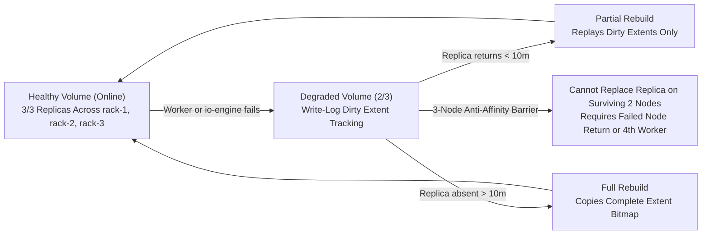

# OpenEBS Mayastor Storage Resilience & Failure Recovery Guide

**Project Name:** Deploy High-Performance Storage for Kubernetes  
**Project ID:** SWFW_5S_08  
**Program:** Zoho SETU — College Student Project Program  
**Target Storage Engine:** OpenEBS `4.6.2` / Replicated PV Mayastor `v2.12.2`  
**Three-State Classification:** `IMPLEMENTED` + `VALIDATED` (Config audits, scenario plans, SHA-256 checksum pipeline, WSL2 fault-injection refusal gates) | `INFRASTRUCTURE-DEPENDENT` (Live multi-node `io-engine` restarts, replica rebuilds, and worker loss)

---

## 1. Failure-Domain & Rebuild Mechanics

Mayastor decouples data-plane replication from Kubernetes `etcd` Raft quorum (`ADR-002`, `docs/storage-architecture-analysis.md`):



### Key Verified Configuration (`infrastructure/storage/openebs/values.yaml`)
- **Partial Rebuild Window (`--faulted-child-wait-period`):** `agents.core.rebuild.partial.enabled: true`, `waitPeriod: "10m"`.
- **Internal Metadata High Availability:** `etcd.replicaCount: 3` with `podAntiAffinityPreset: "hard"` across worker storage nodes.
- **Volume Placement:** Production StorageClasses (`mayastor-nvme-r3-ext4`, `mayastor-nvme-r3-block`) use `repl: "3"` across 3 distinct zoned `DiskPools` (`rack-1`, `rack-2`, `rack-3`).

---

## 2. Resilience Automation Suite & Safety Guardrails

| Artifact | Purpose & Modes | Safety & Evidence Rules |
| :--- | :--- | :--- |
| [`scripts/validate/validate-storage-resilience.sh`](../scripts/validate/validate-storage-resilience.sh) | Read-only check of rebuild timers, 3x replication, `DiskPool` Online/Degraded states, `io-engine` restarts, `VolumeAttachments`, storage events, and optional REST `/v0/volumes`. | Archives `.txt` & `.json` in `reports/storage/`. Reports `N/T` honestly when live Mayastor is absent (`--require-deployed` exits `1`). |
| [`scripts/tests/storage/verify-volume-checksum.sh`](../scripts/tests/storage/verify-volume-checksum.sh) | Deterministic `fsync` + `sha256sum` integrity verification (`--mode write\|verify\|cycle\|k8s-pod`). | Local mode supports non-destructive temp directory sanity verification; Kubernetes mode reuses [`pod-verify-integrity.yaml`](../infrastructure/storage/examples/pod-verify-integrity.yaml). |
| [`scripts/tests/storage/observe-rebuild-events.sh`](../scripts/tests/storage/observe-rebuild-events.sh) | Snapshots & polls `DiskPool`, PVCs, `VolumeAttachment`, Warning events, `io-engine`/`agent-core` logs, and optional REST API `/v0/pools` + `/v0/volumes`. | Strictly read-only observation; supports `--dry-run` and time-bounded `--duration`. |
| [`scripts/tests/storage/run-resilience-drills.sh`](../scripts/tests/storage/run-resilience-drills.sh) | Orchestrates 4 reversible resilience drills defined in [`tests/storage/resilience-scenarios.yaml`](../tests/storage/resilience-scenarios.yaml). | Defaults to `--mode dry-run` / `--mode simulate` (`0` mutations). `--mode execute` is **unconditionally refused on WSL2**, requires `--confirm-drill YES-EXECUTE-RESILIENCE-DRILL`, never deletes PVCs or `DiskPools`, and uses `EXIT` trap `uncordon` cleanup. |

---

## 3. Target Cluster Execution & Recovery Sequence (`INFRASTRUCTURE-DEPENDENT`)

```bash
# 1. Verify baseline resilience state before fault testing
./scripts/validate/validate-storage-resilience.sh --require-deployed

# 2. Preview scenario plan safely without modifying cluster resources
./scripts/tests/storage/run-resilience-drills.sh --scenario io-engine-restart --mode simulate

# 3. Execute controlled io-engine restart drill on multi-node cluster (>= 3 storage workers)
./scripts/tests/storage/run-resilience-drills.sh \
  --scenario io-engine-restart \
  --mode execute \
  --target-node <WORKER_NODE_3> \
  --observe-sec 45 \
  --confirm-drill YES-EXECUTE-RESILIENCE-DRILL

# 4. Verify node schedulability and final Online pool/PVC status
kubectl uncordon <WORKER_NODE_3>   # if worker-cordon-drain was tested manually
kubectl get diskpools,pods -n openebs -o wide
./scripts/validate/validate-storage-resilience.sh --require-deployed
```

### Known Limitations
- **WSL2 Development Host:** Lacks HugePages, raw NVMe drives, and >=3 worker nodes. Replica rebuilding and fault injection remain **`NOT VERIFIED` / `INFRASTRUCTURE-DEPENDENT`** until exercised on multi-node hardware.
- **Standalone `--node-unreachable-timeout` Absent:** Mayastor `v2.12.2` relies on Kubernetes node eviction tolerations plus `nvme.ioTimeout` / `ctrl_loss_tmo`.

