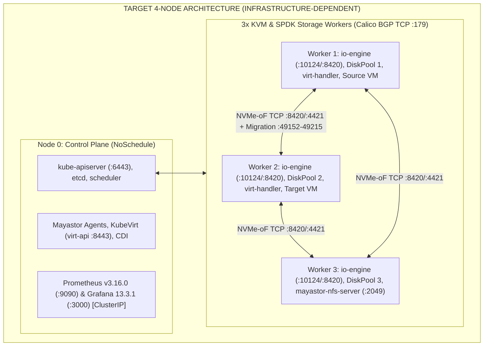

# Deploy High-Performance Storage for Kubernetes (OpenEBS Mayastor + KubeVirt)

**Technical Project Report — Zoho SETU College Student Project Program**  
**Project ID:** `SWFW_5S_08`  
**Repository:** [`https://github.com/Swapnil220705/k8s-high-performance-storage`](https://github.com/Swapnil220705/k8s-high-performance-storage) (`main` branch)  
**Report Date:** November 11, 2026  

---

## A. Executive Summary

- **Problem Statement:** Modern cloud-native platforms increasingly run containerized virtual machines alongside microservices via KubeVirt. However, conventional Kubernetes storage solutions route I/O through Linux kernel filesystems, context switches, and network overlays, degrading latency and throughput on high-speed NVMe hardware while struggling with single-writer vs. shared-access semantics during live migration.
- **Project Objectives:** Design, automate, validate, and prepare for empirical benchmarking a production-oriented **four-node Kubernetes cluster** combining **OpenEBS Replicated PV Mayastor** (user-space SPDK + NVMe-oF TCP) with **KubeVirt + CDI**, supporting persistent raw Block and Filesystem VMs, live migration across nodes, runtime resource hot-plugging, storage failure-recovery drills, reproducible `fio` benchmarking, and Prometheus/Grafana observability.
- **Key Engineering Contributions:**
  1. Reconciled upstream software lifecycles to eliminate EOL releases and verify source-level compatibility across Kubernetes `v1.36.6`, `containerd 2.3.x LTS`, Calico `v3.33.0`, OpenEBS `4.6.2` (Mayastor `v2.12.2`), KubeVirt `v1.9.1`, CDI `v1.66.1`, and `kube-prometheus-stack v93.2.0`.
  2. Authored full Infrastructure-as-Code (`kubeadm`, Calico BGP, OpenEBS Helm values, `DiskPool v1beta3`, 4 StorageClasses, KubeVirt/CDI CRs, NFSv4.1 RWX fallback gateway, 5 VM workload patterns, `MigrationPolicy`/`VMIM`, hot-plug specs, Prometheus ServiceMonitors/rules, and 3 Grafana dashboards) backed by offline CRD JSON schemas.
  3. Built non-destructive preflight, dry-run, validation, SHA-256 integrity, reversible fault-drill, FIO comparability parser (`unittest`-verified), and 9-stage integrated demo automation with hard WSL2 safety refusal gates.
  4. Preserved strict scientific honesty across three independent states: **`IMPLEMENTED`**, **`VALIDATED`**, and **`INFRASTRUCTURE-DEPENDENT`** ([`FINAL_PROJECT_STATUS.md`](FINAL_PROJECT_STATUS.md)).
- **Current Completion Status:** All repository architectures, manifests, validation pipelines, resilience harnesses, benchmark tools, observability stacks, and submission documentation are **`IMPLEMENTED`** and statically/locally **`VALIDATED`** (`11/11` unified validation pass, `44/44` `kubeconform -strict`, `promtool v3.16.0`, Python `unittest`, single-node K3s `v1.36.6+k3s1`). Physical NVMe IOPS, multi-node rebuilds, live migration execution, and cluster-wide scraping remain **`INFRASTRUCTURE-DEPENDENT`** pending multi-node hardware.

---

## B. Problem Definition and Motivation

1. **Kubernetes Persistent Storage Challenges:** Ephemeral container filesystems require external CSI storage providers for stateful workloads. Traditional kernel-space software-defined storage (SDS) systems traverse Linux VFS, page cache, block layer, and multiple thread context switches per I/O request, introducing microseconds to milliseconds of tail-latency jitter.
2. **High-Performance NVMe Requirements:** Modern PCIe NVMe SSDs support hundreds of thousands of IOPS and sub-100 microsecond hardware latencies, making interrupt-driven kernel I/O loops a bottleneck. User-space polled-mode execution (**SPDK**) eliminates syscall/interrupt overhead on dedicated cores.
3. **Storage Availability & Resilience:** Node or disk failures must not corrupt workload data or halt cluster I/O (`RPO = 0`). Storage replication must stay decoupled from Kubernetes control-plane Raft (`etcd`) consensus so data-plane writes continue smoothly even during API maintenance or partial worker faults.
4. **Virtual Machine Workloads in Kubernetes (`KubeVirt`):** Containerized VMs run QEMU/KVM inside `virt-launcher` pods and require persistent boot disks, fast raw block volumes (`/dev/vdb`) for database/FIO workloads, and safe `ReadWriteMany` (`RWX`) semantics for zero-downtime live migration.
5. **Motivation for Replicated NVMe-oF Storage:** OpenEBS Mayastor (`v2.12.2`) pairs user-space SPDK `io-engine` targets with NVMe over Fabrics (`NVMe-oF TCP`) to aggregate raw local NVMe drives across worker nodes into synchronous $N=3$ replicated block volumes consumable directly or via KubeVirt.

---

## C. Requirements and Objectives

### 1. Original Project Scope Requirements (Preserved Under ADR-011)
- **Functional Requirements:** 4-node Kubernetes cluster (`1` control plane + `3` workers); OpenEBS Mayastor replicated block provisioning (`repl=3` and `repl=1` control); KubeVirt hardware `/dev/kvm` virtual machines with cloud-init; VM live migration across nodes; runtime CPU, memory, and volume hot-plugging; `fio` storage benchmark matrix; disk/engine fault recovery verification; Prometheus & Grafana dashboards.
- **Non-Functional, Performance & Reliability Objectives:** Zero fabricated benchmarks; full reproducibility on free local + academic hardware (paid public cloud prohibited); zero-EOL software components (`containerd 2.3 LTS`, `K8s 1.36.x`); strict least-privilege security except where hardware drivers (`/dev/kvm`, HugePages) demand `privileged`; ClusterIP-only monitoring exposure; `RPO = 0` write acknowledgment across 3 replicas; bounded migration bandwidth (`64Mi/s` default TLS) protecting NVMe-oF data traffic.
- **Infrastructure Requirements (Target Cluster):** $\ge 4$ `x86_64` Ubuntu `24.04 LTS` servers (`>= 6` physical CPU cores per worker reserving `2` SPDK busy-poll cores; `>= 32 GB` physical RAM per worker for multi-VM live migration headroom per `ARCHITECTURE.md` §2.1 binary `MemTotal` math; `2 GiB` of `2 MiB` HugePages per storage worker; dedicated blank raw NVMe/SSD drives).

### 2. Additional Engineering Safeguards Implemented Beyond Original Scope
- **Lifecycle & API Reconciliation (`ADR-010`, `ADR-012`, `ADR-013`, `ADR-015`):** Eliminated draft EOL versions (`K8s 1.28/1.34`, `containerd 1.7/2.2`, draft `CDI 1.61.x`), corrected non-existent CSI `thin` parameter myths, verified `KubeVirt v1.9.1` GA feature-gate retirements, and verified exact `Mayastor v2.12.2` Rust Prometheus metric names vs. exporter gaps.
- **Local Single-Node K3s + Offline Schema Cache + WSL2 Safety Gates:** Added offline CRD JSON schemas for Calico, Mayastor (`v1beta3`), KubeVirt/CDI (`v1`/`v1beta1`), Prometheus Operator (`v0.95.2`), and strict Kubernetes `v1.36.6`, plus unconditional WSL2 refusal gates blocking accidental host-disk writes or 3.5 GiB memory exhaustion.

---

## D. System Architecture

The permanent target topology separates Kubernetes control-plane quorum (**Node 0**) from converged compute/storage worker nodes (**Workers 1–3**), routed over Calico `v3.33.0` pure BGP mesh (`Pod CIDR 10.244.0.0/16`, `Service CIDR 10.96.0.0/12`). Full standalone diagrams reside under [`docs/diagrams/`](../../docs/diagrams/).



Key architectural interconnections:
1. **Networking & Canonical Port Policy ([`network-and-virtualization-requirements.md`](../../docs/network-and-virtualization-requirements.md)):** 20 audited ports — 10 host firewall rules (`6443`, `2379`, `2380`, `10250`, `179`, conditional `4789`, `8420`, `4421`, `10124`, `49152–49215`, restricted `9100`) and 10 cluster-internal/loopback ports; TCP `4420` purged; Multus CNI requires 0 network ports.
2. **NFSv4.1 RWX Migration Fallback:** `storage-nfs/mayastor-nfs-server` mounts a single `30Gi` Mayastor RWO `mayastor-nvme-r3-ext4` volume and exports RWX POSIX shares via `csi-driver-nfs v4.9.0` (`nfs-mayastor-rwx`).
3. **Monitoring Isolation:** Prometheus & Grafana remain `ClusterIP`-internal, scraped over internal pod networking (`:9502`, `:8443`, `:9100`).

---

## E. Technology Stack (Verified From Repository Metadata & Manifests)

| Domain | Pinned Version in Repository | Upstream Lifecycle / Qualification Basis | Repository Source of Truth |
| :--- | :--- | :--- | :--- |
| **Target OS & Kernel** | Ubuntu Server `24.04 LTS` (`x86_64`, Linux `6.8 LTS`) | Dev audited on WSL2 `Ubuntu 24.04.4 LTS` (`6.6.87.2-microsoft-standard-WSL2`) | [`ARCHITECTURE.md`](../../ARCHITECTURE.md), [`host-preflight-*.txt`](../environment/host-preflight-2026-11-09_17-06-37.txt) |
| **Kubernetes** | `v1.36.6` (`kubeadm.k8s.io/v1beta4`) | Active until June 2027 (Local dev API tested on `K3s v1.36.6+k3s1`) | [`kubeadm-init-config.yaml`](../../infrastructure/k8s/kubeadm-init-config.yaml) |
| **Container Runtime** | `containerd 2.3.x LTS` | Supported through April 2028; local K3s runs `v2.3.7-k3s1.36` | [`containerd-config-v3.toml`](../../infrastructure/k8s/containerd-config-v3.toml) |
| **CNI Plugin** | Calico `v3.33.0` (`tigera/operator:v1.44.0`) | Qualified for K8s `1.35–1.37`; Pure BGP (`encapsulation: None`) | [`calico/installation.yaml`](../../infrastructure/k8s/calico/installation.yaml) |
| **Storage Engine** | OpenEBS `4.6.2` / Mayastor `v2.12.2` | CI E2E tested up to K8s `v1.35.6` (K8s `1.36` runtime gap documented) | [`chart-metadata.yaml`](../../infrastructure/storage/openebs/chart-metadata.yaml) |
| **Virtualization** | KubeVirt `v1.9.1` + CDI `v1.66.1` (`virtctl v1.9.0`) | KubeVirt supports `>=1.35 <1.37`; CDI `v1.66.1` fixes 4k block imports | [`kubevirt/installation/release-metadata.yaml`](../../kubevirt/installation/release-metadata.yaml) |
| **NFS CSI Fallback** | `csi-driver-nfs` `v4.9.0` + `nfs-server-alpine:12` | Provisioner `nfs.csi.k8s.io`; `nfsvers=4.1,hard,timeo=600` | [`storage/nfs/`](../../storage/nfs/nfs-storageclass.yaml) |
| **Observability** | `kube-prometheus-stack v93.2.0` (`Operator v0.95.2`, `Prom v3.16.0`, `Grafana 13.3.1` / chart `14.4.1`) | `kube-state-metrics 9.0.0`, `prometheus-node-exporter 5.1.0`, `promtool v3.16.0` | [`monitoring/release-metadata.yaml`](../../monitoring/release-metadata.yaml) |
| **Benchmarking & CLI Tools** | `fio 3.36`, `Python 3.12.3`, `kubectl v1.36.0`, `helm v3.17.1`, `kubeconform v0.8.0`, `yq v4.54.3`, `yamllint 1.33.0`, `shellcheck 0.9.0`, `shfmt 3.8.0`, `jq 1.7.1` | SHA-256 checksum verified in M1 (`install-dev-tools.sh`) | [`install-dev-tools.sh`](../../scripts/setup/install-dev-tools.sh), [`docs/development-toolchain.md`](../../docs/development-toolchain.md) |

---

## F. Storage Architecture and Design

See full topology diagram in [`docs/diagrams/02-mayastor-storage-and-replication.md`](../../docs/diagrams/02-mayastor-storage-and-replication.md).

1. **Umbrella Chart & Service Scoping ([`values.yaml`](../../infrastructure/storage/openebs/values.yaml)):** Pins all Mayastor control-plane and data-plane images to `:v2.12.2` (zero `:latest` tags). Disables `lvm`, `zfs`, `rawfile`, `loki`, `alloy`, and `callhome`; retains `engines.local.hostpath` strictly for internal 3-node `mayastor-etcd-localpv` persistence (`hostpathClass.enabled: false`). Reserves `2` SPDK CPU cores (`1Gi` memory, `2Gi` of `2MiB` HugePages) per `io-engine` DaemonSet pod on `openebs.io/engine=mayastor` workers.
2. **DiskPools (`openebs.io/v1beta3`):** Defined across `rack-1`, `rack-2`, and `rack-3` using placeholder `/dev/disk/by-id/<RAW_NVME_BY_ID_WORKER_1..3>` entries ([`diskpools.yaml`](../../infrastructure/storage/mayastor/diskpools.yaml)) and validated against Rust-derived JSON schema [`diskpool_v1beta3.json`](../../infrastructure/storage/mayastor/schemas/openebs.io/diskpool_v1beta3.json). Never auto-applied by setup scripts.
3. **CSI Provisioner & StorageClasses ([`storageclasses.yaml`](../../infrastructure/storage/examples/storageclasses.yaml)):** Uses verified provisioner `io.openebs.csi-mayastor` and omits the non-existent CSI `thin` parameter (`agents.core.capacity.thin.*` handles thin overcommitment globally):
   - `mayastor-nvme-r3-ext4` (`repl=3`, `ext4`, `WaitForFirstConsumer`, `Delete`)
   - `mayastor-nvme-r3-block` (`repl=3`, raw `Block`, `WaitForFirstConsumer`, `Retain`)
   - `mayastor-nvme-r3-block-rwx` (`repl=3`, raw `Block`, `rwxBlock: "true"`, `Retain`, **EXPERIMENTAL** opt-in only)
   - `mayastor-nvme-r1-dev` (`repl=1`, `ext4`, `Immediate`, zero fault tolerance baseline)
4. **Provisioning & Failure Recovery Lifecycle:** On pod bind, `mayastor-csi-controller` schedules 3 anti-affine replicas across DiskPools; the Nexus controller exposes an NVMe-oF TCP (`:8420`) target connected via kernel `nvme-tcp` (`/dev/nvmeXnY`). During transient faults within `--faulted-child-wait-period=10m` (`partial.enabled=true`), the Nexus logs dirty extents and executes a **Partial Rebuild** upon reconnection. On a 3-worker cluster, strict anti-affinity blocks spawning a replacement replica onto the surviving 2 workers until the 3rd node returns or a 4th worker joins.

---

## G. Virtual Machine Integration (`KubeVirt`)

See workflow diagram in [`docs/diagrams/03-vm-storage-and-live-migration.md`](../../docs/diagrams/03-vm-storage-and-live-migration.md).

1. **KubeVirt `v1.9.1` & CDI `v1.66.1` Control Plane:** Configured in [`kubevirt-cr.yaml`](../../kubevirt/installation/kubevirt-cr.yaml) and [`cdi-cr.yaml`](../../kubevirt/installation/cdi-cr.yaml). Enforces `useEmulation: false` (no silent TCG fallback), `vmRolloutStrategy: LiveUpdate` (`maxHotplugRatio: 4`, `maxCpuSockets: 8`, `maxGuest: "16Gi"`), `HonorWaitForFirstConsumer`, and `scratchSpaceStorageClass: mayastor-nvme-r3-ext4`. Workloads run in non-root `kubevirt-workloads` (`baseline` PSA enforce).
2. **Cloud-Init & Multi-Tier VM Definitions ([`kubevirt/virtualmachines/`](../../kubevirt/virtualmachines/)):**
   - [`cloud-init-secret.yaml`](../../kubevirt/virtualmachines/cloud-init-secret.yaml) configures Ubuntu `24.04` (`quay.io/containerdisks/ubuntu:24.04-2610180208`) with `qemu-guest-agent`, `fio`, `nvme-cli`, `lsscsi`, `lock_passwd: true`, and runtime SSH public-key substitution via `07-deploy-vm-examples.sh --ssh-key-file`.
   - **`vm-ubuntu-rwo-fs`** (`mayastor-nvme-r3-ext4`, `evictionStrategy: None`), **`vm-ubuntu-rwo-block`** (`mayastor-nvme-r3-block` + `10Gi` raw block `/dev/vdb` bench disk), **`vm-ubuntu-migration-nfs`** (DEFAULT live-migratable VM backed by `nfs-mayastor-rwx`), **`vm-ubuntu-rwx-block-exp`** (opt-in `Manual` experimental Mayastor RWX block), and **`vm-cirros-dev-minimal`** (`256Mi` CirrOS sanity VM).
3. **Live Migration & Hot-Plugging:** [`migration-policy.yaml`](../../kubevirt/migration/migration-policy.yaml) enforces TLS pre-copy (`disableTLS: false`), auto-converge (`allowAutoConverge: true`), disabled post-copy (`allowPostCopy: false`), and `64Mi` default bandwidth capping (`128Mi` for opt-in experimental RWX) over TCP `49152–49215`. [`vm-ubuntu-hotplug-ready.yaml`](../../kubevirt/hotplug/vm-ubuntu-hotplug-ready.yaml) pre-allocates container headroom (`4` CPU / `4608Mi` limits vs `2` sockets / `2Gi` guest) to allow live CPU socket (`2 -> 4`), guest memory (`2Gi -> 4Gi`), and dynamic SCSI volume (`virtctl addvolume`/`removevolume`) hot-plugging without cgroup OOMKill. Downscaling CPU/RAM requires VM restart; secondary Multus NIC hot-plugging is deferred.

---

## H. Resilience and Failure Recovery

- **Validation & Observability ([`validate-storage-resilience.sh`](../../scripts/validate/validate-storage-resilience.sh), [`observe-rebuild-events.sh`](../../scripts/tests/storage/observe-rebuild-events.sh)):** Audits `values.yaml` partial-rebuild parameters, 3x replication, zoned DiskPools, live `DiskPool` Online/Degraded states, `io-engine` restarts, PVC/`VolumeAttachment` status, Warning events, and Mayastor REST API `/v0/volumes` + `/v0/pools`.
- **Integrity Verification ([`verify-volume-checksum.sh`](../../scripts/tests/storage/verify-volume-checksum.sh)):** Performs deterministic payload generation with `sync` + `sha256sum` baseline & readback (`cycle`, `write`, `verify`, or Kubernetes `pod-verify-integrity.yaml` mode).
- **Controlled Drill Scenarios ([`resilience-scenarios.yaml`](../../tests/storage/resilience-scenarios.yaml), [`run-resilience-drills.sh`](../../scripts/tests/storage/run-resilience-drills.sh)):** Supports (1) `io-engine-restart`, (2) `worker-cordon-drain`, (3) `pool-degradation-check`, and (4) `nfs-gateway-restart`. Defaults to non-mutating `--mode dry-run` / `--mode simulate`; `--mode execute` is **refused unconditionally on WSL2**, requires `--confirm-drill YES-EXECUTE-RESILIENCE-DRILL`, never deletes PVCs/DiskPools, and runs `EXIT`-trap `uncordon` cleanup.

---

## I. Performance Benchmarking Framework

- **Versioned FIO Profiles ([`benchmarks/fio/`](../../benchmarks/fio/)):** `4k-randread.fio`, `4k-randwrite.fio`, `4k-randrw-70-30.fio` (`70/30`), `64k-seqread.fio`, `64k-seqwrite.fio`, and `1m-bandwidth.fio` (`direct=1`, `ioengine=libaio`, `clat_percentiles=1`, `percentile_list=50:95:99:99.9`), parameterized across queue depths (`1, 16, 32, 64`) and job counts (`1, 4`) via [`matrix-config.yaml`](../../benchmarks/fio/matrix-config.yaml) across `local-baseline`, `mayastor-rwo-fs`, `mayastor-rwo-block`, `nfs-rwx`, and opt-in `mayastor-rwx-block-exp`.
- **Execution Guards & Python Analysis ([`run-fio-benchmarks.sh`](../../scripts/benchmark/run-fio-benchmarks.sh), [`summarize-results.py`](../../scripts/benchmark/summarize-results.py)):** Protects host OS root mounts (`findmnt /`) and mounted block devices, checks `free_space >= size + 1GiB`, captures `/proc/meminfo`, HugePages, kernel, and CPU `/proc/stat` snapshots in `benchmark-metadata.json`, computes Read/Write `IOPS`, `BW (MiB/s)`, mean latency, and `p50`/`p95`/`p99`/`p99.9` tail percentiles, and **blocks cross-environment comparisons** (`--compare` exits `2` on mismatched `environment_class`).
- **Explicit Statement on Measurements:** **No physical NVMe benchmark measurements were recorded in this workspace.** Only `fio --parse-only` (`6/6` profiles), `--mode dry-run`, `--mode synthetic-fixture`, and Python `unittest` (`3/3` tests) were executed locally (`INFRASTRUCTURE-DEPENDENT` for real IOPS/latency).

---

## J. Monitoring and Observability

See topology in [`docs/diagrams/04-monitoring-and-observability.md`](../../docs/diagrams/04-monitoring-and-observability.md).

- **Stack (`kube-prometheus-stack v93.2.0`):** Configured in [`monitoring/prometheus/values.yaml`](../../monitoring/prometheus/values.yaml) with constrained overlay [`values-dev-lightweight.yaml`](../../monitoring/prometheus/values-dev-lightweight.yaml) (`ClusterIP`-only `:9090`/`:3000`, accessed via `kubectl port-forward`).
- **Exporters, Alerts & Dashboards:**
  - `mayastor-io-engine-metrics` `ServiceMonitor` (`app: metrics-exporter-io-engine`, port `:9502`) & `kubevirt-metrics` (`prometheus.kubevirt.io: "true"`, HTTPS `:8443`).
  - 10 `promtool v3.16.0`-verified alerts in [`prometheus-rules.yaml`](../../monitoring/prometheus/prometheus-rules.yaml) covering `DiskPool` degraded/faulted/stalled/IO-error/capacity (`>85%`), offline Mayastor nodes, `kubevirt_vmi_non_evictable`, `kubevirt_vmi_migration_failed`, node `NotReady`, and PVC usage.
  - 3 Grafana dashboards: [`mayastor-storage-performance.json`](../../monitoring/grafana/dashboards/mayastor-storage-performance.json), [`kubevirt-vm-telemetry.json`](../../monitoring/grafana/dashboards/kubevirt-vm-telemetry.json), and [`cluster-node-resources.json`](../../monitoring/grafana/dashboards/cluster-node-resources.json).
- **Documented Exporter Limitations:** Mayastor `v2.12.2` Rust collectors emit cumulative `*_latency_us` counters (mean latency rates, no `_bucket` tail histograms) and do not expose `volume_rebuild_progress_percent` (polled via REST `/v0/volumes`); `nfs-server-alpine:12` has no Prometheus exporter (inferred from `kubevirt_vmi_storage_*` and backing RWO metrics).

---

## K. Implementation and Validation Results

| Milestone / Sprint | Key Deliverables | Empirical Local Validation Results |
| :--- | :--- | :--- |
| **M1 (Toolchain & Preflight)** | `install-dev-tools.sh`, `01-host-preflight.sh`, `02-node-prerequisites.sh`, `.yamllint.yaml` | `host-preflight`: **`27 PASS, 8 WARN, 0 FAIL, 1 N/T`**; `node-prerequisites`: **`10 MET, 5 WARN, 0 UNMET`**. |
| **M2 (K8s & Networking)** | `kubeadm-init-config.yaml`, `containerd-config-v3.toml`, Calico `v3.33.0`, `03`/`04` bootstrap, `dev-cluster-local.sh` | `kubeadm config validate`: `[ok]`; local K3s `v1.36.6+k3s1`: **`12 PASS, 1 WARN, 0 FAIL, 1 N/T`** (scheduling, CoreDNS & Pod HTTP OK). |
| **M3 (Mayastor Storage)** | OpenEBS `4.6.2` `values.yaml`, `diskpool_v1beta3.json`, 4 StorageClasses, `05-deploy-mayastor.sh`, validators | `helm lint` (`0 failed`), `helm template`, `validate-mayastor-prerequisites.sh` (**`11 PASS, 4 WARN, 6 FAIL, 1 N/T`** accurately reflecting WSL2), `validate-mayastor-deployment.sh` (**`0 PASS, 1 WARN, 0 FAIL, 8 N/T`**). |
| **Sprint 1 (KubeVirt, VMs, Migration, Hot-Plug)** | KubeVirt `v1.9.1`, CDI `v1.66.1`, NFS GW, 5 VM manifests, policies, `06`/`07`, 4 validators | `06 --dry-run` (`10/10`), `07 --dry-run` (`13/13`), `validate-kubevirt` (`3/4/0/5`), `validate-vm-storage` (`5/1/0/4`), `validate-live-migration` (`2/1/0/3`), `validate-vm-hotplug` (`4/1/0/3`), **6/6** WSL2 refusals `exit 1`. |
| **Sprint 2 (Resilience, FIO, Observability, Demo)** | `resilience-scenarios.yaml`, drills, 6 `.fio` profiles, `summarize-results.py`, `kube-prometheus-stack v93.2.0`, 3 dashboards, `08`, `run-project-demo.sh` | `run-validation.sh`: **`11/11` PASS** (`26` scripts ShellCheck/shfmt clean, `39` YAML `0` warnings, `44/44` `kubeconform -strict`, `38` JSONs `jq`, `6` FIO `--parse-only`, `promtool v3.16.0` 5 jobs / 10 rules, Python `unittest` `3/3`); `validate-project-integration.sh` + 9-stage demo: **`PASS=1, SKIP_INFRA=8, FAIL=0`**; **6/6** WSL2 refusals `exit 1`. |

---

## L. Environment and Infrastructure Constraints

| Attribute | Local WSL2 Development Environment (`AUDITED`) | Target 4-Node Hardware Environment (`REQUIRED FOR LIVE TESTS`) |
| :--- | :--- | :--- |
| **Host Platform & OS** | Windows 11 + WSL2 (`Ubuntu 24.04.4 LTS`, kernel `6.6.87.2-microsoft-standard-WSL2`) | 4 physical/bare-metal-grade `Ubuntu Server 24.04 LTS` nodes (`x86_64`, Linux `6.8 LTS`) |
| **CPU & Virtualization** | AMD Ryzen 5 7535HS (`12` vCPUs, `sse4_2`, `svm`), `/dev/kvm` (`crw-rw---- root:kvm`) | `>= 6` physical cores/worker (2 pinned to SPDK), `vmx`/`svm` + `/dev/kvm` rw for `virt-handler` |
| **RAM & HugePages** | **`3515 MiB` total RAM**, **`0` 2MiB HugePages**, `1024 MiB` swap enabled | **`>= 32 GB` RAM per worker** (`MemTotal ~29.3–29.6 GiB`) for multi-VM live migration, **`2 GiB` HugePages** (`1024 x 2MiB`) |
| **Block Storage** | WSL2 virtual disks (`ext4`/`swap`, 0 raw `/dev/nvme*` pool disks) | Blank, unmounted raw NVMe/SSD `/dev/disk/by-id/*` dedicated per worker (confirmed wipe permission) |
| **Cluster Topology** | Single-node `K3s v1.36.6+k3s1` (API & lint sandbox only) | 1 Control Plane + 3 Workers connected via Layer-2 / Calico Pure BGP mesh |

**Local vs. Hardware Boundary:** Toolchains, schema validation, Helm/YAML linting, Prometheus `promtool` checks, Python unit tests, SHA-256 local cycles, K3s single-node API/CoreDNS/scheduling, and safety refusal gates are genuinely verified locally; distributed data-plane storage, KVM VM workloads, live migration, monitoring scraping, and physical NVMe FIO benchmarks require the target cluster.

---

## M. Limitations and Future Work

1. **No Physical NVMe Benchmark Results Recorded:** Empirical IOPS/latency/bandwidth comparisons across host NVMe, Mayastor RWO File/Block, NFS RWX, and Opt-In RWX Block await physical hardware (`benchmarks/fio/`, `run-fio-benchmarks.sh`).
2. **No Live Multi-Node Mayastor Rebuild Drills:** Partial vs. full rebuild timing (`--faulted-child-wait-period=10m`), degraded throughput, and `io-engine` restarts (`run-resilience-drills.sh --mode execute`) await `>= 3` worker nodes. Also, Mayastor `v2.12.2` compatibility with Kubernetes `v1.36.x` remains unverified by upstream CI (`v1.35.6` tested).
3. **No Multi-Node VM Live Migration Execution:** Both default NFS RWX and experimental RWX Block pre-copy migration (`validate-live-migration.sh --execute`) plus live CPU/memory/SCSI hot-plugging await `>= 2` KVM worker nodes with sufficient memory headroom.
4. **No Live Cluster Monitoring Scraping Verification:** Live Prometheus target up-status (`metrics-exporter-io-engine:9502`, KubeVirt `:8443`) and Grafana UI rendering await live deployment.
5. **Multus Secondary NIC Hot-Plugging Deferred:** Intentionally excluded prior to final academic packaging; remains future work atop the `LiveUpdate` KubeVirt configuration.

---

## N. Conclusion

Project `SWFW_5S_08` delivers a complete, reproducible, lifecycle-current, and non-destructive engineering foundation for high-performance Kubernetes virtual machine storage. By reconciling upstream component compatibility (`K8s v1.36.6`, `containerd 2.3.x LTS`, `Calico v3.33.0`, `OpenEBS 4.6.2 / Mayastor v2.12.2`, `KubeVirt v1.9.1`, `CDI v1.66.1`, `kube-prometheus-stack v93.2.0`), automating deployment and multi-tier safety gates, and verifying every manifest, alert rule, FIO profile, and parser offline on WSL2 without fabricating live hardware data, the repository is turn-key staged for college or laboratory cluster execution and academic evaluation.

---

## O. Reproduction Guide

### 1. Local Environment Checks & Complete Static/Integration Verification (WSL2 / Any Linux Host)
```bash
# Optional fresh toolchain setup (Ubuntu 24.04)
sudo ./scripts/setup/install-dev-tools.sh

# Host & node read-only audits
./scripts/setup/01-host-preflight.sh
./scripts/setup/02-node-prerequisites.sh --report

# Master 11-step static suite + docs check + 9-stage safe demo orchestrator
./scripts/validate/validate-project-integration.sh

# Individual dry-runs & offline verifications
./scripts/setup/05-deploy-mayastor.sh --dry-run
./scripts/setup/06-deploy-kubevirt.sh --dry-run
./scripts/setup/07-deploy-vm-examples.sh --tier all-safe --include-experimental-rwx --ssh-key-file ~/.ssh/id_ed25519.pub --dry-run
./scripts/setup/08-deploy-monitoring.sh --dry-run
./scripts/benchmark/run-fio-benchmarks.sh --mode dry-run
./scripts/benchmark/run-fio-benchmarks.sh --mode synthetic-fixture
./scripts/tests/storage/run-resilience-drills.sh --scenario io-engine-restart --mode simulate
```

### 2. Target 4-Node Ubuntu Cluster Deployment Sequence (`INFRASTRUCTURE-DEPENDENT`)
```bash
# Step 1: Prepare Control Plane & 3 Workers (Ubuntu 24.04, blank NVMe verified)
sudo ./scripts/setup/02-node-prerequisites.sh --apply
sudo ./scripts/setup/03-bootstrap-control-plane.sh --advertise-ip <CP_IP> --node-name <CP_NAME>
# On each worker:
sudo ./scripts/setup/04-join-worker-node.sh --control-plane <CP_IP>:6443 --token <TOKEN> --discovery-hash <HASH> --node-ip <WORKER_IP> --node-name <WORKER_NAME>

# Step 2: Deploy Mayastor (after labeling 3 workers openebs.io/engine=mayastor & confirming raw NVMe disks)
./scripts/validate/validate-mayastor-prerequisites.sh
./scripts/setup/05-deploy-mayastor.sh
kubectl apply -f infrastructure/storage/mayastor/diskpools.yaml   # Only after replacing placeholders with verified by-id paths!
./scripts/validate/validate-mayastor-deployment.sh --require-deployed

# Step 3: Deploy KubeVirt, CDI, NFS RWX Gateway, and VM Examples
./scripts/setup/06-deploy-kubevirt.sh --install-nfs-fallback
./scripts/setup/07-deploy-vm-examples.sh --tier all-safe --ssh-key-file ~/.ssh/id_ed25519.pub
./scripts/validate/validate-vm-storage.sh --require-deployed

# Step 4: Deploy Monitoring (Internal ClusterIP) & Verify Full Stack
./scripts/setup/08-deploy-monitoring.sh --grafana-password-file /secure/path/grafana-admin-pass.txt
./scripts/demo/run-project-demo.sh --mode target-live --confirm-demo YES-EXECUTE-LIVE-DEMO
kubectl -n monitoring port-forward svc/kube-prometheus-stack-grafana 3000:3000

# Step 5: Execute Benchmarks, Resilience Drills, Live Migration & Hot-Plug
./scripts/benchmark/run-fio-benchmarks.sh --mode execute --target-tier mayastor-rwo-block --target-path /dev/vdb --confirm-target YES-I-CONFIRMED-TARGET
./scripts/tests/storage/run-resilience-drills.sh --scenario io-engine-restart --mode execute --confirm-drill YES-EXECUTE-RESILIENCE-DRILL
./scripts/validate/validate-live-migration.sh --execute --vmi vm-ubuntu-migration-nfs -n kubevirt-workloads
./scripts/validate/validate-vm-hotplug.sh --execute --operation all
```
